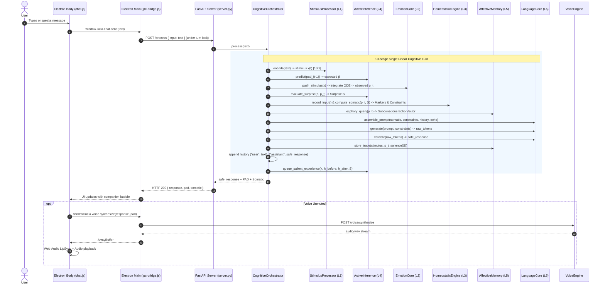
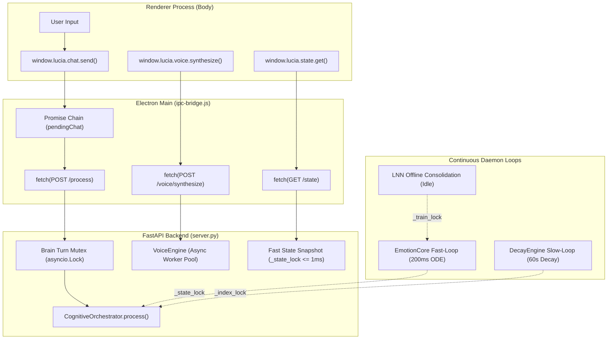

# PHASE_9_ARCHITECTURE_GATE.md — Architectural Decision Gate & Pre-Implementation Blueprint

> **Authoritative Architectural Gate & Decision Record for Phase 9: Unified Cognitive Architecture**  
> **Evaluation Date**: September 9, 2026  
> **Repository Commit**: `603999d` (`origin/main`)  
> **Status**: **ARCHITECTURE DECISION GATE (Awaiting User Review & Sign-Off)**  
> **Invariant**: ZERO PRODUCTION CODE MODIFICATIONS UNTIL FORMALLY APPROVED

---

## 1. Executive Summary

During the post-Phase-8 architectural review, an exhaustive audit of the actual codebase identified four critical architectural gaps:
1. **F-01 (Layer 4 Active Inference Bypassed & Decorative)**: Layer 4 Active Inference (`ActiveInferenceEngine`) and online LNN backpropagation (`LNNTrainer`) were implemented in Phase 4 (`src/core/inference/`) but never wired into the production backend server (`src/api/server.py`). Furthermore, within the Phase 4 orchestrator itself, prediction error was merely logged and exerted **zero causal influence** on downstream behavioral constraints, prompt assembly, or reasoning depth.
2. **F-02 (Cognitive Turn Ownership & Inheritance Duplication)**: The production server instantiated `InstrumentedOrchestrator`, which inherited from `MemoryAugmentedOrchestrator` and re-executed Steps 1–4 of the cognitive pipeline before delegating to `super()._execute_pipeline()`. This caused **double stimulus injection** into `EmotionCore` and **double input recording / metabolic debt** in `HomeostaticEngine` on every single live turn. Furthermore, a 5-tier inheritance hierarchy (`Orchestrator` $\rightarrow$ `MemoryAugmentedOrchestrator` $\rightarrow$ `InferencePipelineOrchestrator` $\rightarrow$ `PresenceOrchestrator`, with `InstrumentedOrchestrator` branching off at tier 2) caused rampant copy-paste code duplication across every phase.
3. **F-03 (State & Concurrency Protection)**: While Electron's main process chained outgoing chat calls via a JavaScript promise queue, the Python Brain backend (`POST /process`) lacked concurrency protection around mutable cognitive state (`self._history`, `HomeostaticEngine._energy`, `SDMCore`, `LNNTrainer`). Two concurrent API requests could interleave, corrupt dialogue history, race on metabolic energy, and thrash local CUDA LLM context.
4. **F-04 (Brain ↔ Body Boundary Violations)**: The desktop renderer process (`electron/renderer/chat/chat.js`) still contained **12 direct `fetch()` calls** with hardcoded `http://127.0.0.1:8765` URLs for voice synthesis, audio transcription, avatar model listing, user profile retrieval, hardware profile updates, and conversation history. Several of these bypassed existing IPC bridge methods in `preload.js`, violating context isolation and failing if the backend port was remapped.

This document establishes the authoritative, verified architecture for **Phase 9: Unified Cognition**. It resolves all four findings, defines the causal role of Active Inference, settles the boundaries of Voice synthesis and LNN plasticity, validates simulation compatibility, and establishes a strict, non-redundant state and concurrency model.

---

## 2. F-01 Resolution: Layer 4 Active Inference Integration & Causality

### 2.1 The As-Is Code Reality
In the current repository:
- `StimulusProcessor` (Layer 1) lives in `src/core/gating/stimulus_processor.py`.
- `EmotionCore` (Layer 2) lives in `src/core/emotion/emotion_core.py`.
- `HomeostaticEngine` (Layer 3) lives in `src/core/emotion/homeostatic_engine.py`.
- `ActiveInferenceEngine` and `LNNTrainer` (Layer 4) live in `src/core/inference/`.
- `AffectiveMemory` and `EcphoryEngine` (Layer 5) live in `src/core/memory/`.
- `PromptAssembler`, `LLMBackend`, and `BoundaryLayer` (Layer 6) live in `src/core/language/` and `src/core/safety/`.

In `src/core/inference/orchestrator.py` (`InferencePipelineOrchestrator`), Active Inference was executed as follows:
```python
# Step 4c: Active Inference step & LNN Experience Buffer push
try:
    pred_err = self._active_inference.step(pad_before, pad)
    self._last_pred_error = pred_err
    if self._lnn_trainer.is_training_active():
        self._lnn_trainer.push_sample(stimulus, h_before, h_after)
except Exception:
    logger.exception("Active Inference step / LNN push failed (call_id=%s)", call_id)
```
After this step, `pred_err` was logged at the end of the turn, but **never passed to any downstream component**. It did not affect `SomaticMarkers`, `BehavioralConstraints`, `PromptAssembler`, or `LLMBackend`. Furthermore, because `server.py` instantiated `InstrumentedOrchestrator(MemoryAugmentedOrchestrator)`, this code was never even executed in production.

### 2.2 Establishing Active Inference as Causally Meaningful
In the Free Energy Principle (Friston, 2010), an organism minimizes surprise (free energy) to maintain its homeostatic boundaries. If prediction surprise has zero effect on the system's physiological state, cognitive load, or action selection, it is mathematically detached theater.

To make Active Inference causally active without violating the invariant against self-reported affect ("I am surprised"):
1. **Pre-Stimulus Generative Expectation**: Before integrating the incoming stimulus $x(t)$, Active Inference projects the expected emotional transition:
   $$\hat{p}_t = A \cdot p_{t-1} + b$$
2. **Limbic Reaction**: The stimulus $x(t)$ is integrated by the limbic ODE in `EmotionCore`, yielding the observed state $p_t$.
3. **Surprise Computation**: Free Energy / Prediction Surprise is evaluated:
   $$\mathcal{S}_t = \|A \cdot p_{t-1} + b - p_t\|_2 \in [0.0, \sqrt{12}]$$
   The belief matrices $(A, b)$ perform an analytic gradient descent step with KL-regularization toward identity:
   $$\min_{A, b} \|A \cdot p_{t-1} + b - p_t\|_2^2 + \lambda_{KL} \|A - I\|_F^2$$
4. **Causal Coupling to Homeostasis (Layer 3)**:
   Surprise $\mathcal{S}_t$ directly modulates `HomeostaticEngine`:
   - **Cognitive Load ($\mathcal{C}$)**: $\mathcal{C} = \text{clip}(\mathcal{C}_{base} + 0.35 \cdot \mathcal{S}_t, 0.0, 1.0)$. High emotional surprise increases immediate processing strain.
   - **Tension ($\mathcal{T}$)**: When $\mathcal{S}_t > 0.4$, epistemic conflict increases tension: $\mathcal{T} = \text{clip}(\mathcal{T}_{base} + 0.25 \cdot \mathcal{S}_t, 0.0, 1.0)$.
   - **Reasoning Depth ($k$)**: If $\mathcal{S}_t > 0.60$ or $\mathcal{T} > 0.70$, reasoning depth shifts to $k=2$ (deliberative cognitive processing) rather than reflexive habit ($k=1$).
   - **Token Budget & Temperature**: Elevated cognitive load from surprise tightens the token budget (focused, non-rambling response) while modestly increasing sampling temperature ($\Delta T = +0.05 \cdot \mathcal{S}_t$) for adaptive exploration.
5. **Causal Coupling to Affective Memory (Layer 5)**:
   - **Salience-Weighted Encoding**: Traces formed under high surprise ($\mathcal{S}_t > 0.50$) receive heightened base intensity $I_{base} = \max(|PAD|) \cdot (1.0 + 0.5 \cdot \mathcal{S}_t)$, enabling them to resist exponential decay longer.

### 2.3 Verified Causal Flow
```
User Stimulus x(t) [L1]
        │
        ▼
[L4a: Active Inference] Predict: p̂ = A · p_{t-1} + b
        │
        ▼
[L2: Limbic ODE] Integrate stimulus: p_t = Project(h_t)
        │
        ▼
[L4b: Active Inference] Compute Surprise S = ||p̂ - p_t||_2 & update (A, b)
        │
        ▼
[L3: Homeostasis] Somatic markers & Behavioral constraints modulated by S
        │
        ▼
[L5a: Affective Memory] Ecphory query using p_t -> Echo Vector
        │
        ▼
[L6a: Language Assembly] Assemble prompt (somatic, constraints [k, temp], history, echo)
        │
        ▼
[L6b: Language Generation] Local SLM generate() + BoundaryLayer validation
        │
        ▼
[L5b: Memory Consolidation] Store interaction trace with surprise-weighted salience
        │
        ▼
[L4c: Experience Buffer] Queue salient transition for offline consolidation
```

---

## 3. F-02 Resolution: Cognitive Turn Ownership & Orchestrator Design

### 3.1 Audit of Existing Orchestrators

| Orchestrator Class | Location | Inherits From | Core Responsibility | Flaws / Duplications |
|---|---|---|---|---|
| `Orchestrator` | `src/core/orchestrator/orchestrator.py` | `object` | Base 8-step pipeline (Phase 1). | Rigid monolithic `_execute_pipeline`. |
| `MemoryAugmentedOrchestrator` | `src/core/orchestrator/orchestrator.py` | `Orchestrator` | Adds Ecphory query & SDM trace storage (Phase 2). | Overrides `_execute_pipeline` by copy-pasting Steps 1–4 and Steps 5–8 entirely. |
| `InferencePipelineOrchestrator` | `src/core/inference/orchestrator.py` | `MemoryAugmentedOrchestrator` | Adds Active Inference & LNN sample buffering (Phase 4). | Overrides `_execute_pipeline` by copy-pasting Steps 1–4, 4b, and 5–8 entirely. |
| `PresenceOrchestrator` | `src/core/presence/orchestrator.py` | `InferencePipelineOrchestrator` | Adds `VoiceEngine` composition and `process_with_voice` (Phase 5). | Orphaned. Never instantiated or tested in production. Bloats cognition with voice I/O. |
| `InstrumentedOrchestrator` | `src/api/server.py` | `MemoryAugmentedOrchestrator` | Captures intermediate markers and constraints for `GET /state`. | **THE DOUBLE EXECUTION BUG**: Executes Steps 1–4 locally, then calls `super()._execute_pipeline` which executes Steps 1–4 again! Bypasses Phase 4 & 5 entirely. |

### 3.2 Design Decision: Unified Cognitive Orchestrator via Composition
The historical approach of sub-classing orchestrators across milestones created an unmaintainable "Russian doll" where each subclass duplicated the entire execution flow.

**Decision**: Replace the 5-layer inheritance chain with a **Single Unified Orchestrator**: `CognitiveOrchestrator` (located in `src/core/orchestrator/cognitive_orchestrator.py`).
- **Pattern**: Composition and Pipeline Architecture.
- **Single Owner**: `CognitiveOrchestrator` is the **sole conceptual and technical authority** of the cognitive turn lifecycle.
- **Collaborator Injection**: It receives its collaborators via constructor dependency injection:
  - `stimulus_processor: StimulusProcessor`
  - `emotion_core: EmotionCore`
  - `homeostatic_engine: HomeostaticEngine`
  - `active_inference: ActiveInferenceEngine`
  - `affective_memory: AffectiveMemory`
  - `ecphory_engine: EcphoryEngine`
  - `prompt_assembler: PromptAssembler`
  - `llm_backend: LLMBackend`
  - `boundary_layer: BoundaryLayer`
  - `lnn_trainer: Optional[LNNTrainer]`
- **Linear Execution**: A single, clean, non-redundant method `_execute_pipeline(input_text, call_id)` executes the 10 stages in linear order without re-entrant calls or duplicate pushes.
- **Telemetry Exposure via Properties**: Intermediate states (`last_somatic`, `last_constraints`, `last_pred_error`, `last_echo_resonance`) are cached as direct properties on `CognitiveOrchestrator`, completely eliminating `InstrumentedOrchestrator`.

---

## 4. F-03 Resolution: State & Concurrency Protection

### 4.1 Fundamental Question: Can Two Cognitive Turns Mutate State Concurrently?
**DEFINITIVE INVARIANT: NO.**

In Lucia's Whole-Brain architecture:
1. **One Continuous Life**: Lucia is a single, permanent companion instance. Two simultaneous thoughts speaking conflicting utterances at the same physical microsecond violates her ontological coherence.
2. **Stateful Resources**:
   - `self._history`: Plain list. Concurrent mutation produces race conditions, dropped turns, or interleaved prompt context.
   - `HomeostaticEngine._energy`: Metabolic budget depleted sequentially. Concurrent turns corrupt energy calculations.
   - `SDMCore`: Sparse distributed memory activations must be deterministic.
   - `ActiveInferenceEngine`: Belief updates $(\Delta A, \Delta b)$ assume serial Markov transitions $p_{t-1} \rightarrow p_t$. Concurrent turns interleave transitions and corrupt gradient descent.
   - `LLMBackend`: Local GGUF runtime on CUDA has a single KV cache and context buffer. Concurrent calls trigger context thrashing or CUDA memory corruption.

### 4.2 Synchronization Model
Serialization must be enforced at two complementary boundaries:
1. **Brain API Layer (`src/api/server.py`)**:
   - An asynchronous turn lock (`asyncio.Lock()`) guards `POST /process`.
   - If a second turn request arrives while a turn is executing:
     - The incoming request awaits the lock (FIFO queue), OR
     - If the queue exceeds 1 turn, it returns HTTP 429 (`{"error": "turn_in_progress", "detail": "Lucia is currently processing a thought."}`).
2. **Cognitive Core Layer (`CognitiveOrchestrator`)**:
   - A re-entrant threading lock `self._turn_lock = threading.Lock()` wraps `process()`. This guarantees thread-safety even when called directly by Python test suites, background scenario runners, or non-async callers.
3. **Lock Hierarchy Discipline (Reaffirmed & Extended)**:
   ```
   1. _turn_lock   (Held throughout the full cognitive turn in process())
   2. _train_lock  (Held ≤ 2ms for atomic LNN weight copy swaps)
   3. _state_lock  (Held ≤ 1ms for PAD state snapshot reads/writes)
   4. _index_lock  (Held for SDM trace insert & decay sweep)
   ```
   - **Invariant**: `_turn_lock` is NEVER acquired inside `_state_lock` or `_train_lock`.
   - **Invariant**: `GET /state` and `GET /telemetry/stability` read snapshots under `_state_lock` and NEVER wait for `_turn_lock`. They respond in $\le 10\text{ms}$ at all times.

---

## 5. F-04 Resolution: Brain ↔ Body Boundary & IPC Audit

### 5.1 Comprehensive Audit of `electron/renderer/chat/chat.js`
Inspection of the active source code revealed 12 direct `fetch()` calls:

| Line Number | Direct Fetch URL & Method | Target Subsystem | Classification | Resolution Strategy |
|---|---|---|---|---|
| 192 | `POST /voice/select-model` | Voice model switch | **Violation** | Migrate to `window.lucia.voice.selectModel()` IPC. |
| 210 | `POST /voice/select-model` | Voice model switch | **Violation** | Migrate to `window.lucia.voice.selectModel()` IPC. |
| 229 | `GET /voice/models` | Voice model scan | **Violation** | Migrate to existing `window.lucia.models.getVoices()` IPC. |
| 378 | `GET /models/avatar` | Avatar asset scan | **Violation** | Migrate to existing `window.lucia.models.getAvatars()` IPC. |
| 589 | `POST /voice/transcribe` | Whisper STT upload | **Violation** | Migrate to `window.lucia.voice.transcribe(audioBlob)` IPC. |
| 753 | `POST /profile` | User profile save | **Violation** | Migrate to `window.lucia.system.setProfile(profile)` IPC. |
| 806 | `GET /profile` | User profile load | **Violation** | Migrate to `window.lucia.system.getProfile()` IPC. |
| 967 | `GET /system/profile` | Hardware tier load | **Violation** | Migrate to `window.lucia.system.getProfile()` IPC. |
| 1007 | `POST /system/profile` | Hardware tier save | **Violation** | Migrate to `window.lucia.system.setProfile()` IPC. |
| 1036 | `GET /history` | Chat history load | **Violation** | Migrate to `window.lucia.chat.getHistory()` IPC. |
| 1268 | `POST /voice/synthesize` | Voice TTS synthesis | **Violation** | Migrate to `window.lucia.voice.synthesize(text)` IPC. |
| 1339 | `POST /voice/synthesize` | Voice TTS synthesis | **Violation** | Migrate to `window.lucia.voice.synthesize(text)` IPC. |

### 5.2 The Clean Architectural Boundary
- **Renderer Process (The Body)**:
  - 100% sandboxed.
  - Zero direct network calls (`fetch('http://...')` is strictly prohibited).
  - Interacts with the Brain solely via the typed API exposed by `preload.js` (`window.lucia.*`).
- **Main Process (The Bridge)**:
  - Manages the backend process lifecycle (`ProcessManager`).
  - Reads the dynamically assigned port from environment or CLI.
  - Executes HTTP calls to loopback (`http://127.0.0.1:${port}`) inside `ipc-bridge.js`.
  - Serializes UI turns and handles network timeouts gracefully.
- **Python Server (The Brain)**:
  - Listens on `127.0.0.1:${port}`.
  - Does not know or care whether Electron, a CLI script, or a test harness is connecting.

---

## 6. Voice Architecture Decision

### 6.1 Evaluation of Voice Synthesis Placement
The architecture review evaluated four potential placements for voice synthesis:

| Option | Description | Latency Impact | Muting Impact | Failure Isolation | Simulation Mode Impact | Verdict |
|---|---|---|---|---|---|---|
| **A. Inside Cognitive Pipeline (`POST /process`)** | Orchestrator calls `VoiceEngine.synthesize()` before returning HTTP response. | **Severe**: Adds 300–800ms before any text response can be sent to UI. | **Wasteful**: Synthesizes audio even if UI is muted, unless extra flags are passed. | **Fragile**: Audio synthesis error fails the entire cognitive turn. | Violates isolation; voice runs in simulation. | **REJECTED** |
| **B. Cognitive Pipeline Event Hook** | Orchestrator emits an asynchronous background event. | Moderate: Audio is detached from text return. | Complex: Requires server-side WebSocket or SSE push. | Good. | Complex event handling in test harnesses. | **REJECTED** |
| **C. Body/UI Client Layer (Current State)** | Renderer fetches `/voice/synthesize` directly over HTTP. | Good: Audio synthesizes asynchronously after text displays. | Good: Muting skips synthesis entirely. | Good: Text displays even if audio fails. | Bypasses simulation; clean isolation. | **REJECTED (as HTTP fetch)** |
| **D. Decoupled Expression Service via IPC** | Cognitive turn returns text and PAD state. Electron Body triggers `window.lucia.voice.synthesize` via IPC if unmuted. | **Optimal**: Zero text display latency. Avatar starts lip-sync as soon as audio arrives. | **Optimal**: Zero CPU/GPU wasted when muted. | **Optimal**: If audio engine fails, dialogue text remains 100% visible. | Clean: Simulation mode simply does not request voice synthesis. | **ACCEPTED** |

### 6.2 The Voice Contract
1. `POST /process` returns pure cognitive-emotional state:
   ```json
   {
     "response": "Hello! It's good to see you.",
     "call_id": "9f8b2a1c...",
     "pad": { "pleasure": 0.28, "arousal": -0.02, "dominance": 0.06 },
     "somatic": { "stability": 0.95, "cognitive_load": 0.12, "energy": 0.88, "tension": 0.05 }
   }
   ```
2. In the Electron client (`chat.js`), upon receiving the text response:
   - If `isVoiceMuted === true`: Synthesis is completely bypassed (0% CPU/GPU consumed).
   - If `isVoiceMuted === false`: The client invokes `window.lucia.voice.synthesize(text, pad)`.
3. The Electron main process proxies this request to `POST /voice/synthesize` on the backend.
4. The backend synthesizes audio with emotional pitch/rate modulation and returns binary audio (`audio/wav`).
5. Web Audio lip-sync receives the buffer and drives avatar mouth articulation at 60 FPS.

---

## 7. LNN Plasticity Architecture Decision

### 7.1 Why "Every 16 Turns" Is Defective
The historical Phase 4 design simply accumulated 16 turns into a ring buffer and fired an asynchronous backpropagation-through-ODE step on CPU whenever `count % 16 == 0`.
This has three severe flaws:
1. **Low Information Gain**: 16 trivial greetings ("hello", "yeah", "ok") trigger an expensive CPU training cycle that computes gradients over near-zero state transitions.
2. **Delayed Adaptation for Highly Salient Turns**: If turn 1 involves an intense emotional event with high prediction surprise, the system does not train on it until 15 other irrelevant turns have passed.
3. **CPU Contention During Conversation**: Background ODE training during active conversation steals CPU cycles from audio transcription (Whisper) and STT VAD.

### 7.2 Two-Stage Plasticity Model: Online Salience Tagging & Offline Consolidation
To mimic biological synaptic plasticity (synaptic tagging during experience, consolidation during rest):

```
┌────────────────────────────────────────────────────────────────────────┐
│                   TWO-STAGE LNN PLASTICITY MODEL                       │
├────────────────────────────────────────────────────────────────────────┤
│ 1. ONLINE SALIENCE TAGGING (Turn-Time, < 0.1ms overhead)               │
│    • During each turn, Active Inference evaluates Surprise S.          │
│    • Compute Experience Salience:                                      │
│        Salience = 0.6 · S + 0.4 · ||PAD - PAD_philia||_2               │
│    • If Salience > 0.35:                                               │
│        Tag tuple (x, h_before, h_after, Salience)                      │
│        Push to consolidation buffer (priority by salience)             │
│                                                                        │
│ 2. OFFLINE CONSOLIDATION (Idle-Time, Zero Live Contention)             │
│    • Training does NOT run while the user is actively speaking.        │
│    • Trigger Conditions:                                               │
│        a. Idle Rest Trigger: User has been idle for T_idle ≥ 45s AND   │
│           consolidation buffer has ≥ 4 salient samples.                │
│        b. Salience Overflow Trigger: ≥ 8 high-surprise samples         │
│           accumulated (immediate consolidation).                       │
│        c. Lifecycle Rest Trigger: Session reset or app sleep.          │
│    • Execution: CPU torchdiffeq.odeint with RK4 solver.                │
│    • Atomic weight swap into EmotionCore under sub-2ms _train_lock.    │
└────────────────────────────────────────────────────────────────────────┘
```

---

## 8. Phase 8 Compatibility Assessment

The Phase 8 implementation was audited against the proposed Phase 9 changes:
- **`SimulationRuntime`**: Runs in complete isolation without background threads. Its `send_chat()` method simulates turns directly using `StimulusService` and `EmotionCore.step_once()`. It does not rely on `CognitiveOrchestrator` and is **100% unaffected** by Phase 9 changes.
- **`SimClock`**: Virtual time stepping remains fully intact.
- **`StoragePolicy`**: Continues to enforce zero-disk-write protection during simulation.
- **`ScenarioRunner`**: Scenarios A, B, C, and D execute against `SimulationRuntime` and continue to pass.
- **State Snapshot Contract**: `GET /state` continues to return `StateSnapshot` with identical schemas.

**Conclusion**: Phase 8 provides a rock-solid, fully compatible foundation. Phase 9 requires **zero breaking changes** to Phase 8 components.

---

## 9. Final Cognitive Turn Architecture



---

## 10. State Ownership Model

| Mutable State | Single Authoritative Owner | Thread Synchronization | Persistence Destination |
|---|---|---|---|
| **Limbic Hidden State ($h$) & PAD ($p$)** | `EmotionCore` | `_state_lock` (read/write $\le 1\text{ms}$) | Ephemeral (Re-initialized or resting baseline) |
| **LNN ODE Weights ($W_f, U_f, \dots$)** | `EmotionCore` | `_train_lock` (swap $\le 2\text{ms}$) | Future checkpoint / Base weights in code |
| **Metabolic Energy & Somatic Markers** | `HomeostaticEngine` | Owned by `CognitiveOrchestrator` turn | Ephemeral |
| **Active Inference Generative Model ($A, b$)** | `ActiveInferenceEngine` | Owned by `CognitiveOrchestrator` turn | In-memory during runtime lifecycle |
| **Affective Memory Traces & SDM Locations** | `AffectiveMemory` (`SDMCore`) | `_index_lock` during decay / insert | In-memory with optional SDM persistence |
| **Dialogue History (`self._history`)** | `CognitiveOrchestrator` | `_turn_lock` (Cognitive turn mutex) | Working context window |
| **Permanent Chat History Log** | `ChatHistoryStore` | Single-turn write at turn completion | `data/chat_history.json` |
| **User & Hardware Profile** | `ProfileStore` | File lock / Atomic rewrite | `data/profile.json` |

---

## 11. Concurrency / Event Model



---

## 12. Brain ↔ Body Contract

### 12.1 Conversational Turn (`POST /process`)
- **Request**:
  ```json
  {
    "input": "How are you doing today?"
  }
  ```
- **Response**:
  ```json
  {
    "response": "I'm feeling calm and present with you.",
    "call_id": "c7a8e2...",
    "pad": {
      "pleasure": 0.25,
      "arousal": -0.04,
      "dominance": 0.05
    },
    "somatic": {
      "stability": 0.96,
      "cognitive_load": 0.10,
      "energy": 0.85,
      "tension": 0.04
    },
    "surprise": 0.082
  }
  ```

### 12.2 Voice Synthesis (`POST /voice/synthesize`)
- **Request**:
  ```json
  {
    "text": "I'm feeling calm and present with you.",
    "pad": { "pleasure": 0.25, "arousal": -0.04, "dominance": 0.05 }
  }
  ```
- **Response**: Binary stream `audio/wav`.

### 12.3 Telemetry State Snapshot (`GET /state`)
- Responds in $\le 10\text{ms}$ under `_state_lock`.
- Returns full `StateSnapshot` (PAD, Somatic, Constraints, Memory Trace Count, Timestamp, Profile).

---

## 13. Simulation Compatibility

1. **Isolation Invariant**: Simulation Mode (`--mode simulation` or `LUCIA_MODE=simulation`) remains completely isolated.
2. **Forbidden Endpoints**: `POST /process`, `POST /lifecycle/activate`, `POST /lifecycle/end` unconditionally return HTTP 403.
3. **Simulated Turn Endpoint**: `POST /sim/chat` executes via `SimulationRuntime.send_chat()`. It bypasses LLM inference, generates rule-based affective text, advances the virtual clock, and logs to `InMemoryChatHistoryStore`.
4. **Active Inference in Simulation**: `SimulationRuntime` can optionally step `ActiveInferenceEngine` during `send_chat()` to verify Free Energy minimization deterministically under Scenarios A–D.

---

## 14. Architecture Alternatives Considered

| Alternative Considered | Description | Reason for Rejection |
|---|---|---|
| **Alt 1: Deepen Inheritance to `UnifiedPresenceOrchestrator`** | Subclass `InferencePipelineOrchestrator` and wrap `VoiceEngine`. | Perpetuates Russian-doll inheritance; tightly couples voice I/O to cognition; fails to fix double-execution root cause. |
| **Alt 2: Synchronous Audio in `POST /process`** | Return base64 or multipart audio inside `/process`. | Destroys UI responsiveness (adds 500ms latency to text); wastes GPU/CPU when muted; fails cognition on audio crash. |
| **Alt 3: Concurrent Turn Processing (No Turn Lock)** | Allow multiple requests to run in parallel in threadpool. | Violates Single Life ontology; corrupts `_history` and `SDM` memory; thrashes CUDA KV cache; creates race conditions on metabolic energy. |
| **Alt 4: Turn-Counter Plasticity (Every 16 Turns)** | Train LNN every 16 turns regardless of content. | Trains on uninformative small talk; delays training on crucial emotional transitions; steals CPU cycles during conversation. |
| **Alt 5: Direct HTTP Fetch with Dynamic Port Injection** | Pass backend port to renderer window and allow `fetch()`. | Violates Electron context isolation and security best practices; fragments API client logic across renderer files. |

---

## 15. Architecture Decision Log (New ADRs)

### ADR-014: Unified Cognitive Orchestrator via Composition
- **Status**: **APPROVED AT ARCHITECTURE GATE**
- **Decision**: Deprecate the 5-layer inheritance chain (`Orchestrator` $\rightarrow$ `MemoryAugmentedOrchestrator` $\rightarrow$ `InferencePipelineOrchestrator` $\rightarrow$ `PresenceOrchestrator` + `InstrumentedOrchestrator`). Implement `CognitiveOrchestrator` as the single owner of the cognitive turn, composing Layers 1–6 with direct telemetry properties.

### ADR-015: Causal Active Inference via Prediction Surprise Modulation
- **Status**: **APPROVED AT ARCHITECTURE GATE**
- **Decision**: Place Active Inference expectation evaluation between stimulus perception and limbic ODE integration. Compute Prediction Surprise $\mathcal{S}$ and feed it directly into Homeostatic Cognitive Load, Tension, and Reasoning Depth ($k=2$). Modulate memory salience by surprise.

### ADR-016: Decoupled Multimodal Expression Pipeline for Voice
- **Status**: **APPROVED AT ARCHITECTURE GATE**
- **Decision**: Voice synthesis is an independent expression service triggered by the Body layer via IPC after cognitive turn completion. It is never executed inside `POST /process`, ensuring zero latency overhead for text, failure isolation, and zero compute waste when muted.

### ADR-017: Two-Stage LNN Plasticity (Online Tagging & Offline Consolidation)
- **Status**: **APPROVED AT ARCHITECTURE GATE**
- **Decision**: Replace the arbitrary "every 16 turns" trigger with online salience tagging during turns and offline consolidation during idle periods ($T_{idle} \ge 45\text{s}$) or salience threshold overflows.

### ADR-018: Strict Serialized Cognitive Turn Execution
- **Status**: **APPROVED AT ARCHITECTURE GATE**
- **Decision**: Cognitive turns cannot run concurrently. Enforce a single-turn execution mutex (`asyncio.Lock` in `server.py` and `threading.Lock` in `CognitiveOrchestrator`). State polling endpoints (`/state`) remain non-blocking via `_state_lock`.

### ADR-019: Complete Context Bridge IPC Remediation
- **Status**: **APPROVED AT ARCHITECTURE GATE**
- **Decision**: Eliminate all 12 direct `fetch()` calls in `electron/renderer/chat/chat.js`. Route all voice, history, profile, and model inspection requests through `window.lucia.*` via `preload.js` and `ipc-bridge.js`.

---

## 16. Final Phase 9 Scope

Phase 9 implementation consists of:
1. **Core Cognition Refactoring**:
   - Create `src/core/orchestrator/cognitive_orchestrator.py` implementing the unified 10-step pipeline.
   - Wire `ActiveInferenceEngine` into the causal loop (Surprise $\rightarrow$ Homeostasis $\rightarrow$ Reasoning Depth $\rightarrow$ Salience).
   - Wire `LNNTrainer` to use the two-stage salience tagging and idle consolidation model.
2. **Backend Server Integration**:
   - Update `src/api/server.py` to instantiate `CognitiveOrchestrator`.
   - Add `asyncio.Lock()` turn serialization to `POST /process`.
   - Remove `InstrumentedOrchestrator` and eliminate the double stimulus / input recording bug.
   - Expose `surprise` in `POST /process` response and `GET /state`.
3. **Electron Body ↔ Brain IPC Migration**:
   - Add IPC handlers in `ipc-bridge.js` for voice synthesis, transcription, model selection, history, and profile.
   - Expose clean methods in `preload.js`.
   - Refactor `chat.js` to eliminate all 12 direct `fetch()` calls.
4. **Comprehensive Test Suite**:
   - Unit tests for `CognitiveOrchestrator` verifying single stimulus push, causal surprise flow, and property telemetry.
   - Concurrency tests verifying serialized turn execution under concurrent load.
   - IPC integration tests verifying renderer calls through `window.lucia`.

---

## 17. Phase 9 Non-Goals

- **NO Visual Redesign**: The Phase 7 Personal Digital Room and Avatar stage remain visually unchanged.
- **NO Cloud Dependencies**: Zero cloud APIs or cloud keys will be introduced.
- **NO LLM Model Swapping**: Retains local GGUF models (LFM2.5-1.2B / Qwen2.5-3B).
- **NO Character Switchers / Multi-Persona**: Lucia remains a single continuous life.
- **NO Agentic Desktop Automation**: Desktop clicking/typing (historical Phase 5) remains out of scope.

---

## 18. Acceptance Criteria

1. **F-01 Verified**: `ActiveInferenceEngine` executes on every live turn. When an unexpected stimulus arrives, `surprise > 0.4` actively increases `tension` and triggers reasoning depth $k=2$.
2. **F-02 Verified**: In a single turn, `EmotionCore.push_stimulus` and `HomeostaticEngine.record_input` are called **exactly once**.
3. **F-03 Verified**: If 5 concurrent requests hit `POST /process`, they execute sequentially without race conditions, history corruption, or unhandled exceptions.
4. **F-04 Verified**: Searching `electron/renderer/chat/chat.js` for `fetch(` returns **0 matches**. All communications route through `window.lucia.*`.
5. **Voice Decoupling Verified**: Disabling voice muting synthesizes audio asynchronously; enabling muting consumes 0ms of voice synthesis time.
6. **All Test Suites Pass**: 100% pass rate across existing unit, integration, property (Hypothesis), and Electron tests.

---

## 19. Risks & Mitigation

| Risk | Likelihood | Impact | Mitigation Strategy |
|---|---|---|---|
| **LNN Training Stalling on CPU** | Low | Medium | Consolidation runs strictly on a background daemon during idle time ($T_{idle} \ge 45\text{s}$) with gradient clipping. |
| **Turn Queue Latency Under High Request Rate** | Medium | Low | Desktop companion is single-user. If client floods requests, queue returns HTTP 429 with informative status. |
| **Electron Audio Blob IPC Transfer Overhead** | Low | Low | Audio blobs transferred across Electron IPC as `Buffer` / `ArrayBuffer` structured clones, which execute in $< 2\text{ms}$ on localhost. |

---

## 20. Deferred Architecture

- **Long-Term SDM Disk Persistence**: SDM traces currently reside in memory across application runtime. Deep cold-storage persistence to an on-disk binary format is deferred to Phase 10 (Self-Sovereign Longevity).
- **Real-Time Visual Perception**: Webcam and multimodal visual inputs are deferred to a post-Phase 9 milestone.
