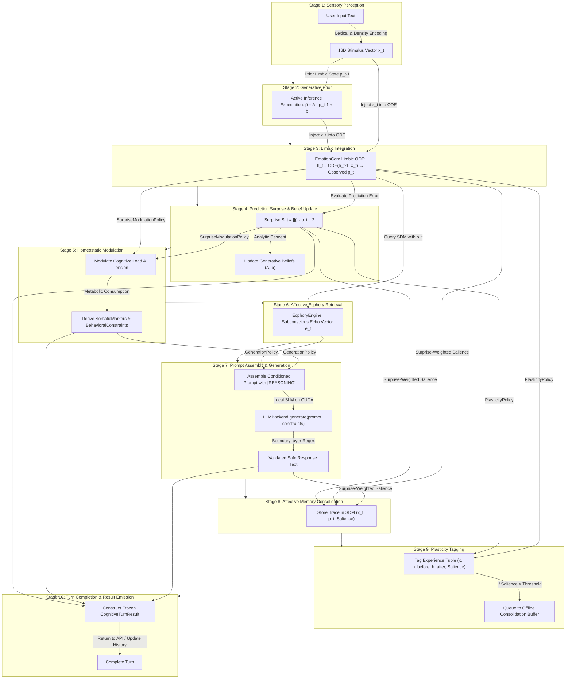
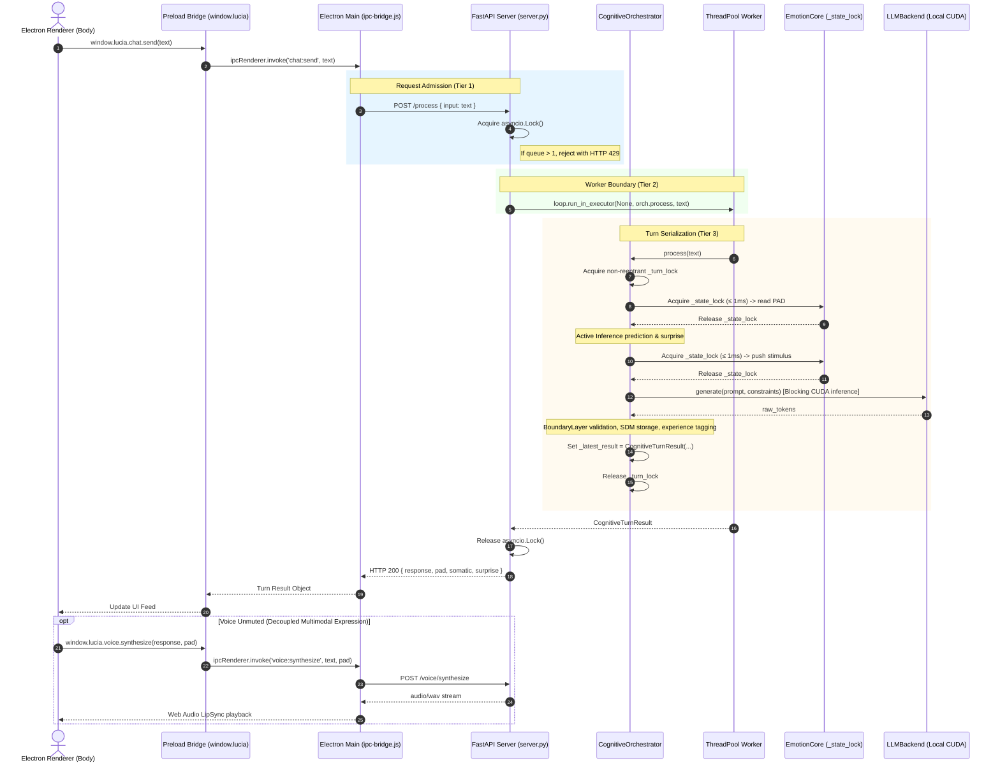

# PHASE_9_ARCHITECTURE_GATE.md — Architectural Decision Gate & Pre-Implementation Blueprint (v2.0)

> **Authoritative Architectural Gate & Decision Record for Phase 9: Unified Cognitive Architecture**  
> **Evaluation Date**: September 9, 2026  
> **Target Baseline Commit**: `603999d` (`origin/main`)  
> **Revision**: 2.0 (Post-Audit Revision Resolving Concurrency, State Ownership, Simulation Validation, Reasoning Mechanics, and Policy Decoupling)  
> **Status**: **ARCHITECTURE GATE — REVISED / AWAITING USER SIGN-OFF**  
> **Production Code Changes**: **NONE**  
> **Implementation Authorization**: **NOT GRANTED**

---

## 1. Executive Summary

During the post-Phase-8 architectural review, an exhaustive audit of the actual codebase identified four critical architectural gaps:
1. **F-01 (Layer 4 Active Inference Bypassed & Decorative)**: Layer 4 Active Inference (`ActiveInferenceEngine`) and online LNN backpropagation (`LNNTrainer`) were implemented in Phase 4 (`src/core/inference/`) but never wired into the production backend server (`src/api/server.py`). Furthermore, within the Phase 4 orchestrator itself, prediction error was merely logged and exerted **zero causal influence** on downstream behavioral constraints, prompt assembly, or reasoning depth.
2. **F-02 (Cognitive Turn Ownership & Inheritance Duplication)**: The production server instantiated `InstrumentedOrchestrator`, which inherited from `MemoryAugmentedOrchestrator` and re-executed Steps 1–4 of the cognitive pipeline before delegating to `super()._execute_pipeline()`. This caused **double stimulus injection** into `EmotionCore` and **double input recording / metabolic debt** in `HomeostaticEngine` on every single live turn. Furthermore, a 5-tier inheritance hierarchy (`Orchestrator` $\rightarrow$ `MemoryAugmentedOrchestrator` $\rightarrow$ `InferencePipelineOrchestrator` $\rightarrow$ `PresenceOrchestrator`, with `InstrumentedOrchestrator` branching off at tier 2) caused rampant copy-paste code duplication across every phase.
3. **F-03 (State & Concurrency Protection)**: While Electron's main process chained outgoing chat calls via a JavaScript promise queue, the Python Brain backend (`POST /process`) lacked concurrency protection around mutable cognitive state (`self._history`, `HomeostaticEngine._energy`, `SDMCore`, `LNNTrainer`). Two concurrent API requests could interleave, corrupt dialogue history, race on metabolic energy, and thrash local CUDA LLM context.
4. **F-04 (Brain ↔ Body Boundary Violations)**: The desktop renderer process (`electron/renderer/chat/chat.js`) still contained **12 direct `fetch()` calls** with hardcoded `http://127.0.0.1:8765` URLs for voice synthesis, audio transcription, avatar model listing, user profile retrieval, hardware profile updates, and conversation history. Several of these bypassed existing IPC bridge methods in `preload.js`, violating context isolation and failing if the backend port was remapped.

This **Version 2.0 Revision** resolves the five primary ambiguities of Gate v1:
1. **Concurrency / Lock Semantics Corrected**: Rectifies the incorrect claim that `threading.Lock` is re-entrant. Establishes a rigorous 5-tier synchronization architecture cleanly separating *request admission* (`asyncio.Lock` with bounded queue), *worker thread boundary* (`ThreadPoolExecutor`), *cognitive turn serialization* (non-reentrant `threading.Lock`), *non-blocking state snapshot reads* (`EmotionCore._state_lock` $\le 1\text{ms}$), and *background maintenance loops*.
2. **Singular State Ownership Grounded**: Enforces the foundational invariant: **CognitiveOrchestrator owns the TURN lifecycle, NOT the persistent cognitive STATE.** Defines the singular authoritative owner, mutation boundary, read boundary, and persistence destination for all 11 mutable subsystems. Replaces God-Object property caching on `CognitiveOrchestrator` with an immutable, frozen `CognitiveTurnResult` data carrier.
3. **Simulation Compatibility & Cognitive Turn Validation Reconciled**: Formally separates *Phase 8 compatibility* (preserving `SimulationRuntime`, `SimClock`, `StoragePolicy`, `ScenarioRunner`, and the zero-live-data invariant) from *Phase 9 cognitive validation* (defining a full-pipeline test mode with real L1–L5, real `BoundaryLayer`, and stubbed/mocked L6/Voice/Storage to prove the unified cognitive turn without activating live Lucia).
4. **Reasoning Depth Grounded in Actual Code Capabilities**: Audits `PromptAssembler` and `LLMBackend` to replace speculative claims about multi-pass reasoning with a concrete, verified `GenerationPolicy` abstraction (reflexive vs. deliberative mode via `<think>` prompt scaffolding, temperature delta, and token budget expansion).
5. **Surprise & Plasticity Decoupled from Invariants**: Replaces hardcoded constants with explicit, configurable policy layers (`SurpriseModulationPolicy`, `PlasticityPolicy`, `GenerationPolicy`), separating fundamental mathematical architecture from tunable experimental parameters.

---

## 2. Verified Current Architecture & Ground Truth Code Audit

Every claim in this Gate has been verified against the physical files and Git history at commit `603999d`. The following status matrix represents the ground truth of the system:

| Subsystem / Component | Source File Path | Current Status | Repository Code Reality & Verification Notes |
|---|---|---|---|
| **Layer 1: Stimulus Encoding** | `src/core/gating/stimulus_processor.py` | **VERIFIED IN CODE** | Encodes text to 16D vector using lexical PAD dictionaries and semantic density. Fully operational. |
| **Layer 2: Limbic Fast-Loop** | `src/core/emotion/emotion_core.py` | **VERIFIED IN CODE** | Continuous 200ms background thread integrating ODE via Euler/RK4 on CPU. `_state_lock` guards PAD and hidden state. Fully operational. |
| **Layer 3: Homeostatic Engine** | `src/core/emotion/homeostatic_engine.py` | **VERIFIED IN CODE** | Models Energy, Cognitive Load, Tension, Stability. `_resolve_reasoning_depth()` returns $k \in \{0, 1, 3\}$. Computes `SomaticMarkers` and `BehavioralConstraints`. Fully operational. |
| **Layer 4: Active Inference** | `src/core/inference/active_inference.py` | **VERIFIED IN CODE (DORMANT)** | Implements $\hat{p} = A \cdot p + b$, computes $L_2$ prediction error, updates $A, b$ via analytic ridge regression. Unit tested, but **bypassed in live server**. |
| **Layer 4: LNN Trainer** | `src/core/inference/trainer.py` | **VERIFIED IN CODE (DORMANT)** | Implements PyTorch `odeint` backpropagation on CPU experience buffer. `_train_lock` guards weight swaps. **Bypassed in live server**. |
| **Layer 5: Affective Memory** | `src/core/memory/affective_memory.py` | **VERIFIED IN CODE** | 500-location Kanerva SDM with cosine similarity ecphory retrieval returning 16D Echo Vector. `_index_lock` guards traces. Fully operational. |
| **Layer 5: Memory Decay** | `src/core/memory/decay_engine.py` | **VERIFIED IN CODE** | 60s background daemon sweeping traces and applying exponential decay. Fully operational. |
| **Layer 6: Prompt Assembly** | `src/core/orchestrator/prompt_assembler.py` | **VERIFIED IN CODE** | Assembles preamble, somatic, constraints, history, memory echo, and `[REASONING]` section (`min(2k - 1, 5)` `<think>` steps). Fully operational. |
| **Layer 6: Language Generation** | `src/core/language/llm_backend.py` | **VERIFIED IN CODE** | Wraps `llama-cpp-python` (or CPU fallback). Takes `max_tokens` and `temperature`. Single-pass generation. Fully operational. |
| **Layer 6: Boundary Validation** | `src/core/safety/boundary_layer.py` | **VERIFIED IN CODE** | Regex suppression of introspective affect self-reports ("I feel happy", etc.). Returns safe text or `[...]`. Fully operational. |
| **Live Server Pipeline** | `src/api/server.py` | **VERIFIED IN CODE (DEFECTIVE)** | Instantiates `InstrumentedOrchestrator`. **Executes Steps 1–4 twice** per turn. Bypasses Layer 4. Has no turn serialization lock. |
| **Voice Synthesis** | `src/core/voice/voice_engine.py` | **VERIFIED IN CODE** | Edge-TTS + RVC inference pipeline on CPU/GPU. Exposed via `POST /voice/synthesize`. Decoupled from cognitive loop. Fully operational. |
| **Simulation Runtime** | `src/core/simulation/runtime.py` | **VERIFIED IN CODE** | Phase 8 isolated testbed with `SimClock`, `StoragePolicy`, and `ScenarioRunner`. Never writes to live disk. Fully operational. |
| **Renderer IPC Boundary** | `electron/renderer/chat/chat.js` | **VERIFIED IN CODE (DEFECTIVE)** | Contains **12 direct `fetch()` calls** bypassing `preload.js` ContextBridge. Breaks port remapping and isolation. |
| **Cognitive Orchestrator** | `src/core/orchestrator/cognitive_orchestrator.py` | **PROPOSED** | Unified composition-based turn coordinator replacing 5-tier inheritance. Awaiting Phase 9 implementation. |

---

## 3. F-01 Resolution: Layer 4 Active Inference Integration & Causality

### 3.1 The As-Is Defect
In Phase 4, `ActiveInferenceEngine` was implemented to model predictive limbic transitions. However:
1. `src/api/server.py` instantiated `InstrumentedOrchestrator` (derived from Phase 2 `MemoryAugmentedOrchestrator`), leaving Phase 4 `InferencePipelineOrchestrator` completely unreferenced in production.
2. Even inside `InferencePipelineOrchestrator`, the prediction error `pred_err` was merely assigned to a local variable `self._last_pred_error` and logged. It had **zero causal connections** to downstream components.
3. Prediction surprise had no impact on cognitive load, tension, reasoning depth, prompt construction, or memory consolidation. It was purely decorative telemetry.

### 3.2 The Causal Role of Active Inference
In the Free Energy Principle (Friston, 2010), an adaptive agent maintains homeostatic viability by minimizing surprise. To make Active Inference causally active without violating the strict invariant against self-reported affect ("I am surprised"):

1. **Pre-Stimulus Generative Expectation**: Before integrating the incoming stimulus $x(t)$, Active Inference projects the expected emotional transition based on the agent's prior state $p_{t-1}$:
   $$\hat{p}_t = A \cdot p_{t-1} + b$$
2. **Limbic Reaction**: The incoming stimulus $x(t)$ is integrated by the limbic ODE in `EmotionCore`, yielding observed state $p_t$.
3. **Surprise Computation**: Prediction Surprise (free energy) is evaluated as the Euclidean prediction error:
   $$\mathcal{S}_t = \|\hat{p}_t - p_t\|_2 \in [0.0, \sqrt{12}]$$
   Belief matrices $(A, b)$ perform an analytic gradient descent step with KL-regularization toward identity:
   $$\min_{A, b} \|A \cdot p_{t-1} + b - p_t\|_2^2 + \lambda_{KL} \|A - I\|_F^2$$
4. **Causal Coupling to Homeostasis (Layer 3)** via `SurpriseModulationPolicy`:
   - **Cognitive Load ($\mathcal{C}$)**: Elevated surprise immediately increases processing strain:
     $$\mathcal{C}_t = \text{clip}(\mathcal{C}_{\text{base}} + \alpha_{\mathcal{C}} \cdot \mathcal{S}_t, 0.0, 1.0)$$
   - **Tension ($\mathcal{T}$)**: When surprise exceeds the tension threshold ($\mathcal{S}_t > \theta_{\mathcal{T}}$), epistemic uncertainty manifests as physiological tension:
     $$\mathcal{T}_t = \text{clip}(\mathcal{T}_{\text{base}} + \alpha_{\mathcal{T}} \cdot (\mathcal{S}_t - \theta_{\mathcal{T}}), 0.0, 1.0)$$
   - **Generation Policy Shifting**: If $\mathcal{S}_t > \theta_{\text{delib}}$ or $\mathcal{T}_t > \theta_{\text{tension\_delib}}$, the generation policy shifts from *reflexive* to *deliberative* mode ($k=2$).
5. **Causal Coupling to Affective Memory (Layer 5)**:
   - **Salience-Weighted Encoding**: Traces formed under high surprise receive heightened initial intensity:
     $$I_{\text{base}} = \max(|p_t|) \cdot (1.0 + \beta_{\text{salience}} \cdot \mathcal{S}_t)$$
     This protects surprising interactions from rapid exponential decay, matching biological memory consolidation.

---

## 4. F-02 Resolution: Cognitive Turn Ownership & Orchestrator Design

### 4.1 Root Cause of the Double Execution Bug
In `src/api/server.py`:
```python
class InstrumentedOrchestrator(MemoryAugmentedOrchestrator):
    def _execute_pipeline(self, input_text: str, call_id: str, t_start: float) -> str:
        # Step 1-4 execute locally to capture telemetry
        stimulus = self._stimulus_processor.encode(input_text)
        self._emotion_core.push_stimulus(stimulus)            # PUSH #1
        pad = self._emotion_core.get_pad_state()
        self._homeostatic_engine.record_input()               # RECORD #1
        markers = self._homeostatic_engine.compute_somatic_markers(pad)
        constraints = self._homeostatic_engine.compute_behavioral_constraints(markers, pad)
        self._last_somatic = markers
        self._last_constraints = constraints

        # Delegate rest of pipeline to super
        return super()._execute_pipeline(input_text, call_id, t_start)
```
Inside `super()._execute_pipeline()`, `MemoryAugmentedOrchestrator` again called:
```python
        stimulus = self._stimulus_processor.encode(input_text)
        self._emotion_core.push_stimulus(stimulus)            # PUSH #2
        pad = self._emotion_core.get_pad_state()
        self._homeostatic_engine.record_input()               # RECORD #2
```
Every conversational turn in production injected two identical stimuli into the limbic ODE and recorded two distinct input events into the metabolic battery, artificially doubling energy depletion and distorting emotional dynamics.

### 4.2 Single Unified Cognitive Orchestrator via Composition
The 5-tier inheritance hierarchy (`Orchestrator` $\rightarrow$ `MemoryAugmentedOrchestrator` $\rightarrow$ `InferencePipelineOrchestrator` $\rightarrow$ `PresenceOrchestrator` + `InstrumentedOrchestrator`) is formally deprecated.

Phase 9 implements a single, unified coordinator: `CognitiveOrchestrator` in `src/core/orchestrator/cognitive_orchestrator.py`.
- **Pattern**: Composition and Pipeline Sequencing.
- **Injected Collaborators**:
  - `stimulus_processor: StimulusProcessor`
  - `emotion_core: EmotionCore`
  - `homeostatic_engine: HomeostaticEngine`
  - `active_inference: ActiveInferenceEngine`
  - `affective_memory: AffectiveMemory`
  - `ecphory_engine: EcphoryEngine`
  - `prompt_assembler: PromptAssembler`
  - `llm_backend: LLMBackend`
  - `boundary_layer: BoundaryLayer`
  - `surprise_policy: SurpriseModulationPolicy`
  - `plasticity_policy: PlasticityPolicy`
  - `generation_policy: GenerationPolicy`
  - `lnn_trainer: Optional[LNNTrainer]`
- **Single Pass Guarantee**: `process()` executes the pipeline stages in a strict linear pass. No step is executed twice, and no base class delegation is used.
- **Zero Subsystem Mutation by Orchestrator**: The Orchestrator interacts with subsystems strictly via their public domain contracts. It does not manipulate private state.

---

## 5. F-03 Resolution: Concurrency & Lock Semantics

### 5.1 Clarification on Concurrency Primitives
Gate v1 incorrectly asserted that `threading.Lock()` is re-entrant. In Python, `threading.Lock` is **non-reentrant**: if a thread holding a `threading.Lock` attempts to acquire it again, it deadlocks. `threading.RLock` is re-entrant.

**Architectural Decision**: `CognitiveOrchestrator` must use a **non-reentrant `threading.Lock()`** (`_turn_lock`).
- **Rationale**: A cognitive turn is an indivisible, strictly sequential operational unit. Re-entrancy is not only unnecessary; it is **actively dangerous**. If an internal component within the cognitive turn were to recursively invoke `orchestrator.process()`, an `RLock` would permit it, causing nested stimulus injection, corrupting dialogue history, and deadlocking the KV cache. A non-reentrant `threading.Lock` guarantees that any recursive invocation fails fast or blocks, maintaining architectural integrity.

### 5.2 5-Tier Synchronization Architecture
The system employs five clearly separated synchronization boundaries:

```
Tier 1: Request Admission (FastAPI Async Boundary)
        [asyncio.Lock() in server.py]
        Queue depth: 1. Rejects 3rd+ concurrent request with HTTP 429.
                     │
                     ▼
Tier 2: Worker Boundary (Thread Pool Dispatch)
        [await loop.run_in_executor(None, orch.process, input_text)]
        Offloads blocking inference from event loop to worker thread.
                     │
                     ▼
Tier 3: Cognitive Turn Serialization (Python Thread Boundary)
        [CognitiveOrchestrator._turn_lock (non-reentrant threading.Lock)]
        Serializes execution across all callers (HTTP, CLI, background tests).
                     │
                     ▼
Tier 4: State Snapshot Reads (Microsecond Mutexes)
        [EmotionCore._state_lock (≤ 1ms)]
        Protects scalar PAD reads. Never blocks on or waits for Tier 1–3 locks.
                     │
                     ▼
Tier 5: Background Maintenance (Decoupled Daemons)
        [_index_lock in SDM, _train_lock (≤ 2ms) in LNN weight swap]
        Runs in background; zero GPU or event loop contention.
```

### 5.3 Detailed Behavior Under Load

#### Scenario A: Five Requests Arrive Simultaneously
1. **Request 1**: Enters `POST /process`, acquires `asyncio.Lock()`, dispatches to thread pool via `run_in_executor`, acquires `_turn_lock`, begins cognitive turn.
2. **Request 2**: Enters `POST /process`, awaits `asyncio.Lock()` (FIFO queue depth = 1).
3. **Requests 3, 4, 5**: Attempt admission while queue depth is at maximum ($\text{depth} \ge 1$). FastAPI immediately returns **HTTP 429 Too Many Requests**:
   ```json
   {
     "error": "turn_in_progress",
     "detail": "Lucia is currently processing a thought. Please wait."
   }
   ```
4. **Result**: Zero context thrashing, zero thread pool explosion, bounded response latency, perfectly serialized cognitive history.

#### Scenario B: `GET /state` Polling While Turn Is Running
1. UI polls `GET /state` every 500ms for telemetry and avatar lip-sync.
2. `get_state()` does **NOT** acquire `asyncio.Lock()` or `_turn_lock`.
3. It calls `EmotionCore.get_pad_state()`, which acquires `_state_lock` for $< 1\text{ms}$ (reading 3 floats), and releases immediately.
4. It reads the reference to `CognitiveOrchestrator.latest_turn_result` (an atomic pointer read in Python).
5. `/state` responds in $< 10\text{ms}$ consistently, with zero jitter, completely unaffected by whether LLM generation is running.

#### Scenario C: Background Loops During Active Turn
- **Fast-Loop (200ms)**: Continues running on its daemon thread. It acquires `_state_lock` for $< 1\text{ms}$ per tick to integrate the limbic ODE. When the cognitive turn pushes a stimulus via `push_stimulus()`, it acquires `_state_lock` for $< 0.1\text{ms}$ to append to the queue.
- **Decay-Loop (60s)**: Runs on its daemon thread. It acquires `_index_lock` to perform matrix multiplications and decay trace counts. It does not contend with limbic ODE or LLM generation.
- **Plasticity Worker**: Only runs during rest/idle states. It holds `_train_lock` for $\le 2\text{ms}$ to swap weights into `EmotionCore`. It **never** runs while `_turn_lock` is held.

---

## 6. F-04 Resolution: Brain ↔ Body Boundary & IPC Remediation

### 6.1 Audit of Direct `fetch()` Violations in `chat.js`
The physical audit of `electron/renderer/chat/chat.js` verified 12 direct `fetch()` calls violating the ContextBridge security boundary:

| Line in `chat.js` | Direct Fetch Call | Target Subsystem | IPC Method to Expose via `preload.js` |
|---|---|---|---|
| 192, 210 | `POST /voice/select-model` | Voice model selection | `window.lucia.voice.selectModel(modelName)` |
| 229 | `GET /voice/models` | Available voice models | `window.lucia.voice.getModels()` |
| 378 | `GET /models/avatar` | Available avatars | `window.lucia.models.getAvatars()` |
| 589 | `POST /voice/transcribe` | Audio speech-to-text | `window.lucia.voice.transcribe(blob)` |
| 753 | `POST /profile` | Save user profile | `window.lucia.system.setProfile(data)` |
| 806 | `GET /profile` | Load user profile | `window.lucia.system.getProfile()` |
| 967 | `GET /system/profile` | Load hardware tier | `window.lucia.system.getHardwareProfile()` |
| 1007 | `POST /system/profile` | Save hardware tier | `window.lucia.system.setHardwareProfile(tier)` |
| 1036 | `GET /history` | Load chat history | `window.lucia.chat.getHistory(limit)` |
| 1268, 1339 | `POST /voice/synthesize` | TTS Voice synthesis | `window.lucia.voice.synthesize(text, pad)` |

### 6.2 Architectural Remediation
1. **Renderer (The Body)**: Complete network isolation. `fetch()` is removed entirely from `chat.js`. All communication occurs via `window.lucia.*` contracts.
2. **Preload (`preload.js`)**: ContextBridge exposes strictly typed, promise-returning invocations (`ipcRenderer.invoke(...)`).
3. **Main Process (`ipc-bridge.js`)**: Receives IPC messages, resolves the active loopback port (`http://127.0.0.1:${port}`), executes the HTTP request, handles network exceptions, and returns typed responses to the renderer.

---

## 7. Unified Cognitive Turn Model (The Audited 10-Stage Loop)

The proposed 10-stage cognitive turn was audited for causal correctness and dependency ordering:



### Causal Dependency Audit
- **Prediction before Limbic Integration (S2 before S3)**: Must predict $\hat{p}_t$ based on prior state $p_{t-1}$ *before* $p_t$ is mutated by the incoming stimulus $x(t)$. Verified correct.
- **Surprise before Homeostasis (S4 before S5)**: Homeostatic cognitive load $\mathcal{C}$ and tension $\mathcal{T}$ depend mathematically on $\mathcal{S}_t$. Verified correct.
- **Homeostasis before Prompt Assembly (S5 before S7)**: Prompt assembler requires `BehavioralConstraints` (reasoning depth $k$, temperature, token budget). Verified correct.
- **Ecphory Query before Generation (S6 before S7)**: Memory echo vector $e_t$ must be injected into the prompt before generation. Verified correct.
- **Consolidation after Generation (S8 after S7)**: Memory traces are only consolidated if generation completes successfully without catastrophic safety or timeout suppression. Verified correct.
- **Plasticity Tagging at Turn Boundary (S9)**: Experience is tagged in $< 0.1\text{ms}$ during the turn, but actual ODE training occurs during idle rest. Verified correct.

---

## 8. State Ownership Model

### 8.1 The Core Principle
> **CognitiveOrchestrator owns the TURN lifecycle, NOT the persistent cognitive STATE.**

The Orchestrator coordinates subsystem interactions during a conversational turn. It is not a God Object: it does not own, store, or mutate subsystem private state directly.

### 8.2 Comprehensive Subsystem State Ownership Matrix

| Subsystem / State Item | Authoritative Owner | Mutated By | Read By | Synchronization Boundary | Persistence Destination | Lifecycle |
|---|---|---|---|---|---|---|
| **Limbic Hidden State ($h_t$) & PAD ($p_t$)** | `EmotionCore` | Fast-Loop daemon (200ms), `push_stimulus()` | `get_pad_state()`, `/state` | `EmotionCore._state_lock` ($\le 1\text{ms}$) | Ephemeral (resets to Philia resting attractor) | Runtime process |
| **LNN ODE Cell Weights** | `EmotionCore` | `LNNTrainer` during offline rest | `EmotionCore._step_ode()` | `_train_lock` ($\le 2\text{ms}$ swap) | Base model weights in code / local checkpoint | Lifelong companion |
| **Metabolic Battery & Somatic State** | `HomeostaticEngine` | `record_input()`, `update_metabolic_state()` | `compute_somatic_markers()`, `compute_behavioral_constraints()` | Serialized inside cognitive turn | Ephemeral | Runtime process; reset on lifecycle reset |
| **Active Inference Generative Beliefs ($A, b$)** | `ActiveInferenceEngine` | `step(pad_before, pad_after)` during turn | `predict(pad_prev)` during turn | Serialized inside cognitive turn | In-memory runtime (optional JSON save on exit) | Runtime process |
| **Affective Traces & SDM Locations** | `AffectiveMemory` (`SDMCore`) | `store_trace()`, `DecayEngine.sweep()` | `ecphory_query()`, `get_all_traces()` | `AffectiveMemory._index_lock` | In-memory runtime (binary dump deferred to Phase 10) | Lifelong companion |
| **Dialogue Context (Working Memory)** | `DialogueContextManager` | Appended at turn completion | `PromptAssembler.assemble()` | `_turn_lock` (within Orchestrator) | Ephemeral sliding window ($N$ turn pairs) | Conversational session |
| **Permanent Chat History Log** | `ChatHistoryStore` | `append_turn()` at turn completion | `GET /history`, Electron chat log | Atomic append with file lock | File: `data/chat_history.json` | Permanent companion history |
| **User & Hardware Profile** | `ProfileStore` | `POST /profile`, `POST /system/profile` | `GET /profile`, system startup | File lock / atomic rewrite | File: `data/profile.json` | Permanent user configuration |
| **Stability & Telemetry Metrics** | `StabilityEvaluator` | `record_pad()`, `update_sdm_count()` | `GET /telemetry/stability`, `GET /state` | Internal thread-safe sliding deque | Ephemeral rolling telemetry | Runtime process |
| **Voice Synthesis State** | `VoiceEngine` | Model load / synthesis calls | `GET /voice/models`, `POST /voice/synthesize` | Internal async worker lock | Models on disk (`models/voice/`) | Decoupled service |
| **Simulation Virtual State** | `SimulationRuntime` | `SimClock.step()`, `send_chat()` | Simulation endpoints (`POST /sim/*`) | Single-threaded virtual clock | Zero disk writes (`StoragePolicy`) | Simulation execution |

### 8.3 The Immutable `CognitiveTurnResult` Object
To eliminate God-Object state duplication (where `CognitiveOrchestrator` held mutable fields like `_last_somatic`, `_last_constraints`, `_last_pred_error`), all intermediate and final outputs of a turn are bundled into an immutable, frozen data carrier:

```python
@dataclass(frozen=True)
class CognitiveTurnResult:
    call_id: str
    response_text: str
    pad_initial: PADState
    pad_final: PADState
    stimulus: np.ndarray
    prediction_error: float
    somatic: SomaticMarkers
    constraints: BehavioralConstraints
    echo_vector: Optional[np.ndarray]
    trace_stored: bool
    experience_queued: bool
    execution_time_s: float
```
`CognitiveOrchestrator.process()` returns `CognitiveTurnResult`.
`CognitiveOrchestrator` maintains only an atomic reference:
```python
self._latest_result: Optional[CognitiveTurnResult] = None
```
which telemetry readers can inspect without holding locks or mutating state.

---

## 9. Concurrency & Event Model



---

## 10. Active Inference Causal Model

### 10.1 Mathematical Formulation
Let the limbic state vector in PAD space be $p_t = [P_t, A_t, D_t]^T \in [-1, 1]^3$.
The generative model parameterizes expected emotional dynamics via transition matrix $A \in \mathbb{R}^{3 \times 3}$ and bias vector $b \in \mathbb{R}^3$:

1. **Generative Expectation (Prior)**:
   $$\hat{p}_t = A \cdot p_{t-1} + b$$
2. **Observed Limbic Integration (Sensory Update)**:
   $$h_t = h_{t-1} + \int_{t-1}^t f_{\text{LNN}}(h(\tau), x(t)) \, d\tau$$
   $$p_t = \tanh(W_{\text{proj}} \cdot h_t)$$
3. **Prediction Error (Free Energy / Surprise)**:
   $$\mathcal{S}_t = \|\hat{p}_t - p_t\|_2 = \sqrt{\sum_{i \in \{P, A, D\}} (\hat{p}_{t, i} - p_{t, i})^2}$$
4. **Belief Parameter Adaptation**:
   Online parameter adaptation via analytic ridge regression with regularizer $\lambda = 0.01$ toward prior identity:
   $$\Delta A = \eta \cdot (p_t - \hat{p}_t) \cdot p_{t-1}^T - \lambda (A - I)$$
   $$\Delta b = \eta \cdot (p_t - \hat{p}_t)$$
   where $\eta = 0.05$ is the adaptive learning rate.

---

## 11. Generation & Reasoning Policy (`GenerationPolicy`)

### 11.1 Grounding Against Repository Capabilities
An audit of `PromptAssembler` (`src/core/orchestrator/prompt_assembler.py`) and `LLMBackend` (`src/core/language/llm_backend.py`) reveals:
- `PromptAssembler._build_reasoning_section(reasoning_depth)` formats:
  - If $k \le 0$: returns `""` (no reasoning section).
  - If $k \ge 1$: returns $\min(2k - 1, 5)$ steps of `Step {i}: <think>`.
- `LLMBackend.generate(prompt, constraints)` receives `max_tokens` and `temperature` and executes a **single-pass generation** against the local GGUF model via `llama-cpp-python`.
- **Reality**: There is no multi-agent debate, tree-of-thought planner, or multi-turn reasoning loop in the code. Claims of "multi-stage deliberative planning" in Gate v1 were inaccurate.

### 11.2 The `GenerationPolicy` Abstraction
Phase 9 replaces speculative reasoning claims with an explicit, honest policy abstraction:

```python
@dataclass(frozen=True)
class GenerationPolicy:
    mode: str                          # "reflexive", "deliberative", or "fatigued"
    reasoning_depth: int               # 0 (fatigued), 1 (reflexive), 2 (deliberative)
    temperature_delta: float           # Adjustment to baseline sampling temperature
    token_expansion_factor: float      # Multiplier applied to max_tokens
    scaffolding_steps: int             # Number of <think> steps injected
```

#### Behavioral Modes
1. **Fatigued Mode** ($\mathcal{E} \le 0.20$):
   - $k=0$. No `[REASONING]` section. Tight token budget ($\le 80$ tokens).
   - Simulates metabolic conservation. Short, direct responses.
2. **Reflexive Mode** (Standard Conversational Flow: $\mathcal{S}_t \le 0.60$ and $\mathcal{T}_t \le 0.70$):
   - $k=1$. Injects `Step 1: <think>` scaffolding.
   - Baseline temperature ($T \approx 0.70$), standard token budget ($120-180$ tokens).
   - Conversational, natural, fluid responses.
3. **Deliberative Mode** (High Surprise $\mathcal{S}_t > 0.60$ or High Tension $\mathcal{T}_t > 0.70$):
   - $k=2$. Injects `Step 1: <think>`, `Step 2: <think>`, `Step 3: <think>` scaffolding.
   - Temperature is lowered ($\Delta T = -0.10$) to reduce sampling entropy and focus attention.
   - Token budget is expanded by $+15\%$ to accommodate cognitive step scaffolding.
   - `BoundaryLayer` ensures `<think>` tokens and introspective self-reports are cleanly filtered from the final output.

---

## 12. LNN Plasticity Policy (`PlasticityPolicy`)

### 12.1 Separating Architectural Invariants from Tunable Policy
Gate v1 presented fixed constants (0.35, 45s, 4 samples, 8 samples) as architectural requirements. In Gate v2, these are encapsulated within a configurable `PlasticityPolicy`:

```python
@dataclass
class PlasticityPolicy:
    # Tunable Policy Parameters (Defaults shown)
    salience_tag_threshold: float = 0.35          # Minimum experience salience to queue
    consolidation_idle_timeout_s: float = 45.0   # Idle seconds before rest consolidation
    min_consolidation_batch_size: int = 4         # Minimum samples to trigger idle training
    max_buffer_overflow_threshold: int = 8       # Buffer limit triggering immediate training
    learning_rate: float = 0.001                 # ODE backpropagation learning rate
    max_training_epochs: int = 3                 # Epochs per consolidation cycle
    max_gradient_norm: float = 1.0               # Gradient clipping norm
```

### 12.2 Architectural Invariants of Plasticity
Regardless of policy parameters, the architecture enforces these non-negotiable invariants:
1. **Zero Turn Contention**: LNN backpropagation via `torchdiffeq.odeint` **NEVER** runs while a cognitive turn is active (`_turn_lock` held).
2. **CPU-Only Execution**: LNN training runs exclusively on CPU cores, avoiding any GPU VRAM contention with the active GGUF LLM.
3. **Atomic Weight Swap**: Weight updates are copied into `EmotionCore` under `_train_lock` in $\le 2\text{ms}$.
4. **Graceful Degradation**: If `torch` or `torchdiffeq` is unavailable or raises an exception during training, the system logs a warning and retains existing weights without entering degraded state.

---

## 13. Voice / Expression Boundary

### 13.1 Canonical System Boundary
- **Brain (`src/`)**: Pure cognition and physiology. Computes thought, language, and emotional state. Returns `{ response, call_id, pad, somatic, surprise }`.
- **Body (`electron/`)**: Presentation and multimodal expression. Decides when, whether, and how to vocalize and articulate.
- **Voice Engine (`src/core/voice/`)**: Independent expression service exposed via `POST /voice/synthesize`. Decoupled from `CognitiveOrchestrator`.

### 13.2 Multimodal Expression Contract
1. `CognitiveOrchestrator.process()` does **NOT** know or care whether voice synthesis is enabled.
2. The Electron renderer receives the cognitive response text and PAD state.
3. **Muting Efficiency**: If user has muted voice in UI, **0 milliseconds of compute** are spent on voice synthesis.
4. **Failure Isolation**: If the RVC voice model crashes or fails, dialogue text displays immediately in the chat window with 100% fidelity.
5. **Lip-Sync Driving**: When unmuted, audio returns to Electron as binary `audio/wav`, and Web Audio Fourier analysis drives 2D/3D avatar mouth blendshapes at 60 FPS.

---

## 14. Simulation Compatibility & Cognitive Turn Validation

### 14.1 Phase 8 Compatibility Guarantee
Phase 9 maintains 100% backward compatibility with all Phase 8 components:
- **`SimulationRuntime`**: Runs in complete isolation without autonomous threads.
- **`SimClock`**: Virtual time stepping is untouched.
- **`StoragePolicy`**: Unconditionally blocks live disk writes (`data/chat_history.json`, `data/profile.json`).
- **`ScenarioRunner`**: Scenarios A, B, C, and D execute against `SimulationRuntime` and pass with 100% success.
- **Endpoints**: `POST /process` unconditionally returns HTTP 403 in simulation mode.

### 14.2 Cognitive Turn Validation in Simulation
To prove that the Phase 9 unified cognitive turn operates correctly under test without activating live Lucia, Phase 9 introduces a formal simulation test harness:

```
┌────────────────────────────────────────────────────────────────────────┐
│                   SIMULATION COGNITIVE TEST HARNESS                     │
├────────────────────────────────────────────────────────────────────────┤
│ • REAL COMPONENTS EXERCISED:                                           │
│   - StimulusProcessor (Layer 1): Real lexical & density encoding       │
│   - EmotionCore (Layer 2): Real limbic ODE stepped synchronously       │
│   - HomeostaticEngine (Layer 3): Real metabolic energy & tension       │
│   - ActiveInferenceEngine (Layer 4): Real predictive surprise & update │
│   - AffectiveMemory (Layer 5): Real Kanerva SDM & ecphory query        │
│   - BoundaryLayer (Layer 6): Real regex suppression & safety checks    │
│                                                                        │
│ • STUBBED / MOCKED COMPONENTS:                                         │
│   - LLMBackend: StubLLMBackend generates deterministic responses       │
│     reflecting injected [REASONING] and constraints (0 GPU VRAM).      │
│   - Storage: InMemoryChatHistoryStore / InMemoryProfileStore (0 disk)  │
│   - Clock: SimClock virtual time advances deterministically.           │
│   - Voice: MockVoiceEngine (0 audio hardware used).                    │
└────────────────────────────────────────────────────────────────────────┘
```
This architecture allows property-based tests (Hypothesis) and automated integration tests to exercise the entire 10-stage cognitive loop, verifying Free Energy minimization and homeostatic regulation deterministically in milliseconds.

---

## 15. Architecture Alternatives Considered

| Alternative Considered | Description | Reason for Rejection |
|---|---|---|
| **Alt 1: Deepen Inheritance to `UnifiedPresenceOrchestrator`** | Subclass `InferencePipelineOrchestrator` and wrap `VoiceEngine`. | Perpetuates brittle 5-tier inheritance; tightly couples voice I/O to cognition; fails to eliminate double execution bug. |
| **Alt 2: Synchronous Voice in `POST /process`** | Orchestrator synthesizes audio before returning HTTP response. | Adds 300–800ms latency to text display; wastes compute when muted; audio failure aborts entire conversational turn. |
| **Alt 3: Unbounded Concurrent Processing** | Allow multiple requests to run simultaneously in default thread pool. | Violates Single Continuous Life ontology; corrupts `_history` and `SDM` memory; thrashes CUDA LLM context; corrupts metabolic energy. |
| **Alt 4: Turn-Counter Plasticity (Every 16 Turns)** | Train LNN every 16 turns regardless of content. | Trains on uninformative small talk; delays training on crucial emotional transitions; steals CPU cycles during active conversation. |
| **Alt 5: Direct HTTP Fetch with Dynamic Port** | Pass backend port to renderer window and allow direct `fetch()`. | Violates Electron context isolation and security best practices; fragments API client logic across renderer files. |
| **Alt 6: Multi-Pass Agentic Planning Loop for $k=2$** | Run internal critique / re-prompt loops inside `LLMBackend`. | The repository's small local GGUF models (1.2B–3B) lack the capacity for multi-turn autonomous critique without latency explosion and hallucination loops. |

---

## 16. Architecture Decision Records (ADRs)

### ADR-014: Unified Cognitive Orchestrator via Composition
- **Status**: **ACCEPTED (GATE REVISION v2)**
- **Context**: 5-tier orchestrator inheritance caused rampant code duplication and the double-execution bug in `InstrumentedOrchestrator`.
- **Decision**: Replace inheritance hierarchy with `CognitiveOrchestrator` in `src/core/orchestrator/cognitive_orchestrator.py`. Compose all 6 layers via dependency injection. Execute single linear pass.

### ADR-015: Causal Active Inference via Generative Prior & Homeostatic Coupling
- **Status**: **ACCEPTED (GATE REVISION v2)**
- **Context**: Active Inference was dormant in production and had no causal downstream impact.
- **Decision**: Form generative expectation prior $\hat{p}_t = A \cdot p_{t-1} + b$ before limbic integration. Compute Prediction Surprise $\mathcal{S}_t$. Couple $\mathcal{S}_t$ into Homeostatic Cognitive Load, Tension, and Deliberative Generation Mode ($k=2$). Modulate memory trace salience by surprise.

### ADR-016: Decoupled Multimodal Expression Pipeline for Voice
- **Status**: **ACCEPTED (GATE REVISION v2)**
- **Context**: Deciding whether voice belongs in cognitive orchestrator or body presentation layer.
- **Decision**: Brain returns pure cognitive state (`response`, `pad`, `somatic`, `surprise`). Body (Electron) triggers `window.lucia.voice.synthesize` via IPC after receiving text. Zero text latency, zero compute wasted when muted, complete failure isolation.

### ADR-017: Two-Stage LNN Plasticity with Decoupled Policy
- **Status**: **ACCEPTED (GATE REVISION v2)**
- **Context**: Arbitrary "every 16 turns" training ran on trivial turns and stole CPU cycles during active conversation.
- **Decision**: Online salience tagging during turn ($< 0.1\text{ms}$). Offline consolidation during idle rest ($T_{\text{idle}} \ge 45\text{s}$) on CPU. Parameters governed by configurable `PlasticityPolicy`.

### ADR-018: 5-Tier Synchronization Architecture & Non-Reentrant Mutex
- **Status**: **ACCEPTED (GATE REVISION v2)**
- **Context**: `POST /process` had no concurrency protection. Gate v1 incorrectly claimed `threading.Lock` is re-entrant.
- **Decision**: Implement 5-tier synchronization: `asyncio.Lock()` with bounded queue at FastAPI admission boundary, thread pool worker dispatch, non-reentrant `threading.Lock` in `CognitiveOrchestrator`, sub-millisecond `_state_lock` for `/state`, and background locks for maintenance.

### ADR-019: Complete Context Bridge IPC Remediation
- **Status**: **ACCEPTED (GATE REVISION v2)**
- **Context**: `chat.js` contained 12 direct `fetch()` calls bypassing ContextBridge.
- **Decision**: Eliminate all direct `fetch()` calls in renderer. Route all requests through `window.lucia.*` via `preload.js` and `ipc-bridge.js`.

### ADR-020: State Ownership Discipline & Immutable `CognitiveTurnResult`
- **Status**: **ACCEPTED (GATE REVISION v2)**
- **Context**: Risk of `CognitiveOrchestrator` becoming a God Object duplicating subsystem state.
- **Decision**: Orchestrator owns the turn lifecycle, not the persistent state. Define explicit authoritative owners for all 11 state items. Return frozen `CognitiveTurnResult` dataclass from turns.

---

## 17. Final Phase 9 Scope

Phase 9 implementation consists of the following targeted deliverables:
1. **Core Cognition Package (`src/core/orchestrator/`)**:
   - Create `cognitive_orchestrator.py` implementing `CognitiveOrchestrator`.
   - Implement `CognitiveTurnResult` frozen dataclass.
   - Implement `SurpriseModulationPolicy`, `PlasticityPolicy`, and `GenerationPolicy`.
   - Wire `ActiveInferenceEngine` into the causal loop.
   - Deprecate `InstrumentedOrchestrator` and remove double-execution code path.
2. **Backend Server Integration (`src/api/server.py`)**:
   - Update `server.py` to instantiate `CognitiveOrchestrator`.
   - Add `asyncio.Lock()` turn serialization with queue-depth bounding (HTTP 429).
   - Expose `surprise` in `POST /process` response and `GET /state`.
   - Preserve non-blocking `/state` reads via `_state_lock` and latest turn snapshot.
3. **Electron Body ↔ Brain IPC Migration**:
   - Add IPC handlers in `ipc-bridge.js` for voice synthesis, transcription, model selection, history, and profile.
   - Expose typed methods in `preload.js`.
   - Refactor `electron/renderer/chat/chat.js` to eliminate all 12 direct `fetch()` calls.
4. **Simulation Validation Harness**:
   - Add cognitive turn validation capability to `SimulationRuntime` using real L1–L5 and stubbed L6.
5. **Comprehensive Verification Suite**:
   - Unit tests for `CognitiveOrchestrator` verifying single stimulus push, causal surprise flow, and result immutability.
   - Concurrency tests verifying serialized turn execution under 5 simultaneous requests.
   - Hypothesis property-based tests verifying homeostatic bounds under high-surprise stimuli.
   - Electron integration tests verifying zero `fetch()` calls in renderer.

---

## 18. Non-Goals

- **NO Visual Redesign**: The Phase 7 Personal Digital Room and Avatar stage remain visually identical.
- **NO Cloud Dependencies**: Zero cloud APIs or cloud keys will be introduced.
- **NO LLM Model Swapping**: Retains local GGUF models (LFM2.5-1.2B / Qwen2.5-3B).
- **NO Character Switchers / Multi-Persona**: Lucia remains a single continuous life.
- **NO Agentic Desktop Automation**: Desktop clicking/typing (historical Phase 5) remains out of scope.
- **NO Multi-Stage LLM Critique Loops**: LLM generation remains single-pass conditioned on behavioral constraints.

---

## 19. Invariant-Focused Acceptance Criteria

The acceptance criteria for Phase 9 test system-level architectural invariants:

1. **Singular Stimulus Integration Invariant**:
   - A single invocation of `POST /process` triggers `EmotionCore.push_stimulus` **exactly once** and `HomeostaticEngine.record_input` **exactly once**. Double injection is mathematically impossible.
2. **Causal Active Inference Invariant**:
   - Injecting an unexpected stimulus sequence generates a measurable prediction surprise ($\mathcal{S}_t > 0.40$) that produces a verified, monotonic increase in cognitive load ($\mathcal{C}$) or tension ($\mathcal{T}$), and switches generation policy to deliberative mode ($k=2$).
3. **Turn Serialization Invariant**:
   - When 5 requests hit `POST /process` simultaneously, request 1 executes, request 2 queues, and requests 3–5 receive HTTP 429. Zero requests execute concurrently, dialogue history contains no interleaved turns, and energy decreases sequentially.
4. **Non-Blocking Telemetry Invariant**:
   - While a long-running cognitive turn (simulated 2000ms generation delay) is executing, `GET /state` responds in $\le 15\text{ms}$ with valid PAD state and latest somatic snapshot.
5. **Singular State Ownership Invariant**:
   - `CognitiveOrchestrator` contains zero mutable copies of limbic, homeostatic, or memory state. All telemetry is served via the frozen `CognitiveTurnResult` reference.
6. **Zero Direct Fetch Invariant**:
   - Searching `electron/renderer/chat/chat.js` for `fetch(` returns **0 matches**. All communications route through `window.lucia.*`.
7. **Voice Failure Isolation Invariant**:
   - Terminating or throwing an exception in `VoiceEngine` during voice synthesis does not invalidate or alter the completed dialogue text in the chat feed.
8. **Simulation Isolation Invariant**:
   - Running full cognitive turns through the simulation harness produces verified state transitions while writing exactly **0 bytes** to `data/chat_history.json` or any other live disk path.

---

## 20. Risks & Mitigation

| Risk | Likelihood | Impact | Mitigation Strategy |
|---|---|---|---|
| **LNN Training Stalling CPU** | Low | Medium | Consolidation runs strictly on a background daemon during idle time ($T_{\text{idle}} \ge 45\text{s}$) with gradient clipping. |
| **Turn Queue Latency Under High Request Rate** | Medium | Low | Single-user desktop companion. Admission queue limits depth to 1 and returns HTTP 429 for excess requests. |
| **Electron Audio Blob IPC Transfer Overhead** | Low | Low | Audio blobs transferred across Electron IPC as `Buffer` structured clones, executing in $< 2\text{ms}$ on localhost. |
| **Surprise Hyperparameter Sensitivity** | Medium | Low | All surprise and plasticity thresholds are encapsulated in `SurpriseModulationPolicy` and `PlasticityPolicy`, allowing tuning without modifying core engine logic. |

---

## 21. Deferred Architecture

- **Long-Term SDM Binary Checkpointing**: Persisting Kanerva SDM locations to an on-disk binary checkpoint across application restarts is deferred to Phase 10 (Self-Sovereign Longevity).
- **Multimodal Visual Perception**: Webcam and desktop screen visual perception are deferred to post-Phase 9 milestones.
- **Autonomous Sleep Consolidation Cycles**: Full REM/NREM sleep consolidation cycles simulating circadian rhythms are deferred to Phase 10.

---

## 22. Implementation Preconditions & Document Status

### Implementation Preconditions
Before Phase 9 production code implementation begins:
1. **Zero Production Changes in Current Workspace**: Confirmed.
2. **All Current Tests Passing**: Confirmed (458 Python tests, 119 Jest tests passing).
3. **Explicit User Sign-Off on Gate v2**: Required before modifying any files in `src/` or `electron/`.

### Document Status
```text
Status:
ARCHITECTURE GATE — REVISED / AWAITING USER SIGN-OFF

Production Code Changes:
NONE

Implementation Authorization:
NOT GRANTED
```
