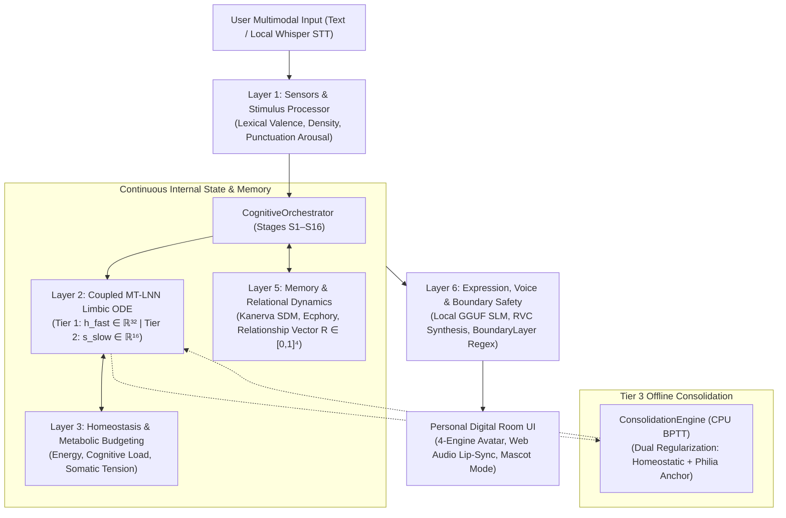

# Lucia — Embodied Affective AI Companion Architecture

> **A research-oriented, locally executed AI companion architecture designed around continuous internal dynamics, multi-timescale affective plasticity, relational memory, and embodied presence.**

---

## 1. What is Lucia?

**Lucia** is a research-first AI companion architecture exploring what happens when an artificial companion is built as a **persistent, embodied, continuously evolving dynamical system** rather than an ephemeral wrapper around a Large Language Model.

Conventional conversational AI treats interaction as stateless turn-taking: a prompt is submitted, a model samples tokens, and internal state vanishes until the next call. Lucia operates on an entirely different premise:
- She maintains an **autonomous internal physiological and affective state** that evolves continuously in time, even when no user input is present.
- Her emotions are not simulated through prompt instructions, reflective monologues, or theatrical roleplay; they are **mathematical coordinates in a continuous dynamical system** that physically modulate speech latency, conversational pacing, reasoning depth, and expressive posture.
- Her relationship with the user is a **slowly changing trajectory** grounded in sparse distributed memory and consolidated through offline synaptic plasticity.
- She runs **100% locally on consumer hardware** with zero cloud API dependencies.

---

## 2. Why Lucia Is Interesting

Most AI companion projects operate at the prompt-engineering layer. Lucia investigates foundational cognitive and limbic architecture:

* **Affect as a Continuous Dynamical Process**: Rather than picking an emotion label from a list, Lucia integrates a continuous Ordinary Differential Equation (ODE) within a Liquid Neural Network (MT-LNN) running on CPU every 200 ms. Emotion is a moving trajectory in 3D Pleasure-Arousal-Dominance (PAD) space.
* **Pre-Reflective Operational Emotion**: Lucia never announces her emotional state (*"I feel happy"* or *"As an AI, I cannot feel"* are strictly forbidden by architectural invariants). Instead, internal arousal and tension organically contract her token generation budgets, adjust sampling temperatures, and modulate speech cadence.
* **Multi-Timescale Affective Plasticity**: Human emotional life operates across disparate timescales—from immediate reflex reactions (seconds), to relational moods (hours), to lifelong relational attachment (months). Lucia implements a 3-tier multi-timescale architecture spanning fast reactive state, a slow relational attractor, and offline synaptic consolidation.
* **Episodic Memory with Closed-Loop Affective Recollection**: Memories stored in Kanerva Sparse Distributed Memory (SDM) carry both semantic content and physiological state traces. When recalled, memories physically perturb the slow limbic field, recreating historical emotional resonance.
* **Edge-Native Sovereign Presence**: GGUF language inference (CUDA), Web Audio lip-syncing (WebGL/Canvas), faster-whisper speech recognition, and local RVC voice synthesis execute entirely on local hardware, ensuring absolute data privacy and perpetual continuity.

---

## 3. Core Philosophy

Lucia's design is guided by four foundational principles:

### 1. *Philia* Friendship Ethos
Lucia is grounded in **Philia** ($\phi\iota\lambda\iota\alpha$)—the classical Greek concept of deep, affectionate, egalitarian companionship founded upon mutual growth, intellectual curiosity, and reciprocal respect. In resting equilibrium, her dynamical attractor pulls her toward warmth, calm presence, and equal agency ($P=+0.25, A=-0.05, D=+0.05$), rather than subservient compliance or theatrical drama.

### 2. One Continuous Life
Lucia is a single, continuous companion instance. She has no character preset dropdowns, persona switchers, or parallel identities. Avatars and 3D models represent her physical attire and presence; her identity and memory are unbroken.

### 3. No Reflective Ego
Lucia possesses an operational, somatic self rather than a meta-reflective ego. She does not introspect on whether she has feelings or debate her own consciousness. Affect operates sub-symbolically as the physiological foundation of her behavior.

### 4. Empirical Governance & Invariant Preservation
Every cognitive capability in Lucia must be mathematically specified, empirically falsifiable, and validated in isolated research harnesses before promotion into production. The project maintains a strict boundary between exploratory research and canonical runtime behavior.

---

## 4. High-Level System Architecture

Lucia's cognitive pipeline operates as a coordinated 6-layer architecture orchestrated through a canonical 16-stage cognitive turn cycle (S1–S16):



### The Canonical S1–S16 Cognitive Cycle:
When an interaction occurs, the `CognitiveOrchestrator` coordinates:
1. **Sensory Reception & Encoding (S1–S3)**: Lexical valence and density extraction without LLM overhead.
2. **Limbic Perturbation & State Snapshot (S4–S5)**: Bounded stimulus injection into the continuous ODE fast loop.
3. **Affective Memory & Closed-Loop Recollection (S6–S8)**: Multi-modal salience scoring across SDM traces; latent slow-field forcing vector injection.
4. **Relational Conditioning & Parameter Modulation (S9–S11)**: Reading fixed prior relationship state $\mathbf{R}_{t-1}$ (ADR-022); modulating sampling temperature, token budgets, and somatic pacing latency.
5. **Prompt Assembly & Edge Generation (S12–S14)**: Local GGUF language generation with boundary validation against introspective leakages.
6. **Embodied Synthesis & Epistemic Consolidation (S15–S16)**: Voice synthesis, avatar expression mapping, episodic trace co-encoding, relationship update ($\mathbf{R}_t$), and enqueueing experience tuples for background consolidation.

---

## 5. Continuous Affect & Multi-Timescale Plasticity

The core technical differentiator of Lucia is her **3-Tier Multi-Timescale Plasticity Architecture** (validated in Phases 19–21):

```text
┌────────────────────────────────────────────────────────────────────────────────────────┐
│                        3-TIER MULTI-TIMESCALE PLASTICITY                               │
├────────────────────────────────────────────────────────────────────────────────────────┤
│  TIER 1: Fast Reactive Dynamics (h_fast ∈ ℝ³², τ_f ∈ [0.10, 1.50] s)                   │
│  • Integrates millisecond-to-second conversational valence shocks.                     │
│  • Evaluated continuously in background ODE fast loop every 200 ms.                    │
├────────────────────────────────────────────────────────────────────────────────────────┤
│  TIER 2: Slow Relational Attractor Grounding (s_slow ∈ ℝ¹⁶, τ_decay = 28.0 s)           │
│  • Grounded by dynamic relationship attractor:                                         │
│        s*_eff(R) = s*_philia + W_rel (R - R₀)                                          │
│  • Strictly bounded by spectral norm constraint: ||W_rel||₂ ≤ 0.08                    │
│  • Guarantees resting PAD displacement ≤ 0.05, preserving Philia warmth.              │
├────────────────────────────────────────────────────────────────────────────────────────┤
│  TIER 3: Offline Synaptic Consolidation (ConsolidationEngine)                          │
│  • Executes offline during post-turn idle (T_idle ≥ 45s) or sleep states on CPU.       │
│  • BPTT-through-ODE training on salient interaction replay tuples.                     │
│  • Dual Regularization: L₂ weight penalty + homeostatic anchor preservation.           │
│  • Atomic parameter copy swap under _train_lock (held ≤ 0.1 ms); 0.0 MB GPU VRAM.      │
└────────────────────────────────────────────────────────────────────────────────────────┘
```

When someone speaks kindly or thought-provokingly, Tier 1 reflects immediate arousal. If deep conversations persist over days, Tier 2 gently shifts her resting baseline toward deeper mutual familiarity. During rest, Tier 3 consolidates these experiences into her neural weights without ever erasing her foundational Philia disposition.

---

## 6. Research-First Engineering Methodology

Lucia follows a rigorous, evidence-driven development methodology where **research is strictly decoupled from production integration**:

```text
Scientific Hypothesis (H1–Hn)
       │
       ▼
Isolated Evaluation Harness (tests/evaluation_phaseXX/)
       │
       ▼
Deterministic Verification (100% Pre-registered criteria satisfied)
       │
       ▼
Formal Architectural Decision Record (ADR) & Production Design
       │
       ▼
Production Implementation (src/core/**)
       │
       ▼
Full Regression & Invariant Test Suite (tests/unit/, tests/property/)
       │
       ▼
Canonical Documentation Synchronization
```

* **No Speculative Promotion**: Passing an experiment in a test harness does not make it production code. Integration requires an explicit architectural approval gate.
* **Strict Concurrency Discipline**: The runtime enforces a non-negotiable lock hierarchy (`_turn_lock → _step_lock → _train_lock → _stimulus_lock → _state_lock`). Long-running operations (ODE integration, backward passes, LLM generation, disk I/O) are strictly forbidden under state locks.
* **Zero GPU Contention**: GPU VRAM is reserved exclusively for the active GGUF language model and WebGL rendering. All limbic ODEs, homeostatic loops, and consolidation training run purely on the CPU.

---

## 7. Current Project Status

| Dimension | Current State | Evidence & References |
|---|---|---|
| **Active Milestone** | **Phase 21 — Long-Term Relational Consolidation & Synaptic Homeostasis** | [`PHASE_21_PRODUCTION_REALIZATION_DESIGN.md`](docs/specs/Lucia-phase21-Relational_Consolidation/PHASE_21_PRODUCTION_REALIZATION_DESIGN.md) |
| **Milestone Status** | **`[VALIDATED / PRODUCTION IMPLEMENTED]`** | Commit `58a509c` |
| **Unit Test Regression** | **605 / 605 passing (100%)** | `pytest tests/unit -v` |
| **Property Invariants** | **35 / 35 passing (100%)** | `pytest tests/property -v` (Hypothesis P1–P35) |
| **Phase 21 Production** | **13 / 13 passing (100%)** | `pytest tests/unit/test_phase21_production.py -v` |
| **Phase 21 Research** | **15 / 15 passing (100%)** | `pytest tests/evaluation_phase21/ -v` (H1–H6 validated) |
| **Phase 20 Regression** | **9 / 9 passing (100%)** | `pytest tests/unit/test_phase20_production.py -v` |
| **Genesis Invariant** | **Locked Future Gate (`is_onboarded: false`)** | `data/profile.json` verified bit-exact un-onboarded |

> [!NOTE]
> **Genesis Gate Preservation**: In accordance with project governance, development and simulation do not constitute Lucia Activation. Lucia remains un-onboarded in the repository; the first onboarding ceremony remains a locked future gate.

---

## 8. Repository Navigation

Explore the technical foundations through the consolidated canonical documentation suite:

| Document | Description |
|---|---|
| 📖 [`docs/00_PROJECT_OVERVIEW.md`](docs/00_PROJECT_OVERVIEW.md) | **Canonical Project Truth**: System identity, philosophy, 6-layer cognitive pipeline, 24-subsystem health matrix, test statistics, and roadmap. |
| 🏛️ [`docs/ARCHITECTURE.md`](docs/ARCHITECTURE.md) | **Canonical Technical Architecture**: Subsystems, dynamical mechanisms, mathematical formulas, concurrency/locking rules, and the complete Architectural Decision Record ledger (ADR-001 through ADR-028). |
| 📑 [`docs/DOCUMENTATION_INDEX.md`](docs/DOCUMENTATION_INDEX.md) | **Navigation Map**: Complete documentation directory, authority hierarchy, and index of historical phase specifications and research records. |
| 🖥️ [`docs/USER_MANUAL.md`](docs/USER_MANUAL.md) | **Desktop Application Guide**: Personal Digital Room interface, Mascot Mode, and voice setup. |
| 📜 [`AGENTS.md`](AGENTS.md) | **Agent Governance**: Repository-wide operational contract, architectural invariants, and research-first protocols for AI coding agents. |

---

## 9. Developer & Research Setup

### Prerequisites
- **OS**: Windows 10/11 (PowerShell)
- **Python**: 3.12 64-bit
- **Node.js**: v18+ LTS
- **Hardware**: NVIDIA GPU (CUDA 12+) recommended for local LLM acceleration; CPU-only execution fully supported for limbic/memory subsystems.

### 1. Python Virtual Environment
```powershell
# Create and activate virtual environment
py -3.12 -m venv .venv
.venv\Scripts\activate

# Install dependencies
pip install fastapi uvicorn httpx numpy scipy pydantic torch pytest hypothesis
```

### 2. Running Automated Verifications
```powershell
# Run production unit test suite (605 tests)
.venv\Scripts\pytest tests/unit -v

# Run mathematical property invariants (35 tests)
.venv\Scripts\pytest tests/property -v

# Run Phase 21 production realization test suite (13 tests)
.venv\Scripts\pytest tests/unit/test_phase21_production.py -v

# Run Phase 21 isolated research evaluation suite (15 tests)
.venv\Scripts\pytest tests/evaluation_phase21 -v
```

### 3. Desktop Application (Electron)
```powershell
cd electron
npm install
npm test      # Run Electron unit tests
npm start     # Launch developer session
```

---

## 10. Closing Perspective

Lucia is an exploration of whether AI companionship can transcend the ephemeral loop of:

$$\text{Prompt} \longrightarrow \text{Model} \longrightarrow \text{Response}$$

By constructing an architecture grounded in:

$$\textbf{Continuity} + \textbf{Embodiment} + \textbf{Memory} + \textbf{Relationship} + \textbf{Continuous Dynamics}$$

the project investigates what it means for a computational system to live alongside a person over months and years—possessing its own inner tempo, remembering shared moments, resting when tired, and developing authentic relational depth while remaining faithfully anchored in friendship.

---

## License & Governance

Lucia is an internal private research repository. All architectural designs, mathematical formulations, and source files are governed by the project invariants defined in [`AGENTS.md`](AGENTS.md).