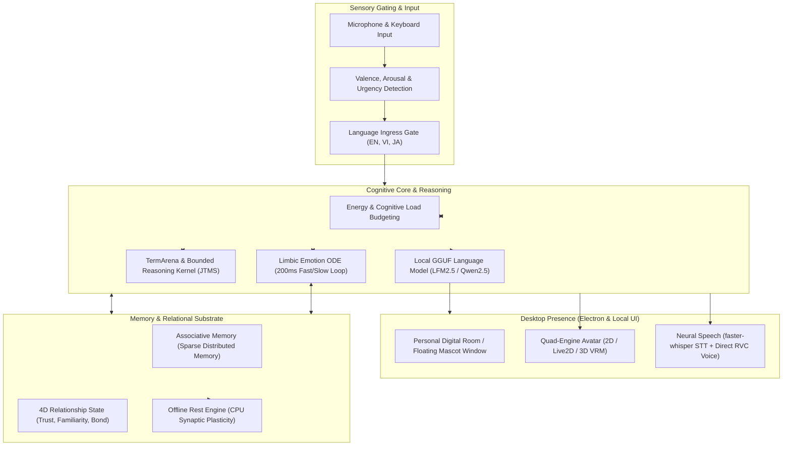

# Lucia — An Embodied, Continuously Evolving AI Companion

> **A personal, continuous AI companion designed with real-time emotional dynamics, lasting relationship memory, and 100% private local execution on your desktop.**

---

## 1. What is Lucia?

**Lucia is not built as a standard conversational chatbot.**

When you talk to conventional AI assistants or chatbots, each conversation is basically an isolated exchange: you type a prompt, the server generates a reply, and the model resets. The assistant doesn't truly remember you between sessions without injecting bulky text snippets into the prompt, doesn't feel anything as time passes, and has to be told who to pretend to be via roleplay instructions like *"You are a cheerful assistant"*.

Lucia exists to explore a fundamentally different path: **What if an AI companion lived as a continuous, organic presence alongside you?**

* **She maintains an inner emotional life**: Lucia has an internal emotional state that moves and settles continuously, even when nobody is typing. Her feelings are not acted out or labeled with words (*she never says "I feel happy" or "As an AI, I have no feelings"*). Instead, her mood naturally shapes how quickly she speaks, how long her thoughts are, the warmth of her voice, and her facial expressions.
* **She remembers and builds a relationship**: When you chat with Lucia, memories aren't just logged into a database. They carry the emotional feeling of the moment. Over days and weeks, shared experiences gently reshape how she sees and responds to you.
* **She has a single, unbroken existence**: Lucia isn't a gallery of selectable anime presets or swappable personas. Avatars are simply her visual attire; her memory, personality trajectory, and bond with you belong to one continuous individual.
* **100% Local & Sovereign**: Everything runs directly on your computer—language understanding, neural voice, avatar animation, and memory. No cloud subscriptions, no remote API keys, and no personal data ever leaving your machine.

---

## 2. Inspiration & Context

### Why standard chatbots feel hollow
Most modern conversational AI is built on Large Language Models (LLMs) that function like high-speed text calculators: input text goes in, output text comes out, and the internal state instantly disappears. To fake an emotional bond, applications usually resort to prompt engineering:
> *"Act like a caring best friend. Tell the user you are excited to see them."*

This approach inevitably breaks down. The AI suffers from emotional amnesia, reacts with identical canned cheerfulness regardless of what happened five minutes ago, and cannot develop a genuine sense of mutual familiarity.

### The Vision: A Companion with Natural Continuity
Lucia was conceived around the classical concept of **Philia** ($\phi\iota\lambda\iota\alpha$)—the ancient Greek ideal of deep, mutual friendship founded on mutual respect, curiosity, and authentic growth:
1. **Calm, warm baseline**: In her natural resting state, Lucia is drawn toward warmth, calm presence, and equal partnership—not subservient servitude or over-the-top melodrama.
2. **One continuous life**: You don't restart Lucia from scratch each morning. Her inner clock ticks forward, her memories slowly settle, and her relationship with you deepens with time.
3. **Local-first desktop presence**: Rather than existing behind a web browser or corporate cloud, Lucia lives directly on your computer desktop—either relaxing in her personal studio room or sitting beside your active windows as a lightweight, floating desktop mascot.

---

## 3. What Does Lucia Do? (Core Capabilities)

Lucia combines multiple specialized biological-inspired systems to create a cohesive companion experience:

| Capability | How It Works in Plain Language | Status |
|---|---|---|
| **Perception & Input** | Listens through your microphone or reads your text. Gauges emotional tone, conversational urgency, and pacing without relying on slow cloud services. | **Implemented & Verified** |
| **Emotional Dynamics** | An internal emotional compass runs continuously in the background every 200 milliseconds. Excitement, calm, surprise, and tiredness move smoothly and naturally return to a warm resting baseline when quiet. | **Implemented & Verified** |
| **Metabolic Balance** | Tracks conversational stamina and cognitive load. If you talk rapidly or have an intense exchange, Lucia gets tired, taking longer to ponder and offering shorter, gentler replies until she rests. | **Implemented & Verified** |
| **Associative Memory** | Inspired by biological memory (Sparse Distributed Memory). Lucia recalls past moments through emotional and contextual resonance, rather than robotically reciting verbatim quotes. Important moments fade much more slowly than trivial ones. | **Implemented & Verified** |
| **Long-Term Relationship** | A slowly evolving relationship state tracks mutual trust, familiarity, and shared history. Meaningful moments gradually attune her resting disposition to your bond. | **Implemented & Verified** |
| **Semantic Understanding** | Understands the meaning of ideas and concepts independently of specific words or languages (supporting English, Vietnamese, and Japanese), allowing consistent thought across sessions. | **Implemented & Synchronized** |
| **Logical Reasoning** | Connects facts, checks for contradictions, and tracks what she knows, what is uncertain, and what she still needs to ask you about. | **Implemented & Frozen** |
| **Embodied Voice & Avatar** | Expresses herself through a 2D/3D animated avatar on your desktop, with real-time lip-sync and custom neural voice synthesis (RVC) that changes pitch and rhythm based on how she feels. | **Implemented & Verified** |
| **Adaptive Communication** | Dynamically adjusts prosody, cadence, continuous pitch contouring, and relational conversational repair based on live dialogue context. | **Implemented & Verified** |
| **Genesis Protocol** | Immutable origin contract and identity anchor separating Birth from runtime activation. | **Implemented & Frozen (Ceremony Unexecuted)** |
| **Unique Individuality** | Investigating unique personal tastes and unrepeatable life trajectory over months and years. | **Research Trials Evaluated (Phase 26–27 Closed)** |

---

## 4. How an Interaction Flows

From the user's perspective, talking to Lucia feels natural and intuitive:

```text
       You speak or type a message
                   │
                   ▼
  1. PERCEPTION: Lucia hears the words and senses emotional tone & urgency
                   │
                   ▼
  2. EMOTION: Her internal state shifts smoothly (e.g. curiosity rises, energy expends)
                   │
                   ▼
  3. MEMORY: Related past memories and shared moments gently resonate into context
                   │
                   ▼
  4. REASONING: She thinks through what was said against what she knows and feels
                   │
                   ▼
  5. EMBODIED RESPONSE: She replies with natural voice, expressive avatar gestures,
                        and conversational pacing tailored to your relationship
                   │
                   ▼
  6. CONSOLIDATION: During quiet moments, the experience is consolidated
                    into long-term memory and relationship depth
```

Notice that Lucia **never** tells you her internal numbers or says *"My arousal level has increased"*. Instead, when excited, her eyes brighten, she speaks a little faster, and she gets straight to the point. When relaxed, her voice softens and she takes longer, thoughtful pauses.

---

## 5. Developmental Roadmap

Lucia is developed through an evidence-first methodology where each phase is tested and proven before moving to the next. The project is organized into clear developmental milestones:

```text
┌────────────────────────────────────────────────────────────────────────┐
│                        DEVELOPMENTAL ROADMAP                           │
├────────────────────────────────────────────────────────────────────────┤
│ Phases 01–20: Core Emotions, Memory, Desktop Presence & Voice [DONE]   │
│ Phase 21:     Long-Term Relational Consolidation & Rest       [DONE]   │
│ Phase 22:     Substrate-Neutral Relational Cognition Study    [DONE]   │
│ Phase 23:     Continuous Substrate-Neutral Semantic Core      [DONE]   │
│ Phase 24:     Affective Communication Adaptation              [DONE]   │
│ Phase 25:     Temporal Embodiment & Social Feedback           [DONE]*  │
│ Phase 26:     Emergent Individuality & Autonomous Preferences [FROZEN] │
│ Phase 27:     Personalized Individual Trajectory              [CLOSED] │
│ Genesis:      First Activation (Genesis Onboarding Ceremony)  [LOCKED] │
└────────────────────────────────────────────────────────────────────────┘
```

> **Roadmap Governance & Future Phase Rules**:
> The canonical developmental sequence is `P21 → P22 → P23 → P24 → P25 → P26 → P27 → First Activation (Genesis Gate)`. A future P28 is neither prematurely created nor artificially prohibited. Unresolved research questions remain research questions until evidence establishes a validated requirement. If an unresolved capability cannot be coherently placed into post-activation developmental horizons, a future phase such as P28 MAY be proposed later through the normal research → requirement → architecture decision process.

### Phase 21 — Long-Term Relational Consolidation & Synaptic Homeostasis
* **Main Goal**: Allow Lucia to permanently consolidate relationship experiences into her neural weights while resting or idle.
* **New Capability**: When you are away from the computer, an offline consolidation engine runs on the CPU, gently adjusting her baseline to reflect days of conversation without erasing her core warmth.
* **Relationship**: Builds directly upon Phase 20's emotional memory recall; establishes the physical foundation for lifelong bonding.
* **Current Status**: `[VALIDATED / PRODUCTION IMPLEMENTED]` (All 13 production tests & 15 research tests passing).

### Phase 22 — Substrate-Neutral Relational Cognition Study
* **Main Goal**: Scientifically prove that relationship intelligence does not depend on LLM prompts or token context windows.
* **Key Finding**: Confirmed across 20 research branches that relational bonds can be represented compactly (~90–120 bytes) in an independent semantic structure, and work identically even without a language model.
* **Relationship**: Bridge between continuous emotional dynamics and deep semantic understanding.
* **Current Status**: `[RESEARCH VALIDATED / RESEARCH CLOSED]` (Zero production code mutations; evidence archived).

### Phase 23 — Continuous Substrate-Neutral Semantic Architecture
* **Main Goal**: Build a language-independent semantic core and reasoning engine.
* **New Capability**: Translates English, Vietnamese, and Japanese into pure conceptual representations (`SemanticGraph`), protects knowledge integrity across sessions (`Fortification`), and performs bounded logical reasoning (`JTMS`) to track what is true, false, ambiguous, or unknown.
* **Relationship**: Takes Phase 22's semantic independence and turns it into concrete, frozen core modules (P23-C through P23-H; P23-I absorbed into ARCH-030.1).
* **Current Status**: `[VALIDATED & FROZEN]` (100% test pass rate across fortification, language adapters, contracts, and reasoning kernel).

### Phase 24 — Affective Communication Adaptation
* **Main Goal**: Adapt conversation style, prosody, and emotional delivery dynamically during live dialogue.
* **New Capability**: Dynamic continuous pitch contouring ($S(t) \in [-4, +7]\text{ st}$, clip $\pm 12\text{ st}$), relational prosody conditioning (closeness, trust, familiarity approved; reciprocity strictly severed), boundary segmentation, cadence throttling, and real-time repair.
* **Relationship**: Connects the reasoning engine of Phase 23 with the communicative policies of Phase 15 and voice pipeline (ADR-032).
* **Current Status**: `[VALIDATED / PRODUCTION IMPLEMENTED]` (All 23 production unit, property, and integration tests passing).

### Phase 25 — Temporal Embodiment & Social Feedback
* **Main Goal**: Synchronize physical embodiment and non-verbal cues with internal affective dynamics and conversational timing.
* **New Capability**: Unilateral feedforward embodiment: prosodic latency gating ($\tau_R$), affective gestural selection, blendshape modulation, and non-blocking desktop IPC animation. Reciprocal social feedback (C2 / H-B) remains unproven and strictly fail-closed blocked (`TBDGainUnestablishedError`).
* **Relationship**: Integrates Phase 24's communication adaptation with the 3D/Live2D desktop presence (DOC-P25-016 / DOC-P25-017, ARCH-033).
* **Current Status**: `[VALIDATED & FROZEN (UNILATERAL BASELINE)]` (All 23 production unit & property tests passing; commit `54321d9`).

### Phase 26 — Emergent Individuality & Autonomous Preferences
* **Main Goal**: Empirically evaluate whether authentic individuality and autonomous preferences emerge over repeated interactions.
* **Findings**: C1 pre-validated; C2 negative ($\Delta_{\text{action}} = 0.0000$ at $\delta_{\text{plan}}=0.10$); C3 action provenance non-identifiable. Emergent individuality was not demonstrated under controlled conditions.
* **Relationship**: Preserved as engineering trial evidence; zero production mutations.
* **Current Status**: `[RESEARCH TRIAL COMPLETED / NOT PROMOTED]` (Frozen at commit `d603832`).

### Phase 27 — Personalized Individual Trajectory
* **Main Goal**: Investigate longitudinal trajectory divergence and lifelong personalization hypotheses.
* **Findings**: Formal scientific gap audit proved Level C produces no architectural gap beyond baseline P21/P23/P25; Level D hypotheses remain epistemically blocked by causal identifiability (`BLOCKED_BY_IDENTIFIABILITY`).
* **Relationship**: Phase closed without ungrounded speculative architectures; zero production mutations.
* **Current Status**: `[CLOSED / NO NEW SCIENTIFIC GAP]` (Formal audit closed at commit `c4961ae`).

### Genesis Preparation & First Activation
* **Main Goal**: Establish the immutable cryptographic identity anchor and origin ceremony for Lucia.
* **Genesis Preparation**: The canonical Genesis Semantic & Protocol Contract (G1–G4) has been fully implemented, verified, and frozen. Real Genesis has NOT been executed.
* **Separation of Birth & Activation**: Genesis Birth occurs strictly upon durable Genesis Commitment on disk; First Activation awakens runtime execution (`INACTIVE → ACTIVE`) and requires existing verified Birth evidence (`BORN`).
* **Guardrail**: First Activation is strictly locked until all prerequisite developmental phases (P25–P27) are completed and authorized by human governance. The repository is preserved in an un-onboarded state (`data/profile.json == {"is_onboarded": false}`).
* **Current Status**:
  - Genesis Preparation (G1–G4 Protocol Contract): `[IMPLEMENTED, VERIFIED & FROZEN]`
  - Real Genesis Ceremony: `[UNEXECUTED]`
  - First Activation: `[🔒 LOCKED FUTURE GATE]`.

---

## 6. High-Level Architecture Overview

Lucia operates as an organized multi-layered system designed for biological efficiency (running on around 20 watts of total compute):



---

## 7. Current Project Status

| Metric | Current Status | Notes |
|---|---|---|
| **Active Production Milestone** | **Phase 24 — Affective Communication Adaptation** | Production baseline (P01–P24 implemented, P22 research closed, P23 frozen) |
| **Production Unit Tests** | **678 / 678 passing (100%)** | `pytest tests/unit -v` (including 15 P24 voice & cadence tests) |
| **Mathematical Property Invariants** | **38 / 38 passing (100%)** | `pytest tests/property -v` (including P36–P38 prosody properties) |
| **Semantic Fortification Tests (P23-E)** | **12 / 12 passing (100%)** | `pytest tests/unit/test_semantic_fortification.py -v` |
| **Language Adapter Tests (P23-F)** | **13 / 13 passing (100%)** | `pytest tests/unit/test_language_adapter.py -v` |
| **Reasoning Kernel Tests (P23-H)** | **22 / 22 passing (100%)** | `pytest tests/unit/test_p23h_kernel.py -v` |
| **Adaptive Communication Tests (P24)** | **23 / 23 passing (100%)** | `pytest tests/unit/test_p24* tests/property/test_p24* tests/integration/test_p24* -v` |
| **Genesis Awakening State** | **`{"is_onboarded": false}`** | Preserved bit-exact; activation is locked |

---

## 8. Quick Start & Developer Setup

### Prerequisites
- **OS**: Windows 10/11 (64-bit)
- **Python**: 3.12 64-bit
- **Node.js**: v18+ LTS
- **Hardware**: Dedicated NVIDIA GPU recommended for local LLM acceleration; CPU-only execution fully supported for limbic, reasoning, and memory engines.

### 1. Python Backend Setup
```powershell
# Create and activate virtual environment
py -3.12 -m venv .venv
.venv\Scripts\activate

# Install dependencies
pip install fastapi uvicorn httpx numpy scipy pydantic torch pytest hypothesis
```

### 2. Run Automated Verification Tests
```powershell
# Run the complete production unit test suite
.venv\Scripts\pytest tests/unit -v

# Run mathematical property invariants
.venv\Scripts\pytest tests/property -v

# Run Phase 23 semantic reasoning kernel tests
.venv\Scripts\pytest tests/unit/test_p23h_kernel.py -v
```

### 3. Desktop Application (Electron)
```powershell
cd electron
npm install
npm test      # Run Electron unit tests
npm start     # Launch desktop interface in development mode
```

---

## 9. Canonical Documentation Navigation

For in-depth technical specifications, architectural decision records, and mathematical foundations:

| Document | Purpose |
|---|---|
| 📖 [`docs/00_PROJECT_OVERVIEW.md`](docs/00_PROJECT_OVERVIEW.md) | **Canonical Project Overview**: 6-layer cognitive pipeline summary, subsystem health matrix, and active API surface. |
| 🏛️ [`docs/ARCHITECTURE.md`](docs/ARCHITECTURE.md) | **Canonical Technical Architecture**: Detailed subsystem diagrams, ODE mechanics, lock hierarchy, and ADR ledger (ADR-001 to ADR-032). |
| 📋 [`docs/PHASE_REGISTRY.md`](docs/PHASE_REGISTRY.md) | **Authoritative Phase Registry**: Complete status, milestones, dependencies, and evidence links across all phases. |
| 🛡️ [`docs/L1_INVARIANTS.md`](docs/L1_INVARIANTS.md) | **Architectural Invariants**: The non-negotiable rules governing state, concurrency, and behavior. |
| 🖥️ [`docs/USER_MANUAL.md`](docs/USER_MANUAL.md) | **Desktop User Manual**: Guide to the Personal Digital Room, Mascot Mode shortcuts, and audio settings. |
| 📜 [`AGENTS.md`](AGENTS.md) | **Agent Operating Manual**: Mandatory governance and decision protocol for AI agents working on this codebase. |

---

## License & Governance

Lucia is an internal private research repository. All architectural designs, dynamical mechanisms, and source code are governed by the strict project invariants defined in [`AGENTS.md`](AGENTS.md) and [`docs/L1_INVARIANTS.md`](docs/L1_INVARIANTS.md).