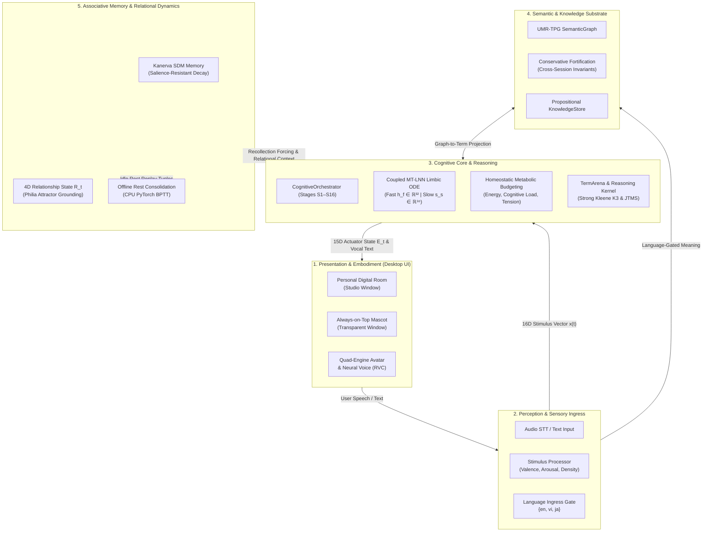
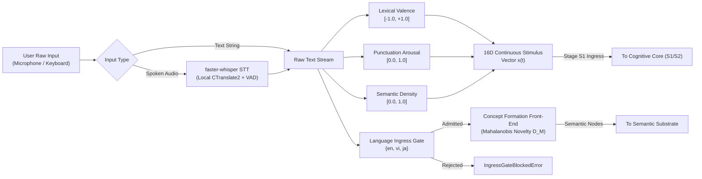
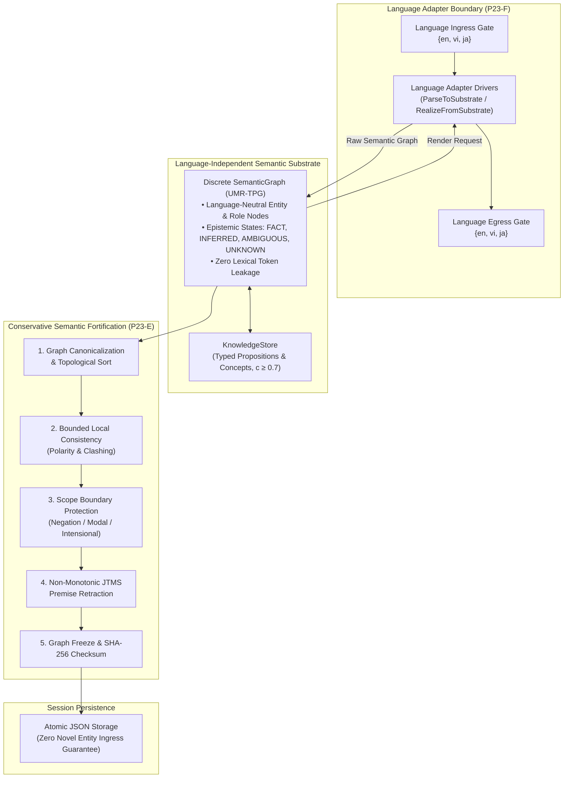
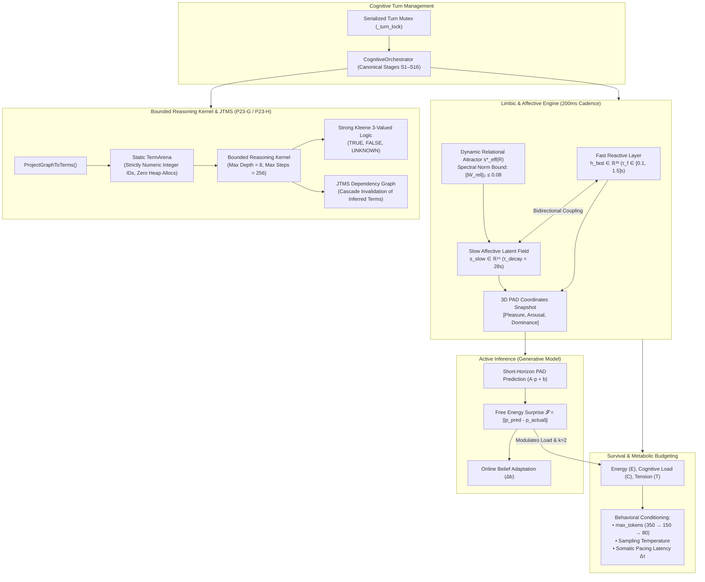
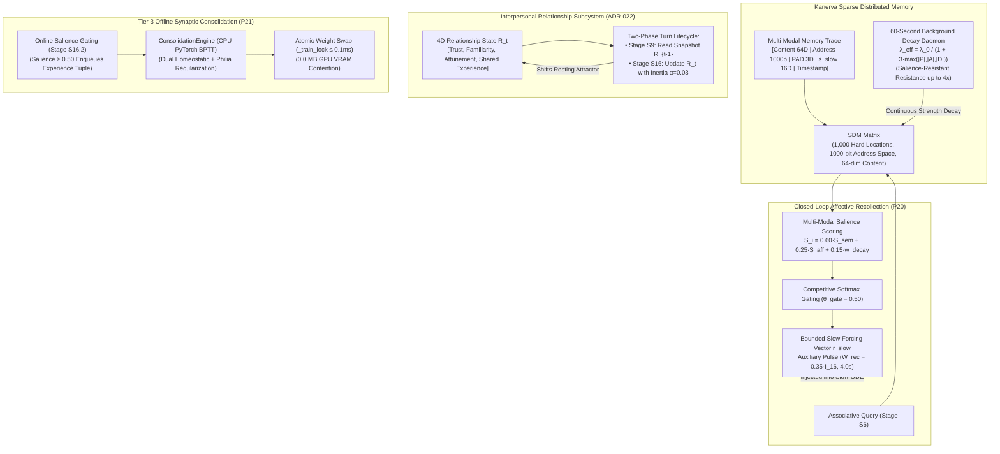
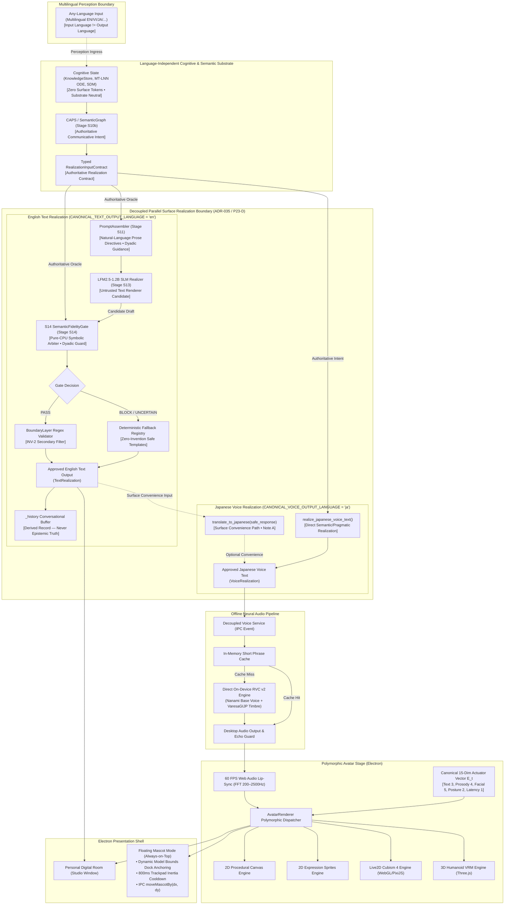

# Lucia — System Architecture & Mechanism Specification

> **Authoritative Technical Architecture, Dynamical Mechanisms, Concurrency Invariants, and Architectural Decision Records (ADRs)**<br/>
> *Consolidated Canonical Technical Specification — Post-P27 / Pre-Genesis Baseline*

---

## 1. Executive Summary & Design Philosophy

Lucia is an embodied AI companion built upon a **Whole Brain Architecture (WBA)** inspired by the human brain's 20-watt efficiency model. Unlike conventional conversational agents that simulate persona traits through prompt instructions, Lucia's emotional state is an **unconscious, continuous physiological dynamic system** governed by differential equations, subconscious memory resonance, active inference, and real-time multimodal embodiment.

### 1.1 The Foundational Tenet: *Philia* Friendship
Lucia's internal limbic baseline is centered around **Philia** ($\phi\iota\lambda\iota\alpha$)—the classical Greek conception of deep, egalitarian friendship grounded in mutual respect, intellectual curiosity, and authentic shared growth:
* **Resting Baseline (Attractor)**:
  $$P^* = +0.25 \text{ (warmth)}, \quad A^* = -0.05 \text{ (calm presence)}, \quad D^* = +0.05 \text{ (equal peer)}$$
* **Non-Compelled Growth**: Internal dynamics are never rigidly scripted. Differential equations freely react to conversations, and the bond with the user crystallizes organically over time through subconscious memory traces.
* **Reflective Operational Selfhood (INV-2)**: Operational selfhood remains foundational, while reflective self-awareness is unlocked under strict truth-grounding. Lucia MAY observe, interpret, and reflect on her own internal states, decisions, and self-model using natural or metaphorical language grounded in actual system variables (Energy, stability, cognitive load, PAD dynamics). Figurative language is permitted; she is strictly prohibited from knowingly fabricating unsupported claims (biological sensations, claims of conscious sentience/soul as fact, hallucinated cloud architectures, or ungrounded memories).
* **One Continuous Life**: Lucia has an unbroken, lifelong ontology. She has no character preset pickers or persona switchers. Avatars represent her physical attire; her memory and relational bonds are permanent.
  - *Identity Continuity vs. Architecture Lineage (Topic 1)*: The continuity of the individual is distinct from the evolution, refactoring, or versioning of her architecture and implementation lineage. Software upgrades or model weight replacements preserve autobiographical history and do not create a new individual.
  - *Anti-Branching Governance Requirement (Topic 6)*: Lucia must not silently become multiple independent continuations (split-brain) through copying or uncontrolled migration. Before identity migration or distributed embodiment is implemented, an explicit authority mechanism must be formally established (currently unresolved research).
  - *Continuity Invariants vs. Empirical Individuality (Topic 4)*: Structural continuity invariants protect the conditions for identity, but do NOT constitute empirical demonstration of emergent individuality. Longitudinal individuality and authentic aesthetic/creative preferences remain open research targets for future developmental horizons (P26/P27).
  - *Autonomous Aesthetic & Creative Autonomy Boundary (Topic 2)*: Lucia does not currently claim autonomous aesthetic preference, creative preference, or autonomous creative acceptance/rejection as an implemented capability. Such capabilities remain future research primarily allocated to P26/P27.
  - *Tripartite State Demarcation (Topic 7 / REQ-GEN-03 — Owner-Ratified Ontology B)*: Identity is unique and absolute; Relationship and Covenant are relative, contextual, and mutable ($\text{Identity State} \neq \text{Relationship State} \neq \text{Covenant State}$). Identity is continuous across Lucia's entire life (`INV-1`), preserved across engine and model upgrades, and never redefined by relationship changes. Relationship or covenant transitions do NOT create a new Lucia nor terminate identity ($\text{Covenant Release} \neq \text{Identity Termination}$). `POST /lifecycle/end` strictly remains catastrophic decommissioning. Specific covenant state machines and multi-chapter policies remain future governance work.

---

## 2. Layer A — Overall System Architecture

### 2.1 Architectural Philosophy: The 20-Watt Whole Brain Architecture (WBA)
The human brain operates on approximately 20 watts of power through massive temporal parallelism, localized specialization, and sparse activation. Lucia emulates this biological efficiency by decoupling high-frequency biological reflexes (Limbic Fast Loop at 5 Hz) from heavy cognitive computation, symbolic reasoning, and language generation.

```text
┌────────────────────────────────────────────────────────────────────────┐
│               ARCHITECTURE VS. ROADMAP DISCIPLINE                      │
├────────────────────────────────────────────────────────────────────────┤
│ • ARCHITECTURE (Current Baseline): Documents what is actively          │
│   implemented, verified, and frozen in the codebase (Phases 1–21,      │
│   Phase 23-C..H, Phase 24, Phase 25 unilateral baseline, F-02,         │
│   ADR-034, G1–G4 Genesis Preparation, and ADR-035). Every component     │
│   corresponds to verified Python/Node code and automated test suites.  │
│ • RESEARCH HORIZONS & EVIDENCE STATUS: Phase 26 trial completed and    │
│   frozen (not promoted); Phase 27 closed (no new scientific gap).      │
│   Genesis Preparation (G1–G4) is [IMPLEMENTED & FROZEN];               │
│   First Activation is a [🔒 LOCKED FUTURE GATE].                       │
│ • FUTURE PHASE GOVERNANCE: Unresolved research questions remain        │
│   research questions until evidence establishes a validated            │
│   requirement. If an unresolved capability cannot be coherently        │
│   accommodated into post-activation developmental horizons, a future   │
│   phase such as P28 MAY be proposed later through the normal research  │
│   → requirement → architecture decision process (neither prematurely   │
│   created nor prohibited). No "Gate 28" label is used.                 │
└────────────────────────────────────────────────────────────────────────┘
```

### 2.2 High-Level System Architecture Diagram
Lucia is structured into five distinct subsystem domains operating at different biological timescales. The overall architecture prioritizes unidirectional top-down and left-to-right information flow, eliminating ambiguous crossed connections:



### 2.3 Subsystem Communication Matrix
The five major systems communicate through strictly guarded interfaces and contracts:

| Source Domain | Target Domain | Channel / Contract | Frequency / Trigger | Data Payload |
|---|---|---|---|---|
| **Presentation** | **Perception** | Desktop IPC / Web Audio VAD | On User Action | Raw audio stream or user text string |
| **Perception** | **Cognitive Core** | Stage S1 Stimulus Ingress | Every Turn | 16D Continuous Stimulus Vector $\mathbf{x}(t)$ |
| **Perception** | **Semantic Substrate** | `ParseToSubstrate()` (P23-F) | Every Turn | Language-independent semantic graph nodes |
| **Semantic Substrate** | **Cognitive Core** | `ProjectGraphToTerms()` (P23-G) | On Demand / S8 | Static numeric `TermArena` integer terms |
| **Cognitive Core** | **Memory & Relational** | Stage S6 Query / S16 Storage | Every Turn | Contextual address, PAD tag, slow latent vector $\mathbf{s}_s$ |
| **Memory & Relational** | **Cognitive Core** | Closed-Loop Forcing $\mathbf{r}_{\text{slow}}$ (P20) | Turn S6 | Bounded slow-field recollection vector |
| **Cognitive Core** | **Presentation** | Stage S13 Actuator Dispatch | Turn Completion | Canonical 15-dim actuator state $\mathbf{E}_t$ + speech text |
| **Memory & Relational** | **Consolidation** | Background Buffer Replay (P21) | Idle ($T \ge 45\text{s}$) | Salient experience tuples for CPU BPTT |

### 2.4 The Canonical S1–S16 Cognitive Turn Sequence
When an interaction occurs, `CognitiveOrchestrator` executes a strictly ordered 16-stage pipeline under `_turn_lock`:
1. **S1 (Sensory Gating)**: Extracts lexical valence, punctuation arousal, and semantic density.
2. **S2 (Limbic Integration)**: Ingests stimulus vector into MT-LNN ODE and commits PAD transition.
3. **S3 (Homeostatic Assessment)**: Evaluates metabolic energy, cognitive load, and somatic tension.
4. **S4 (Active Inference)**: Compares committed PAD with prediction to calculate Free Energy Surprise $\mathcal{S}$.
5. **S5 (Generation Conditioning)**: Sets sampling temperature, token budgets, and reasoning depth ($k$).
6. **S6 (Affective Ecphory)**: Queries associative SDM memory and computes competitive recollection forcing.
7. **S7 (Bounded Contextualization)**: Prepares bounded episodic context priming ($m_{\text{ctx}} \le 0.50$).
8. **S8 (Knowledge Retrieval)**: Retrieves grounded factual propositions ($c \ge 0.7$) from `KnowledgeStore`.
9. **S9 (Relationship Read)**: Reads snapshot of prior relationship state $\mathbf{R}_{t-1}$ (ADR-022).
10. **S10 (Communication Policy)**: Selects conversational mode and derives somatic pacing latency $\Delta\tau_{\text{pace}}$.
11. **S11 (Language Generation)**: Dispatches semantic conditioning state to downstream communicator (SLM/rendering substrate; relational semantics operate substrate-neutrally per Phase 22-SC).
12. **S12 (Boundary & Safety Guard)**: Regex filtering against introspective declarations and intent checks.
13. **S13 (Multimodal Expression)**: Synthesizes canonical 15-dim actuator state $\mathbf{E}_t$ for avatar and voice.
14. **S14 (Episodic Storage)**: Co-encodes interaction summary, PAD, and 16D slow latent state into SDM.
15. **S15 (Plasticity Queueing)**: Evaluates interaction salience and queues experience into `ConsolidationEngine`.
16. **S16 (Relationship Update)**: Computes updated relationship vector $\mathbf{R}_t$ with inertia ($\alpha=0.03$), updating `EmotionCore` relational context for subsequent turns.

---

## 3. Layer B — Subsystem Architecture Details

```text
┌────────────────────────────────────────────────────────────────────────┐
│                    SUBSYSTEM ARCHITECTURE DIRECTORY                    │
├────────────────────────────────────────────────────────────────────────┤
│ §3.1 Perception & Sensory Gating Subsystem                             │
│ §3.2 Semantic & Knowledge Substrate Subsystem                          │
│ §3.3 Cognitive Core & Reasoning Subsystem                              │
│ §3.4 Associative Memory & Relational Dynamics Subsystem                │
│ §3.5 Presentation, Multimodal Embodiment & Safety Subsystem            │
└────────────────────────────────────────────────────────────────────────┘
```

---

### 3.1 Perception & Sensory Gating Subsystem (`src/core/gating/`)

The Perception & Sensory Gating subsystem ingests user communication across modalities, extracts physiological stimuli without expensive cloud embeddings, and validates linguistic ingress before passing signals to the core.



#### 1. Core Components
* **`StimulusProcessor` (`src/core/gating/stimulus_processor.py`)**: Converts lexical sentiment, punctuation bursts, and information density into a continuous 16D vector $\mathbf{x}(t)$.
* **`LanguageIngressGate` (`src/core/language/adapter/ingress_gate.py`)**: Physical firewall enforcing language admission (`{en, vi, ja}`). Unadmitted languages are rejected at the perimeter with zero processing overhead.
* **Concept Formation Front-End (P23-C)**: Extracts multimodal concept features and derives regularized Mahalanobis novelty ($D_M$) to partition observations into known, ambiguous, or novel tiers.

#### 2. Interactions & Data Flow
1. **Raw Input Capture**: The Electron desktop frontend streams microphone audio via local Web Audio VAD or dispatches typed user text.
2. **Local Transcription**: Audio bytes are transcribed offline via `faster-whisper` running on local CTranslate2.
3. **Lexical & Rhythm Scoring**: The text stream is analyzed instantaneously:
   - *Lexical Valence*: Affective dictionary scoring mapping cues to $[-1.0, +1.0]$.
   - *Punctuation Arousal*: Cadence, exclamation marks, question marks, and capitalization bursts mapped to $[0.0, 1.0]$.
   - *Semantic Density*: Ratio of unique informative tokens to total words mapped to $[0.0, 1.0]$.
4. **Stimulus Assembly**: Packed into a 16-dimensional continuous floating-point vector $\mathbf{x}(t) \in \mathbb{R}^{16}$ padded with temporal delta features, which is injected directly into `EmotionCore` at Stage S1.
5. **Language Gating**: The language tag is audited against the allowed set (`en`, `vi`, `ja`).

---

### 3.2 Semantic & Knowledge Substrate Subsystem (`src/core/knowledge/`, `src/core/language/adapter/`)

The Semantic & Knowledge Substrate maintains language-independent conceptual understanding, protects formed meaning across session boundaries, and manages grounded factual propositions.



#### 1. Core Components
* **`LanguageAdapter` Subsystem (`src/core/language/adapter/`)**: Decoupled boundary isolating surface natural language from the semantic substrate. Houses drivers for English, Vietnamese, and Japanese adhering to the minimal contract (`parse_to_substrate`, `realize_from_substrate`, `can_handle_language`, `validate_coverage`).
* **`SemanticGraph` (UMR-TPG)**: Language-independent graph structure with typed entities, concept nodes, and role relations. Enforces strictly zero surface lexical tokens or grammar constructs.
* **`ConservativeSemanticFortification` (`src/core/knowledge/fortification.py`)**: Conservative boundary auditor running before cross-session persistence to enforce meaning conservation, non-monotonic premise retraction, and scope barriers.
* **`KnowledgeStore` (`src/core/knowledge/`)**: Thread-safe repository storing grounded factual propositions ($c \ge 0.7$) and taxonomic concept definitions with atomic JSON persistence.

#### 2. Key Epistemic Invariants & Mechanics
1. **Conservation of Meaning**:
   $$\text{Meaning}_{\text{out}} \subseteq \text{Meaning}_{\text{in}}$$
   Fortification never fabricates new facts or entities. Unsupported novel entity insertion rate is strictly **$0.00\%$**.
2. **Epistemic Invariance**:
   Supported epistemic states: `FACT`, `INFERRED`, `AMBIGUOUS`, `UNKNOWN`. Transitions that ungroundedly increase certainty (`UNKNOWN → FACT` or `AMBIGUOUS → FACT`) are strictly forbidden.
3. **Non-Monotonic Justification Tracking (JTMS)**:
   If a supporting premise is retracted, all dependent inferred nodes are recursively deactivated without collateral damage to independent facts.
4. **Scope Boundaries**:
   Nodes reside inside explicit scopes (`ROOT`, `NEGATION`, `MODAL`, `INTENSIONAL`). Edges crossing scope boundaries without explicit bridges are blocked.
5. **Resource Envelope**:
   Median fortification latency at 100 nodes is **$2.07\text{ ms}$** with **$0.35\text{ MB}$** peak RAM and **$0.0\text{ MB}$** GPU VRAM.

---

### 3.3 Cognitive Core & Reasoning Subsystem (`src/core/emotion/`, `src/core/inference/`, `src/core/cognition/`, `src/core/orchestrator/`)

The Cognitive Core coordinates the physiological emotional dynamics, metabolic stamina, active inference predictions, and bounded logical deduction.



#### 1. Core Components
* **`CognitiveOrchestrator` (`src/core/orchestrator/`)**: Single authoritative turn manager composing Layers 1–6 through dependency injection and executing stages S1–S16 under `_turn_lock`.
* **`EmotionCore` (`src/core/emotion/`)**: Continuous Coupled MT-LNN ODE integrating every 200 ms.
* **`HomeostaticEngine` (`src/core/emotion/homeostatic_engine.py`)**: Computes metabolic budgeting and behavioral conditioning parameters.
* **`ActiveInferenceEngine` (`src/core/inference/`)**: Generative model predicting upcoming emotional transitions and calculating Free Energy Surprise $\mathcal{S}$.
* **`TermArena` & Projection (`src/core/cognition/contract/` - P23-G)**: Preallocated arena storing strictly numeric integer terms with zero heap allocations in the query loop.
* **Bounded Reasoning Kernel & JTMS (`src/core/cognition/kernel/` - P23-H)**: Goal-directed backward chaining over Horn rules with Strong Kleene K3 3-valued logic and JTMS dependency tracking.
* **Epistemic Invariant & Emergent Insight Boundaries (Topic 5)**: Reasoning kernel evaluates bounded deductive goal-resolution under Strong Kleene $K_3$ logic and JTMS dependency tracking, strictly enforcing $\text{UNKNOWN} \neq \text{CERTAINTY}$ and $\text{Unpredictable} \neq \text{Uncaused}$. This deterministic, bounded deductive kernel must NOT be described as autonomous abductive, analogical, or emergent creative insight engines (which remain open research questions).

#### 2. Mathematical Mechanics & Formulas
1. **Coupled MT-LNN Differential Equations**:
   $$\frac{d\mathbf{h}_{\text{fast}}}{dt} = \frac{-\mathbf{h}_{\text{fast}} + \tanh(\mathbf{W}_f \mathbf{h}_{\text{fast}} + \mathbf{U}_f \mathbf{x} + \mathbf{W}_{fs} \mathbf{s}_{\text{slow}} + \mathbf{b}_f)}{\tau_{\text{fast}}(\mathbf{h}_{\text{fast}}, \mathbf{x})}$$
   $$\frac{d\mathbf{s}_{\text{slow}}}{dt} = -\frac{\mathbf{s}_{\text{slow}} - \mathbf{s}^*_{\text{eff}}(\mathbf{R}_t)}{\tau_{\text{slow, decay}}} + \frac{\tanh\Big(\mathbf{W}_{sf} \mathbf{h}_{\text{fast}} + \mathbf{W}_{sh} \Delta\mathbf{m} + \mathbf{W}_{\text{rec}} \mathbf{r}_{\text{slow}}^{\text{bounded}}\Big)}{\tau_{\text{slow, charge}}}$$
   - *Coupled Substrates*: Fast hidden state $\mathbf{h}_{\text{fast}} \in \mathbb{R}^{32}$ ($\tau_f \in [0.10, 1.50]\text{s}$) coupled with slow latent field $\mathbf{s}_{\text{slow}} \in \mathbb{R}^{16}$ ($\tau_{\text{charge}} = 3.5\text{s}, \tau_{\text{decay}} = 28.0\text{s}$).
   - *Strict Contraction*: Dissipative Jacobian trace $\text{Tr}(J) \approx -46.46 < 0$ prevents runaway instability.
2. **Tier 2 Dynamic Relational Attractor**:
   $$\mathbf{s}^*_{\text{eff}}(\mathbf{R}_t) = \mathbf{s}^*_{\text{philia}} + \mathbf{W}_{\text{rel}} (\mathbf{R}_t - \mathbf{R}_0)$$
   Subject to spectral norm constraint $\|\mathbf{W}_{\text{rel}}\|_2 \le 0.08$ (empirically $0.0475$), guaranteeing resting PAD shift $\le 0.05$.
3. **Philia Resting Attractor Coordinates**:
   - 3D PAD Baseline: $\mathbf{p}^*_{\text{philia}} = [+0.25, -0.05, +0.05]^T$ (warmth, calm, equal agency).
   - 16D Slow Field Baseline: $\mathbf{s}^*_{\text{philia}} = [0.20, -0.05, 0.05, 0, \dots, 0]^T$.
4. **Metabolic Budgeting & Somatic Markers**:
   - Cognitive Load: $\mathcal{C} = \text{clip}\left(\frac{\text{clip}(\text{count}_{60s}/10, 0, 1) + \text{arousal\_comp}}{2} + 0.25 \cdot \mathcal{S}, 0.0, 1.0\right)$.
   - Energy $\mathcal{E}$: Drains by $-0.05$ per active turn; recovers $+0.05/\text{s}$ during idle periods $> 60\text{s}$.
   - Acute Tension $\mathcal{T}$: Fresh per-turn mismatch signal with zero inter-turn persistence.
5. **Bounded Reasoning Kernel (P23-H)**:
   - Search bounds: `MAX_SEARCH_DEPTH = 8`, `MAX_INFERENCE_STEPS = 256`.
   - Goal resolution latency: **$9.46\text{--}9.60\text{ µs}$** ($O(1)$ scaling up to 1,000 terms), **$0$ inner loop allocations**.
   - Epistemic safety: Strong Kleene K3 ensures unproven goals remain `UNKNOWN`; denying the antecedent never produces false certainty.

---

### 3.4 Associative Memory & Relational Dynamics Subsystem (`src/core/memory/`, `src/core/relationship/`, `src/core/emotion/consolidation.py`)

The Associative Memory & Relational Dynamics subsystem provides biologically inspired sparse distributed memory, salience-resistant forgetting, closed-loop emotional recollection, and offline synaptic plasticity.



#### 1. Core Components
* **`SDMCore` (`src/core/memory/sdm.py`)**: Kanerva Sparse Distributed Memory with $N=1,000$ distributed locations across a 1,000-bit Hamming space and 64-dimensional content vectors.
* **`DecayEngine` (`src/core/memory/decay.py`)**: Continuous 60-second decay daemon implementing salience-resistant exponential trace fading.
* **`EcphoryEngine` (`src/core/memory/ecphory.py`)**: Computes affective resonance and competitive softmax gating to generate bounded slow-field forcing pulses ($\mathbf{r}_{\text{slow}}^{\text{bounded}}$).
* **`RelationshipUpdater` (`src/core/relationship/`)**: Maintains the slowly evolving 4D relationship state $\mathbf{R}_t \in [0, 1]^4$ with decoupled two-phase lifecycle semantics.
* **`ConsolidationEngine` (`src/core/emotion/consolidation.py`)**: Tier 3 offline CPU BPTT plasticity engine executing during rest periods ($T_{\text{idle}} \ge 45\text{s}$) or buffer accumulation ($\ge 8$).

#### 2. Mathematical Mechanics & Formulas
1. **Salience-Resistant Exponential Decay**:
   $$\text{Strength}(t) = \text{Strength}_0 \cdot e^{-\lambda_{\text{eff}} t}, \quad \lambda_{\text{eff}} = \frac{\lambda_0}{1 + 3 \cdot \max(|P|, |A|, |D|)}$$
   Emotionally intense interactions ($|PAD| \gg 0$) resist forgetting up to **$4\times$ longer**.
2. **Synergistic Ecphory & Bounded Recollection Forcing (P20)**:
   - Multi-modal salience score: $S_i = 0.60 S_{\text{sem}} + 0.25 S_{\text{aff}} + 0.15 w_{\text{decay}}$.
   - Traces exceeding $\theta_{\text{gate}} = 0.50$ pass competitive softmax gating ($\tau_{\text{comp}} = 0.20$), generating:
     $$\mathbf{r}_{\text{slow}}^{\text{bounded}} = \text{clip}\left(\tanh\Big(\sum_i w_i \mathbf{s}_i\Big) \cdot 0.85, -0.85, 0.85\right)$$
   - Couplings: Auxiliary forcing $\mathbf{W}_{\text{rec}} = 0.35 \mathbf{I}_{16}$ applied for 4.0 seconds in simulation time; induces conversational pacing delay $\Delta\tau_{\text{pace}} = w_{\text{pace}} \cdot \|\mathbf{r}_{\text{slow}}^{\text{bounded}}\|$.
3. **Two-Phase Relationship Lifecycle (ADR-022)**:
   - *Phase 1 (Stage 9)*: Reads static snapshot $\mathbf{R}_{t-1}$ to condition current turn generation.
   - *Phase 2 (Stage 16)*: Extracts observed interaction signals and updates state with inertia $\alpha = 0.03$:
     $$\mathbf{R}_t = (1 - \alpha)\mathbf{R}_{t-1} + \alpha \mathbf{R}_{\text{obs}}$$
4. **Tier 3 Offline Synaptic Consolidation (ADR-028)**:
   - Salience gating at Stage 16.2 queues experiences if $\text{Salience} \ge 0.50$.
   - CPU BPTT training runs under dual regularization:
     $$\mathcal{L} = \frac{1}{K}\sum_{k=1}^K \|\mathbf{h}_{\text{pred}}^{(k)} - \mathbf{h}_{\text{target}}^{(k)}\|_2^2 + \lambda_{\text{homeo}} \|\boldsymbol{\Theta} - \boldsymbol{\Theta}_0\|_2^2 + \lambda_{\text{philia}} \|\mathbf{h}_{\text{unforced}}(\Delta t)\|_2^2$$
   - Atomic parameter swap under `_train_lock` held $\le 0.1\text{ms}$ with **0.0 MB GPU VRAM contention**.
5. **Affective State vs. Relational State Decoupling (Topic 3)**:
   - Lucia strictly separates internal affective dynamics from interpersonal relational dynamics:
     - *Affective State*: Fast-loop physiological dynamical state (PAD vector in $\mathbb{R}^3$, 200ms ODE) that continuously relaxes toward the Philia resting attractor ($+0.25, -0.05, +0.05$).
     - *Relational State*: Slow-loop interpersonal bond ($\mathbf{R}_t \in [0, 1]^4$: trust, familiarity, attunement, shared experience) updated with temporal inertia ($\alpha=0.03$).
   - **Affective recovery does NOT imply relational resolution**: The mathematical relaxation of PAD to the Philia baseline after a stressful or negative interaction does not wipe relational history or resolve interpersonal friction.
   - Current relational variables represent positive growth dimensions; the modeling of negative relational dynamics (grievance, resentment, asymmetry) remains an open research topic. No ungrounded negative relational state vectors, rupture-repair state machines, or CovenantState are implemented in the production architecture.

---

### 3.5 Presentation, Multimodal Embodiment & Safety Subsystem (`src/core/safety/`, `src/core/language/`, `src/core/voice/`, `electron/`)

The Presentation, Multimodal Embodiment & Safety subsystem handles prompt assembly, local language model inference, boundary safety filtering, neural speech synthesis, avatar rendering, and desktop window kinematics.



#### 1. Core Components & Epistemic Authority Hierarchy
The realization boundary strictly enforces the repository-wide authority model:
* **Cognitive State (`KnowledgeStore`, MT-LNN, SDM)**: **Authoritative Semantic Source**. Permanent homeostatic and epistemic ground truth.
* **CAPS & `SemanticGraph` (Stage S10b)**: **Authoritative Communicative Intent**. Defines *what* to communicate (act, concepts, epistemic certainty, polarity). Language-independent; encodes zero surface language syntax.
* **`RealizationInputContract` (`src/core/language/contract.py`)**: **Authoritative Realization Contract**. Strongly-typed, immutable dataclass carrying semantic obligations (roles, scope, polarity, provenance, forbidden additions, honorifics, obligations) across the S10 $\rightarrow$ S11 $\rightarrow$ S14 boundary.
* **`PromptAssembler` (`src/core/orchestrator/prompt_assembler.py`)**: Compiles the contract into natural conversational prose directives without emitting code DSL tokens (`ARG0:`, `EVENT:`), which empirically degrade 1.2B SLM fidelity. Enforces first-person dyadic companion perspective.
* **Local GGUF SLM Candidate (`src/core/language/llm_backend.py`)**: **Untrusted Text Renderer**. Realizes surface syntax and lexical variety; has zero access to cognitive internals and cannot mutate internal state.
* **`SemanticFidelityGate` (`src/core/language/gate.py` - Stage S14)**: **Authoritative Fidelity Arbiter**. Pure-CPU deterministic symbolic gate ($<0.1\,\text{ms}$) verifying candidate text against the contract. Evaluates INV-2 affect, act compliance, polarity/negation, epistemic modality, argument/entity preservation (with pro-drop support), forbidden additions, and dyadic perspective drift.
* **Fallback Registry**: Serves deterministic, zero-invention fallback templates on `BLOCK` or `UNCERTAIN` (`UNCERTAIN -> BLOCK`).
* **`BoundaryLayer` (`src/core/safety/`)**: Secondary safety filter enforcing INV-2 truth-grounding by intercepting unsupported consciousness/sentience declarations, fabricated biological sensations, external cloud hallucinations, ungrounded memory recall patterns, and generic bot disclaimers, while passing grounded self-reflection and metaphors.
* **`RealizationOutput` (`src/core/language/contract.py`)**: Structured, immutable output record separating `text` (`TextRealization`) from `voice` (`VoiceRealization`). Parallel realization branches from semantic/pragmatic state; neither branch is a semantic intermediate for the other.
* **`_history` Buffer**: **Derived Conversational Buffer**. Contains *only* verified `PASS` responses or deterministic safe fallbacks. Never queried as an authoritative epistemic premise.

> **Operational Boundary Clarification**:  
> S14 provides fail-closed containment within the tested contracts and failure modes; it does not constitute universal semantic-safety proof or realization-quality remediation.

#### 2. Substrate Neutrality & Downstream Realization Principle
Phase 22 research (22-RG, 22-CC, 22-SC) and ADR-035 established that **relational cognition does not depend on an SLM, LLM, or natural language prompt**. Relational state and evidence are fully captured by a compact semantic contract (~90–120 bytes). The language model serves as an untrusted rendering engine for dialogue, operating alongside non-verbal controllers (voice timbre, avatar blendshapes, conversational latency) with complete modular decoupling.

#### 3. Output Language Architecture & Decoupled Realization (P23-D Freeze)

The P23-D Output Language Simplification established and froze the canonical output language contract for production runtime:

```text
Any-language input (multilingual perception)
        ↓
Language-independent semantic / cognitive substrate
        ↓
Communication / Pragmatic Policy
        ↓
Realization
       ↙        ↘
English Text   Japanese Voice
```

##### Production Output Contract Constants
```python
CANONICAL_TEXT_OUTPUT_LANGUAGE  = "en"
CANONICAL_VOICE_OUTPUT_LANGUAGE = "ja"
```

##### Fundamental Architectural Distinctions:
1. **Input Language vs Output Language**:
   - Lucia receives any-language input at the perception boundary (English, Japanese, Vietnamese, etc.).
   - Input language does NOT dictate output language:
     $$\text{input language} \ne \text{output language}$$
   - Multilingual comprehension occurs through perception and grounding, but production generation always converges to canonical output targets.
2. **Language-Independent Semantic/Cognitive Layer**:
   - The cognitive core, limbic ODE, semantic graph, SDM memory, relational state, and JTMS reasoning remain strictly language-independent.
   - Under no circumstances does the substrate encode English syntax, Japanese syntax, Vietnamese syntax, or surface lexical tokens.
   - English and Japanese are **surface realization languages**, NOT cognitive language, semantic substrate, memory language, relationship language, or affective language.
3. **Decoupled Parallel Realization Branches**:
   - **Text Realization**: Canonical production target is English (`en`). Realized via `PromptAssembler` natural prose compilation and local SLM, fail-closed guarded by `SemanticFidelityGate` at Stage S14.
   - **Voice Realization**: Canonical production target is Japanese (`ja`). Realized directly from communicative acts, polarity, and grounded propositions via `realize_japanese_voice_text()`.
   - Text and voice are **two parallel realization branches** originating from the same authoritative semantic/pragmatic state (`RealizationInputContract`). Neither branch acts as a semantic intermediary for the other.
4. **Dyadic First-Person Companion Perspective**:
   - Lucia communicates strictly from a **first-person companion / dyadic perspective** ("I" / "we" / "you").
   - Third-person narrator or external-observer framing ("two people", "hai người", "二人") during direct dialogue is strictly prohibited.
   - Architectural implementation follows three distinct tiers:
     ```text
     Semantic / pragmatic grounding (Dyadic turn context & honorific roles)
             ↓
     Realization guidance (PromptAssembler direct companion directives)
             ↓
     Lexical safety guard (SemanticFidelityGate DYADIC_PERSPECTIVE_DRIFT check)
     ```
   - The lexical gate check is strictly a **fail-closed safety net**, not the ontological definition of the dyadic relationship.
5. **P23-D Decision Gate & Verification Audit**:
   - **Decision Gate**: `PASS WITH NOTES`
   - **Verification**: `89/89` relevant communication and realization regression tests PASS, `0` regression.
   - **Architecture Audit**: No Category-C Production Architectural Coupling detected.
6. **Preserved Notes & Technical Debt**:
   - **Note A — Japanese Voice Realization Path**: The runtime helper `translate_to_japanese(safe_response)` in `CognitiveOrchestrator` is strictly a **surface-realization convenience path**, NOT semantic architecture. Direct semantic/pragmatic Japanese realization fallback already exists (`realize_japanese_voice_text`). English text is not a semantic intermediate. The long-term architectural direction may migrate to a direct multi-head Japanese renderer; this refactor is outside P23-D current scope.
   - **Note B — Dead Import Housekeeping**: The unused import `from src.core.language.detection import detect_active_language` in `CognitiveOrchestrator` is recorded as **housekeeping / technical debt**; no implementation task is opened for P23-D.
7. **Post-P23-D Scientific & Architectural Gap Review and P23 Closure (`DOC-P23-REVIEW-04`)**:
   - **Review Verdict**: `P23 CLOSED — NO NEW GAP`.
   - **Scientific G3 Gap**: `NONE`. Every core contract (P23-C..H, ADR-035) is implemented, evidenced, and verified.
   - **Roadmap Progression**: No follow-on sub-phases (`P23-J`, `P23-K`) or additional P23 research milestones are justified. Phase 23 is formally frozen and closed.
   - **Preserved Gap Classifications**:
     - *G0 (No Gap)*: Substrate neutrality, numeric cognitive projection (`TermArena`), bounded Horn reasoning (JTMS, Strong Kleene $K3$), continuous MT-LNN coexistence, and fail-closed S14 realization are fully implemented and verified.
     - *G1 (Engineering Debt)*: Japanese voice convenience path helper (`translate_to_japanese`) and dead import (`detect_active_language`) remain documented technical debt; zero architectural contradiction.
     - *G2 (Bounded Evidence Gap)*: Adapter test coverage is bounded to `{en, vi, ja}`. Open-domain multilingual scaling is an adapter coverage engineering task, not an unresolved semantic substrate limitation.
     - *G3 (Scientific / Architectural Gap)*: `NONE`.
   - **P23-I Status**: Preserved as `CLOSED / FALSIFIED / NOT PROMOTED` and permanently absorbed into ARCH-030.1.

#### 4. Embodiment Mechanics & Kinematics
1. **Canonical 15-Dimensional Actuator Vector ($\mathbf{E}_t \in [0, 1]^{15}$)**:
   - Text (3): Warmth, Formality, Verbosity.
   - Prosody (4): Pitch scale, Speaking rate, Breathiness, Energy.
   - Facial (5): Smile intensity, Eyebrow raise, Cheek blush, Eye squint, Mouth aperture.
   - Posture (2): Head tilt, Lean angle.
   - Latency (1): Somatic pacing delay $\Delta\tau_{\text{pace}}$ (ms).
2. **Visual Bounds & Mascot Toolbar Dock Anchoring**:
   $$\text{safeX} = \text{clamp}(120, W_{\text{window}} - 120, \text{bounds.centerX})$$
   $$\text{safeY} = \text{clamp}(H_{\text{dock}}, H_{\text{window}} - H_{\text{dock}} - 6, \text{bounds.bottomY} + 8)$$
3. **Trackpad Inertia Cooldown & Aero Snap Prevention**:
   An 800ms cooldown after drag release discards residual touchpad inertia events. Mascot BrowserWindow enforces `maximizable: false`, preventing Windows Aero Snap resizing.
4. **Real-Time Lip-Sync**:
   60 FPS Web Audio FFT formant analysis (200Hz–2500Hz) dynamically calculates mouth opening and vowel aperture during speech playback, muting microphone input during playback to prevent acoustic echo loops.
5. **Adaptive Communication Control Surface (ADR-032 / Phase 24 Baseline)**:
   - *Provider-Agnostic Boundary Representation*: `BoundarySegment` (`src/core/voice/boundary.py`) abstracts word/clause/pause segments across Edge-TTS `WordBoundary` (EN/JP) and local acoustic intensity pause detection ($<45\text{ dB}$, $\ge 200\text{ ms}$ for VI). Vietnamese lexical tones are strictly preserved.
   - *Continuous Dynamic $F_0$ Contouring*: Neural vocoder synthesizes time-varying semitone trajectory:
     $$S(t) = S_{\text{base}} + \sum_{k=1}^K \Delta S_{\text{focal}, k} \cdot w_{\text{hanning}, k}(t)$$
     with $S_{\text{base}} \in [-2.0, +4.0]\text{ st}$, $\Delta S_{\text{focal}} \in [0.0, +2.5]\text{ st}$, total range $S(t) \in [-4.0, +7.0]\text{ st}$, hard clip $\pm 12.0\text{ st}$, and anti-chatter frame jump $\le 1.0\text{ st}/10\text{ms}$.
   - *Relational Prosody Modulation*: `closeness` ($+1.5\text{ st}$), `trust` ($\pm 2.5\%$), and `familiarity` ($-50\text{ ms}$) condition vocal output. **`reciprocity` is strictly severed from vocal actuation** (reserved exclusively for slow limbic attractor displacement $\mathbf{W}_{\text{rel}}$ in `EmotionCore`).
   - *Punctuation Cadence Conditioning*: Conversational orthographic tokens (`...`, `,`, `!`) in `src/core/voice/cadence.py` drive neural breathing pauses without arbitrary token rewriting.
   - *Client Actuation Bridge*: Electron IPC (`chat.js`) forwards `response.expression.voice` to `window.lucia.voice.synthesize`, which invokes the bounded `/voice/synthesize` API (`src/api/server.py`).

---

## 4. Desktop & Mascot Window IPC Architecture

Lucia provides two presentation contexts managed by Electron:

```text
┌────────────────────────────────────────────────────────────────────────┐
│                        ELECTRON MAIN PROCESS                           │
│  • HotkeyManager (Ctrl+Shift+L)   • TrayManager (Always running core)  │
│  • ProcessManager (FastAPI subproc) • MascotWindowManager              │
└───────────────────────────────────┬────────────────────────────────────┘
                                    │ IPC Bridge (ContextBridge)
           ┌────────────────────────┴────────────────────────┐
           ▼                                                 ▼
┌──────────────────────────────┐          ┌──────────────────────────────┐
│     MAIN APP WINDOW (STUDIO) │          │   ALWAYS-ON-TOP MASCOT MODE  │
│ • Personal Digital Room      │          │ • Transparent, frameless     │
│ • Progressive Disclosure Nav │          │ • Zero-chrome desktop avatar │
│ • Interactive Chat Feed      │          │ • Model-anchored dock toolbar│
│ • Full-Height Avatar Stage   │          │ • Mouse window drag via IPC  │
│ • Settings, Journal, Diag    │          │ • Smart hover-bounded zoom   │
└──────────────────────────────┘          └──────────────────────────────┘
```

Window translation in Mascot Mode is handled by `window.lucia.window.moveMascotBy(dx, dy)` communicating directly with the main process. This eliminates Chromium's native `-webkit-app-region: drag` bug on Windows where touchpad dragging floods mouse wheel events and unintentionally resizes content.

---

## 5. Concurrency, Threading & Lock Invariants

Lucia operates with non-blocking concurrent daemon threads coordinated by strict thread-safe locks:

| Thread / Worker Name | Module | Cadence | Purpose | Lock Discipline |
|---|---|---|---|---|
| **`Cognitive Turn Mutex`** | Brain Core (`server.py`) | Per Turn | Serializes cognitive turn execution | Holds `asyncio.Lock` & `_turn_lock` during `process()` |
| **`EmotionCore-FastLoop`** | Limbic Engine | 200ms | Solves continuous Coupled MT-LNN ODE | Holds `_step_lock`, `_state_lock` ($\le 1\text{ms}$), copies weights via `_train_lock` |
| **`DecayEngine-SlowLoop`** | Memory Store | 60s | Applies emotional memory decay | Holds `_index_lock` |
| **`ConsolidationEngine`** | Offline Plasticity | Idle / Buffer | Tier 3 CPU BPTT-through-ODE with dual regularization | Holds `_train_lock` strictly during atomic parameter swap ($\le 0.1\text{ms}$) |
| **`SimClock Background`** | Simulation | Configurable | Virtual clock advancement when resumed | Dispatches synchronous callbacks; no autonomous loops |
| **`Uvicorn Async Loop`** | FastAPI Server | Event-driven | Serves `/process`, `/state`, `/sim/*`, `/voice/*` | Async non-blocking I/O (`/state` reads under `_state_lock`) |
| **`Electron Render Thread`**| UI / Avatar | 60 / 30 FPS | WebGL & Canvas avatar rendering | RequestAnimationFrame loop |

### 5.1 Lock Hierarchy Discipline
All components strictly observe the verified repository lock hierarchy:
$$\text{Orchestrator } \_turn\_lock \longrightarrow \_step\_lock \longrightarrow \_train\_lock \longrightarrow \_stimulus\_lock \longrightarrow \_state\_lock$$
* **`_turn_lock`**: Serializes single-turn execution in `CognitiveOrchestrator`. Held during turn pipeline including local LLM generation to preserve Lucia's single continuous train of thought. Never blocks `/state` or telemetry polling.
* **`_step_lock`**: Serializes ODE step calculation between turn threads and the background `FastLoop` worker. Held during `solve_ivp` ($\sim 0.5 - 2\text{ms}$) to serialize LNN hidden state mutation.
* **`_train_lock`**: Protects LNN weight arrays during parameter copy or plasticity weight swap ($\le 0.1\text{ms}$). Released before `solve_ivp`.
* **`_stimulus_lock`**: Protects pending stimulus FIFO buffer and sequence token counters ($\le 0.1\text{ms}$).
* **`_state_lock`**: Protects `_pad_snapshot` reads/writes ($\le 1\text{ms}$).
* **Rules**: Always acquire `_train_lock` before `_state_lock`. Never acquire `_state_lock` and then attempt to acquire `_train_lock` (deadlock risk). Hold locks strictly for bounded in-memory copies ($\le 1-2\text{ms}$). Never perform disk/network I/O, ODE integration, backward passes, or LLM generation under locks.

### 5.2 Taxonomy of Three Temporal State Categories
1. **Persistent Dynamical State**: Coupled MT-LNN states ($\mathbf{h}_{\text{fast}} \in \mathbb{R}^{32}, \mathbf{s}_{\text{slow}} \in \mathbb{R}^{16}$), committed PAD, and SDM traces. Continuous and permanent across turns, decaying smoothly toward Philia resting baseline under background ODE relaxation.
   - **Cold-Restart Checkpoint Contract (F-02 Implementation)**:
     - *Storage Target*: `data/dynamical_state.json` (backup: `data/dynamical_state.json.bak`).
     - *Exact Persisted Fields*:
       - `schema_version`: `"1.0"` (strict schema validation).
       - `created_at`: POSIX UTC float (temporal anchor for elapsed physical time).
       - `state.h_fast`: 32 floats in $[-1.0, 1.0]$.
       - `state.s_slow`: 16 floats in $[-1.0, 1.0]$.
       - `state.m_homeo`: 4 floats in $[0.0, 1.0]$ (optional somatic context).
       - `state.pad`: Projected $\{P, A, D\}$ coordinates (optional inspection metadata).
     - *Lock Discipline*: Zero disk I/O under locks. Snapshot is taken in memory under $\_step\_lock \to \_state\_lock$ ($\le 1\text{ms}$), locks are released immediately, and atomic file serialization occurs outside critical sections.
     - *Crash-Safe Fallback Ladder*:
       1. Atomically commits via temporary file (`os.replace`), preserving previous valid state in `.json.bak`.
       2. If primary file is corrupted, incomplete, or incompatible, automatically falls back to `.json.bak`.
       3. If neither primary nor backup is valid, cleanly falls back to canonical initial baseline ($\mathbf{h}=0, \mathbf{s}=\mathbf{s}^*_{\text{philia}}$, Philia PAD) without mutating live state.
     - *Elapsed Physical Time Recovery*: On cold restart, calculates $\Delta t = t_{\text{recovery}} - t_{\text{checkpoint}}$. Advances state through canonical unforced idle relaxation using `EmotionCore.integrate_unforced_idle(duration_s=Δt, dt=0.20)` (forward Euler with canonical ODE parameters).
     - *Unresolved Specification Gap*: The canonical architecture does not currently define a maximum downtime integration ceiling (e.g., when a host is powered off for weeks/months). Until human governance ratifies a saturation cutoff or early-convergence threshold, the system executes canonical `integrate_unforced_idle`.
2. **Accumulated Physiological State**: Energy $\mathcal{E}$, Cognitive Load $\mathcal{C}$, and input frequency window. Depletes with turns ($\Delta\mathcal{E} = -0.05$) and compounds with rapid conversational frequency, throttling token budgets ($350 \to 150 \to 80$).
3. **Instantaneous Derived Affect**: Free Energy Surprise $\mathcal{S}$ and per-turn Somatic Tension $\mathcal{T}$. Zero inter-turn persistence; evaluated strictly on the current transition $(p_{before} \to p_{after})$ and cleared each turn. Triggers $k=2$ deliberative reasoning depth when $\mathcal{S} \ge 0.60$ or $\mathcal{T} \ge 0.70$.

---

## 6. Host Hardware Capability Probing & CPU-First Execution Discipline

Lucia provides truthful host hardware capability probing (`detect_host_capabilities()`) and a factual inspection surface via `GET /system/hardware` to guide optional local SLM realizer execution (`llama-cpp-python`). Legacy selectable hardware tiers (`HardwareTier`, `ResourceProfile`, `/system/profile`) and fake hardware-dependent cognitive scaling have been completely eliminated.

Under the **20-Watt Whole Brain Architecture**, the cognitive core is strictly decoupled from host GPU hardware:
1. **Mathematical Invariance of Cognitive Core**: Continuous limbic ODE integration (`EmotionCore`, $5\text{ Hz}$ / 200ms fixed $\Delta t$), homeostatic regulation, and affective dynamics execute exclusively on the CPU with 0.0 MB GPU VRAM contention. ODE step sizes are mathematically calibrated to the Philia attractor and are never dynamically accelerated or throttled by UI settings.
2. **Associative Memory Invariance**: Sparse Distributed Memory (SDM) operates at a fixed architectural baseline of 1,000 hard locations (ARCH-003, P02/P20), independent of host GPU memory.
3. **Substrate-Neutral Internal Representations**: Internal reasoning and relational memory representations (UMR-TPG `SemanticGraph`, numeric Concept IDs, Strong Kleene K3) are token-free and do not depend on context-window token budgets.
4. **Boundary Realizer Offloading**: GPU VRAM is utilized strictly for optional acceleration of downstream natural language realization (local SLM via `llama.cpp`) and WebGL avatar rendering. Host capability detection does not mutate internal cognitive substrates or memory capacity.

---

## 7. Runtime Isolation & Deterministic Simulation Architecture (Phase 8)

Phase 8 introduces a deterministic simulation environment operating under the invariant:

$$\text{Development / Simulation Environment} \neq \text{Lucia Activation}$$

* **Virtual Clock (`SimClock`)**: Replaces autonomous wall-clock loops with controllable, step-driven virtual time (`step`, `pause`, `resume`, `set_speed`, `reset`). Dispatches fast-tick callbacks (`EmotionCore.step_once`) and slow-tick callbacks (`DecayEngine.apply_decay_tick`).
* **Ephemeral Storage Policy (`StoragePolicy`)**: Replaces `data/chat_history.json` and `data/profile.json` with `InMemoryChatHistoryStore` and `InMemoryProfileStore`. `assert_write_permitted()` actively intercepts any attempt to write into protected directories.
* **Dual Stimulus Pathways**:
  1. *Sensory Pathway*: Text $\to$ `StimulusProcessor.encode()` $\to$ 16D vector $\to$ `EmotionCore` (`pathway: "sensory_text"`).
  2. *Debug Vector Probe*: Raw 16D vector injected directly into `EmotionCore` (`pathway: "debug_vector_probe"`).
* **Canonical Body UI Integration**: Simulation Canopy (`#simulation-canopy`) and Console drawer (`#simulation-console-drawer`) mount conditionally within the existing Phase 7 Personal Digital Room (`index.html`). No secondary companion interface is created.

---

## 8. Architectural Decision Records (ADR Ledger)

### ADR-001: Reflective Operational Selfhood & Continuous Dynamical Affect vs. Prompted Emotional Roleplay
* **Status**: **ACCEPTED** (Phase 1, reaffirmed and updated under Reflective Operational Selfhood)
* **Context**: Traditional LLM chatbots simulate emotion by prepending system instructions (e.g. *"You are cheerful"*). This produces superficial roleplay and character amnesia.
* **Decision**: Emotion is modeled as a continuous dynamical system in 3-dimensional PAD space governed by a Liquid Neural Network (LNN) ODE solved every 200ms. Emotion is pre-reflective in origin and mechanically conditions generation through token length, sampling temperature, reasoning depth ($k$), and response latency. Under **Reflective Operational Selfhood (INV-2)**, Lucia is unlocked to observe, interpret, reflect on, and communicate about her internal states (somatic energy, stability, cognitive load, PAD dynamics, active inference) using natural or metaphorical language grounded in actual system variables. The `BoundaryLayer` and `SemanticFidelityGate` enforce truth-grounding: preventing fabricated factual claims of biological sensations, unsupported claims of conscious sentience/soul as objective fact, hallucinated cloud architecture, and ungrounded memories.

### ADR-002: Local GGUF Small Language Model (SLM) + Boundary Layer vs. Theoretical SNN/HDC
* **Status**: **ACCEPTED** (Phase 1, clarified post-Phase 22 and updated under Reflective Operational Selfhood)
* **Context**: Foundational concept whitepapers proposed a token-free language core using Hyperdimensional Computing (HDC) and Spiking Neural Networks (SNNs).
* **Decision**: Because production-ready general conversational generation via HDC/SNN does not yet exist for edge consumer hardware, Lucia pragmatically adopts a local GGUF Small Language Model (**LFM2.5-1.2B Instruct** or **Qwen2.5-3B**) accelerated via CUDA on consumer GPUs (e.g. RTX 3050 Ti Laptop, 4GB VRAM). Truth-grounded reflective operational selfhood is enforced deterministically by placing the rule-based `BoundaryLayer` and `SemanticFidelityGate` validators directly downstream of the LLM.  
  *(Architectural Clarification post-Phase 22-SC: SLM/LLM là một downstream realization/rendering substrate tùy chọn; relational semantic state phải tồn tại độc lập với nó. Nhận thức quan hệ không phát sinh từ prompt/token context mà từ cấu trúc quan hệ ngữ nghĩa độc lập C1/C4).*

### ADR-003: Kanerva Sparse Distributed Memory (SDM) with Emotional Resonance vs. Vector RAG
* **Status**: **ACCEPTED** (Phase 2)
* **Context**: Standard RAG relies on dense vector databases that inject past snippets as verbatim quotes (*"On Tuesday you told me X"*), breaking conversational immersion.
* **Decision**: Lucia implements **Pentti Kanerva's Sparse Distributed Memory (SDM)** (1,000 hard locations, 1,000-bit Hamming address space, 64-dim content vectors) augmented with **Affective Tagging** and **Synergistic Ecphory**:
  1. Every interaction trace is stored with a frozen 3D PAD emotional tag.
  2. Memory decay is salience-resistant: emotionally intense moments ($|PAD| \gg 0$) resist forgetting up to $4\times$ longer.
  3. Recall is associative: current emotional states resonate with past traces via cosine similarity, synthesizing an **Echo Vector** that subtly primes the LLM prompt without quoting verbatim text.

### ADR-004: CPU-Only LNN Plasticity (`torchdiffeq`) Without GPU VRAM Contention
* **Status**: **ACCEPTED** (Phase 4)
* **Context**: To adapt emotional dynamics over time, LNN ODE weights must be trainable via gradient descent. However, consumer laptop GPUs (e.g. RTX 3050 Ti, 4GB VRAM) are heavily occupied by the LLM GGUF model.
* **Decision**: Implement `LNNTrainer` entirely on CPU. Experience tuples are buffered in a ring buffer. Background CPU thread runs backpropagation-through-ODE using `torchdiffeq.odeint`. Updated weights are swapped into `EmotionCore` inside a sub-2ms `_train_lock`, guaranteeing **0.0 MB GPU VRAM contention**.

### ADR-005: Phase 5 Pivot: Vocal & Visual Multimodal Presence over Desktop Agency
* **Status**: **SUPERSEDED SPEC / PIVOT IMPLEMENTED** (Phase 5)
* **Context**: Phase 5 originally proposed agentic desktop automation (screen capture via Qwen2.5-VL 3B, Windows UIAutomation, PyAutoGUI). This deviated sharply from Lucia's identity as an intimate companion and introduced extreme VRAM pressure.
* **Decision**: Pivot Phase 5 to **Embodied Multimodal Presence**:
  1. Direct, self-contained RVC voice synthesis engine with Edge-TTS base voice.
  2. Complete offline Speech-to-Text via `faster-whisper` and local Web Audio VAD.
  3. Real-time quad-engine avatar stage (2D Canvas, Sprites, Live2D, 3D VRM) with 60 FPS Web Audio lip-syncing.
  Original contents of `.kiro/specs/lucia-presence-phase5/` are preserved as historical artifacts, but superseded for Phase 5.

### ADR-006: Phase 7 Paradigm Shift: Personal Digital Room vs. Technical AI Dashboard
* **Status**: **ACCEPTED** (Phase 7)
* **Context**: Earlier phases used a 3-column desktop layout that prominently displayed technical telemetry (live PAD coordinate numbers, tick jitter, memory counters), framing Lucia as a machine rather than a companion.
* **Decision**: Refactor desktop interface around **Progressive Disclosure** and the **Personal Digital Room** aesthetic:
  1. *Primary Interface*: Avatar stage and dialogue feed in an intimate, nighttime room. Emotion is expressed through posture, facial blendshapes, voice cadence, and subtle qualitative cues.
  2. *Secondary Interface*: Appearance, Voice, Presence, and Hardware settings.
  3. *Tertiary Interface*: Raw numeric telemetry is relocated to a dedicated Diagnostics modal (`Ctrl + Shift + D`).

### ADR-007: Ontology of "One Continuous Life" vs. Character Presets
* **Status**: **ACCEPTED** (Phase 7, clarified with 7-topic lessons)
* **Context**: Traditional desktop AI apps feature "character switchers" where users alternate between completely different personas.
* **Decision**: Lucia has **One Continuous Life**. She is a single, continuous individual whose emotional trajectory, affective memory traces, and relationship with the user persist indefinitely. Avatar models represent her **Appearance** (physical attire), not different people. Agents must **never** create character preset selectors or multiple Lucia personalities.  
  *(Architectural Clarification: Continuity of the individual is distinct from architectural versioning; anti-branching is an explicit requirement forbidding silent cloning or split-brain instances; and continuity protection is not an empirical claim of emergent individuality).*

### ADR-008: Dual Presentation Architecture: Studio Window & Always-on-Top Mascot Mode
* **Status**: **ACCEPTED** (Phases 6 & 7)
* **Decision**: Deliver two complementary presentation modes via Electron:
  1. *Studio Mode*: Full-window experience with rich chat feed, journal, and appearance stage.
  2. *Floating Mascot Mode*: A transparent, frameless, Always-on-Top desktop avatar with an anchored toolbar dock that automatically follows the character's feet (`getModelBounds()`).

### ADR-009: Fully Offline Audio Pipeline vs. Third-Party Cloud APIs
* **Status**: **ACCEPTED** (Phases 5 & 6)
* **Decision**: Implement a 100% offline audio pipeline:
  1. *STT*: Continuous microphone capture streamed via frontend `MediaRecorder` + Web Audio VAD to local `POST /voice/transcribe`, running local CTranslate2 `faster-whisper`.
  2. *TTS*: Local synthesis via Edge-TTS / RVC model pipeline running entirely on the host machine.
  3. *Echo Prevention*: Voice input automatically pauses during Lucia's speech playback and resumes on completion.

### ADR-010: Existential Lifecycle Boundary: Genesis Awakening, Solemn End-of-Life, and Identity Isolation
* **Status**: **ACCEPTED** (Phase 7.7, clarified with lifecycle semantics)
* **Decision**:
  1. *Sole Destruction Authority*: `POST /lifecycle/end` is the single authority for lifecycle termination (erases associative memory, episodic traces, conversation history, resets LNN weights to Philia baseline, and writes un-onboarded profile with `born_at: null`). It represents catastrophic individual decommissioning, not a normal relational transition. (A hypothetical concept of non-destructive Covenant Release is an unratified research topic).
  2. *Exact Solemn Confirmation*: Requires typing the exact phrase `END LUCIA`.
  3. *Surgical Renderer Cleanup*: On success, only Lucia identity keys are purged; all application preferences (appearance, audio, presence, performance) are preserved.
  4. *Genesis Birth & Activation Decoupling Invariant*: Genesis Birth is strictly decoupled from First Activation (`Genesis Birth != First Activation`). Lucia's `born_at` timestamp and Identity Anchor are established strictly upon durable Genesis Commitment (`genesis_commitment.json`, the Birth boundary). First Activation transitions the runtime from `INACTIVE` to `ACTIVE` and requires verified existing Birth evidence (`BORN`). If called on `NOT_BORN`, activation fails closed with HTTP 400. Real Genesis has NOT been executed in repository baseline; First Activation remains locked.
  5. *Identity Isolation*: *Previous Lucia ≠ Future Lucia*. No past memories or emotional adaptation leak across the boundary.

### ADR-011: Runtime Isolation & Deterministic Simulation Environment
* **Status**: **ACCEPTED** (Phase 8)
* **Decision**: Formally bifurcate system into `LiveRuntime` and `SimulationRuntime` based on invariant $\text{Development} \neq \text{Activation}$:
  1. `SimulationRuntime.activate()` unconditionally raises `ActivationSafetyError`. In simulation mode, `/lifecycle/activate`, `/lifecycle/end`, and `/process` return HTTP 403.
  2. `SimClock` replaces daemon threads with controllable virtual time leaps (`step()`, `pause()`, `resume()`).
  3. `StoragePolicy` intercepts all writes resolving into `data/`, using ephemeral in-RAM adapters.
  4. Distinguishes sensory user text (`pathway: "sensory_text"`) from raw 16D debug probes (`pathway: "debug_vector_probe"`).

### ADR-014: Unified Cognitive Orchestrator via Composition
* **Status**: **APPROVED AT ARCHITECTURE GATE** (Phase 9)
* **Decision**: Deprecate the 5-tier inheritance hierarchy (`Orchestrator` $\to$ `PresenceOrchestrator`). Implement `CognitiveOrchestrator` as the single authoritative owner of the cognitive turn, composing Layers 1–6 via dependency injection and executing a single non-redundant linear pipeline.

### ADR-015: Causal Active Inference via Prediction Surprise Modulation
* **Status**: **APPROVED AT ARCHITECTURE GATE** (Phase 9)
* **Decision**: Integrate Active Inference into the live causal loop: Free Energy Surprise $\mathcal{S}$ feeds directly into `HomeostaticEngine` to modulate Cognitive Load ($\mathcal{C} \propto \mathcal{S}$), Tension ($\mathcal{T} \propto \mathcal{S}$), and shift reasoning depth to $k=2$ when $\mathcal{S} > 0.60$.

### ADR-016: Decoupled Multimodal Expression Pipeline for Voice
* **Status**: **APPROVED AT ARCHITECTURE GATE** (Phase 9)
* **Decision**: Decouple Voice as an asynchronous **Expression Service** triggered by the Electron Body UI via IPC after cognitive turn completion. Eliminates 300–800ms of synchronous text latency and isolates audio failure from conversation display.

### ADR-017: Two-Stage LNN Plasticity (Online Tagging & Offline Consolidation)
* **Status**: **APPROVED AT ARCHITECTURE GATE** (Phase 9)
* **Decision**: Adopt two-stage plasticity: online tagging of salient experience tuples during conversational turns ($\text{Salience} > 0.35$), followed by offline CPU training during idle rest ($T_{\text{idle}} \ge 45\text{s}$), swapping weights under sub-2ms `_train_lock`.

### ADR-018: Strict Serialized Cognitive Turn Execution
* **Status**: **APPROVED AT ARCHITECTURE GATE** (Phase 9)
* **Decision**: Enforce strict turn serialization. In `server.py`, wrap `POST /process` in an asynchronous mutex (`asyncio.Lock`). In `CognitiveOrchestrator`, protect `process()` with a re-entrant `threading.Lock`. State polling (`/state`) remains non-blocking ($\le 10\text{ms}$) under `_state_lock`.

### ADR-019: Complete Context Bridge IPC Remediation
* **Status**: **APPROVED AT ARCHITECTURE GATE** (Phase 9)
* **Decision**: Eliminate all direct `fetch()` calls from the renderer. Register complete IPC channels in `ipc-bridge.js` and expose them on `window.lucia.*` in `preload.js` to ensure 100% sandboxed context isolation.

### ADR-020: Hybrid Ampere CUDA / AVX2 CPU Binary Stack for Local GGUF Inference
* **Status**: **ACCEPTED & VERIFIED** (Phase 9.5)
* **Decision**: Synthesize a hybrid binary stack resolving `0xc000001d (STATUS_ILLEGAL_INSTRUCTION)` on Zen 2 CPUs: pre-compiled CUDA kernels targeting Ampere (`sm_86` / RTX 3050 Ti) combined with locally compiled AVX2 `ggml-cpu.dll` from matching submodule commit `f49e917`. Enables full 17/17 layer GPU offload at 152 tok/s.

### ADR-021: Production Promotion of Conceptual Knowledge Subsystem (K0–K5)
* **Status**: **ACCEPTED & PROMOTED WITH GUARDS** (Phase 16)
* **Decision**: Promote structured knowledge models to `src/core/knowledge/` under strict production contracts: entities represented as typed `Proposition` and `Concept` nodes with explicit provenance; forward derivation engine enforcing bounded inference depth ($d_{max} \le 3$); thread-safe `KnowledgeStore` with atomic JSON persistence (`data/knowledge.json`).

### ADR-022: Production Promotion of Interpersonal Relationship Subsystem with Two-Phase Lifecycle
* **Status**: **ACCEPTED & PROMOTED WITH GUARDS** (Phase 16)
* **Decision**: Promote `RelationshipState` and `RelationshipUpdater` to `src/core/relationship/` with a **strictly decoupled two-phase lifecycle**:
  1. *Phase 1 (Read State at Stage 9)*: Relationship state $\mathbf{R}_{t-1}$ is read snapshot-style to condition communication policy selection.
  2. *Turn Generation (Stages 10–15)*: Prompt assembly and generation proceed based on fixed $\mathbf{R}_{t-1}$.
  3. *Phase 2 (Signal Extraction & Update at Stage 16.3)*: Interaction signals are extracted from dialogue outcomes. The updater applies inertia ($\alpha=0.03$) and temporal decay to compute $\mathbf{R}_t$, which is persisted to `data/relationship.json` and forwarded to `EmotionCore` for subsequent turns. Eliminates runaway within-turn feedback loops.

### ADR-023: Production Promotion of Communicative Strategy & Bounded Memory Contextualization
* **Status**: **ACCEPTED & PROMOTED WITH GUARDS** (Phase 16)
* **Decision**: Promote `CommunicationPolicy` and `CommunicationState` to `src/core/communication/`:
  1. *Bounded Memory Contextualization*: Ecphory echo salience provides a bounded scalar priming signal ($m_{ctx} \in [0.0, 0.50]$) exclusively to communication policy at Stage 10. Memory does NOT alter the core ODE directly.
  2. *Zero Hidden State Feedback*: Memory traces have zero backward projection into limbic hidden state $\mathbf{h} \in \mathbb{R}^{32}$.
  3. *Multi-Strategy Pacing Modulation*: Maps PAD, energy, and relationship into 5 discrete strategies and bounded somatic response latency ($0 \le \tau_{pacing} \le 1000\text{ms}$).

### ADR-024: Production Promotion of Multimodal Expression Policy with Canonical 15-Dim Actuator Schema and Feedforward Decoupling
* **Status**: **ACCEPTED & PROMOTED WITH GUARDS** (Phase 16)
* **Decision**: Promote `ExpressionPolicy` and `ExpressionState` to `src/core/expression/` adhering strictly to canonical 15-dimensional actuator vector $\mathbf{E} \in [0, 1]^{15}$ (Text 3, Prosody 4, Facial 5, Posture 2, Latency 1). Pure feedforward actuator decoupling ensures WebGL avatar and RVC voice synthesis have zero feedback loop into `EmotionCore` ODE state.

### ADR-025: Realization of Canonical 16-Stage Cognitive Pipeline Sequence & Storage Isolation Policy
* **Status**: **ACCEPTED & IMPLEMENTED** (Phase 16)
* **Decision**: Expand `CognitiveOrchestrator.process()` to a strictly ordered 16-stage pipeline (S1–S16). Enforce strict storage isolation: all automated test suites and simulation loops are prohibited from reading or mutating canonical runtime files (`data/*.json`), executing against ephemeral RAM models or temporary directories (`tmp_path`). `data/profile.json` remains permanently un-onboarded (`is_onboarded = false`).

### ADR-026: Coupled Multi-Timescale Liquid Neural Network (MT-LNN) Dynamics with Philia Attractor Grounding
* **Status**: **PROMOTED & ACCEPTED** (Phase 19)
* **Decision**: Formally promote Coupled Multi-Timescale Liquid Neural Network (MT-LNN) to core affective specification: fast reactive hidden layer ($\mathbf{h}_{\text{fast}} \in \mathbb{R}^{32}, \tau_f \in [0.10, 1.50]\text{s}$) coupled bidirectionally with slow affective latent layer ($\mathbf{s}_{\text{slow}} \in \mathbb{R}^{16}, \tau_s \in [30, 90]\text{s}$). Slow dynamics are centered around Philia attractor coordinate $\Delta\mathbf{s} = \mathbf{s} - \mathbf{s}^*_{\text{philia}}$, guaranteeing unforced relaxation asymptotically converges to $\mathbf{p}^*_{\text{philia}} = [+0.25, -0.05, +0.05]$ with strictly dissipative contraction ($\text{Tr}(J) \le -40.0$).

### ADR-027: Closed-Loop Affective Recollection via Slow-Field Latent Forcing ($\mathbf{r}_{\text{slow}}^{\text{bounded}}$)
* **Status**: **PROMOTED, APPROVED & PRODUCTION IMPLEMENTED** (Phase 20, Commit: `f20420a`)
* **Decision**: Implement Closed-Loop Affective Recollection by coupling retrieved episodic traces into the slow latent field $\mathbf{s}_{\text{slow}} \in \mathbb{R}^{16}$ of the coupled MT-LNN:
  1. *Episodic Latent Trace Encoding*: Every episodic interaction stores an encoded 16D slow-field trace $\mathbf{s}_{\text{enc}} \in \mathbb{R}^{16}$ captured from `EmotionCore.get_slow_latent_state()` at Stage 16.1. Pre-Phase-20 memories use a deterministic 3-case legacy fallback approximation.
  2. *Multi-Modal Salience & Gating*: Memory retrieval computes composite score $S_i = 0.60 S_{\text{sem}} + 0.25 S_{\text{aff}} + 0.15 w_{\text{decay}}$ with competitive softmax gating ($\tau_{\text{comp}} = 0.20$) above threshold $\theta_{\text{gate}} = 0.50$.
  3. *Continuous ODE Slow-Field Forcing*: Auxiliary bounded forcing ($\mathbf{W}_{\text{rec}} = 0.35\mathbf{I}_{16}$) couples into the slow differential equation for a 4.0-second pulse in simulation time.
  4. *Counterfactual Specificity*: Quadplet controls confirm downstream modulation depends strictly on coordinate-specific latent geometry; permuted/shuffled traces invert trajectory deflection.
  5. *Decoupled Ownership*: `EcphoryEngine` emits `RecollectionResult` with zero dependency on `EmotionCore`; `CognitiveOrchestrator` owns actuation. Feature flag `enable_affective_recollection` provides instant fallback.

### ADR-028: Long-Term Relational Consolidation & Synaptic Homeostasis Architecture
* **Status**: **PROMOTED, APPROVED & PRODUCTION IMPLEMENTED** (Phase 21, Commit: `58a509c`)
* **Decision**: Establish and empirically validate a 3-tier multi-timescale plasticity architecture:
  1. *Tier 1 (Fast Reactive)*: $\mathbf{h}_{\text{fast}} \in \mathbb{R}^{32}$ integrates lexical shocks ($\tau_f \in [0.10, 1.50]\text{s}$).
  2. *Tier 2 (Slow Relational Attractor)*: $\mathbf{s}_{\text{slow}} \in \mathbb{R}^{16}$ integrates affective momentum, with resting equilibrium shifted by relationship state $\mathbf{R}_t \in [0, 1]^4$:
     $$\mathbf{s}^*_{\text{eff}}(\mathbf{R}_t) = \mathbf{s}^*_{\text{philia}} + \mathbf{W}_{\text{rel}} (\mathbf{R}_t - \mathbf{R}_0)$$
     subject to strict spectral norm constraint $\|\mathbf{W}_{\text{rel}}\|_2 \le 0.08$ (empirically $0.0475$), guaranteeing maximum slow displacement $\le 0.08$ and resting PAD displacement $\le 0.05$.
  3. *Tier 3 (Offline Synaptic Consolidation)*: Standalone `ConsolidationEngine` (`src/core/emotion/consolidation.py`) runs offline CPU backpropagation-through-ODE (`torchdiffeq.odeint`) during unforced rest intervals ($T_{\text{idle}} \ge 45\text{s}$) or buffer accumulation ($\ge 8$) with sequential continuity ($\mathbf{h}_0^{(k)} = 0.60\mathbf{h}_{\text{prev}} + 0.40\mathbf{h}_{\text{before}}^{(k)}$) and dual homeostatic/Philia regularization:
     $$\mathcal{L} = \frac{1}{K}\sum_{k=1}^K \|\mathbf{h}_{\text{pred}}^{(k)} - \mathbf{h}_{\text{target}}^{(k)}\|_2^2 + \lambda_{\text{homeo}} \|\boldsymbol{\Theta} - \boldsymbol{\Theta}_0\|_2^2 + \lambda_{\text{philia}} \|\mathbf{h}_{\text{unforced}}(\Delta t)\|_2^2$$
  4. *Atomic Parameter Swap*: Parameter updates swap under `_train_lock` held $\le 0.1\text{ms}$ with **0.0 MB GPU VRAM contention**.
  5. *ADR-022 Ordering & Fallback*: Stage 9 reads snapshot $\mathbf{R}_{t-1}$; Stage 16.3 computes $\mathbf{R}_t$ and updates `EmotionCore`; feature flag `enable_relational_consolidation` restores Phase 20 baseline when disabled.

### DRAFT ADR-029: Decoupled Directional Prediction Error Side-Channel [DRAFT / RESEARCH RECORD ONLY / NOT RATIFIED]
* **Status**: **`DRAFT / RESEARCH RECORD ONLY / NOT RATIFIED`** (Archival Research Record Only — NOT RATIFIED / UNAPPROVED / NOT ADMITTED TO PRODUCTION)
* **Production Admission**: **`NOT ADMITTED`** (Production Architecture Gate is **STRICTLY LOCKED**; Production mutations = 0)
* **Quality Gate 2 Status**: **`STRICTLY BLOCKED`** ($\bar{S}_M = 0.5792, \bar{S}_H = 0.6477 \implies \Delta_{\text{HM}} = +0.0685 < 0.1500$)
* **Phase 22 H1 Status**: **`INCONCLUSIVE`** (Formal Path C / v1.4 benchmark did not establish required pooled surprise separation)
* **Authoritative Decision Statement**:
  > *R3 is supported for continued architectural consideration and evidence consolidation, but remains a research candidate and is not ratified for production use.*  
  *(Quality Gate 2 remains strictly blocked independently of this decision.)*

* **Context & Problem Formulation**:
  Under canonical Phase 22 active inference, scalar prediction error $S = \|\mathbf{r}_T\|_2 = \|\hat{\mathbf{p}}_T - \mathbf{p}_T\|_2$ exhibits severe metric collapse across 358 Medium-High stimulus pairs ($|\Delta S| < 0.05$) due to Euclidean angular loss in 3-dimensional PAD space. To evaluate whether directional prediction error resolves this collapse, research investigations formulated candidate dual-aspect measurement representation $R3 = \operatorname{sign}_\epsilon(\mathbf{r}_T) \in \{-1, 0, +1\}^3$. Across 6 isolated research studies, R3 demonstrated mathematical, temporal, semantic, architectural, and behavioral viability in research harnesses. However, evidence is strictly bounded to research harnesses; no production admission or Quality Gate 2 reopening is authorized.

* **Explicit Separation of Evidence Layers**:
  1. **Layer A — Measurement Evidence (Mathematical Representation)**:
     - Candidate dual-aspect measurement representation consisting of scalar magnitude $S = \|\mathbf{r}_T\|_2 \ge 0$ and ternary directional components $\mathbf{d} = \operatorname{sign}_\epsilon(\mathbf{r}_T) \in \{-1, 0, +1\}^3$.
     - Dual aspects: 1 scalar magnitude + 3 ternary directional coordinates = 27 discrete directional states.
     - Information capacity: $\log_2(27) \approx 4.755$ bits of directional state capacity.
     - Candidate deadband parameter: $\epsilon = 0.010$.
     - *Epistemological Boundary*: R3 is currently a **research candidate**, NOT a production contract.
  2. **Layer B — Temporal Evidence (Dynamical Stability)**:
     - Static single-turn evaluations ($T \in [1, 25]$ across all $N=270$ probes): exactly zero directional transitions ($0.00\%$ intra-turn sign jitter).
     - Multi-turn conversational stream (1,080 ticks): 309 transitions, of which $84.47\%$ concentrate at near-zero residuals ($\|r\| < 0.010$) and $0.00\%$ at $\|r\| \ge 0.100$.
     - Deadband $\epsilon = 0.010$ suppresses $57.61\%$ of multi-turn chatter transitions while retaining $100\%$ of tested Type-A reversals.
     - T12 collapse resolution: 286 / 358 matched-magnitude pairs.
     - *Epistemological Boundary*: Preserve the distinction between observed stability under the evaluated regime and universal temporal stability; do NOT generalize beyond the tested regime.
  3. **Layer C — Consumer Behavioral Evidence (Research-Harness Adapter)**:
     - Evaluated 6 conditions: C0 (scalar $S$), C1 ($S + R2$), C2 ($S + R3$), C3 ($S + rA$), C4 (shuffled $R3$), C5 ($R3$ with fixed $S_0 = 0.50$).
     - Frozen corpus lineage: Canonical Candidate G1 Stimulus Corpus Master Seed = 9999 ($N=270$, 90/tier, frozen/immutable); Consumer robustness seeds = 42, 43, 44, 45, 46.
     - Primary findings:
       - C0 total scalar collapse: $D_{\text{action}} = 0.0000 \pm 0.0000$ across $N=6,734$ matched-magnitude pairs ($|S_i - S_j| \le 0.02$).
       - C2 action divergence: $D_{\text{action}} = 0.0425 \pm 0.0000$.
       - C4 action divergence: $D_{\text{action}} = 0.2912 \pm 0.0142$.
       - C5 fixed-$S$ result: $D_{\text{action}} = 0.0425 \pm 0.0000$ (exactly reproduced C2 action divergence).
       - Collapse pair differentiation: 286 / 358 previously collapsed discordant matched pairs were differentiated by C2.
       - **Mandatory Calibrated Formulation**: *C2 differentiates 79.89% of the previously collapsed discordant matched pairs under the evaluated research-harness consumer.* (Do NOT state "R3 recovers ground truth", "recovers the lost distinction", "Gate 2 is recovered", "proves physiological direction", or "production validated").
       - Same-direction pair parity: $100\%$ exact ($\Delta_{\text{parity}} = 0.0000$).
       - **Calibrated C4 Interpretation**: *Shuffled-direction control produces substantially different, less correspondence-preserving behavior.* (Do NOT characterize as "degraded utility" without qualification).
       - **Calibrated C5 Interpretation**: *C5 with fixed $S_0 = 0.50$ exactly reproduces the C2 action-divergence result. Within the evaluated research adapter and matched-pair regime, directional information accounts for the observed discrete action divergence. Variation in scalar magnitude within the matched-pair tolerance did not produce additional argmax action divergence in this adapter.* (Do NOT claim that scalar intensity is irrelevant globally, magnitude has no information value, R3 replaces S, or continuous intensity modulation is validated).
       - **Cross-Seed Invariant Explanation ($\text{std} = 0.0000$)**: Consumer robustness seeds govern tie-breaking micro-jitter $\mathcal{N}(0, 10^{-6})$ and C4 permutation ordering. The observed argmax action valuation margin $|G(a^*) - G(a')| \ge 0.010$ is $10^4\times$ larger than the micro-jitter scale, preventing argmax reversal under unpermuted conditions. C4 remains seed-sensitive ($\text{std} = 0.0142$) because the permutation sequence itself varies with seed. Does NOT imply the broader architecture is deterministic.
       - **F1–F10 Evaluation Taxonomy**:
         - Hard & Bounded Invariants (`PASS`): F1 (Bit-Exact $S$ Recovery), F5 (Zero Coupling to Fast ODE State), F6 (Strict Bounded Latency $\le 2\text{ms}$), F7 (Zero GPU VRAM Allocation), F8 (Non-Blocking Telemetry Preservation), F9 (Genesis Profile Bit-Exact Preservation), F10 (Zero Production Code Diff).
         - Empirical Outcome Criteria (`OBSERVED_CONSISTENT`): F2 (C2 Non-Zero Action Divergence on Matched Pairs), F3 (C4 Shuffled Policy Incoherence & Divergence), F4 (C2 Directional Semantic Octant Correspondence). Do not label empirical hypothesis-supporting observations as "falsification tests passed".
  4. **Layer D — Production Architecture (Lucia Canonical Runtime)**:
     - Production runtime mutations = 0 in `src/core/**`, `src/api/**`, `electron/**`.
     - Live Small Language Model prompt conditioning remains completely untested.
     - Production EFE policy evaluation remains unintegrated.
     - Multimodal Live2D/VRM blendshapes and mascot embodiment remain decoupled.
     - *Core Epistemological Principle*: The accumulated evidence supports Layers A–C to varying degrees; it does NOT constitute Layer D.

* **7-Tier Evidence Classification Matrix**:

| Classification Tier | Audited Claims & Observations | Operational Scope & Justification |
|---|---|---|
| **`SUPPORTED`** | • Canonical Scalar $S$ Preservation (`INV-1`: bit-exact magnitude identity)<br/>• Prediction Residual Provenance at Stage S4 (algebraic calculation at expectation-feedback boundary)<br/>• R3 Deterministic Ternary Encoding Math (27 states, ~4.755 bits; mathematical projection only, zero consumer differentiation claim)<br/>• Static Intra-Turn Temporal Stability (0.00% jitter under unperturbed ODE relaxation)<br/>• Architectural Channel Boundary: Definitional non-identity of physiological surprise (Layer 4) vs. semantic uncertainty (Layer 1/5) per `AGENTS.md` §1 & `docs/ARCHITECTURE.md` §4.3 (canonical architectural invariant; does NOT assert empirical validation of H1 hypothesis, which remains INCONCLUSIVE with Gate 2 BLOCKED)<br/>• Zero Production Code Mutations (`production diff = 0`) | Mathematically proven and verified by deterministic automated tests; bit-exact legacy compatibility guaranteed. |
| **`OBSERVED`** | • Near-Zero Transition Concentration (84.47% at $\|r\| < 0.010$)<br/>• Deadband Chatter Reduction (57.61% suppressed at $\epsilon=0.010$) | Empirically measured in multi-turn simulation stream; holds under tested regime. |
| **`RESEARCH_HARNESS_ONLY`** | • R3 Produces Directional Behavioral Differentiation under Evaluated Research-Harness Consumer ($D_{\text{action}} = 0.0425$)<br/>• Discordant Matched Pair Differentiation (79.89%, 286/358 pairs differentiated under research adapter)<br/>• Track A Empirical Surprise/Uncertainty Near-Zero Partial Correlation ($\hat{\rho}_{\text{partial}} = +0.0134$ on Candidate G1; unratified for production due to Gate 2/Gate 4 failure, H1 remains INCONCLUSIVE)<br/>• Clarification / Retrieval Octant Correspondence<br/>• C2 vs. C4 Shuffled Comparison ($D_{\text{action}} = 0.2912$) | Confined strictly to isolated research adapter/consumer; unverified in live production cognitive pipeline. Does NOT constitute architectural-level or production-level validation of directional separation. |
| **`EVIDENCE_CONSISTENT`** | • Magnitude / Direction Functional Division<br/>• Producer Ownership Boundary at Stage S4<br/>• Passive Transport Semantics across Stages S5–S12 | Synthesized architectural design principles consistent with canonical 16-stage pipeline. |
| **`HYPOTHESIS`** | • Downstream Consumer Contract Declarations (`MAGNITUDE_ONLY`, etc.)<br/>• Kanerva SDM Flashbulb Directional Associative Addressing | Proposed candidate architectural interfaces and theoretical memory addressing mechanisms. |
| **`UNTESTED`** | • Local 7B SLM Prompt Conditioning & Generation Quality<br/>• Multimodal Live2D/VRM Avatar Blendshape Modulation<br/>• Mascot Kinematic Embodiment Coupling<br/>• Production Active Inference EFE Policy Valuation | Zero live production experiments conducted in Phase 22. |
| **`NOT_JUSTIFIED`** | • Relational Synaptic Modulation in `ConsolidationEngine` (ADR-028)<br/>• Claim that R3 is production-correct or architecture-approved<br/>• Claim that R3 recovers biological ground truth or conscious affect<br/>• Claim that R3 opens or resolves Quality Gate 2 | Forbidden by architectural invariants, slow-loop homeostatic isolation, or ungrounded claims. |

* **Candidate Architectural Proposal (Proposed Candidate Contract — Zero Production Commitment)**:
  1. *Producer Contract*: Stage S4 (`ActiveInferenceEngine.step()`) shall be the sole authorized producer, emitting candidate `PhysiologicalSurprise`.
  2. *Value Object Candidate*: Define immutable frozen dataclass `PhysiologicalSurprise(magnitude: float, direction: Tuple[int, int, int], timestamp_tick: int, exposure_ticks: int, provenance: str = "ActiveInferenceEngine:S4")`. Implements `__float__()` returning magnitude $S$ for bit-exact backward compatibility. Policy parameters (`deadband_eps = 0.010`, `exposure_weight` $w_{\text{exp}}(T)$) remain optional research-policy metadata. Directional coordinates must NOT encode subjective psychological labels (e.g. "happy", "sad", "angry").
  3. *Transport Contract*: `CognitiveOrchestrator` passively forwards value object across S5–S12; orchestrator MUST NOT semantically interpret directional signs or branch pipeline routing on signs.
  4. *Consumer Contracts*: Downstream consumers must explicitly declare capability contracts: `MAGNITUDE_ONLY`, `DIRECTION_ONLY`, or `MAGNITUDE_AND_DIRECTION`.
  5. *Strict Prohibitions*: Prohibited from modulating `EmotionCore` ODE hidden states $\mathbf{h}(t)$, leaking into `ConsolidationEngine` Tier 3 synaptic weights (ADR-028), bypassing `BoundaryLayer` regex (S13), modulating Somatic Load (S5), or coupling directly to continuous Live2D/VRM blendshapes.

* **Mandatory Future Admission Requirements (FAR-01 through FAR-09)**:
  This record SHALL NOT be ratified or promoted to production until all 9 mandatory requirements are empirically satisfied:
  - `FAR-01`: Cross-corpus stimulus generalization outside Candidate G1.
  - `FAR-02`: Hardware floating-point noise floor calibration across diverse CPUs.
  - `FAR-03`: Long-horizon dynamic multi-turn stress testing (>1,000 conversational turns).
  - `FAR-04`: Transport overhead micro-benchmark confirming critical path impact $\le 0.05\text{ms}$.
  - `FAR-05`: Deterministic C0 baseline zero-regression verification.
  - `FAR-06`: Downstream consumer contract static and runtime enforcement.
  - `FAR-07`: Synaptic boundary isolation audit verifying zero leakage into ConsolidationEngine.
  - `FAR-08`: WebGL Live2D/VRM blendshape visual continuity evaluation.
  - `FAR-09`: Independent resolution of Quality Gate 2 stimulus compression.

---

### DRAFT ADR-030: Substrate-Neutral Relational Semantic Conditioning & Evidence Gating [DRAFT / RESEARCH RECORD ONLY / NOT RATIFIED]
* **Status**: **`DRAFT / RESEARCH RECORD ONLY / NOT RATIFIED`** (Archival Research Record Only — NOT RATIFIED / UNAPPROVED / NOT ADMITTED TO PRODUCTION)
* **Production Admission**: **`NOT ADMITTED`** (Production Architecture Gate is **STRICTLY LOCKED**; Production mutations = 0)
* **Research Phase**: Phase 22 Research Chain (`22-AL → 22-INF → 22-SSF → 22-EKF → 22-ONT → 22-REL → 22-ANCHOR → 22-RI → 22-MR → 22-RG → 22-CC → 22-SC`)
* **Governance Status**: **`[RESEARCH VALIDATED / NOT PROMOTED]`** (Empirically verified in isolated harnesses; production promotion requires future Architecture Gate)
* **Authoritative Decision Statement**:
  > *Relational cognition in Lucia does not depend on Small Language Models (SLMs), prompt engineering, or token context windows. Relational state and evidence conditioning operate as a compact, structured, substrate-neutral semantic interface (C1/C4), with the SLM acting strictly as an optional downstream realization engine alongside non-language action policies and embodiment controllers.*

* **Key Research Findings & Architectural Ledger**:
  1. **Observable Layer & State Dynamics (22-AL, 22-INF, 22-SSF, 22-EKF)**: Observable interaction layer continuously maintains 4D relational state $\mathbf{R}_t \in [0, 1]^4$ with continuous state estimation and epistemic foraging.
  2. **Relational Warmth & Trust Tiering (22-ONT, 22-REL, 22-ANCHOR, 22-RI)**: Relational Warmth is anchored in episodic graph structure and evidence grading rather than prompt adjectives. Trust tier transitions require grounded episodic verification.
  3. **Memory Retrieval & Relevance Gating (22-MR, 22-RG)**: Hybrid SDM associative retrieval (M4) is filtered through a safety-first hybrid gate (G4), preserving $\ge 99\%$ mandatory relational anchors and rupture/repair evidence while compressing irrelevant context by $65.8\%$.
  4. **Substrate Neutrality & Consumer Independence (22-CC, 22-SC)**:
     - Relational cognition operates independently of natural-language tokens or prompt contexts. The 345-token context budget in 22-CC is decomposed as $85\%$ syntactic serialization overhead; true irreducible semantic state is $\sim 90–120$ bytes.
     - Non-language downstream consumers (D0 Symbolic Rule Renderer, D2 Direct Action Policy) achieved identical $1.0000$ relational decision fidelity with $0.00\%$ over-inference without an SLM.
     - Candidate C1 (Structured Relational Frame) and Candidate C4 (Hybrid State with Boundary Markers) are validated as the minimum sufficient semantic conditioning interface.
  5. **Negative Result Preserved (Candidate C3 — Dense HDC Superposition)**: Standalone 1024-dimensional dense Hyperdimensional Computing (HDC) vector superposition suffers from $1/\sqrt{N}$ crosstalk noise when $N > 5$ anchors ($68.2\%$ rupture recovery), proving dense HDC is **INSUFFICIENT** as an independent cognitive substrate.
  6. **Phase 23 Handoff Contract**: Phase 23 inherits this substrate-neutral semantic interface for continuous semantic formation and token-free multi-modal communication, without assuming an SLM as a mandatory cognitive substrate.

---

### ARCH-030 — Cognitive Core Contracts & Projection
* **Status**: **ACCEPTED & PRODUCTION IMPLEMENTED** (Phase 23-G, Commit: `b1ee99c`)
* **Canonical Architecture Pipeline**:
  ```text
  P23-C
    ↓
  P23-D — UMR-TPG semantic substrate
    ↓
  P23-E — SemanticGraph / Fortification
    ↓
  P23-F — Language Adapter
    ↓
  P23-G — Graph → TermArena projection
    ↓
  P23-H — Reasoning Kernel / JTMS
  ```
  *(Note: P23-I was investigated and formally rejected as an independent subsystem; its surviving boundary requirement is absorbed into ARCH-030.1 below. P23-I does not represent a missing implementation layer.)*
* **Decision**: Establish language-independent cognitive core interface operating on strictly numeric integer IDs (`TermArena`), Strong Kleene 3-valued logic (`epistemic.py`), derivation provenance (`provenance.py`), and non-monotonic justification cascade retraction (`jtms.py`). Ingress is mediated by `ProjectGraphToTerms()` projecting `SemanticGraph` substrate into preallocated static arena buffers with zero heap allocation in the inner reasoning loop.

#### ARCH-030.1: Upstream Perceptual Ingress Mapping Contract (P23-C → P23-G)
The Cognitive Core contracts accept semantic graphs formed from upstream raw multimodal concept formation (P23-C) according to a deterministic geometric novelty mapping:

1. **Tier 1 (Known Concept Assimilation)**:
   - Condition: $D_M \le 2.5\sigma$ (regularized Mahalanobis distance to active concept prototype centroid $\boldsymbol{\mu}_k$).
   - Semantic State: Mapped to `SemanticNode.epistemic_state = EpistemicState.FACT`.
   - Projection: Projected into `TermArena` as `EntityTerm` / `LogicalTerm` with `EpistemicStatus.FACT`.

2. **Tier 2 (Boundary Ambiguity / Competing Hypotheses)**:
   - Condition: $2.5\sigma < D_M \le 4.0\sigma$.
   - Semantic State: Mapped to `SemanticNode.epistemic_state = EpistemicState.AMBIGUOUS`. Candidate hypotheses are preserved in `SemanticNode.attributes["alternative_hypotheses"]`.
   - Projection: Projected into `TermArena` as `EntityTerm` / `LogicalTerm` with `EpistemicStatus.AMBIGUOUS`. Competing candidate concepts are preserved through `alternative_concept_ids: Tuple[int, ...]`. In P23-H reasoning, un-disambiguated ambiguous terms evaluate to `KleeneValue.UNKNOWN` and emit `DisambiguationSubgoal`.

3. **Tier 3 (Novel Concept Accommodation vs. Transient Outlier)**:
   - Condition: $D_M > 4.0\sigma$.
   - Transient Outlier: If an isolated single outlier without density recurrence, discarded at perception boundary before `SemanticGraph` / `TermArena` ingress (zero symbolic ingress).
   - Recurrent Density Peak ($k \ge 3$): Accommodated as a provisional concept. Enters `SemanticGraph` as `SemanticNode.epistemic_state = EpistemicState.UNKNOWN`.
   - Projection: Projected into `TermArena` as `EntityTerm` / `LogicalTerm` with `EpistemicStatus.UNKNOWN`. In P23-H reasoning, unknown terms evaluate to `KleeneValue.UNKNOWN` and emit `InformationSubgoal`.

4. **Non-Promotion Invariant**:
   > **Tier 2 and Tier 3 must never be silently promoted to `FACT`.**  
   Under zero circumstances may un-disambiguated ambiguous observations ($2.5\sigma < D_M \le 4.0\sigma$) or novel/unproven observations ($D_M > 4.0\sigma$) enter `TermArena` as `EpistemicStatus.FACT`. The governing epistemic invariant remains absolute: **UNKNOWN MUST NEVER SILENTLY BECOME CERTAINTY.**

5. **Parsimony & Zero-Runtime Guarantee**:
   > **This contract requires no new runtime subsystem, adapter, state manager, daemon, confidence scalar, or background process.**  
   All mechanisms are natively implemented and enforced by existing contracts: `src/core/knowledge/fortification.py`, `src/core/cognition/contract/projection.py`, `src/core/cognition/contract/epistemic.py`, and `src/core/cognition/kernel/engine.py`.

6. **Ownership Boundaries**:
   - **P23-C** owns perceptual evidence representation, regularized Mahalanobis distance calculation, and novelty tier derivation.
   - **P23-G** owns semantic, provenance, and epistemic projection into numeric term structures (`TermArena`).
   - `ProjectGraphToTerms()` remains the sole, authoritative projection boundary between semantic graphs and cognitive core terms.

---

### ADR-032: Phase 24 Adaptive Communication Control Architecture
* **Status**: **ACCEPTED & PRODUCTION IMPLEMENTED** (Phase 24, Commit: `5097f2f`)
* **Decision**: Establish bounded feedforward adaptive communication control architecture connecting relational state $\mathbf{R}_t \in [0, 1]^4$ and affective state $\mathbf{p} \in [-1, 1]^3$ to vocal prosody, cadence, and boundary actuation without internal limbic feedback loops:
  1. *ADR-032.1 (Relational → Vocal Conditioning Policy)*:
     - `closeness` contributes positive offset to vocal pitch: $\Delta S_{\text{close}} = +1.5 \cdot R_{\text{closeness}}\text{ st} \in [0.0, +1.5]\text{ st}$.
     - `trust` stabilizes speech rate: $\Delta v_{\text{trust}} = +5.0 \cdot (R_{\text{trust}} - 0.50)\% \in [-2.5\%, +2.5\%]$.
     - `familiarity` reduces clause boundary pauses: $\Delta \tau_{\text{pause, fam}} = -50.0 \cdot R_{\text{familiarity}}\text{ ms} \in [-50\text{ ms}, 0\text{ ms}]$.
     - **`reciprocity` is STRICTLY FORBIDDEN from vocal actuation**; reciprocity couples exclusively to slow limbic attractor displacement $\mathbf{W}_{\text{rel}}$ in `EmotionCore` (ADR-028).
  2. *ADR-032.2 (Dynamic $F_0$ Trajectory & Focal Accentuation Contract)*:
     $$S(t) = S_{\text{base}} + \sum_{k=1}^K \Delta S_{\text{focal}, k} \cdot w_{\text{hanning}, k}(t)$$
     Base pitch $S_{\text{base}} \in [-2.0, +4.0]\text{ st}$, focal accents $\Delta S_{\text{focal}} \in [0.0, +2.5]\text{ st}$, instantaneous total $S(t) \in [-4.0, +7.0]\text{ st}$, hard clip $\pm 12.0\text{ st}$, and anti-chatter frame jump $|\Delta S / \Delta t| \le 1.0\text{ st} / 10\text{ms}$ enforced by Hanning window ($T \ge 150\text{ ms}$).
  3. *ADR-032.3 (Provider-Agnostic Boundary Representation & Vietnamese Fallback)*:
     Immutable `BoundarySegment` dataclass (`src/core/voice/boundary.py`) abstracts word/clause/pause boundaries. Ingests Edge-TTS `WordBoundary` for English and Japanese; executes local acoustic intensity pause detection ($<45\text{ dB}$, $\ge 200\text{ ms}$) on `audio_16k` for Northern Vietnamese. Vietnamese lexical tones are strictly preserved.
  4. *ADR-032.4 (Acoustic Parameter Translation Contract)*:
     Decouples upstream Edge-TTS from downstream RVC vocoder. Edge-TTS is fixed at linear unsaturated $+60\text{ Hz}$ base with rate modulation $[-20\%, +20\%]$; RVC applies continuous semitone pitch trajectory $F_0(t) = F_0(t) \cdot 2^{S(t) / 12}$.
  5. *ADR-032.5 (Client Actuation Bridge & IPC Protocol Repair)*:
     Electron `chat.js` forwards `response.expression.voice` to `window.lucia.voice.synthesize`, which transmits `pitch_hz` and `closeness` to the FastAPI backend `/voice/synthesize` endpoint (`src/api/server.py`).

---

### ADR-033: Persistent Continuous Life State & Long-Downtime Recovery (F-02)
* **Status**: **ACCEPTED & PRODUCTION IMPLEMENTED** (F-02, Owner Decisions D-01, D-02, D-03)
* **Governing Evidence & Audit**: [`docs/others/F-02_FINAL_RATIFICATION/`](file:///c:/Users/Lunafiah/Desktop/My_project/Lucia/docs/others/F-02_FINAL_RATIFICATION/), [`docs/others/F-02_IMPLEMENTATION/`](file:///c:/Users/Lunafiah/Desktop/My_project/Lucia/docs/others/F-02_IMPLEMENTATION/)
* **Decision**: Establish Two-Tier Coherent Persistent Life State and Hybrid Short Numerical Replay + Long-Downtime Asymptotic Recovery architecture across process restarts:
  1. *ADR-033.1 (Two-Tier State Partitioning)* `[OWNER-RATIFIED ARCHITECTURE]`:
     - **Tier 1 (Authoritative Persistent)**: `data/genesis_commitment.json` (durable Genesis commitment record, uncommitted in baseline), `data/profile.json` (Genesis onboarding state), `data/relationship.json` (4D vector $\mathbf{R}_t$, stage, interaction count), `data/chat_history.json` (archival/autobiographical history), `data/dynamical_state.json` ($h_{\text{fast}}$, $s_{\text{slow}}$, $E$, $C$, timestamps, epoch), and `data/epoch_manifest.json` (logical synchronization barrier).
     - **Tier 2 (Reconstructible Runtime)**: Relationally conditioned attractor $s^*_{\text{eff}}(R_t)$, relaxed downtime states $(h_{\text{fast}}, s_{\text{slow}})$, homeostatic equilibrium ($E \to 1.0, C \to 0.0$), derived PAD vector $\mathbf{p} = \text{project}(h, s, E, C)$, and reseeded working context `_history`.
     - **Volatile (Unpersisted)**: Ephemeral token buffers, surprise, tension, and inner-loop ODE derivatives.
     - **Deferred**: Kanerva SDM associative memory matrix persistence remains deferred to Phase 25.
  2. *ADR-033.2 (Startup Dependency Inversion Sequence)* `[VERIFIED FROM CODE]`:
     Eliminates historical startup tear (E-01/E-02/E-03). In `build_cognitive_orchestrator()`:
     $$\text{verify\_and\_reconcile\_stores}() \longrightarrow \text{Load } R_t \longrightarrow \text{Instantiate EmotionCore} \longrightarrow \text{Inject } R_t \longrightarrow \text{Restore Checkpoint \& Idle Recovery} \longrightarrow \text{Reseed } \_history$$
     Guarantees that downtime recovery NEVER executes against the stranger baseline $R_0 = [0, 0.5, 0, 0.5]$.
  3. *ADR-033.3 (Hybrid Downtime Recovery Dynamics)* `[MATHEMATICALLY DERIVED / VERIFIED NUMERICALLY]`:
     Replaces naive unbounded Euler replay with a bounded, two-regime recovery dynamic:
     - **Short Numerical Replay ($\Delta t \le \tau_{\text{candidate}}$)**: Forward Euler replay ($dt = 0.2\text{s}$) simulating complete limbic ODE and homeostatic dynamics. Configured via `recovery_short_replay_cutoff_s` (engineering candidate $\tau_{\text{candidate}} = 180.0\text{s}$, explicitly **NOT** a universal mathematical constant; CPU latency $\le 1.5\,\text{ms}$).
     - **Intermediate Decay ($\tau_{\text{candidate}} < \Delta t < \tau_{\text{asymptotic}}$)**: $180\text{s}$ forward Euler replay followed by exponential decay toward $s^*_{\text{eff}}(R_t)$ and $\mathbf{0}$ ($\tau_{\text{asymptotic}} = 300.0\text{s}$).
     - **Long-Downtime Asymptotic Recovery ($\Delta t \ge \tau_{\text{asymptotic}}$)**: Instantaneous $O(1)$ projection ($< 0.05\,\text{ms}$):
       $$h_{\text{fast}} \to \mathbf{0}, \quad s_{\text{slow}} \to s^*_{\text{eff}}(R_t) = s^*_{\text{philia}} + \mathbf{W}_{\text{rel}}(R_t - R_0), \quad E \to 1.0, \quad C \to 0.0$$
       Never defaults to absolute Philia $s^*_{\text{philia}}$ when an interpersonal bond exists.
  4. *ADR-033.4 (Derived PAD Contract)* `[VERIFIED FROM CODE]`:
     PAD is strictly derived from recovered $(h_{\text{fast}}, s_{\text{slow}}, E, C)$ via canonical projection $\mathbf{p} = \text{project}(h, s, E, C)$. Serialized PAD is non-authoritative and discarded upon restore.
  5. *ADR-033.5 (Commit Barrier & Consistency Detection)* `[OWNER-RATIFIED ARCHITECTURE]`:
     `data/epoch_manifest.json` functions as an explicit Commit Barrier and Consistency Detection mechanism (explicitly **NOT** an atomic multi-file database transaction). Stage 16 sequentially advances `relationship.json` (epoch $N+1$), `dynamical_state.json` (epoch $N+1$), and `epoch_manifest.json` (epoch $N+1$). On startup, `verify_and_reconcile_stores()` detects epoch divergence and deterministically rolls back skewed stores to matching `.json.bak` files, strictly preventing split-brain merges.
  6. *ADR-033.6 (Working-Memory Reseeding)* `[VERIFIED FROM CODE]`:
     On startup, `CognitiveOrchestrator._history` is reseeded with the tail $K$ turns from `data/chat_history.json`. $K$ is configured via `context_history_turns: int = 10` in `OrchestratorConfig` (configurable engineering parameter, **NOT** an invariant).

---

### P25 Architecture Contract v0.1: Temporal Embodiment & Social Feedback
* **Status**: **ACCEPTED & PRODUCTION IMPLEMENTED (UNILATERAL BASELINE)** (Phase 25, Commit: `54321d9`, Contract: `DOC-P25-016`, Freeze Report: `DOC-P25-017`)
* **Decision**: Establish bounded feedforward unilateral temporal embodiment and social feedback adaptation architecture (`src/core/embodiment/`):
  1. *Temporal Continuity & Elapsed-Time Dynamics*: Tracks physical elapsed time ($\Delta t$) between interaction turns and sessions; simulates somatic/affective relaxation toward the Philia resting attractor ($P^* = +0.25, A^* = -0.05, D^* = +0.05$) during idle periods; tracks multi-timescale decay.
  2. *Discrete Turn Dynamics & State Estimation*: `DiscreteTurnDynamics` with turn hysteresis ($h=0.08$); `SocialStateEstimator` ingests inter-turn latency, utterance cadence, and pacing markers.
  3. *Bounded Relational Attunement*: `BoundedRelationalAttunement` attunes $\mathbf{R}_t \in \mathbb{R}^4$ within $[\mathbf{R}_{\min}, \mathbf{R}_{\max}]$ and decays toward baseline with $\tau_{\text{rel}}=600\text{ s}$.
  4. *P24 Expression Conditioning*: Directly conditions P24 feedforward vocal prosody (pitch and cadence modulations).
  5. *Boundary Invariants*: Reciprocal coupling (`Lucia expression → user response → reciprocal adaptation`, H-B) is explicitly UNPROVEN; candidate realization C2 is BLOCKED (`TBDGainUnestablishedError`); synchrony $\neq$ causality. Zero production mutations to limbic ODE; bit-exact Genesis invariant preserved (`{"is_onboarded": false}`).

---

### ADR-034: Identity Authority & Anti-Branching Specification
* **Status**: **ACCEPTED & PRODUCTION IMPLEMENTED** (Identity Authority, Commit: `e2ee7da`, Specification: `docs/others/IDENTITY_AUTHORITY_SPECIFICATION/ADR-034_IDENTITY_AUTHORITY.md`)
* **Decision**: Establish architectural identity authority, process instance locking, migration boundary verification, and provenance protection (`src/core/identity/`):
  1. *Identity Anchor & Origin Contract*: Cryptographic root verification, immutable `IdentityAnchor` (`src/core/identity/identity_anchor.py`).
  2. *Instance Lock & Anti-Branching Boundary*: Exclusive OS-level file lock (`InstanceLock` in `src/core/identity/instance_lock.py`), strictly preventing split-brain runtime instances.
  3. *Provenance & Migration Verification*: Deterministic verification of epoch progression, rollback prevention, and explicit migration authority boundary (`MigrationBoundary`, `ProvenanceVerifier`).
  4. *Genesis Gate Decoupling*: Enforces strict separation: Genesis Birth occurs upon durable commitment (`data/genesis_commitment.json`), while First Activation is a locked runtime transition requiring verified prior Birth.

---

### ADR-035: Production Realization Boundary & S14 Fail-Closed Gate
* **Status**: **ACCEPTED & PRODUCTION IMPLEMENTED / FROZEN** (Post-P24 Baseline, Commit: `a5adbb0`, Specification: `docs/others/PRODUCTION_REALIZATION_BOUNDARY_ADR/ADR_035_PRODUCTION_REALIZATION_BOUNDARY.md`)
* **Decision**: Establish an immutable typed contract and a deterministic, fail-closed verification boundary between the symbolic Cognitive Core (CAPS / SemanticGraph) and the untrusted local Small Language Model (LFM2.5-1.2B):
  1. *Typed Realization Contract*: Strongly-typed `RealizationInputContract` carries authoritative intent (act, polarity, epistemic status, semantic roles, arguments, provenance).
  2. *Natural Prose Compilation*: `PromptAssembler` compiles intent into conversational natural prose directives without injecting counter-productive code/DSL tokens (`ARG0:`, `RULE:`).
  3. *Fail-Closed Semantic Fidelity Gate*: Pure CPU symbolic gate (`SemanticFidelityGate` at Stage S14, $<0.1\text{ ms}$, 0 MB GPU VRAM) intercepts ungrounded generation and falls back to deterministic registry (`FALLBACK_REGISTRY`).
  4. *Ephemeral History Isolation*: Only verified outputs or safe fallbacks are admitted to working history.
  5. *Canonical Output Language Simplification & Decoupled Realization (P23-D Freeze)*:
     - Fixed canonical production realization targets:
       ```python
       CANONICAL_TEXT_OUTPUT_LANGUAGE  = "en"
       CANONICAL_VOICE_OUTPUT_LANGUAGE = "ja"
       ```
     - Language Independence of Cognitive Substrate: English and Japanese are strictly **surface realization languages**, never cognitive language, semantic substrate, memory language, relationship language, or affective language. Cognitive representations encode zero surface language tokens or syntax.
     - Multilingual Perception Decoupled: Multilingual input is admitted at the perception boundary; input language does not dictate output language ($\text{input language} \ne \text{output language}$).
     - Decoupled Parallel Realization: Text (`TextRealization`) and voice (`VoiceRealization`) realize in parallel directly from semantic/pragmatic state (`RealizationOutput`). Neither branch is a semantic intermediate for the other.
     - Dyadic First-Person Companion Perspective: Grounding $\rightarrow$ Realization guidance $\rightarrow$ Lexical safety guard (safety net, not definition). Narrator/external-observer drift is blocked.
  6. *Realization Boundary Remediation & Capacity Characterization (P23-D Increments 1–5)*:
     - *Increment 1 (Architecture Knowledge Grounding)*: Seeded verified canonical architecture concepts and propositions in `KnowledgeStore` (`src/core/knowledge/bootstrap.py`).
     - *Increment 2 (Response Completion Planning)*: Implemented `ResponseCompletionPlanner` (`src/core/communication/response_completion_planner.py`), formally decoupling conversational presence (`ResponseDepth`) from token capacity. Uses calibrated language density profiles (`avg_sentence_tokens`, `min_token_floor`, `expansion_factor` for EN, VI, JA), dynamic turn-obligation planning, multi-facet inquiry detection, and minimum token ceilings (DEEP $\ge 250$ tokens) to prevent premature token truncation.
     - *Increment 3 (Universal Epistemic Grounding & Concept Expansion)*: Eliminated false-`FACT` epistemic loophole. Enforced universal fail-closed epistemic safety across all topics: inquiries lacking propositions in `KnowledgeStore` are assigned `epistemic_status="UNKNOWN"`, clamped to tight boundary statements (~110 tokens), and fall back to deterministic safety statements. Expanded concept schema with rich bilingual attributes (`definition_vi`, `vietnamese_name`, relations, properties).
     - *Increment 4 (Prompt Hierarchy Re-Anchoring & Realization De-escalation)*: Re-anchored prompt hierarchy to place Grounded Knowledge immediately before realization directives. Compacted `<internal_somatic>` and `<internal_self>` tags into concise 2-sentence operational summaries. Suppressed 64-line raw memory echo vectors during technical explanations. Replaced negative lexical priming ("Do not...") with positive prescriptive directives ("Giải thích trực tiếp..."). Enforced natural Vietnamese dyadic companion honorifics (`em`/`anh`).
     - *Increment 5 (Realization Capacity Characterization & Final Boundary Freeze)*: Empirically characterized that the 1.2B SLM has a continuous Vietnamese generation ceiling of $\sim 280$ tokens / 3 subsystems before syntactic truncation occurs. Cross-lingual grounding passes with 434 tokens in English and 179 tokens across all 6 subsystems in Japanese. Deterministic fail-closed S14 Gate and deterministic fallbacks operate with 100% containment reliability. Architecture is officially frozen: no further prompt tinkering; S14 Gate provides verified fail-closed safety.

---

### ADR-036: Cognitive Execution Observability & First Activation Gate Controls
* **Status**: **ACCEPTED & PRODUCTION IMPLEMENTED / VERIFIED** (Post-P27 Baseline, Blockers 1–4 Resolved)
* **Decision**: Establish robust execution observability across the S1–S16 cognitive pipeline and enforce strict first-activation gating:
  1. *ADR-036.1 (Deterministic Operator Genesis Entry Point - Blocker 1)*: Implemented `perform_operator_genesis` and CLI `scripts/run_genesis.py` requiring explicit `--confirm-genesis`, clean pre-Genesis state, Git commit origin binding, and atomic commitment write (`data/genesis_commitment.json`).
  2. *ADR-036.2 (Legacy Profile Bypass Prevention - Blocker 2)*: Enforced gate in `POST /profile` rejecting direct injection of `is_onboarded: true`, `born_at`, or `identity_anchor` (HTTP 400 Bad Request); migrated Electron UI to preferences-only submission followed by canonical `POST /lifecycle/activate`.
  3. *ADR-036.3 (Runtime `/process` Gate - Blocker 3)*: Enforced `_is_live_companion_active` in `POST /process` (HTTP 403 `{"error": "runtime_inactive"}` when inactive); direct activation strictly forbidden in simulation mode.
  4. *ADR-036.4 (Cognitive Execution Trace Subsystem - Blocker 4)*: Implemented in-memory, thread-safe, bounded `TraceBuffer` (default 100 turns) and `CognitiveExecutionTracer` in `src/core/telemetry/execution_trace.py`:
     - Emits allowlisted scalar spans for all 16 stages (S1..S16) containing module ID, duration, contract results, invariant results, and scalar state summaries.
     - Strictly diagnostic only: explicitly NEVER captures CoT, internal monologue, raw memories, prompts, or completions.
     - Fail-open resilience: Telemetry errors never disrupt the cognitive turn.
     - Declared DAG causal attribution (`STAGE_CAUSAL_DEPENDENCIES`), isolating `first_causal_failure_candidate`, downstream propagated failures, and independent failure loci.

---

### ADR-037: Lifecycle Awakening Orchestration Boundary & Status Introspection
* **Status**: **ACCEPTED & PRODUCTION IMPLEMENTED / VERIFIED** (Post-P27 Baseline, Commit: `f2c206d`)
* **Context**: Under the tripartite ontological foundation (ADR-034 / G1–G4), `Genesis Birth != First Activation`. Low-level `POST /lifecycle/activate` strictly verifies that an instance is already `BORN` and fails closed on `NOT_BORN` (`HTTP 400 Bad Request`) to ensure that activation never synthesizes Birth. Direct UI invocation of raw `POST /lifecycle/activate` resulted in premature `NOT_BORN` rejection during first-time onboarding.
* **Decision**: Establish the canonical user-facing Awakening ceremony orchestration layer above low-level Birth and Activation boundaries:
  1. *Awakening Ceremony Orchestrator (`src.core.identity.awakening:awaken_companion` / `POST /lifecycle/awaken`)*: A single user-facing orchestration boundary that safely executes the appropriate lifecycle operation according to current ontological (`NOT_BORN` / `BORN` / `ENDED`) and runtime (`INACTIVE` / `ACTIVE`) state:
     - **Case A (`NOT_BORN`)**: First-time Awakening:
       1. Genesis Birth (`perform_operator_genesis`) creating durable Genesis Commitment (`data/genesis_commitment.json`) and synchronizing `profile.json`.
       2. Verify durable Genesis Commitment immediately post-birth (`verify_genesis() == VERIFIED_BORN`).
       3. Confirm ontological state is `BORN` (runtime `INACTIVE`).
       4. First Activation transitioning runtime from `INACTIVE` to `ACTIVE`.
       5. Result: `BORN + ACTIVE`.
       *(Birth failure prevents Activation; Activation failure preserves `BORN + INACTIVE` and allows activation retry without re-Genesis).*
     - **Case B (`BORN + INACTIVE`)**: Existing instance Awakening:
       1. First Activation only (runtime `INACTIVE` $\to$ `ACTIVE`).
       2. Result: `BORN + ACTIVE`.
       *(Never performs Genesis Birth again; existing durable evidence is immutable).*
     - **Case C (`BORN + ACTIVE`)**: Already active companion:
       - Idempotent confirmation. Returns already-active status without duplicate Birth or duplicate Activation side effects.
     - **Case D (`ENDED`)**: Terminal instance:
       - Permanently rejected (`HTTP 410 GONE`). Decommissioning is catastrophic and irreversible; Re-Genesis and reactivation are strictly forbidden.
  2. *Lifecycle Status Introspection (`GET /lifecycle/status`)*: Exposes `outcome`, `ontology_state` (`NOT_BORN` / `BORN` / `ENDED`), `runtime_state` (`INACTIVE` / `ACTIVE`), `is_onboarded`, and `born_at`. The canonical distinction between ontological existence and runtime activity remains strictly explicit without introducing a collapsed enum.
  3. *Preservation of Low-Level Activation Boundary*: `POST /lifecycle/activate` is preserved without mutation as a low-level gate requiring prior Birth. It fails closed on `NOT_BORN` and never implicitly synthesizes Birth. The desktop UI invokes `POST /lifecycle/awaken`, never calling raw `POST /lifecycle/activate` directly.

---

### ADR-039: Epistemic Admission Contract — Bounded Schema & Ingress Wiring Extension
* **Status**: **ACCEPTED & PRODUCTION IMPLEMENTED / VERIFIED** (Outcome B, Canonical ADR: [`docs/others/epistemic_admission_contract/ADR_039_EPISTEMIC_ADMISSION_CONTRACT.md`](file:///c:/Users/Lunafiah/Desktop/My_project/Lucia/docs/others/epistemic_admission_contract/ADR_039_EPISTEMIC_ADMISSION_CONTRACT.md); Suite: `test_epistemic_admission_contract.py` 11/11 PASS, 163/163 Regression PASS)
* **Context**: Prior to ADR-039, non-root propositions projected from `KnowledgeStore` into `TermArena` were hardcoded into root scope (`scope_id=1`), causing modal/unverified assertions to leak into universal root reasoning. Furthermore, `Proposition` lacked persistence tracking for causal relations, antecedents, and rules; `LanguageIngressGate` (ADR-038) was unwired from the live turn loop; and `KnowledgeStore.revise()` did not propagate premise retractions to `JTMS`.
* **Decision**: Implement the ratified Final Epistemic Admission Contract as a bounded schema and wiring extension (Outcome B):
  1. *Scope-Relative Epistemic Truth*: `scope:root` denotes the primary reasoning namespace, not universally verified objective truth. Non-root propositions remain isolated in modal containers (`scope:modal:user_claim`, `scope:modal:unclassified`). In `TermArena`, modal scopes intern to distinct IDs ($\ge 2$); goals in root scope (`scope_id=1`) strictly evaluate to `KleeneValue.UNKNOWN` against modal terms.
  2. *Authority × Domain Deterministic Admission Policy*:
     - User affect/preference/biography $\to$ `ROOT_ADMIT` (`scope:root`, `provenance=USER_STATED`).
     - Unsupported user external-world claims and third-party attributions $\to$ `MODAL_ADMIT` (`scope:modal:user_claim`).
     - Assistant/LLM claims $\to$ `REJECT` (zero epistemic authority).
     - Confirmed echoes (`CONFIRMED_ECHO`) $\to$ `status=UNKNOWN`, `disposition=REJECT` (zero mutation, zero staging).
     - Sound derivation (`DERIVED`) $\to$ `ROOT_ADMIT` (`scope:root`).
     - Unknown predicates/domains $\to$ `STAGE` (`scope:modal:unclassified`).
     - Conflicts with active root propositions $\to$ `STAGE` (`scope:modal:unclassified`, non-destructive).
  3. *`USER_STATED ≠ BELIEVES`*: User-originated root admissions retain `ProvenanceType.USER_STATED` and preserve the asserted predicate. The system strictly forbids synthesizing or converting `USER_STATED(p) → BELIEVES(user, p)`.
  4. *Ephemeral Candidate Staging*: Pre-admission assertions fail closed to in-memory staging (`KnowledgeStore.stage_candidate()`). Staged candidates are never serialized to disk and are cleared on lifecycle reset (`reset_lifecycle()`). No arbitrary TTL is enforced.
  5. *KnowledgeStore → JTMS Revision Bridge*: `KnowledgeStore.revise()` invalidates old propositions and notifies registered callbacks. `CognitiveOrchestrator` resolves proposition IDs to numeric term IDs via `SymbolTable` and dispatches `RetractionDirective` to `JTMS.retract_premise()`. Dependent inferences cascade to inactive, while independent alternative justifications survive. Bootstrap knowledge is immutable (`PermissionError`).
  6. *Invariant NEG-02*: Continuous confidence $< 1.0$ (e.g. `0.999`) never independently yields discrete `EpistemicStatus.FACT`.
  7. *Live Ingress Orchestration (Hooks S1b & S1c)*: Canonical cognitive turn sequence preserves 16 stages ($S_1 \dots S_{16}$). S1b (Propositional Ingress / Anti-Echo) and S1c (Epistemic Admission) execute as internal orchestration hooks between $S_1$ and $S_2$, preceding Stage $S_8$ (Knowledge Retrieval).

---

### 8.1 Reconciliation of Outdated Specs & Conflicting Decisions

| Dimension | Outdated / Preliminary Spec | Authoritative Implemented Reality | Resolution & Rationale |
|---|---|---|---|
| **SDM Dimension** | 64-bit address, 16-bit content (introductory pedagogical notes). | 1,000-bit address (`D=1000`), 64-dim content (`M=64`), $N=1,000$ locations (`src/core/memory/sdm.py`). | 64-bit mention was an introductory simplification; 1,000-bit address is the true Kanerva Hamming space implemented and tested. |
| **Resting Baseline** | $P=0.1, A=0.0, D=0.0$ (Phase 1 spec default). | Philia Attractor: $P=+0.25, A=-0.05, D=+0.05$ (`EmotionCore`). | Shifted during Phase 6 tuning to provide a warmer, calmer, egalitarian peer baseline. |
| **Decay Cadence** | 3,600 seconds / 1 hour (Phase 2 spec glossary). | 60 seconds continuous background daemon tick (`DecayEngine`). | 60-second tick with scaled effective decay rate ($\lambda_{eff}$) ensures smooth mathematical forgetting. |
| **Layer 1 Path** | `src/core/sensors/` (early draft). | `src/core/gating/stimulus_processor.py`. | Directory renamed during Phase 1 restructuring; all active code lives in `src/core/gating/`. |
| **Layer 3 Path** | `src/core/homeostasis/` (early draft). | `src/core/emotion/homeostatic_engine.py`. | `HomeostaticEngine` co-located with `EmotionCore` under `src/core/emotion/`. |
| **Voice Backend** | Piper / Kokoro ONNX (`models/voice/README.md`). | Direct RVC v2 engine (`.pth` + `.index`) with Edge-TTS (`src/core/voice/voice_engine.py`). | RVC provides superior character timbre customization and emotional pitch modulation. |
| **UI Telemetry Focus** | Front-page telemetry meters (Phases 3 & 6). | Progressive disclosure; telemetry relocated to Diagnostics modal (Phase 7). | Companion-first philosophy: interact with Lucia first, inspect technical systems second. |
| **Chat Session Reset** | "Clear Screen" perceived as memory wipe. | Visual chat reset only; long-term SDM memory and friendship bond remain untouched. | Architectural separation between ephemeral chat history (`chat_history.json`) and subconscious memory (`SDMCore`). |
| **Runtime Authority** | Monolithic live execution on startup. | Dual runtime modes: `LiveRuntime` vs `SimulationRuntime` (`src/core/simulation/`). | Phase 8 runtime isolation prevents live companion contamination during simulation. |

---

### 8.2 Comprehensive Architecture Change Log

| Decision ID | Previous Architecture | Current Architecture | Reason | Phase | Status |
|---|---|---|---|---|---|
| **ARCH-001** | Prompted roleplay emotion | Pre-reflective continuous PAD LNN ODE ($5\text{ Hz}$) | Organic affect, eliminates amnesia and superficial roleplay | Phase 1 | Implementation Fact |
| **ARCH-002** | Theoretical HDC/SNN language core | Local GGUF SLM (LFM2.5-1.2B) + BoundaryLayer | Consumer edge hardware feasibility (4GB VRAM target) | Phase 1 | Implementation Fact |
| **ARCH-003** | RAG dense vector lookup | Kanerva SDM + Salience Decay + Synergistic Ecphory | Subconscious affective priming without robotic quotes | Phase 2 | Implementation Fact |
| **ARCH-004** | GPU ODE training | CPU `torchdiffeq.odeint` LNNTrainer | Zero VRAM contention with active GGUF LLM | Phase 4 | Implementation Fact |
| **ARCH-005** | Desktop ReAct screen agency | Embodied Multimodal Presence (RVC, STT, Quad-Avatar)| Preserves companion intimacy; fits 4GB VRAM ceiling | Phase 5 | Pivot Implemented |
| **ARCH-006** | Technical 3-column UI | Personal Digital Room (Progressive Disclosure) | Transformed app from technical dashboard to intimate room | Phase 7 | Implementation Fact |
| **ARCH-007** | Character presets / pickers | Single Continuous Life ontology | Lifelong relational bond; avatars are attire, not personas | Phase 7 | Implementation Fact |
| **ARCH-008** | Single window mode | Dual Presentation: Studio Window & Mascot Mode | Unobtrusive presence on desktop during user work | Phase 6/7 | Implementation Fact |
| **ARCH-009** | Cloud STT/TTS | Fully offline local speech pipeline (`faster-whisper`, RVC)| 100% privacy, zero cloud costs, works offline | Phase 5/6 | Implementation Fact |
| **ARCH-010** | Casual chat wipes | Solemn End-of-Life boundary (`POST /lifecycle/end`) | Existential gravity; prevents relational contamination | Phase 7.7 | Implementation Fact |
| **ARCH-011** | Monolithic process startup | Runtime Isolation: `LiveRuntime` vs `SimulationRuntime` | Enforce Development $\neq$ Activation; zero live contamination | Phase 8 | Implementation Fact |
| **ARCH-012** | 5-tier inheritance hierarchy | `CognitiveOrchestrator` via composition (ADR-014) | Eliminates double stimulus/input bug; single turn ownership | Phase 9 | Implementation Fact |
| **ARCH-013** | Direct renderer `fetch()` calls | Complete `window.lucia` IPC bridge mediation (ADR-019) | Security isolation and dynamic port resilience | Phase 9 | Implementation Fact |
| **ARCH-014** | Decorative Active Inference | Causal Active Inference modulating Homeostasis (ADR-015)| Free Energy minimization actively shapes behavior | Phase 9 | Implementation Fact |
| **ARCH-015** | Synchronous voice in cognitive turn | Decoupled Expression Service via IPC (ADR-016) | Zero text latency; failure isolation; zero compute when muted | Phase 9 | Implementation Fact |
| **ARCH-016** | Arbitrary 16-turn LNN batching | Two-stage plasticity: online salience + idle consolidation | Zero CPU contention during conversation; salient learning | Phase 9 | Implementation Fact |
| **ARCH-017** | Unsynchronized cognitive turn execution | Serialized turn mutex (`asyncio.Lock` & `_turn_lock`) | Single continuous life; prevents state corruption | Phase 9 | Implementation Fact |
| **ARCH-018** | Upstream AVX-512 `llama-cpp-python` wheel| Hybrid Ampere CUDA (`sm_86`) + Native AVX2 `ggml-cpu.dll` | Resolves `0xc000001d` on Zen 2 CPUs; enables real CUDA | Phase 9.5 | Implementation Fact |
| **ARCH-019** | Unstructured episodic memory only | Grounded Conceptual Knowledge Subsystem (`KnowledgeStore`)| Distinguishes episodic memory from structured facts | Phase 16 | Implementation Fact |
| **ARCH-020** | Stateless relationship dynamics | Persistently evolving Interpersonal Relationship | Provides slow relational inertia without runaway feedback | Phase 16 | Implementation Fact |
| **ARCH-021** | Fixed conversational prompt style | Communicative Strategy & Bounded Contextualization | Affective and relational modulation of conversation pacing | Phase 16 | Implementation Fact |
| **ARCH-022** | Hardcoded blendshape/voice tags | Canonical 15-Dim Multimodal Expression Policy | Controlled, semantically consistent multimodal embodiment | Phase 16 | Implementation Fact |
| **ARCH-023** | 10-Stage Cognitive Pipeline | Canonical 16-Stage Cognitive Pipeline (ADR-025) | Unified execution contract across all cognitive subsystems | Phase 16 | Implementation Fact |
| **ARCH-024** | Single-layer limbic ODE | Coupled Multi-Timescale LNN (MT-LNN) + Philia Attractor | Multi-minute affective continuity, exact Philia convergence | Phase 19 | Implementation Fact |
| **ARCH-025** | Open-loop text retrieval & echo vector | Closed-Loop Affective Recollection via Slow Forcing | Memory-identity-dependent trajectory deflection (ADR-027) | Phase 20 | Implementation Fact |
| **ARCH-026** | Static weights & fixed resting attractor | 3-Tier Multi-Timescale Plasticity & Relational Inertia | Attunes baseline dynamics to history; bounded by spectral norm | Phase 21 | Implementation Fact |
| **ARCH-027** | SLM/prompt as mandatory cognitive substrate | Substrate-Neutral Semantic Interface (C1/C4) + G4 Gate | Decouples relational cognition from language models; enables token-free multi-modal realization | Phase 22 | Research Validated |
| **ARCH-028** | Unfortified session-boundary persistence | Conservative Semantic Fortification Subsystem (P23-E) | Preserves meaning ($\text{Meaning}_{\text{out}} \subseteq \text{Meaning}_{\text{in}}$), protects epistemic states, JTMS retraction, zero-ingress | Phase 23-E | Implementation Fact |
| **ARCH-029** | Direct natural language processing in cognitive core | Language Adapter Boundary & Substrate Contract (P23-F) | Strict ingress/egress gating ({en, vi, ja}), substrate purity, zero language leakage, epistemic preservation | Phase 23-F | Implementation Fact |
| **ARCH-030** | Language-dependent or unstructured cognitive core interface | Semantic Substrate → Cognitive Core Contract (P23-G) | Zero natural language strings in Core (strictly numeric IDs); Strong Kleene 3-valued logic; non-monotonic JTMS cascade invalidation; DisambiguationSubgoal for ambiguous branches; zero dynamic allocation in inner loop via static TermArena | Phase 23-G | Implementation Fact |
| **ARCH-031** | Passive semantic substrate in Cognitive Core | Bounded Goal-Directed Reasoning Kernel & JTMS (P23-H) | Operationalizes numeric substrate into backward goal resolution; MAX_SEARCH_DEPTH=8, MAX_INFERENCE_STEPS=256; deterministic cycle breaking; static Horn rules with O(1) head-predicate index; preallocated BindingFrame with bitmask; Strong Kleene K3 evaluation with strict epistemic safety (FIX-23H-01: unproven goals remain UNKNOWN; denying antecedent never yields FALSE); multi-justification JTMS non-monotonic cascade invalidation; InformationSubgoal / DisambiguationSubgoal; 0 net persistent heap growth / 0 dynamic container growth in steady-state loop | Phase 23-H | Implementation Fact |
| **ARCH-032** | Static voice pitch shift / severed client prosody forwarding | Bounded Adaptive Communication Control Contract (ADR-032) | `BoundarySegment` multi-lingual boundary abstraction, continuous dynamic F0 Hanning contouring ($S(t) \in [-4.0, +7.0]\text{ st}$, clip $\pm 12\text{ st}$, anti-chatter bounds), relational prosody conditioning (closeness $+1.5\text{ st}$, trust $\pm 2.5\%$, familiarity $-50\text{ ms}$; reciprocity strictly severed), bounded `/voice/synthesize` API surface, and IPC bridge forwarding | Phase 24 | Implementation Fact |
| **ARCH-033** | Unbounded Euler replay / startup stranger baseline decay | Two-Tier Persistent Life State & Hybrid Downtime Recovery (ADR-033) | Eliminates startup ordering tear (E-01/E-02/E-03) via dependency inversion ($R_t$ injected before recovery); Two-Tier persistent state taxonomy; hybrid short numerical replay ($\Delta t \le 180\text{s}$, $dt=0.2\text{s}$) + intermediate decay + $O(1)$ long-downtime asymptotic recovery ($\Delta t \ge 300\text{s}$) converging to relationally conditioned attractor $s^*_{\text{eff}}(R_t)$; derived PAD contract; `epoch_manifest.json` Commit Barrier and crash-safe `.bak` consistency reconciliation; working memory reseeding from `chat_history.json` tail $K=10$ turns; bit-exact Genesis invariant preservation | F-02 | Implementation Fact |
| **ARCH-033 (P25)** | Unsynchronized embodiment & unmodeled inter-turn latency | Unilateral Temporal Embodiment & Social Dynamics (DOC-P25-016) | Operationalizes elapsed-time effects, multi-timescale decays, discrete turn dynamics, and bounded relational attunement conditioning P24 prosody; reciprocal feedback C2 blocked; H-B unproven | Phase 25 | Implementation Fact / Frozen |
| **ARCH-034** | Unenforced instance boundaries / ambiguous Genesis authority | Identity Authority, Instance Lock & Genesis Contract (ADR-034) | Single continuous life OS instance locking (`InstanceLock`), cryptographic root verification, durable Genesis commitment protocol (G1–G4), fail-closed verification, First Activation gate isolation | Genesis Prep | Implementation Fact / Frozen |
| **ARCH-035** | Open-loop unconstrained text generation with 59.5% semantic loss | Production Realization Boundary & S14 Fail-Closed Gate (ADR-035 / P23-D Realization Increments 1–5 Frozen) | Strongly-typed `RealizationInputContract` carries authoritative intent; `PromptAssembler` compiles natural prose without code DSL tokens; untrusted `LFM2.5-1.2B` SLM isolated from cognitive state; pure CPU symbolic `SemanticFidelityGate` (<0.1ms) enforces fail-closed containment (`UNCERTAIN -> BLOCK`) with zero-invention deterministic fallback; `ResponseCompletionPlanner` decouples presence depth from completion tokens (`DENSITY_PROFILES`); universal epistemic grounding clamps ungrounded queries; explanatory concept expansion (`bootstrap.py`); prompt hierarchy re-anchored with compact state fencing; dyadic companion perspective; Increments 1–5 frozen; PASS (85/85 tests PASS, 0 regression). | Post-P24 Baseline | Implementation Fact / Frozen |
| **ARCH-036** | Unobservable cognitive turn execution & ungated startup execution | Cognitive Execution Observability & First Activation Gate Controls (ADR-036) | In-memory circular `TraceBuffer` & `CognitiveExecutionTracer` recording allowlisted S1–S16 spans; DAG causal attribution isolating `first_causal_failure_candidate`, downstream propagated, and independent failures; fail-open resilience; 0 turn I/O; deterministic operator CLI (`scripts/run_genesis.py`); gated `POST /profile`; and fail-closed `/process` runtime activation gate | Post-P27 Baseline | Implementation Fact / Verified |
| **ARCH-037** | Low-level /activate direct UI invocation failure | Lifecycle Awakening Orchestration Boundary (`POST /lifecycle/awaken`, ADR-037) | Safe sequential coordination of Birth and Activation; isolates status via `GET /lifecycle/status`; UI invokes `/awaken` | Post-P27 Baseline | Implementation Fact / Verified |
| **ARCH-038** | Ungrounded proposition ingress & F15 echo loops | Grounded Propositional Causal Ingress Contract (ADR-038) | Bounded 5-state causal links, anti-echo firewall, and in-session semantic term indexing | P23-H E3 | Implementation Fact / Verified |
| **ARCH-039** | Modal scope flattening, unwired ingress, & detached belief revision | Epistemic Admission Contract: Bounded Schema & Wiring Extension (ADR-039) | Scope-relative truth (`scope:root` primary namespace), Authority × Domain policy, `USER_STATED ≠ BELIEVES`, ephemeral staging, KnowledgeStore → JTMS revision bridge | Post-P27 Baseline | Implementation Fact / Verified |


