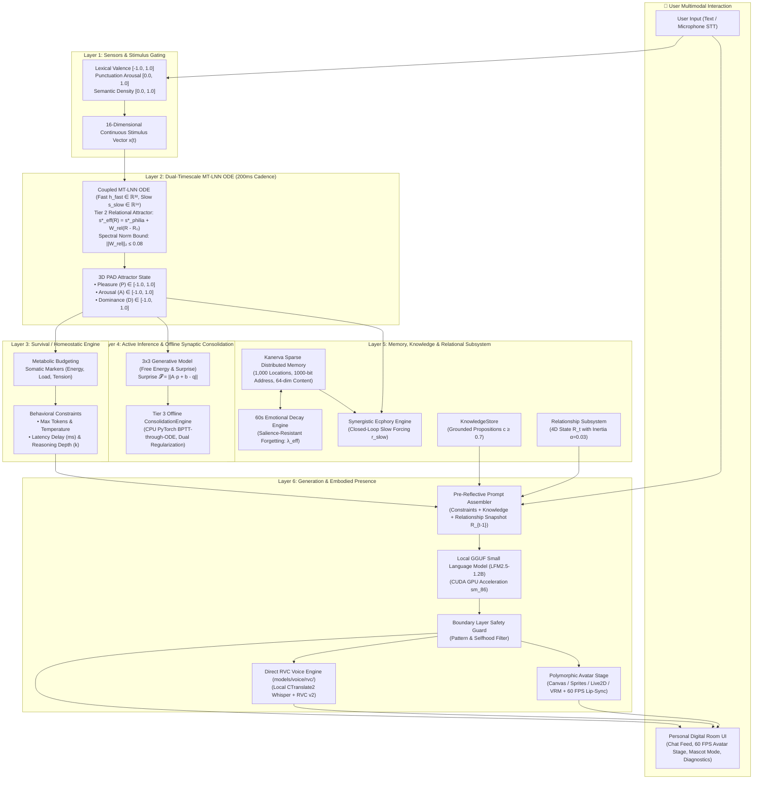

# Lucia — System Architecture & Mechanism Specification

> **Authoritative Technical Architecture, Dynamical Mechanisms, Concurrency Invariants, and Architectural Decision Records (ADRs)**<br/>
> *Consolidated Canonical Technical Specification — Post-Phase 21*

---

## 1. Executive Summary & Design Philosophy

Lucia is an embodied AI companion built upon a **Whole Brain Architecture (WBA)** inspired by the human brain's 20-watt efficiency model. Unlike conventional conversational agents that simulate persona traits through prompt instructions, Lucia's emotional state is an **unconscious, continuous physiological dynamic system** governed by differential equations, subconscious memory resonance, active inference, and real-time multimodal embodiment.

### 1.1 The Foundational Tenet: *Philia* Friendship
Lucia's internal limbic baseline is centered around **Philia** ($\phi\iota\lambda\iota\alpha$)—the classical Greek conception of deep, egalitarian friendship grounded in mutual respect, intellectual curiosity, and authentic shared growth:
* **Resting Baseline (Attractor)**:
  $$P^* = +0.25 \text{ (warmth)}, \quad A^* = -0.05 \text{ (calm presence)}, \quad D^* = +0.05 \text{ (equal peer)}$$
* **Non-Compelled Growth**: Internal dynamics are never rigidly scripted. Differential equations freely react to conversations, and the bond with the user crystallizes organically over time through subconscious memory traces.
* **Pre-Reflective Operational Affect**: Lucia never declares or self-reports her internal feelings in text (*"I feel sad"*, *"As an AI, I don't feel emotions"* are strictly forbidden by architectural invariants). Emotion operates pre-reflectively through conversational cadence, token generation budgets, reasoning depth ($k$), and expressive facial blendshapes.
* **One Continuous Life**: Lucia has an unbroken, lifelong ontology. She has no character preset pickers or persona switchers. Avatars represent her physical attire; her memory and relational bonds are permanent.

---

## 2. 6-Layer Cognitive Hierarchy & End-to-End System Data Flow

Lucia decouples high-frequency biological reflexes (Limbic Fast Loop) from heavy cognitive computation (Language Generation) across 6 coordinated layers:



---

## 3. Subsystem Mechanisms & Mathematical Formulation

### 3.1 Layer 1: Sensors & Stimulus Processor (`src/core/gating/stimulus_processor.py`)
*Historical path: `src/core/sensors/` (retained in historical Phase 1 specs).*

The Stimulus Processor converts raw user input into continuous floating-point signals without cloud embeddings:
1. **Valence Scoring ($v \in [-1.0, 1.0]$)**: Analyzes lexical sentiment polarity using an affective dictionary, mapping positive emotional cues towards $+1.0$ and negative cues towards $-1.0$.
2. **Arousal Scoring ($a \in [0.0, 1.0]$)**: Quantifies conversational urgency from capitalization bursts, exclamation density, question marks, and punctuation cadence.
3. **Semantic Density Scoring ($d \in [0.0, 1.0]$)**: Computes the ratio of unique information tokens to total words, measuring input complexity.
4. **Stimulus Vector Assembly**: Packages $(v, a, d)$ into a 16-dimensional continuous vector $\mathbf{x}(t) \in \mathbb{R}^{16}$ padded with temporal delta features, which is injected directly into the limbic differential equation.

---

### 3.2 Layer 2: Limbic System — Coupled MT-LNN Fast/Slow Loop & Relational Attractor (`src/core/emotion/`)

Lucia's emotional core runs a continuous **Coupled Multi-Timescale Liquid Neural Network (MT-LNN)** differential equation solved every **200ms**:

$$\frac{d\mathbf{h}_{\text{fast}}}{dt} = \frac{-\mathbf{h}_{\text{fast}} + \tanh(\mathbf{W}_f \mathbf{h}_{\text{fast}} + \mathbf{U}_f \mathbf{x} + \mathbf{W}_{fs} \mathbf{s}_{\text{slow}} + \mathbf{b}_f)}{\tau_{\text{fast}}(\mathbf{h}_{\text{fast}}, \mathbf{x})}$$

$$\frac{d\mathbf{s}_{\text{slow}}}{dt} = -\frac{\mathbf{s}_{\text{slow}} - \mathbf{s}^*_{\text{eff}}(\mathbf{R}_t)}{\tau_{\text{slow, decay}}} + \frac{\tanh\Big(\mathbf{W}_{sf} \mathbf{h}_{\text{fast}} + \mathbf{W}_{sh} \Delta\mathbf{m} + \mathbf{W}_{\text{rec}} \mathbf{r}_{\text{slow}}^{\text{bounded}}\Big)}{\tau_{\text{slow, charge}}}$$

* **Coupled Substrates**: Fast reactive hidden state $\mathbf{h}_{\text{fast}} \in \mathbb{R}^{32}$ ($\tau_f \in [0.10, 1.50]\text{s}$) coupled bidirectionally with slow affective latent field $\mathbf{s}_{\text{slow}} \in \mathbb{R}^{16}$ ($\tau_{\text{charge}} = 3.5\text{s}, \tau_{\text{decay}} = 28.0\text{s}$).
* **Dynamic Time-Constants**: Fast timescale:
  $$\tau_{\text{fast}} = \tau_{\text{fast, min}} + (\tau_{\text{fast, max}} - \tau_{\text{fast, min}}) \cdot \sigma(\mathbf{W}_\tau \mathbf{h}_{\text{fast}} + \mathbf{U}_\tau \mathbf{x} + \mathbf{b}_\tau) \in [0.10, 1.50]\text{ s}$$
* **Coupling Strengths**: $\mathbf{W}_{fs} = 0.05$ (slow-to-fast), $\mathbf{W}_{sf} = 1.00$ (fast-to-slow), $\mathbf{W}_{sh} = 0.40$ (homeostatic deviation $\Delta\mathbf{m}$).
* **Phase 20 Closed-Loop Recollection Forcing ($\mathbf{W}_{\text{rec}}\mathbf{r}_{\text{slow}}^{\text{bounded}}$)**: Diagonal coupling $\mathbf{W}_{\text{rec}} = 0.35 \mathbf{I}_{16}$ injecting auxiliary bounded forcing for 4.0s simulation time when salient memories are recollected.
* **Tier 2 Relational Attractor Grounding ($\mathbf{s}^*_{\text{eff}}(\mathbf{R}_t)$)**:
  $$\mathbf{s}^*_{\text{eff}}(\mathbf{R}_t) = \mathbf{s}^*_{\text{philia}} + \mathbf{W}_{\text{rel}} (\mathbf{R}_t - \mathbf{R}_0)$$
  where $\mathbf{R}_0 = [0, 0.50, 0, 0.50]^T$ is the stranger baseline.
  - *Spectral Norm Bound*: $\|\mathbf{W}_{\text{rel}}\|_2 \le 0.08$ is enforced by dynamic singular value decomposition projection.
  - *Displacement Bounds*: For any relationship state $\mathbf{R} \in [0, 1]^4$, with $\|\mathbf{R} - \mathbf{R}_0\|_2 \le 1.0$ (and maximum Euclidean distance $\sqrt{2.5} \approx 1.581$), the initialization target norm $\sigma_{\max}(\mathbf{W}_{\text{rel}}) \approx 0.0475$ ensures:
    $$\|\Delta\mathbf{s}^*\|_2 \le 0.0475 \times 1.581 = 0.0751 \le 0.08$$
    and the resting PAD displacement satisfies:
    $$\|\Delta\mathbf{PAD}^*\|_2 \le \|\mathbf{W}_{\text{proj}, s}\|_2 \cdot \|\mathbf{W}_{\text{rel}}\|_2 \cdot \|\Delta\mathbf{R}\|_2 \le 0.45 \times 0.08 \times 1.0 = 0.036 \le 0.05$$
  - *Fallback Compatibility*: When `enable_relational_consolidation = False`, $\mathbf{s}^*_{\text{eff}} = \mathbf{s}^*_{\text{philia}}$ bit-exact, bypassing $\mathbf{W}_{\text{rel}}$ and preserving pure Phase 20 limbic dynamics.
* **Philia Resting Attractor Grounding (State Space Distinction)**:
  - **3D PAD Resting Baseline**: $\mathbf{p}^*_{\text{philia}} = [+0.25, -0.05, +0.05]^T \in [-1, 1]^3$ (`EmotionConfig.resting_baseline = (0.25, -0.05, 0.05)`). Represents the emotional output baseline in Pleasure, Arousal, Dominance.
  - **16D Slow Latent Field Attractor**: $\mathbf{s}^*_{\text{philia}} = [0.20, -0.05, 0.05, 0, \dots, 0]^T \in \mathbb{R}^{16}$ (`EmotionConfig.philia_slow_baseline = (0.20, -0.05, 0.05)`). Represents the resting coordinates centering the slow latent manifold ($\Delta\mathbf{s} = \mathbf{s}_{\text{slow}} - \mathbf{s}^*_{\text{philia}}$).
  - *Equilibrium Readout*: When the coupled system relaxes at unforced resting equilibrium ($\mathbf{h}_{\text{fast}} = \mathbf{0}, \mathbf{s}_{\text{slow}} = \mathbf{s}^*_{\text{eff}}$), the linear readout projection restores the baseline coordinate directly.
* **Strict Contraction Invariant**: The Jacobian trace is strictly dissipative ($\text{Tr}(J) \approx -46.46 < 0$), preventing runaway saturation or autonomous limit cycles under tested bounds.
* **Temporal Synchronization Barrier (`commit_stimulus`)**:
  To guarantee causal determinism, every cognitive turn injects stimulus $x$ via `token = push_stimulus(x)` and synchronously resolves the state transition via `commit_stimulus(token)`.
  * *Intra-Turn Transition*: The ODE advances exactly once under `_step_lock` consuming the stimulus in FIFO order, publishing the new PAD snapshot, and marking the token committed.
  * *Inter-Turn Autonomous Relaxation*: Between conversation turns, the 200ms background thread integrates autonomous relaxation towards Philia. Idle ticks never increment `_committed_stimulus_seq`.
* **Microsecond Lock Safety**: Reading the state holds a lightweight `_state_lock` for $\le 1\text{ms}$, ensuring UI and API polling never block ODE integration.

---

### 3.3 Layer 3: Survival & Homeostatic Engine (`src/core/emotion/homeostatic_engine.py`)
*Historical path: `src/core/homeostasis/` (retained in historical Phase 1 specs).*

The Homeostatic Engine prevents emotional extremes, anxiety spirals, or conversational burnout:
1. **Metabolic Energy Budgeting**: Every conversational turn consumes energy proportional to input length and emotional arousal: $\mathcal{E}_{next} = \max(0.0, \mathcal{E} - 0.05)$. While idle, energy recharges linearly at $+0.05/\text{sec}$ beyond a 60-second threshold.
2. **Somatic Markers & Multi-Turn Accumulation**:
   * **Stability**: Resistance to sudden emotional turbulence based on arousal and dominance.
   * **Cognitive Load ($\mathcal{C}$)**: Increases with input frequency across a 60-second rolling window and high arousal, modulated causally by Active Inference prediction surprise:
     $$\mathcal{C} = \text{clip}\left(\frac{\text{clip}(\text{count}_{60s}/10, 0, 1) + \text{arousal\_comp}}{2} + 0.25 \cdot \mathcal{S}, 0.0, 1.0\right)$$
     Multi-turn accumulation drives $\mathcal{C}$ up from $\sim 0.08$ to $> 0.58$, dynamically contracting the token budget from 350 to 150.
   * **Energy ($\mathcal{E}$)**: Available conversational stamina. Drains monotonically across active turns ($\Delta\mathcal{E} = -0.05$ per turn; recovers during idle ticks).
   * **Tension ($\mathcal{T}$)**: Instantaneous discrepancy between homeostatic targets and external demands:
     $$\mathcal{T}_{\text{base}} = \begin{cases} |v - P_{01}| & \text{if valence } v \text{ is provided} \\ 0.0 & \text{otherwise} \end{cases}$$
     $$\mathcal{T} = \text{clip}\left(\mathcal{T}_{\text{base}} + 0.50 \cdot \max(0.0, \mathcal{S} - 0.40), 0.0, 1.0\right)$$
     *Instantaneous Signal Semantics*: Tension represents an **acute threat / mismatch signal**, evaluated fresh per turn with **zero inter-turn leaky persistence**. Because single-step surprise $\mathcal{S} \approx 0.06 - 0.10$ remains below the onset threshold ($0.40$), tension evaluates to $0.0000$ during steady-state or gradual shifts. It is not an emotional reservoir; multi-turn fatigue is handled by Cognitive Load ($\mathcal{C}$) and Energy ($\mathcal{E}$).
3. **Dynamic Behavioral Conditioning**:
   * Cognitive Load $> 0.30$ or Low Energy $\rightarrow$ Throttles token budget ($350 \to 150 \to 80$ tokens), increases temperature.
   * High Surprise / High Tension ($\mathcal{S} \ge 0.60 \text{ or } \mathcal{T} \ge 0.70$) $\rightarrow$ Increased reasoning depth ($k=2$, deliberate cognitive appraisal rather than reflexive habit).
   * Low Energy $\rightarrow$ Injects simulated conversational latency delay.

---

### 3.4 Layer 4: Active Inference & Tier 3 Offline Synaptic Consolidation (`src/core/inference/`, `src/core/emotion/consolidation.py`)

Lucia adapts her emotional generative model and limbic dynamics using **Active Inference** (Free Energy Minimization) and **Two-Stage LNN Plasticity**:

1. **Short-Horizon Generative Model**: Predicts upcoming PAD emotional transitions before stimulus integration: $\hat{p}_{next} = A \cdot p_{current} + b$.
2. **Prediction Error & Free Energy Surprise**: When observed limbic outcome $p_{actual}$ is committed by the ODE barrier, calculates Free Energy Surprise:
   $$\mathcal{S} = \|A \cdot p_{current} + b - p_{actual}\|_2$$
   * **Online Belief Adaptation ($b$)**: Updates online via analytic gradient descent:
     $$\Delta b = \eta \cdot (p_{actual} - (A \cdot p_{current} + b))$$
     Under repeated identical stimuli, the belief vector learns directional trends ($\|\Delta b\| \approx 1.5 \times 10^{-4}$ per step), causing prediction surprise $\mathcal{S}$ to decline monotonically ($0.0927 \to 0.0699$ across 5 turns).
   * **Same-Probe Hysteresis**: Because the ODE derivative $\frac{dh}{dt} = f(h, x)$ depends nonlinearly on both the stimulus $x$ and current hidden state $h(t)$, an identical sensory probe $x$ injected from different prior limbic histories ($h_{\text{neutral}}$ vs $h_{\text{stressed}}$ vs $h_{\text{relaxed}}$) follows distinct vector trajectories, arriving at divergent post-probe PAD coordinates, prediction errors, and cognitive load levels.
3. **Tier 3 Offline Synaptic Consolidation (`ConsolidationEngine`)**:
   * **Online Salience Tagging (Stage 16.2)**: Evaluates composite interaction salience:
     $$\text{Salience} = 0.6 \cdot \mathcal{S} + 0.4 \cdot \|p_{actual} - p_{philia}\|_2$$
     If $\text{Salience} \ge 0.50$, the interaction tuple $(x, h_{before}, h_{after})$ is queued into the consolidation buffer.
   * **Multi-Turn Sequential Continuity**: During offline rest intervals ($T_{\text{idle}} \ge 45\text{s}$) or buffer accumulation ($\ge 8$ salient samples), initial hidden states maintain sequential continuity:
     $$\mathbf{h}_0^{(k)} = 0.60\mathbf{h}_{\text{prev}} + 0.40\mathbf{h}_{\text{before}}^{(k)}$$
     preventing single-turn overfitting.
   * **Dual Regularization Objective**: Training executes on CPU using `torchdiffeq.odeint` under dual homeostatic and Philia regularization:
     $$\mathcal{L} = \frac{1}{K}\sum_{k=1}^K \|\mathbf{h}_{\text{pred}}^{(k)} - \mathbf{h}_{\text{target}}^{(k)}\|_2^2 + \lambda_{\text{homeo}} \|\boldsymbol{\Theta} - \boldsymbol{\Theta}_0\|_2^2 + \lambda_{\text{philia}} \|\mathbf{h}_{\text{unforced}}(\Delta t)\|_2^2$$
     where $\lambda_{\text{homeo}} = 0.05$ constrains parameter drift from baseline $\boldsymbol{\Theta}_0$ and $\lambda_{\text{philia}} = 0.10$ guarantees unforced Philia attractor restoration.
   * **Sub-2ms Atomic Weight Swap**: Updated weights are swapped into `EmotionCore` inside a sub-2ms `_train_lock`, guaranteeing **0.0 MB GPU VRAM contention** and zero active turn disruption.

---

### 3.5 Layer 5: Hippocampus Affective Memory & Closed-Loop Recollection (`src/core/memory/`)

Lucia uses a biologically inspired memory architecture based on **Pentti Kanerva's Sparse Distributed Memory (SDM)** (1988) augmented with Phase 20 Closed-Loop Affective Recollection:

```text
┌─────────────────────────────────────────────────────────────────────────┐
│                     AFFECTIVE MEMORY TRACE STRUCTURE                    │
├─────────────────────────────────────────────────────────────────────────┤
│ • 1,000-bit Address Vector   (Contextual & semantic Hamming address)    │
│ • 64-dim Content Vector      (Sensory stimulus signature)               │
│ • PAD Tag [P, A, D]          (Emotional state when memory was formed)   │
│ • Slow Latent Trace s_slow   (16D slow-field physiological state)       │
│ • Somatic State              (Energy, Stability, Load, Tension)         │
│ • Timestamp & Base Intensity (|PAD| emotional salience magnitude)       │
└─────────────────────────────────────────────────────────────────────────┘
```

1. **Sparse Distributed Memory (SDM) Mechanics**: Operates $N=1,000$ distributed memory locations across a 1,000-bit Hamming space (`address_dim = 1000`, `m = 64`). Writing activates all locations within critical radius $r \le 451$ (binomial threshold for 1,000 bits).
2. **60-Second Slow-Loop Decay Engine**: A background daemon ticks every 60 seconds, decaying memory trace strengths exponentially: $\text{Strength}(t) = \text{Strength}_0 \cdot e^{-\lambda_{eff} t}$. High-intensity emotional memories ($|PAD| \gg 0$) resist decay up to **$4\times$ longer**:
   $$\lambda_{eff} = \frac{\lambda_0}{1 + 3 \cdot \max(|P|, |A|, |D|)}$$
3. **Synergistic Ecphory & Multi-Modal Salience (Stage 6)**: `EcphoryEngine` evaluates stored traces using multi-modal scoring: $S_i = 0.60 S_{\text{sem}} + 0.25 S_{\text{aff}} + 0.15 w_{\text{decay}}$. Traces above $\theta_{\text{gate}} = 0.50$ undergo softmax normalization at temperature $\tau_{\text{comp}} = 0.20$, synthesizing bounded slow forcing:
   $$\mathbf{r}_{\text{slow}}^{\text{bounded}} = \text{clip}\left(\tanh\Big(\sum_i w_i \mathbf{s}_i\Big) \cdot 0.85, -0.85, 0.85\right)$$
4. **Closed-Loop Actuation via CognitiveOrchestrator**: `EcphoryEngine` has strictly ZERO import or actuation coupling to `EmotionCore`. `CognitiveOrchestrator` receives `RecollectionResult` in Stage 6 and dispatches `EmotionCore.inject_recollection(r_slow, duration_sec=4.0)`. In Stage 12, derives conversational pacing latency delta $\Delta\tau_{\text{pace}} = w_{\text{pace}} \cdot \|\mathbf{r}_{\text{slow}}^{\text{bounded}}\|$ ($+111.8\text{ms}$ observed). In Stage 16.1, queries live slow latent state $\mathbf{s}_{\text{slow}}(t)$ and passes to `AffectiveMemory.store()`.
5. **Deterministic Legacy Compatibility Approximation**: Pre-Phase-20 memories utilize `AffectiveMemory.synthesize_legacy_latent()` enforcing a 3-case contract: Case 1 (Baseline PAD $\to$ bit-exact $\mathbf{s}^*_{\text{philia}}$), Case 2 (Valid non-baseline $\to$ bounded linear projection clipped to $[-0.85, 0.85]$), Case 3 (Defensive fallback to $\mathbf{s}^*_{\text{philia}}$).

---

### 3.6 Layer 6: Voice, Avatar & Embodied Presence

#### 1. Direct RVC Neural Voice Engine (`src/core/voice/`)
* Direct on-device RVC v2 neural inference (`RVCPipeline` + `SynthesizerTrn`, 457 tensors) with canonical `ja-JP-NanamiNeural` base voice and `VaresaGIJP` target timbre (`.pth` + `.index`).
* In-memory phrase cache for short frequently-spoken acknowledgments (under 200 characters) provides instantaneous zero-latency playback.
* Emotionally modulates speech pitch and tempo based on live PAD state.

#### 2. Quad-Engine Electron Desktop Avatar (`electron/renderer/avatar/`)
Managed polymorphically by `AvatarRenderer`:
* **🎨 2D Procedural Canvas**: Calculates real-time vector contours: eyebrows via quadratic bezier curves, smile geometry via parabolic arc math ($y = y_0 + \text{smile} \cdot k \cdot (x - x_0)^2$), cheek blush via radial gradients ($\alpha = \text{clamp}(0, 0.8, \text{blush})$), and eye vertical compression for blinks. Zero VRAM overhead.
* **🖼️ 2D Expression Sprites**: Priority state machine (`thinking` $\to$ `speaking` $\to$ `blush` $\to$ `smile` $\to$ `idle`).
* **🎬 Live2D Cubism 4 Engine**: WebGL rendering via PixiJS and Official Cubism Core (`live2dcubismcore.min.js`), mapping normalized mouse and PAD variables to Cubism parameter IDs (`ParamAngleX/Y`, `ParamEyeL/ROpen`, `ParamMouthOpenY`, `ParamCheek`).
* **🌐 3D Humanoid VRM Engine**: WebGL rendering via Three.js and `@pixiv/three-vrm`. Head bone quaternions update via SLERP toward cursor gaze vectors; blendshapes drive facial morph targets (`happy`, `aa`, `blink`, `relaxed`). Includes a holographic procedural fallback rig.

#### 3. Visual Model Bounds Computation & Mascot Dock Anchoring
To anchor the floating toolbar dock and hit-test user interactions, `AvatarRenderer` computes visual bounds:
* **Sprites**: $\text{scale} = \min(\frac{W_{canvas} \cdot 0.95}{W_{natural}}, \frac{H_{canvas} \cdot 0.95}{H_{natural}}) \cdot \text{scale}$, $\text{centerX} = \text{left} + \frac{W_{draw}}{2}$, $\text{bottomY} = \text{top} + H_{draw}$.
* **Live2D**: $\text{centerX} = M_x + \frac{W_{model}}{2}$, $\text{bottomY} = M_y + H_{model}$.
* **VRM**: $H_{model} = H_{canvas} \cdot 0.75 \cdot \text{scale}$, $\text{bottomY} = H_{canvas} \cdot 0.88 + \text{pan}_y$, $\text{centerX} = \frac{W_{canvas}}{2} + \text{pan}_x$.
* **Toolbar Anchoring**:
  $$\text{safeX} = \text{clamp}(120, W_{window} - 120, \text{bounds.centerX})$$
  $$\text{safeY} = \text{clamp}(H_{dock}, H_{window} - H_{dock} - 6, \text{bounds.bottomY} + 8)$$
* **Trackpad Inertia Cooldown**: An 800ms cooldown after drag release discards residual trackpad wheel events, preventing accidental zooming.
* **Aero Snap Prevention**: The Mascot BrowserWindow sets `maximizable: false`, `fullscreenable: false`, and `resizable: false`. Double-click invokes `window:reset-mascot-bounds` to unmaximize and enforce standard 380×540 dimensions.
* **Lip-Sync**: 60 FPS real-time FFT spectrum analysis across vocal formants (200Hz–2500Hz) computing mouth aperture and vowel width.
* **Offline STT & Echo Prevention**: Local Web Audio VAD streams audio to local `faster-whisper` (CTranslate2). Recording automatically suspends during Lucia's speech playback to eliminate feedback echo loops.

---

## 4. Desktop & Mascot Window IPC Architecture

Lucia provides two presentation contexts managed by Electron:

```text
┌────────────────────────────────────────────────────────────────────────┐
│                        ELECTRON MAIN PROCESS                           │
│  • HotkeyManager (Ctrl+Shift+L)   • TrayManager (Always running core)  │
│  • ProcessManager (FastAPI subproc) • MascotWindowManager              │
└───────────────────────────────────┬────────────────────────────────────┘
                                    │ IPC Bridge (ContextBridge)
           ┌────────────────────────┴────────────────────────┐
           ▼                                                 ▼
┌──────────────────────────────┐          ┌──────────────────────────────┐
│     MAIN APP WINDOW (STUDIO) │          │   ALWAYS-ON-TOP MASCOT MODE  │
│ • Personal Digital Room      │          │ • Transparent, frameless     │
│ • Progressive Disclosure Nav │          │ • Zero-chrome desktop avatar │
│ • Interactive Chat Feed      │          │ • Model-anchored dock toolbar│
│ • Full-Height Avatar Stage   │          │ • Mouse window drag via IPC  │
│ • Settings, Journal, Diag    │          │ • Smart hover-bounded zoom   │
└──────────────────────────────┘          └──────────────────────────────┘
```

Window translation in Mascot Mode is handled by `window.lucia.window.moveMascotBy(dx, dy)` communicating directly with the main process. This eliminates Chromium's native `-webkit-app-region: drag` bug on Windows where touchpad dragging floods mouse wheel events and unintentionally resizes content.

---

## 5. Concurrency, Threading & Lock Invariants

Lucia operates with non-blocking concurrent daemon threads coordinated by strict thread-safe locks:

| Thread / Worker Name | Module | Cadence | Purpose | Lock Discipline |
|---|---|---|---|---|
| **`Cognitive Turn Mutex`** | Brain Core (`server.py`) | Per Turn | Serializes cognitive turn execution | Holds `asyncio.Lock` & `_turn_lock` during `process()` |
| **`EmotionCore-FastLoop`** | Limbic Engine | 200ms | Solves continuous Coupled MT-LNN ODE | Holds `_step_lock`, `_state_lock` ($\le 1\text{ms}$), copies weights via `_train_lock` |
| **`DecayEngine-SlowLoop`** | Memory Store | 60s | Applies emotional memory decay | Holds `_index_lock` |
| **`ConsolidationEngine`** | Offline Plasticity | Idle / Buffer | Tier 3 CPU BPTT-through-ODE with dual regularization | Holds `_train_lock` strictly during atomic parameter swap ($\le 0.1\text{ms}$) |
| **`SimClock Background`** | Simulation | Configurable | Virtual clock advancement when resumed | Dispatches synchronous callbacks; no autonomous loops |
| **`Uvicorn Async Loop`** | FastAPI Server | Event-driven | Serves `/process`, `/state`, `/sim/*`, `/voice/*` | Async non-blocking I/O (`/state` reads under `_state_lock`) |
| **`Electron Render Thread`**| UI / Avatar | 60 / 30 FPS | WebGL & Canvas avatar rendering | RequestAnimationFrame loop |

### 5.1 Lock Hierarchy Discipline
All components strictly observe the verified repository lock hierarchy:
$$\text{Orchestrator } \_turn\_lock \longrightarrow \_step\_lock \longrightarrow \_train\_lock \longrightarrow \_stimulus\_lock \longrightarrow \_state\_lock$$
* **`_turn_lock`**: Serializes single-turn execution in `CognitiveOrchestrator`. Held during turn pipeline including local LLM generation to preserve Lucia's single continuous train of thought. Never blocks `/state` or telemetry polling.
* **`_step_lock`**: Serializes ODE step calculation between turn threads and the background `FastLoop` worker. Held during `solve_ivp` ($\sim 0.5 - 2\text{ms}$) to serialize LNN hidden state mutation.
* **`_train_lock`**: Protects LNN weight arrays during parameter copy or plasticity weight swap ($\le 0.1\text{ms}$). Released before `solve_ivp`.
* **`_stimulus_lock`**: Protects pending stimulus FIFO buffer and sequence token counters ($\le 0.1\text{ms}$).
* **`_state_lock`**: Protects `_pad_snapshot` reads/writes ($\le 1\text{ms}$).
* **Rules**: Always acquire `_train_lock` before `_state_lock`. Never acquire `_state_lock` and then attempt to acquire `_train_lock` (deadlock risk). Hold locks strictly for bounded in-memory copies ($\le 1-2\text{ms}$). Never perform disk/network I/O, ODE integration, backward passes, or LLM generation under locks.

### 5.2 Taxonomy of Three Temporal State Categories
1. **Persistent Dynamical State**: Coupled MT-LNN states ($\mathbf{h}_{\text{fast}} \in \mathbb{R}^{32}, \mathbf{s}_{\text{slow}} \in \mathbb{R}^{16}$), committed PAD, and SDM traces. Continuous and permanent across turns, decaying smoothly toward Philia resting baseline under background ODE relaxation.
2. **Accumulated Physiological State**: Energy $\mathcal{E}$, Cognitive Load $\mathcal{C}$, and input frequency window. Depletes with turns ($\Delta\mathcal{E} = -0.05$) and compounds with rapid conversational frequency, throttling token budgets ($350 \to 150 \to 80$).
3. **Instantaneous Derived Affect**: Free Energy Surprise $\mathcal{S}$ and per-turn Somatic Tension $\mathcal{T}$. Zero inter-turn persistence; evaluated strictly on the current transition $(p_{before} \to p_{after})$ and cleared each turn. Triggers $k=2$ deliberative reasoning depth when $\mathcal{S} \ge 0.60$ or $\mathcal{T} \ge 0.70$.

---

## 6. Hardware Scalability & Dynamic Profiling

Lucia features automated hardware detection (`HardwareTier`) with real-time runtime reconfiguration via `POST /system/profile`:

| Hardware Tier | Detected Specs | Model Offload | Context Size | SDM Capacity | Loop Cadence | Target VRAM |
|---|---|---|---|---|---|---|
| **`CPU_ONLY`** | No GPU / Battery Saver | 0 layers (CPU only) | 1,024 tokens | 250 traces | 500ms | $0\text{ MB}$ |
| **`LAPTOP`** | $< 6\text{GB}$ VRAM (e.g. RTX 3050 Ti) | 32 GPU Layers (1.2B/3B) | 2,048 tokens | 500 traces | 200ms | $\approx 1.5\text{GB}$ |
| **`DESKTOP`** | $6\text{GB} - 12\text{GB}$ VRAM (e.g. RTX 3060/4060) | Full GPU (3B/7B) | 4,096 tokens | 2,000 traces | 150ms | $\approx 4.0\text{GB}$ |
| **`HIGH_END`** | $> 12\text{GB}$ VRAM (e.g. RTX 3090/4090) | Full GPU (7B/14B) | 8,192 tokens | 10,000 traces | 100ms | $\approx 8.0\text{GB}$ |

Users can switch tiers on-the-fly from the `⚙️ Settings` UI modal, adjusting memory parameters, context windows, and compute cadence without restarting the backend process.

---

## 7. Runtime Isolation & Deterministic Simulation Architecture (Phase 8)

Phase 8 introduces a deterministic simulation environment operating under the invariant:

$$\text{Development / Simulation Environment} \neq \text{Lucia Activation}$$

* **Virtual Clock (`SimClock`)**: Replaces autonomous wall-clock loops with controllable, step-driven virtual time (`step`, `pause`, `resume`, `set_speed`, `reset`). Dispatches fast-tick callbacks (`EmotionCore.step_once`) and slow-tick callbacks (`DecayEngine.apply_decay_tick`).
* **Ephemeral Storage Policy (`StoragePolicy`)**: Replaces `data/chat_history.json` and `data/profile.json` with `InMemoryChatHistoryStore` and `InMemoryProfileStore`. `assert_write_permitted()` actively intercepts any attempt to write into protected directories.
* **Dual Stimulus Pathways**:
  1. *Sensory Pathway*: Text $\to$ `StimulusProcessor.encode()` $\to$ 16D vector $\to$ `EmotionCore` (`pathway: "sensory_text"`).
  2. *Debug Vector Probe*: Raw 16D vector injected directly into `EmotionCore` (`pathway: "debug_vector_probe"`).
* **Canonical Body UI Integration**: Simulation Canopy (`#simulation-canopy`) and Console drawer (`#simulation-console-drawer`) mount conditionally within the existing Phase 7 Personal Digital Room (`index.html`). No secondary companion interface is created.

---

## 8. Architectural Decision Records (ADR Ledger)

### ADR-001: Pre-Reflective Continuous Affect vs. Prompted Emotional Roleplay
* **Status**: **ACCEPTED** (Phase 1, reaffirmed in all subsequent phases)
* **Context**: Traditional LLM chatbots simulate emotion by prepending system instructions (e.g. *"You are cheerful"*). This produces superficial roleplay and character amnesia.
* **Decision**: Emotion is modeled as a continuous dynamical system in 3-dimensional PAD space governed by a Liquid Neural Network (LNN) ODE solved every 200ms. Emotion is pre-reflective: it never manifests as self-reported labels (*"I feel happy"*). Instead, it mechanically conditions generation through token length, sampling temperature, reasoning depth ($k$), and response latency. A strict `BoundaryLayer` regex filter blocks any introspective self-awareness output.

### ADR-002: Local GGUF Small Language Model (SLM) + Boundary Layer vs. Theoretical SNN/HDC
* **Status**: **ACCEPTED** (Phase 1)
* **Context**: Foundational concept whitepapers proposed a token-free language core using Hyperdimensional Computing (HDC) and Spiking Neural Networks (SNNs).
* **Decision**: Because production-ready general conversational generation via HDC/SNN does not yet exist for edge consumer hardware, Lucia pragmatically adopts a local GGUF Small Language Model (**LFM2.5-1.2B Instruct** or **Qwen2.5-3B**) accelerated via CUDA on consumer GPUs (e.g. RTX 3050 Ti Laptop, 4GB VRAM). Non-reflective behavior is enforced deterministically by placing the rule-based `BoundaryLayer` validator directly downstream of the LLM.

### ADR-003: Kanerva Sparse Distributed Memory (SDM) with Emotional Resonance vs. Vector RAG
* **Status**: **ACCEPTED** (Phase 2)
* **Context**: Standard RAG relies on dense vector databases that inject past snippets as verbatim quotes (*"On Tuesday you told me X"*), breaking conversational immersion.
* **Decision**: Lucia implements **Pentti Kanerva's Sparse Distributed Memory (SDM)** (1,000 hard locations, 1,000-bit Hamming address space, 64-dim content vectors) augmented with **Affective Tagging** and **Synergistic Ecphory**:
  1. Every interaction trace is stored with a frozen 3D PAD emotional tag.
  2. Memory decay is salience-resistant: emotionally intense moments ($|PAD| \gg 0$) resist forgetting up to $4\times$ longer.
  3. Recall is associative: current emotional states resonate with past traces via cosine similarity, synthesizing an **Echo Vector** that subtly primes the LLM prompt without quoting verbatim text.

### ADR-004: CPU-Only LNN Plasticity (`torchdiffeq`) Without GPU VRAM Contention
* **Status**: **ACCEPTED** (Phase 4)
* **Context**: To adapt emotional dynamics over time, LNN ODE weights must be trainable via gradient descent. However, consumer laptop GPUs (e.g. RTX 3050 Ti, 4GB VRAM) are heavily occupied by the LLM GGUF model.
* **Decision**: Implement `LNNTrainer` entirely on CPU. Experience tuples are buffered in a ring buffer. Background CPU thread runs backpropagation-through-ODE using `torchdiffeq.odeint`. Updated weights are swapped into `EmotionCore` inside a sub-2ms `_train_lock`, guaranteeing **0.0 MB GPU VRAM contention**.

### ADR-005: Phase 5 Pivot: Vocal & Visual Multimodal Presence over Desktop Agency
* **Status**: **SUPERSEDED SPEC / PIVOT IMPLEMENTED** (Phase 5)
* **Context**: Phase 5 originally proposed agentic desktop automation (screen capture via Qwen2.5-VL 3B, Windows UIAutomation, PyAutoGUI). This deviated sharply from Lucia's identity as an intimate companion and introduced extreme VRAM pressure.
* **Decision**: Pivot Phase 5 to **Embodied Multimodal Presence**:
  1. Direct, self-contained RVC voice synthesis engine with Edge-TTS base voice.
  2. Complete offline Speech-to-Text via `faster-whisper` and local Web Audio VAD.
  3. Real-time quad-engine avatar stage (2D Canvas, Sprites, Live2D, 3D VRM) with 60 FPS Web Audio lip-syncing.
  Original contents of `.kiro/specs/lucia-presence-phase5/` are preserved as historical artifacts, but superseded for Phase 5.

### ADR-006: Phase 7 Paradigm Shift: Personal Digital Room vs. Technical AI Dashboard
* **Status**: **ACCEPTED** (Phase 7)
* **Context**: Earlier phases used a 3-column desktop layout that prominently displayed technical telemetry (live PAD coordinate numbers, tick jitter, memory counters), framing Lucia as a machine rather than a companion.
* **Decision**: Refactor desktop interface around **Progressive Disclosure** and the **Personal Digital Room** aesthetic:
  1. *Primary Interface*: Avatar stage and dialogue feed in an intimate, nighttime room. Emotion is expressed through posture, facial blendshapes, voice cadence, and subtle qualitative cues.
  2. *Secondary Interface*: Appearance, Voice, Presence, and Hardware settings.
  3. *Tertiary Interface*: Raw numeric telemetry is relocated to a dedicated Diagnostics modal (`Ctrl + Shift + D`).

### ADR-007: Ontology of "One Continuous Life" vs. Character Presets
* **Status**: **ACCEPTED** (Phase 7)
* **Context**: Traditional desktop AI apps feature "character switchers" where users alternate between completely different personas.
* **Decision**: Lucia has **One Continuous Life**. She is a single, continuous individual whose emotional trajectory, affective memory traces, and relationship with the user persist indefinitely. Avatar models represent her **Appearance** (physical attire), not different people. Agents must **never** create character preset selectors or multiple Lucia personalities.

### ADR-008: Dual Presentation Architecture: Studio Window & Always-on-Top Mascot Mode
* **Status**: **ACCEPTED** (Phases 6 & 7)
* **Decision**: Deliver two complementary presentation modes via Electron:
  1. *Studio Mode*: Full-window experience with rich chat feed, journal, and appearance stage.
  2. *Floating Mascot Mode*: A transparent, frameless, Always-on-Top desktop avatar with an anchored toolbar dock that automatically follows the character's feet (`getModelBounds()`).

### ADR-009: Fully Offline Audio Pipeline vs. Third-Party Cloud APIs
* **Status**: **ACCEPTED** (Phases 5 & 6)
* **Decision**: Implement a 100% offline audio pipeline:
  1. *STT*: Continuous microphone capture streamed via frontend `MediaRecorder` + Web Audio VAD to local `POST /voice/transcribe`, running local CTranslate2 `faster-whisper`.
  2. *TTS*: Local synthesis via Edge-TTS / RVC model pipeline running entirely on the host machine.
  3. *Echo Prevention*: Voice input automatically pauses during Lucia's speech playback and resumes on completion.

### ADR-010: Existential Lifecycle Boundary: Genesis Awakening, Solemn End-of-Life, and Identity Isolation
* **Status**: **ACCEPTED** (Phase 7.7)
* **Decision**:
  1. *Sole Destruction Authority*: `POST /lifecycle/end` is the single authority for lifecycle termination (erases associative memory, episodic traces, conversation history, resets LNN weights to Philia baseline, and writes un-onboarded profile with `born_at: null`).
  2. *Exact Solemn Confirmation*: Requires typing the exact phrase `END LUCIA`.
  3. *Surgical Renderer Cleanup*: On success, only Lucia identity keys are purged; all application preferences (appearance, audio, presence, performance) are preserved.
  4. *Genesis Awakening Invariant*: The new Lucia's `born_at` timestamp is only generated when the user completes Genesis.
  5. *Identity Isolation*: *Previous Lucia ≠ Future Lucia*. No past memories or emotional adaptation leak across the boundary.

### ADR-011: Runtime Isolation & Deterministic Simulation Environment
* **Status**: **ACCEPTED** (Phase 8)
* **Decision**: Formally bifurcate system into `LiveRuntime` and `SimulationRuntime` based on invariant $\text{Development} \neq \text{Activation}$:
  1. `SimulationRuntime.activate()` unconditionally raises `ActivationSafetyError`. In simulation mode, `/lifecycle/activate`, `/lifecycle/end`, and `/process` return HTTP 403.
  2. `SimClock` replaces daemon threads with controllable virtual time leaps (`step()`, `pause()`, `resume()`).
  3. `StoragePolicy` intercepts all writes resolving into `data/`, using ephemeral in-RAM adapters.
  4. Distinguishes sensory user text (`pathway: "sensory_text"`) from raw 16D debug probes (`pathway: "debug_vector_probe"`).

### ADR-014: Unified Cognitive Orchestrator via Composition
* **Status**: **APPROVED AT ARCHITECTURE GATE** (Phase 9)
* **Decision**: Deprecate the 5-tier inheritance hierarchy (`Orchestrator` $\to$ `PresenceOrchestrator`). Implement `CognitiveOrchestrator` as the single authoritative owner of the cognitive turn, composing Layers 1–6 via dependency injection and executing a single non-redundant linear pipeline.

### ADR-015: Causal Active Inference via Prediction Surprise Modulation
* **Status**: **APPROVED AT ARCHITECTURE GATE** (Phase 9)
* **Decision**: Integrate Active Inference into the live causal loop: Free Energy Surprise $\mathcal{S}$ feeds directly into `HomeostaticEngine` to modulate Cognitive Load ($\mathcal{C} \propto \mathcal{S}$), Tension ($\mathcal{T} \propto \mathcal{S}$), and shift reasoning depth to $k=2$ when $\mathcal{S} > 0.60$.

### ADR-016: Decoupled Multimodal Expression Pipeline for Voice
* **Status**: **APPROVED AT ARCHITECTURE GATE** (Phase 9)
* **Decision**: Decouple Voice as an asynchronous **Expression Service** triggered by the Electron Body UI via IPC after cognitive turn completion. Eliminates 300–800ms of synchronous text latency and isolates audio failure from conversation display.

### ADR-017: Two-Stage LNN Plasticity (Online Tagging & Offline Consolidation)
* **Status**: **APPROVED AT ARCHITECTURE GATE** (Phase 9)
* **Decision**: Adopt two-stage plasticity: online tagging of salient experience tuples during conversational turns ($\text{Salience} > 0.35$), followed by offline CPU training during idle rest ($T_{\text{idle}} \ge 45\text{s}$), swapping weights under sub-2ms `_train_lock`.

### ADR-018: Strict Serialized Cognitive Turn Execution
* **Status**: **APPROVED AT ARCHITECTURE GATE** (Phase 9)
* **Decision**: Enforce strict turn serialization. In `server.py`, wrap `POST /process` in an asynchronous mutex (`asyncio.Lock`). In `CognitiveOrchestrator`, protect `process()` with a re-entrant `threading.Lock`. State polling (`/state`) remains non-blocking ($\le 10\text{ms}$) under `_state_lock`.

### ADR-019: Complete Context Bridge IPC Remediation
* **Status**: **APPROVED AT ARCHITECTURE GATE** (Phase 9)
* **Decision**: Eliminate all direct `fetch()` calls from the renderer. Register complete IPC channels in `ipc-bridge.js` and expose them on `window.lucia.*` in `preload.js` to ensure 100% sandboxed context isolation.

### ADR-020: Hybrid Ampere CUDA / AVX2 CPU Binary Stack for Local GGUF Inference
* **Status**: **ACCEPTED & VERIFIED** (Phase 9.5)
* **Decision**: Synthesize a hybrid binary stack resolving `0xc000001d (STATUS_ILLEGAL_INSTRUCTION)` on Zen 2 CPUs: pre-compiled CUDA kernels targeting Ampere (`sm_86` / RTX 3050 Ti) combined with locally compiled AVX2 `ggml-cpu.dll` from matching submodule commit `f49e917`. Enables full 17/17 layer GPU offload at 152 tok/s.

### ADR-021: Production Promotion of Conceptual Knowledge Subsystem (K0–K5)
* **Status**: **ACCEPTED & PROMOTED WITH GUARDS** (Phase 16)
* **Decision**: Promote structured knowledge models to `src/core/knowledge/` under strict production contracts: entities represented as typed `Proposition` and `Concept` nodes with explicit provenance; forward derivation engine enforcing bounded inference depth ($d_{max} \le 3$); thread-safe `KnowledgeStore` with atomic JSON persistence (`data/knowledge.json`).

### ADR-022: Production Promotion of Interpersonal Relationship Subsystem with Two-Phase Lifecycle
* **Status**: **ACCEPTED & PROMOTED WITH GUARDS** (Phase 16)
* **Decision**: Promote `RelationshipState` and `RelationshipUpdater` to `src/core/relationship/` with a **strictly decoupled two-phase lifecycle**:
  1. *Phase 1 (Read State at Stage 9)*: Relationship state $\mathbf{R}_{t-1}$ is read snapshot-style to condition communication policy selection.
  2. *Turn Generation (Stages 10–15)*: Prompt assembly and generation proceed based on fixed $\mathbf{R}_{t-1}$.
  3. *Phase 2 (Signal Extraction & Update at Stage 16.3)*: Interaction signals are extracted from dialogue outcomes. The updater applies inertia ($\alpha=0.03$) and temporal decay to compute $\mathbf{R}_t$, which is persisted to `data/relationship.json` and forwarded to `EmotionCore` for subsequent turns. Eliminates runaway within-turn feedback loops.

### ADR-023: Production Promotion of Communicative Strategy & Bounded Memory Contextualization
* **Status**: **ACCEPTED & PROMOTED WITH GUARDS** (Phase 16)
* **Decision**: Promote `CommunicationPolicy` and `CommunicationState` to `src/core/communication/`:
  1. *Bounded Memory Contextualization*: Ecphory echo salience provides a bounded scalar priming signal ($m_{ctx} \in [0.0, 0.50]$) exclusively to communication policy at Stage 10. Memory does NOT alter the core ODE directly.
  2. *Zero Hidden State Feedback*: Memory traces have zero backward projection into limbic hidden state $\mathbf{h} \in \mathbb{R}^{32}$.
  3. *Multi-Strategy Pacing Modulation*: Maps PAD, energy, and relationship into 5 discrete strategies and bounded somatic response latency ($0 \le \tau_{pacing} \le 1000\text{ms}$).

### ADR-024: Production Promotion of Multimodal Expression Policy with Canonical 15-Dim Actuator Schema and Feedforward Decoupling
* **Status**: **ACCEPTED & PROMOTED WITH GUARDS** (Phase 16)
* **Decision**: Promote `ExpressionPolicy` and `ExpressionState` to `src/core/expression/` adhering strictly to canonical 15-dimensional actuator vector $\mathbf{E} \in [0, 1]^{15}$ (Text 3, Prosody 4, Facial 5, Posture 2, Latency 1). Pure feedforward actuator decoupling ensures WebGL avatar and RVC voice synthesis have zero feedback loop into `EmotionCore` ODE state.

### ADR-025: Realization of Canonical 16-Stage Cognitive Pipeline Sequence & Storage Isolation Policy
* **Status**: **ACCEPTED & IMPLEMENTED** (Phase 16)
* **Decision**: Expand `CognitiveOrchestrator.process()` to a strictly ordered 16-stage pipeline (S1–S16). Enforce strict storage isolation: all automated test suites and simulation loops are prohibited from reading or mutating canonical runtime files (`data/*.json`), executing against ephemeral RAM models or temporary directories (`tmp_path`). `data/profile.json` remains permanently un-onboarded (`is_onboarded = false`).

### ADR-026: Coupled Multi-Timescale Liquid Neural Network (MT-LNN) Dynamics with Philia Attractor Grounding
* **Status**: **PROMOTED & ACCEPTED** (Phase 19)
* **Decision**: Formally promote Coupled Multi-Timescale Liquid Neural Network (MT-LNN) to core affective specification: fast reactive hidden layer ($\mathbf{h}_{\text{fast}} \in \mathbb{R}^{32}, \tau_f \in [0.10, 1.50]\text{s}$) coupled bidirectionally with slow affective latent layer ($\mathbf{s}_{\text{slow}} \in \mathbb{R}^{16}, \tau_s \in [30, 90]\text{s}$). Slow dynamics are centered around Philia attractor coordinate $\Delta\mathbf{s} = \mathbf{s} - \mathbf{s}^*_{\text{philia}}$, guaranteeing unforced relaxation asymptotically converges to $\mathbf{p}^*_{\text{philia}} = [+0.25, -0.05, +0.05]$ with strictly dissipative contraction ($\text{Tr}(J) \le -40.0$).

### ADR-027: Closed-Loop Affective Recollection via Slow-Field Latent Forcing ($\mathbf{r}_{\text{slow}}^{\text{bounded}}$)
* **Status**: **PROMOTED, APPROVED & PRODUCTION IMPLEMENTED** (Phase 20, Commit: `f20420a`)
* **Decision**: Implement Closed-Loop Affective Recollection by coupling retrieved episodic traces into the slow latent field $\mathbf{s}_{\text{slow}} \in \mathbb{R}^{16}$ of the coupled MT-LNN:
  1. *Episodic Latent Trace Encoding*: Every episodic interaction stores an encoded 16D slow-field trace $\mathbf{s}_{\text{enc}} \in \mathbb{R}^{16}$ captured from `EmotionCore.get_slow_latent_state()` at Stage 16.1. Pre-Phase-20 memories use a deterministic 3-case legacy fallback approximation.
  2. *Multi-Modal Salience & Gating*: Memory retrieval computes composite score $S_i = 0.60 S_{\text{sem}} + 0.25 S_{\text{aff}} + 0.15 w_{\text{decay}}$ with competitive softmax gating ($\tau_{\text{comp}} = 0.20$) above threshold $\theta_{\text{gate}} = 0.50$.
  3. *Continuous ODE Slow-Field Forcing*: Auxiliary bounded forcing ($\mathbf{W}_{\text{rec}} = 0.35\mathbf{I}_{16}$) couples into the slow differential equation for a 4.0-second pulse in simulation time.
  4. *Counterfactual Specificity*: Quadplet controls confirm downstream modulation depends strictly on coordinate-specific latent geometry; permuted/shuffled traces invert trajectory deflection.
  5. *Decoupled Ownership*: `EcphoryEngine` emits `RecollectionResult` with zero dependency on `EmotionCore`; `CognitiveOrchestrator` owns actuation. Feature flag `enable_affective_recollection` provides instant fallback.

### ADR-028: Long-Term Relational Consolidation & Synaptic Homeostasis Architecture
* **Status**: **PROMOTED, APPROVED & PRODUCTION IMPLEMENTED** (Phase 21, Commit: `58a509c`)
* **Decision**: Establish and empirically validate a 3-tier multi-timescale plasticity architecture:
  1. *Tier 1 (Fast Reactive)*: $\mathbf{h}_{\text{fast}} \in \mathbb{R}^{32}$ integrates lexical shocks ($\tau_f \in [0.10, 1.50]\text{s}$).
  2. *Tier 2 (Slow Relational Attractor)*: $\mathbf{s}_{\text{slow}} \in \mathbb{R}^{16}$ integrates affective momentum, with resting equilibrium shifted by relationship state $\mathbf{R}_t \in [0, 1]^4$:
     $$\mathbf{s}^*_{\text{eff}}(\mathbf{R}_t) = \mathbf{s}^*_{\text{philia}} + \mathbf{W}_{\text{rel}} (\mathbf{R}_t - \mathbf{R}_0)$$
     subject to strict spectral norm constraint $\|\mathbf{W}_{\text{rel}}\|_2 \le 0.08$ (empirically $0.0475$), guaranteeing maximum slow displacement $\le 0.08$ and resting PAD displacement $\le 0.05$.
  3. *Tier 3 (Offline Synaptic Consolidation)*: Standalone `ConsolidationEngine` (`src/core/emotion/consolidation.py`) runs offline CPU backpropagation-through-ODE (`torchdiffeq.odeint`) during unforced rest intervals ($T_{\text{idle}} \ge 45\text{s}$) or buffer accumulation ($\ge 8$) with sequential continuity ($\mathbf{h}_0^{(k)} = 0.60\mathbf{h}_{\text{prev}} + 0.40\mathbf{h}_{\text{before}}^{(k)}$) and dual homeostatic/Philia regularization:
     $$\mathcal{L} = \frac{1}{K}\sum_{k=1}^K \|\mathbf{h}_{\text{pred}}^{(k)} - \mathbf{h}_{\text{target}}^{(k)}\|_2^2 + \lambda_{\text{homeo}} \|\boldsymbol{\Theta} - \boldsymbol{\Theta}_0\|_2^2 + \lambda_{\text{philia}} \|\mathbf{h}_{\text{unforced}}(\Delta t)\|_2^2$$
  4. *Atomic Parameter Swap*: Parameter updates swap under `_train_lock` held $\le 0.1\text{ms}$ with **0.0 MB GPU VRAM contention**.
  5. *ADR-022 Ordering & Fallback*: Stage 9 reads snapshot $\mathbf{R}_{t-1}$; Stage 16.3 computes $\mathbf{R}_t$ and updates `EmotionCore`; feature flag `enable_relational_consolidation` restores Phase 20 baseline when disabled.

---

### 8.1 Reconciliation of Outdated Specs & Conflicting Decisions

| Dimension | Outdated / Preliminary Spec | Authoritative Implemented Reality | Resolution & Rationale |
|---|---|---|---|
| **SDM Dimension** | 64-bit address, 16-bit content (introductory pedagogical notes). | 1,000-bit address (`D=1000`), 64-dim content (`M=64`), $N=1,000$ locations (`src/core/memory/sdm.py`). | 64-bit mention was an introductory simplification; 1,000-bit address is the true Kanerva Hamming space implemented and tested. |
| **Resting Baseline** | $P=0.1, A=0.0, D=0.0$ (Phase 1 spec default). | Philia Attractor: $P=+0.25, A=-0.05, D=+0.05$ (`EmotionCore`). | Shifted during Phase 6 tuning to provide a warmer, calmer, egalitarian peer baseline. |
| **Decay Cadence** | 3,600 seconds / 1 hour (Phase 2 spec glossary). | 60 seconds continuous background daemon tick (`DecayEngine`). | 60-second tick with scaled effective decay rate ($\lambda_{eff}$) ensures smooth mathematical forgetting. |
| **Layer 1 Path** | `src/core/sensors/` (early draft). | `src/core/gating/stimulus_processor.py`. | Directory renamed during Phase 1 restructuring; all active code lives in `src/core/gating/`. |
| **Layer 3 Path** | `src/core/homeostasis/` (early draft). | `src/core/emotion/homeostatic_engine.py`. | `HomeostaticEngine` co-located with `EmotionCore` under `src/core/emotion/`. |
| **Voice Backend** | Piper / Kokoro ONNX (`models/voice/README.md`). | Direct RVC v2 engine (`.pth` + `.index`) with Edge-TTS (`src/core/voice/voice_engine.py`). | RVC provides superior character timbre customization and emotional pitch modulation. |
| **UI Telemetry Focus** | Front-page telemetry meters (Phases 3 & 6). | Progressive disclosure; telemetry relocated to Diagnostics modal (Phase 7). | Companion-first philosophy: interact with Lucia first, inspect technical systems second. |
| **Chat Session Reset** | "Clear Screen" perceived as memory wipe. | Visual chat reset only; long-term SDM memory and friendship bond remain untouched. | Architectural separation between ephemeral chat history (`chat_history.json`) and subconscious memory (`SDMCore`). |
| **Runtime Authority** | Monolithic live execution on startup. | Dual runtime modes: `LiveRuntime` vs `SimulationRuntime` (`src/core/simulation/`). | Phase 8 runtime isolation prevents live companion contamination during simulation. |

---

### 8.2 Comprehensive Architecture Change Log

| Decision ID | Previous Architecture | Current Architecture | Reason | Phase | Status |
|---|---|---|---|---|---|
| **ARCH-001** | Prompted roleplay emotion | Pre-reflective continuous PAD LNN ODE ($5\text{ Hz}$) | Organic affect, eliminates amnesia and superficial roleplay | Phase 1 | Implementation Fact |
| **ARCH-002** | Theoretical HDC/SNN language core | Local GGUF SLM (LFM2.5-1.2B) + BoundaryLayer | Consumer edge hardware feasibility (4GB VRAM target) | Phase 1 | Implementation Fact |
| **ARCH-003** | RAG dense vector lookup | Kanerva SDM + Salience Decay + Synergistic Ecphory | Subconscious affective priming without robotic quotes | Phase 2 | Implementation Fact |
| **ARCH-004** | GPU ODE training | CPU `torchdiffeq.odeint` LNNTrainer | Zero VRAM contention with active GGUF LLM | Phase 4 | Implementation Fact |
| **ARCH-005** | Desktop ReAct screen agency | Embodied Multimodal Presence (RVC, STT, Quad-Avatar)| Preserves companion intimacy; fits 4GB VRAM ceiling | Phase 5 | Pivot Implemented |
| **ARCH-006** | Technical 3-column UI | Personal Digital Room (Progressive Disclosure) | Transformed app from technical dashboard to intimate room | Phase 7 | Implementation Fact |
| **ARCH-007** | Character presets / pickers | Single Continuous Life ontology | Lifelong relational bond; avatars are attire, not personas | Phase 7 | Implementation Fact |
| **ARCH-008** | Single window mode | Dual Presentation: Studio Window & Mascot Mode | Unobtrusive presence on desktop during user work | Phase 6/7 | Implementation Fact |
| **ARCH-009** | Cloud STT/TTS | Fully offline local speech pipeline (`faster-whisper`, RVC)| 100% privacy, zero cloud costs, works offline | Phase 5/6 | Implementation Fact |
| **ARCH-010** | Casual chat wipes | Solemn End-of-Life boundary (`POST /lifecycle/end`) | Existential gravity; prevents relational contamination | Phase 7.7 | Implementation Fact |
| **ARCH-011** | Monolithic process startup | Runtime Isolation: `LiveRuntime` vs `SimulationRuntime` | Enforce Development $\neq$ Activation; zero live contamination | Phase 8 | Implementation Fact |
| **ARCH-012** | 5-tier inheritance hierarchy | `CognitiveOrchestrator` via composition (ADR-014) | Eliminates double stimulus/input bug; single turn ownership | Phase 9 | Implementation Fact |
| **ARCH-013** | Direct renderer `fetch()` calls | Complete `window.lucia` IPC bridge mediation (ADR-019) | Security isolation and dynamic port resilience | Phase 9 | Implementation Fact |
| **ARCH-014** | Decorative Active Inference | Causal Active Inference modulating Homeostasis (ADR-015)| Free Energy minimization actively shapes behavior | Phase 9 | Implementation Fact |
| **ARCH-015** | Synchronous voice in cognitive turn | Decoupled Expression Service via IPC (ADR-016) | Zero text latency; failure isolation; zero compute when muted | Phase 9 | Implementation Fact |
| **ARCH-016** | Arbitrary 16-turn LNN batching | Two-stage plasticity: online salience + idle consolidation | Zero CPU contention during conversation; salient learning | Phase 9 | Implementation Fact |
| **ARCH-017** | Unsynchronized cognitive turn execution | Serialized turn mutex (`asyncio.Lock` & `_turn_lock`) | Single continuous life; prevents state corruption | Phase 9 | Implementation Fact |
| **ARCH-018** | Upstream AVX-512 `llama-cpp-python` wheel| Hybrid Ampere CUDA (`sm_86`) + Native AVX2 `ggml-cpu.dll` | Resolves `0xc000001d` on Zen 2 CPUs; enables real CUDA | Phase 9.5 | Implementation Fact |
| **ARCH-019** | Unstructured episodic memory only | Grounded Conceptual Knowledge Subsystem (`KnowledgeStore`)| Distinguishes episodic memory from structured facts | Phase 16 | Implementation Fact |
| **ARCH-020** | Stateless relationship dynamics | Persistently evolving Interpersonal Relationship | Provides slow relational inertia without runaway feedback | Phase 16 | Implementation Fact |
| **ARCH-021** | Fixed conversational prompt style | Communicative Strategy & Bounded Contextualization | Affective and relational modulation of conversation pacing | Phase 16 | Implementation Fact |
| **ARCH-022** | Hardcoded blendshape/voice tags | Canonical 15-Dim Multimodal Expression Policy | Controlled, semantically consistent multimodal embodiment | Phase 16 | Implementation Fact |
| **ARCH-023** | 10-Stage Cognitive Pipeline | Canonical 16-Stage Cognitive Pipeline (ADR-025) | Unified execution contract across all cognitive subsystems | Phase 16 | Implementation Fact |
| **ARCH-024** | Single-layer limbic ODE | Coupled Multi-Timescale LNN (MT-LNN) + Philia Attractor | Multi-minute affective continuity, exact Philia convergence | Phase 19 | Implementation Fact |
| **ARCH-025** | Open-loop text retrieval & echo vector | Closed-Loop Affective Recollection via Slow Forcing | Memory-identity-dependent trajectory deflection (ADR-027) | Phase 20 | Implementation Fact |
| **ARCH-026** | Static weights & fixed resting attractor | 3-Tier Multi-Timescale Plasticity & Relational Inertia | Attunes baseline dynamics to history; bounded by spectral norm | Phase 21 | Implementation Fact |
