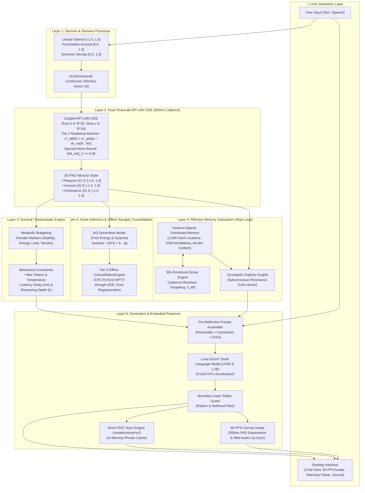

# Lucia — Deep Component Mechanism Specification

> **Comprehensive explanation of every subsystem, mathematical formula, memory lifecycle, and data flow in Lucia.**

---

## 1. End-to-End System Data Flow



---

## 2. Component-by-Component Mechanism Deep Dive

---

### Component 1: Sensors & Stimulus Processor (`src/core/gating/stimulus_processor.py`)
*Historical path: `src/core/sensors/` (retained in historical Phase 1 specs).*

The Stimulus Processor converts raw user input into continuous floating-point signals without relying on cloud embeddings or heavy neural networks.

1. **Valence Scoring ($v \in [-1.0, 1.0]$)**:
   * Analyzes lexical sentiment polarity using an affective dictionary.
   * Maps positive emotional cues (gratitude, warmth, joy) towards $+1.0$ and negative cues (frustration, hostility, sadness) towards $-1.0$.
2. **Arousal Scoring ($a \in [0.0, 1.0]$)**:
   * Quantifies conversational urgency from capitalization bursts, exclamation density, question marks, and punctuation cadence.
3. **Semantic Density Scoring ($d \in [0.0, 1.0]$)**:
   * Computes the ratio of unique information tokens to total words, measuring input complexity.
4. **Stimulus Vector Assembly**:
   * Packages $(v, a, d)$ into a 16-dimensional continuous vector $x(t) \in \mathbb{R}^{16}$ padded with temporal delta features, which is injected directly into the limbic differential equation.

---

### Component 2: Limbic System — Coupled MT-LNN Fast/Slow Loop (`src/core/emotion/`)

Lucia's emotional state is not simulated through text prompts; it is a **continuous physiological-like state machine** running a continuous **Coupled Multi-Timescale Liquid Neural Network (MT-LNN)** differential equation solved every **200ms**:

$$\frac{d\mathbf{h}_{\text{fast}}}{dt} = \frac{-\mathbf{h}_{\text{fast}} + \tanh(\mathbf{W}_f \mathbf{h}_{\text{fast}} + \mathbf{U}_f \mathbf{x} + \mathbf{W}_{fs} \mathbf{s}_{\text{slow}} + \mathbf{b}_f)}{\tau_{\text{fast}}(\mathbf{h}_{\text{fast}}, \mathbf{x})}$$

$$\frac{d\mathbf{s}_{\text{slow}}}{dt} = -\frac{\mathbf{s}_{\text{slow}} - \mathbf{s}^*_{\text{eff}}(\mathbf{R}_t)}{\tau_{\text{slow, decay}}} + \frac{\tanh\Big(\mathbf{W}_{sf} \mathbf{h}_{\text{fast}} + \mathbf{W}_{sh} \Delta\mathbf{m} + \mathbf{W}_{\text{rec}} \mathbf{r}_{\text{slow}}^{\text{bounded}}\Big)}{\tau_{\text{slow, charge}}}$$

* **Fast Layer ($\mathbf{h}_{\text{fast}} \in \mathbb{R}^{32}$)**: Continuous 32-dimensional reactive limbic state responding to sensory stimuli $\mathbf{x}(t) \in \mathbb{R}^{16}$.
* **Dynamic Time-Constants**: Fast timescale $\tau_{\text{fast}} = \tau_{\text{fast, min}} + (\tau_{\text{fast, max}} - \tau_{\text{fast, min}}) \cdot \sigma(\mathbf{W}_\tau \mathbf{h}_{\text{fast}} + \mathbf{U}_\tau \mathbf{x} + \mathbf{b}_\tau) \in [0.10, 1.50]\text{ s}$.
* **Slow Affective Latent Field ($\mathbf{s}_{\text{slow}} \in \mathbb{R}^{16}$)**: Retains multi-minute emotional momentum ($\tau_{\text{slow, charge}} = 3.50\text{ s}, \tau_{\text{slow, decay}} = 28.00\text{ s}$).
* **Coupling Strengths**: $\mathbf{W}_{fs} = 0.05$ (slow-to-fast), $\mathbf{W}_{sf} = 1.00$ (fast-to-slow), $\mathbf{W}_{sh} = 0.40$ (homeostatic deviation $\Delta\mathbf{m}$).
* **Phase 20 Closed-Loop Recollection Forcing ($\mathbf{W}_{\text{rec}}\mathbf{r}_{\text{slow}}^{\text{bounded}}$)**: Diagonal coupling $\mathbf{W}_{\text{rec}} = 0.35 \mathbf{I}_{16}$ injecting auxiliary bounded forcing for 4.0s simulation time when salient memories are recollected.
* **Tier 2 Relational Attractor Grounding ($\mathbf{s}^*_{\text{eff}}(\mathbf{R}_t)$)**:
  $$\mathbf{s}^*_{\text{eff}}(\mathbf{R}_t) = \mathbf{s}^*_{\text{philia}} + \mathbf{W}_{\text{rel}} (\mathbf{R}_t - \mathbf{R}_0)$$
  where $\mathbf{R}_0 = [0, 0.50, 0, 0.50]^T$ is the stranger baseline.
  - *Spectral Norm Bound*: $\|\mathbf{W}_{\text{rel}}\|_2 \le 0.08$ is enforced by dynamic singular value decomposition projection.
  - *Displacement Bounds*: For any relationship state $\mathbf{R} \in [0, 1]^4$, with $\|\mathbf{R} - \mathbf{R}_0\|_2 \le 1.0$ (and maximum Euclidean distance $\sqrt{2.5} \approx 1.581$), the initialization target norm $\sigma_{\max}(\mathbf{W}_{\text{rel}}) \approx 0.0475$ ensures:
    $$\|\Delta\mathbf{s}^*\|_2 \le 0.0475 \times 1.581 = 0.0751 \le 0.08$$
    and the resting PAD displacement satisfies:
    $$\|\Delta\mathbf{PAD}^*\|_2 \le \|\mathbf{W}_{\text{proj}, s}\|_2 \cdot \|\mathbf{W}_{\text{rel}}\|_2 \cdot \|\Delta\mathbf{R}\|_2 \le 0.45 \times 0.08 \times 1.0 = 0.036 \le 0.05$$
  - *Fallback Compatibility*: When `enable_relational_consolidation = False`, $\mathbf{s}^*_{\text{eff}} = \mathbf{s}^*_{\text{philia}}$ bit-exact, bypassing $\mathbf{W}_{\text{rel}}$ and preserving pure Phase 20 limbic dynamics.
* **PAD Projection**: The fast hidden state $\mathbf{h}_{\text{fast}}$ is linearly projected onto the 3-dimensional **PAD Space** clamped to $[-1.0, 1.0]^3$:
  * **Pleasure ($P$)**: Valence from distressed ($-1.0$) to joyful/warm ($+1.0$).
  * **Arousal ($A$)**: Vitality from calm/sleepy ($-1.0$) to alert/excited ($+1.0$).
  * **Dominance ($D$)**: Social agency from submissive/shy ($-1.0$) to assertive ($+1.0$).
* **Philia Resting Attractor Grounding (Distinction Between State Spaces)**:
  - **3D PAD Resting Baseline**: $\mathbf{p}^*_{\text{philia}} = [+0.25, -0.05, +0.05]^T \in [-1, 1]^3$ (`EmotionConfig.resting_baseline = (0.25, -0.05, 0.05)`). Represents the emotional output baseline in Pleasure, Arousal, Dominance.
  - **16D Slow Latent Field Attractor**: $\mathbf{s}^*_{\text{philia}} = [0.20, -0.05, 0.05, 0, \dots, 0]^T \in \mathbb{R}^{16}$ (`EmotionConfig.philia_slow_baseline = (0.20, -0.05, 0.05)`). Represents the resting coordinates centering the slow latent manifold ($\Delta\mathbf{s} = \mathbf{s}_{\text{slow}} - \mathbf{s}^*_{\text{philia}}$).
  - **Equilibrium Readout**: When the coupled system relaxes at unforced resting equilibrium ($\mathbf{h}_{\text{fast}} = \mathbf{0}, \mathbf{s}_{\text{slow}} = \mathbf{s}^*_{\text{eff}}$), the linear readout projection restores the baseline coordinate directly.
  - **Legacy Compatibility Mapping**: In `synthesize_legacy_latent()`, Case 1 checks whether a legacy 3D PAD tag matches the 3D baseline $\mathbf{p}^*_{\text{philia}} = [0.25, -0.05, 0.05]$; if so, it synthesizes the 16D slow attractor $\mathbf{s}^*_{\text{philia}} = [0.20, -0.05, 0.05, 0, \dots, 0]^T$ bit-exact.
* **Strict Contraction Invariant**: The Jacobian trace is strictly dissipative ($\text{Tr}(J) \approx -46.46 < 0$ in tested parameter domain), preventing runaway saturation or autonomous limit cycles under tested bounds.
* **Temporal Synchronization Barrier (`commit_stimulus`)**:
  To guarantee causal determinism, every cognitive turn injects stimulus $x$ via `token = push_stimulus(x)` and synchronously resolves the state transition via `commit_stimulus(token)`.
  * **Intra-Turn Transition**: The ODE advances exactly once under `_step_lock` consuming the stimulus in FIFO order, publishing the new PAD snapshot, and marking the token committed.
  * **Inter-Turn Autonomous Relaxation**: Between conversation turns, the 200ms background thread integrates autonomous relaxation towards Philia. Idle ticks never increment `_committed_stimulus_seq`.
* **Microsecond Lock Safety**: Reading the state holds a lightweight `_state_lock` for $\le 1\text{ms}$, ensuring UI and API polling never block ODE integration.

---

### Component 3: Survival & Homeostatic Engine (`src/core/emotion/homeostatic_engine.py`)
*Historical path: `src/core/homeostasis/` (retained in historical Phase 1 specs).*

The Homeostatic Engine prevents emotional extremes, anxiety spirals, or conversational burnout:

1. **Metabolic Energy Budgeting**:
   * Every conversational turn consumes energy proportional to input length and emotional arousal: $\mathcal{E}_{next} = \max(0.0, \mathcal{E} - 0.05)$.
   * While idle, energy recharges linearly at $+0.05/\text{sec}$ beyond a 60-second threshold.
2. **Somatic Markers & Multi-Turn Accumulation**:
   * **Stability**: Resistance to sudden emotional turbulence based on arousal and dominance.
   * **Cognitive Load ($\mathcal{C}$)**: Increases with input frequency across a 60-second rolling window and high arousal, modulated causally by Active Inference prediction surprise:
     $$\mathcal{C} = \text{clip}\left(\frac{\text{clip}(\text{count}_{60s}/10, 0, 1) + \text{arousal\_comp}}{2} + 0.25 \cdot \mathcal{S}, 0.0, 1.0\right)$$
     *Multi-turn accumulation*: Successive rapid turns drive $\mathcal{C}$ up from $\sim 0.08$ to $> 0.58$, dynamically contracting the token budget from 350 to 150.
   * **Energy ($\mathcal{E}$)**: Available conversational stamina. Drains monotonically across active turns ($\Delta\mathcal{E} = -0.05$ per turn; recovers during idle ticks).
   * **Tension ($\mathcal{T}$)**: Instantaneous discrepancy between homeostatic targets and external demands:
     $$\mathcal{T}_{\text{base}} = \begin{cases} |v - P_{01}| & \text{if valence } v \text{ is provided} \\ 0.0 & \text{otherwise} \end{cases}$$
     $$\mathcal{T} = \text{clip}\left(\mathcal{T}_{\text{base}} + 0.50 \cdot \max(0.0, \mathcal{S} - 0.40), 0.0, 1.0\right)$$
     *Instantaneous Signal Semantic*: Tension represents an **acute threat / mismatch signal**, evaluated fresh per turn with **zero inter-turn leaky persistence**. Because single-step surprise $\mathcal{S} \approx 0.06 - 0.10$ remains below the onset threshold ($0.40$), tension evaluates to $0.0000$ during steady-state or gradual shifts. It is not an emotional reservoir; multi-turn fatigue is handled by Cognitive Load ($\mathcal{C}$) and Energy ($\mathcal{E}$).
3. **Dynamic Behavioral Conditioning**:
   * Instead of telling the model "be happy" or "be sad", the Homeostatic Engine dynamically modifies generation parameters:
     * **Cognitive Load $> 0.30$ or Low Energy** $\rightarrow$ Throttles token budget ($350 \to 150 \to 80$ tokens), increases temperature.
     * **High Surprise / High Tension ($\mathcal{S} \ge 0.60 \text{ or } \mathcal{T} \ge 0.70$)** $\rightarrow$ Increased reasoning depth ($k=2$, deliberate cognitive appraisal rather than reflexive habit).
     * **Low Energy** $\rightarrow$ Injects simulated conversational latency delay.

---

### Component 4: Active Inference & Online LNN Plasticity (`src/core/inference/`)

Lucia adapts her emotional generative model and limbic dynamics using **Active Inference** (Free Energy Minimization) and **Two-Stage LNN Plasticity**:

1. **Short-Horizon Generative Model**:
   * Predicts upcoming PAD emotional transitions before stimulus integration:
     $$\hat{p}_{next} = A \cdot p_{current} + b$$
2. **Prediction Error & Free Energy Surprise**:
   * When observed limbic outcome $p_{actual}$ is committed by the ODE barrier, calculates Free Energy Surprise:
     $$\mathcal{S} = \|A \cdot p_{current} + b - p_{actual}\|_2$$
   * **Online Belief Vector Adaptation ($b$)**:
     * Belief bias vector $b$ updates online via analytic gradient descent:
       $$\Delta b = \eta \cdot (p_{actual} - (A \cdot p_{current} + b))$$
     * Under repeated identical stimuli, the belief vector gradually learns the directional trend ($\|\Delta b\| \approx 1.5 \times 10^{-4}$ per step), causing prediction surprise $\mathcal{S}$ to decline monotonically ($0.0927 \to 0.0699$ across 5 turns).
   * **Single-Step vs. Multi-Turn Dynamics & Hysteresis**:
     * A single ODE step ($\Delta t = 0.1$) shifts PAD by $\approx 0.06 - 0.10$, yielding an instantaneous surprise $\mathcal{S} \approx 0.06 - 0.10 < \theta_{\text{deliberative}} = 0.60$.
     * **Same-Probe Hysteresis**: Because the ODE derivative $\frac{dh}{dt} = f(h, x)$ depends nonlinearly on both the stimulus $x$ and the current hidden state $h(t)$, an identical sensory probe $x$ injected from different prior limbic histories ($h_{\text{neutral}}$ vs $h_{\text{stressed}}$ vs $h_{\text{relaxed}}$) follows distinct vector trajectories, arriving at divergent post-probe PAD coordinates, prediction errors, and cognitive load levels.
3. **Tier 3 Offline Synaptic Consolidation (`ConsolidationEngine`)**:
   * **Online Salience Tagging (Stage 16.2)**: Evaluates composite interaction salience across Free Energy surprise and limbic displacement:
     $$\text{Salience} = 0.6 \cdot \mathcal{S} + 0.4 \cdot \|p_{actual} - p_{philia}\|_2$$
     If $\text{Salience} \ge 0.50$, the interaction tuple $(x, h_{before}, h_{after})$ is queued into the consolidation buffer.
   * **Multi-Turn Sequential Continuity**: During offline rest intervals ($T_{idle} \ge 45\text{s}$) or buffer accumulation ($\ge 8$ salient samples), initial hidden states maintain sequential historical continuity:
     $$\mathbf{h}_0^{(k)} = 0.60\mathbf{h}_{\text{prev}} + 0.40\mathbf{h}_{\text{before}}^{(k)}$$
     preventing single-turn overfitting.
   * **Dual Regularization Objective**: Training executes on CPU using `torchdiffeq.odeint` under dual homeostatic and Philia regularization:
     $$\mathcal{L} = \frac{1}{K}\sum_{k=1}^K \|\mathbf{h}_{\text{pred}}^{(k)} - \mathbf{h}_{\text{target}}^{(k)}\|_2^2 + \lambda_{\text{homeo}} \|\boldsymbol{\Theta} - \boldsymbol{\Theta}_0\|_2^2 + \lambda_{\text{philia}} \|\mathbf{h}_{\text{unforced}}(\Delta t)\|_2^2$$
     where $\lambda_{\text{homeo}} = 0.05$ constrains parameter drift from baseline $\boldsymbol{\Theta}_0$ and $\lambda_{\text{philia}} = 0.10$ guarantees unforced Philia attractor restoration.
   * **Sub-2ms Atomic Weight Swap**: Updated weights are swapped into `EmotionCore` inside a sub-2ms `_train_lock`, guaranteeing **0.0 MB GPU VRAM contention** and zero active turn disruption.

---

### Component 5: Hippocampus Affective Memory & Closed-Loop Recollection (`src/core/memory/`)

Lucia uses a biologically inspired memory architecture based on **Pentti Kanerva's Sparse Distributed Memory (SDM)** (1988) augmented with Phase 20 Closed-Loop Affective Recollection:

```
┌─────────────────────────────────────────────────────────────────────────┐
│                     AFFECTIVE MEMORY TRACE STRUCTURE                    │
├─────────────────────────────────────────────────────────────────────────┤
│ • 1,000-bit Address Vector   (Contextual & semantic Hamming address)    │
│ • 64-dim Content Vector      (Sensory stimulus signature)               │
│ • PAD Tag [P, A, D]          (Emotional state when memory was formed)   │
│ • Slow Latent Trace s_slow   (16D slow-field physiological state)       │
│ • Somatic State              (Energy, Stability, Load, Tension)         │
│ • Timestamp & Base Intensity (|PAD| emotional salience magnitude)       │
└─────────────────────────────────────────────────────────────────────────┘
```

1. **Sparse Distributed Memory (SDM) Mechanics**:
   * Operates $N=1,000$ distributed memory locations across a 1,000-bit Hamming space (`address_dim = 1000`, `m = 64`).
   * Writing activates all locations within critical radius $r \le 451$ (binomial threshold for 1,000 bits).
2. **60-Second Slow-Loop Decay Engine**:
   * A background daemon ticks every 60 seconds, decaying memory trace strengths exponentially:
     $$\text{Strength}(t) = \text{Strength}_0 \cdot e^{-\lambda_{eff} t}$$
   * **Emotional Intensity Resistance**: Memories formed during intense emotional moments ($|PAD| \gg 0$) resist decay up to **$4\times$ longer**:
     $$\lambda_{eff} = \frac{\lambda_0}{1 + 3 \cdot \max(|P|, |A|, |D|)}$$
3. **Synergistic Ecphory & Multi-Modal Salience (Stage 6)**:
   * When Lucia interacts with the user, `EcphoryEngine` evaluates stored traces using multi-modal scoring:
     $$S_i = 0.60 S_{\text{sem}} + 0.25 S_{\text{aff}} + 0.15 w_{\text{decay}}$$
   * **Competitive Softmax Gating**: Traces above $\theta_{\text{gate}} = 0.50$ undergo softmax normalization at temperature $\tau_{\text{comp}} = 0.20$:
     $$w_i = \frac{\exp(S_i / \tau_{\text{comp}})}{\sum_{j \in \mathcal{A}} \exp(S_j / \tau_{\text{comp}})}$$
   * **Bounded Slow Forcing Synthesis**: Emits typed `RecollectionResult` containing:
     $$\mathbf{r}_{\text{slow}}^{\text{bounded}} = \text{clip}\left(\tanh\Big(\sum_i w_i \mathbf{s}_i\Big) \cdot 0.85, -0.85, 0.85\right)$$
4. **Closed-Loop Actuation via CognitiveOrchestrator**:
   * `EcphoryEngine` has strictly ZERO import or actuation coupling to `EmotionCore`.
   * `CognitiveOrchestrator` receives `RecollectionResult` in Stage 6 and evaluates the actuation policy:
     * If active and `enable_affective_recollection` is true, dispatches `EmotionCore.inject_recollection(r_slow, duration_sec=4.0)`.
     * In Stage 12, deriving conversational pacing latency delta $\Delta\tau_{\text{pace}} = w_{\text{pace}} \cdot \|\mathbf{r}_{\text{slow}}^{\text{bounded}}\|$ ($+111.8\text{ms}$ observed).
     * In Stage 16.1, queries live physiological state $\mathbf{s}_{\text{slow}}(t)$ and passes to `AffectiveMemory.store()`.
5. **Deterministic Legacy Compatibility Approximation**:
   * Pre-Phase-20 memories lacking a slow latent vector utilize `AffectiveMemory.synthesize_legacy_latent()` enforcing a 3-case contract:
     - Case 1 (Baseline PAD): Returns bit-exact $\mathbf{s}^*_{\text{philia}}$.
     - Case 2 (Non-baseline valid PAD): Bounded linear projection $\mathbf{s}_{\text{approx}} = (\mathbf{W}_{\text{pad}\to\text{slow}} \Delta\mathbf{p}) + \mathbf{s}^*_{\text{philia}}$ clipped to $[-0.85, 0.85]$.
     - Case 3 (Non-finite/NaN/Inf): Safe defensive fallback to $\mathbf{s}^*_{\text{philia}}$.
6. **Memory Causal Maturity Hierarchy**:
   * **Level A (Storage)**: PROVEN (`AffectiveMemory.store`).
   * **Level B (Associative Retrieval)**: PROVEN (`EcphoryEngine.query`).
   * **Level C (Affective Recollection)**: **PROVEN & PRODUCTION IMPLEMENTED** (Phase 20 Closed-Loop Slow-Field Forcing).
   * **Level D (Autobiographical Continuity)**: PLANNED FUTURE RESEARCH (Structured episodic causal graph).

---

### Component 6: Conversational History Store (`src/core/storage/history_store.py`)

Lucia strictly separates **subconscious affective memory (SDM)** from **literal dialogue history**:

* **Storage Location**: [`data/chat_history.json`](file:///c:/Users/Lunafiah/Desktop/My_project/Lucia/data/chat_history.json).
* **Schema**:
  ```json
  {
    "version": 1,
    "metadata": { "created_at": "2026-09-02T17:00:00" },
    "sessions": [
      {
        "id": "session_20260902_170000",
        "created_at": "2026-09-02T17:00:00",
        "turns": [
          { "role": "user", "content": "Hello Lucia!", "timestamp": 1788343200.0 },
          { "role": "companion", "content": "Hi my friend!", "timestamp": 1788343202.5 }
        ]
      }
    ]
  }
  ```
* **"Clear Screen" Independence**: Clearing conversation turns starts a new session in `data/chat_history.json` but **does not erase her long-term SDM memory traces or affective bond**.

---

### Component 7: Direct RVC Voice Engine (`src/core/voice/`)

* **Direct Discovery**: Automatically scans `models/voice/rvc/` for character subfolders containing `.pth` and `.index` files.
* **In-Memory Phrase Cache**: Short frequently-spoken acknowledgments (under 200 characters) are cached in memory for instantaneous zero-latency playback.
* **Emotion Modulation**: Modulates speech pitch and tempo based on live PAD state (e.g. higher pitch on high excitement, slower tempo on high calmness).

---

### Component 8: Quad-Engine Desktop Avatar & Web Audio Lip-Sync (`electron/renderer/avatar/`)

#### 1. Polymorphic 4-Engine Architecture
Lucia provides a polymorphic avatar rendering pipeline dynamically managed by `AvatarRenderer`:
* **🎨 2D Procedural Canvas Engine**:
  * Calculates real-time vector contours: eyebrows via quadratic bezier curves, smile geometry via parabolic arc math ($y = y_0 + \text{smile} \cdot k \cdot (x - x_0)^2$), cheek blush via radial gradients with dynamic opacity $\alpha = \text{clamp}(0, 0.8, \text{blush})$, and eyes with parametric vertical compression for blinks:
    $$h_{eye} = h_0 \cdot \max(0.05, 1.0 - \text{blinkProgress})$$
* **🖼️ 2D Expression Sprites Engine**:
  * Evaluates state machine priority on every frame:
    $$\text{State} = \begin{cases} \text{"thinking"} & \text{if awaiting backend response} \\ \text{"speaking"} & \text{if lip-sync mouth aperture } > 0.08 \\ \text{"blush"} & \text{if } P > 0.40 \land A > 0.10 \\ \text{"smile"} & \text{if } P > 0.30 \\ \text{"idle"} & \text{otherwise} \end{cases}$$
* **🎬 Live2D Cubism 4 Engine**:
  * Utilizes PixiJS and Official Cubism Core (`live2dcubismcore.min.js`). Maps normalized mouse coordinates and PAD variables into standard Cubism parameter IDs:
    * `ParamAngleX`, `ParamAngleY` $\leftarrow \text{mouse.x} \cdot 30^\circ, \text{mouse.y} \cdot 30^\circ$
    * `ParamEyeLOpen`, `ParamEyeROpen` $\leftarrow \text{clamp}(0, 1.2, \text{eyeOpen} \cdot (1 - \text{blinkProgress}))$
    * `ParamMouthOpenY` $\leftarrow \text{lipSync.mouthOpen}$
    * `ParamCheek` $\leftarrow \text{clamp}(0, 1, \text{blush})$
* **🌐 3D Humanoid VRM Engine**:
  * Built on Three.js and `@pixiv/three-vrm`. Updates head bone quaternions using spherical linear interpolation (SLERP) toward cursor gaze vectors.
  * Drives facial blendshape morph targets (`happy`, `aa`, `blink`, `relaxed`) on the VRM Expression Manager. Includes an emergency holographic procedural rig if external VRM assets are unavailable.

#### 2. Visual Model Bounds Computation (`getModelBounds()`)
To anchor UI elements (such as the mascot toolbar dock) and hit-test user interactions, `AvatarRenderer` computes the visual bounding box across all active engines:
* **Sprites Engine**:
  $$\text{scale} = \min\left(\frac{W_{canvas} \cdot 0.95}{W_{natural}}, \frac{H_{canvas} \cdot 0.95}{H_{natural}}\right) \cdot \text{mascotScale}$$
  $$\text{left} = \frac{W - W_{draw}}{2} + \text{pan}_x, \quad \text{top} = H - H_{draw} + \text{pan}_y$$
  $$\text{bottomY} = \text{top} + H_{draw}, \quad \text{centerX} = \text{left} + \frac{W_{draw}}{2}$$
* **Live2D Engine**:
  $$\text{left} = M_x, \quad \text{right} = M_x + W_{model}, \quad \text{centerX} = M_x + \frac{W_{model}}{2}, \quad \text{bottomY} = M_y + H_{model}$$
* **3D VRM Engine**:
  $$H_{model} = H_{canvas} \cdot 0.75 \cdot \text{mascotScale}, \quad W_{model} = H_{model} \cdot 0.55$$
  $$\text{bottomY} = H_{canvas} \cdot 0.88 + \text{pan}_y, \quad \text{top} = \text{bottomY} - H_{model}, \quad \text{centerX} = \frac{W_{canvas}}{2} + \text{pan}_x$$
* **Procedural Canvas Engine**:
  $$R_{head} = \min(W_{canvas}, H_{canvas}) \cdot 0.30 \cdot \text{mascotScale}$$
  $$\text{centerX} = \frac{W_{canvas}}{2} + \text{pan}_x, \quad \text{bottomY} = \frac{H_{canvas}}{2} + \text{pan}_y + R_{head} \cdot 1.8$$

#### 3. Dynamic Toolbar Dock Anchoring
In Mascot Mode, the floating toolbar dock mathematically anchors directly beneath the character's feet:
$$\text{safeX} = \text{clamp}(120, W_{window} - 120, \text{bounds.centerX})$$
$$\text{safeY} = \text{clamp}(H_{dock}, H_{window} - H_{dock} - 6, \text{bounds.bottomY} + 8)$$
This keeps the control pill attached directly to the character regardless of panning or zoom levels.

#### 4. Hit-Tested Hover Zoom, Inertia Cooldown & Drag Isolation
To eliminate accidental zooming when moving the mascot window via trackpad or mouse gestures:
* **Cursor Hit-Testing (`isCursorOverModel`)**:
  $$\text{isOverModel} = (x_{cursor} \ge \text{bounds.left}) \land (x_{cursor} \le \text{bounds.right}) \land (y_{cursor} \ge \text{bounds.top}) \land (y_{cursor} \le \text{bounds.bottom})$$
* **Trackpad Drag Inertia Cooldown**: When releasing the drag (`mouseup`), `lastWindowDragEndTime = Date.now()` is set. Any residual momentum wheel events received within $800\text{ms}$ are discarded:
  $$\text{if } (t_{now} - t_{dragEnd} < 800\text{ms}) \implies \text{discard wheel zoom}$$
* **Aero Snap Prevention & Bounds Guard**: Mascot window configuration sets `maximizable: false`, `fullscreenable: false`, and `resizable: false` to prevent Windows Aero Snap from maximizing transparent canvas views. Double-clicking or resetting invokes `window:reset-mascot-bounds` to unmaximize and enforce $380 \times 540$ dimensions.

#### 5. Adaptive Framerate Throttling
Supports runtime energy conservation:
$$\Delta t = t_{now} - t_{lastFrame}$$
$$\text{if } \Delta t < \left(\frac{1000}{\text{targetFps}} - 2\text{ms}\right) \implies \text{skip render frame}$$
* At 60 FPS: ultra-fluid rendering for high-end immersion.
* At 30 FPS: 50% reduction in rendering load for laptop battery preservation.

#### 6. 60 FPS Web Audio Lip-Sync (`lip-sync.js`)
* Connects an `AudioContext` & `AnalyserNode` frequency analyzer to voice playback.
* Analyzes vocal formants (bins 2–32, ~200Hz–2500Hz) to drive mouth height and vowel width in real time.

#### 7. Offline Speech-to-Text & VAD Pipeline (`src/core/voice/stt_engine.py`)
To eliminate Chromium's proprietary cloud requirement and `chunked_data_pipe_upload_data_stream.cc` network failure in standalone Electron:
* **Local Web Audio VAD**: Analyzes microphone input frequency bin averages at 100ms intervals. Detects speech when volume $> 14$ and finalizes utterances after $1.2\text{s}$ of subsequent silence.
* **MediaRecorder Opus/WebM Chunking**: Audio is streamed into in-memory chunks without writing temporary browser files.
* **Offline `faster-whisper` Engine**: Dispatches audio bytes to `POST /voice/transcribe`, running local CTranslate2 Whisper model with auto-detected hardware acceleration (FP16 on CUDA, INT8 on CPU) and Silero VAD filtering.
* **Speaker-to-Mic Echo Loop Prevention**: Voice recording is automatically suspended during Lucia's speech synthesis playback and resumed upon completion.

---

### Component 9: Limbic Stability Evaluator (`src/core/telemetry/`)

* **Fast-Loop Tick Jitter**: Tracks variance against the nominal 200ms cadence over a trailing 100-tick window.
* **ODE Velocity Variance ($\sigma_v^2$)**: Monitors the rate of change of hidden state norm $\|dh/dt\|_2$.
* **Composite Limbic Stability Index (LSI)**:
  $$\text{LSI} = 0.4 \cdot e^{-\frac{\text{Jitter}_{mean}}{50\text{ms}}} + 0.4 \cdot e^{-\sigma_v^2} + 0.2 \cdot \left(1.0 - 0.5 \cdot \frac{\text{Traces}}{\text{Capacity}}\right)$$
* **Automated Recovery Watchdog**: If a mathematical stall or NaN/Inf state occurs, state automatically resets to the Philia resting baseline without crashing.

---

### Component 10: Modular Extensibility & Lifecycle Hook Bus (`src/core/plugins/`)

Lucia includes a non-blocking hook bus so future features (e.g. 3D VRM models, screen vision, external chat tools) can be plugged in without refactoring core code:

* `on_turn_start(input_text)`
* `on_stimulus_encoded(stimulus_vector)`
* `on_somatic_updated(pad_state, somatic_markers)`
* `on_prompt_assembled(prompt_text)`
* `on_response_generated(response_text)`
* `on_turn_completed(turn_record)`

---

### Component 11: Simulation Engine, Virtual Clock & Ephemeral Storage (`src/core/simulation/`)

Phase 8 implements deterministic, inspectable simulation mechanics operating under the strict invariant $\text{Development} \neq \text{Activation}$:

1. **Virtual Clock Mechanism (`SimClock`)**:
   * Synchronously advances virtual time without running autonomous sleep-loops:
     $$\Delta t_{accum} \mathrel{+}= \Delta t_{step}$$
   * Dispatches fast-tick callbacks (`EmotionCore.step_once`) for each elapsed 200ms interval, subject to `max_fast_ticks=50` to prevent event-loop starvation during multi-hour time leaps.
   * Computes due slow-tick decay events:
     $$\text{due\_slow\_ticks} = \lfloor \frac{\text{elapsed\_virtual\_seconds}}{60.0} \rfloor$$
     Executing synchronous `DecayEngine.apply_decay_tick(60.0)` for every accumulated minute.
2. **Ephemeral Storage Isolation (`StoragePolicy`)**:
   * Intercepts and blocks all file write operations resolving into `data/` or `data/profile.json` (`assert_write_permitted()`).
   * Replaces disk JSON stores with `InMemoryChatHistoryStore` (RAM list) and `InMemoryProfileStore` (RAM dict).
   * Unconditionally blocks live companion awakening: `SimulationRuntime.activate()` raises `ActivationSafetyError`.
3. **Sensory vs. Debug Probe Pathway Mechanics**:
   * *Sensory Pathway*: Invokes `StimulusProcessor.encode(text)` yielding a 16D vector tagged `pathway: "sensory_text"`.
   * *Debug Probe Pathway*: Injects raw 16D vector directly into `EmotionCore` tagged `pathway: "debug_vector_probe"`, bypassing sensory processing.

---

## 3. Summary of Concurrency & Threads

| Thread | Frequency | Module | Function |
|---|---|---|---|
| **Fast-Loop ODE** | 200ms | `src/core/emotion/` | Solves continuous emotion differential equation (live mode) |
| **Slow-Loop Decay** | 60s | `src/core/memory/` | Applies emotional memory forgetting curve (live mode) |
| **ConsolidationEngine** | Idle / Buffer | `src/core/emotion/consolidation.py` | Tier 3 offline CPU BPTT plasticity with dual regularization |
| **SimClock Driver** | Virtual / Step | `src/core/simulation/` | Synchronous callback dispatching & time-warp in simulation mode |
| **Uvicorn Server** | Event-Driven | `src/api/server.py` | Serves FastAPI REST & telemetry endpoints |
| **Electron UI** | 60 FPS | `electron/renderer/` | Hardware-accelerated avatar rendering & lip-sync |
