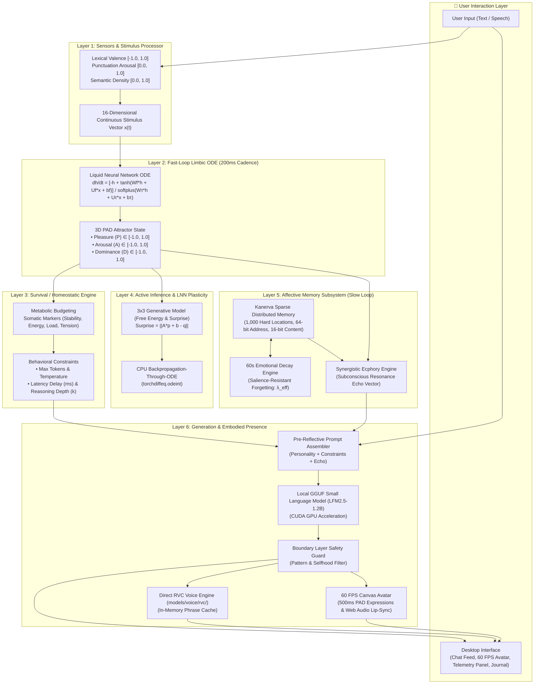

# Lucia — Deep Component Mechanism Specification

> **Comprehensive explanation of every subsystem, mathematical formula, memory lifecycle, and data flow in Lucia.**

---

## 1. End-to-End System Data Flow



---

## 2. Component-by-Component Mechanism Deep Dive

---

### Component 1: Sensors & Stimulus Processor (`src/core/sensors/`)

The Stimulus Processor converts raw user input into continuous floating-point signals without relying on cloud embeddings or heavy neural networks.

1. **Valence Scoring ($v \in [-1.0, 1.0]$)**:
   * Analyzes lexical sentiment polarity using an affective dictionary.
   * Maps positive emotional cues (gratitude, warmth, joy) towards $+1.0$ and negative cues (frustration, hostility, sadness) towards $-1.0$.
2. **Arousal Scoring ($a \in [0.0, 1.0]$)**:
   * Quantifies conversational urgency from capitalization bursts, exclamation density, question marks, and punctuation cadence.
3. **Semantic Density Scoring ($d \in [0.0, 1.0]$)**:
   * Computes the ratio of unique information tokens to total words, measuring input complexity.
4. **Stimulus Vector Assembly**:
   * Packages $(v, a, d)$ into a 16-dimensional continuous vector $x(t) \in \mathbb{R}^{16}$ padded with temporal delta features, which is injected directly into the limbic differential equation.

---

### Component 2: Limbic System Fast Loop (`src/core/emotion/`)

Lucia's emotional state is not simulated through text prompts; it is a **continuous physiological-like state machine** running a continuous **Liquid Time-Constant (LTC) differential equation** on a dedicated background thread every **200ms**:

$$\frac{dh}{dt} = \frac{-h + \tanh(W_f h + U_f x + b_f)}{\text{softplus}(W_\tau h + U_\tau x + b_\tau)}$$

* **Hidden State ($h \in \mathbb{R}^{32}$)**: Continuous 32-dimensional limbic state.
* **Liquid Time-Constants**: The denominator $\text{softplus}(W_\tau h + U_\tau x + b_\tau)$ dynamically scales the rate of emotional change. Intense inputs cause fast shifts; calm moments allow slow, organic settling.
* **PAD Projection**: The 32D hidden state is linearly projected onto the 3-dimensional **PAD Space** clamped to $[-1.0, 1.0]^3$:
  * **Pleasure ($P$)**: Valence from distressed ($-1.0$) to joyful/warm ($+1.0$).
  * **Arousal ($A$)**: Vitality from calm/sleepy ($-1.0$) to alert/excited ($+1.0$).
  * **Dominance ($D$)**: Social agency from submissive/shy ($-1.0$) to assertive ($+1.0$).
* **Philia Resting Attractor**: When left idle without stimulus ($x=0$), the ODE smoothly converges back to Lucia's friendship baseline:
  $$P^* = +0.25, \quad A^* = -0.05, \quad D^* = +0.05$$
* **Microsecond Lock Safety**: Reading the state holds a lightweight `_state_lock` for $\le 1\text{ms}$, ensuring the UI and API polling never block the ODE solver.

---

### Component 3: Survival & Homeostatic Engine (`src/core/homeostasis/`)

The Homeostatic Engine prevents emotional extremes, anxiety spirals, or conversational burnout:

1. **Metabolic Energy Budgeting**:
   * Every conversational turn consumes energy proportional to input length and emotional arousal.
   * While idle, energy recharges linearly at $+0.05/\text{sec}$ up to $1.0$.
2. **Somatic Markers**:
   * **Stability**: Resistance to sudden emotional turbulence.
   * **Cognitive Load**: Short-term processing strain.
   * **Energy**: Available conversational stamina.
   * **Tension**: Discrepancy between internal homeostatic targets and external demands.
3. **Dynamic Behavioral Conditioning**:
   * Instead of telling the model "be happy" or "be sad", the Homeostatic Engine dynamically modifies generation parameters:
     * **High Arousal / Low Energy** $\rightarrow$ Shorter token budget (brisk replies), higher temperature.
     * **High Tension** $\rightarrow$ Increased reasoning depth ($k=2$).
     * **Low Energy** $\rightarrow$ Injects simulated conversational latency delay.

---

### Component 4: Active Inference & Online LNN Plasticity (`src/core/inference/`)

Lucia adapts her emotional responses over time using **Active Inference** (Free Energy Minimization):

1. **Short-Horizon Generative Model**:
   * Maintains a linear transition matrix $A \in \mathbb{R}^{3 \times 3}$ and bias vector $b \in \mathbb{R}^3$ predicting the upcoming PAD state:
     $$\hat{p}_{next} = A \cdot p_{current} + b$$
2. **Prediction Error & Surprise**:
   * When the actual outcome $p_{actual}$ is observed, the engine calculates Free Energy Surprise:
     $$\text{Surprise} = \|A \cdot p_{current} + b - p_{actual}\|_2$$
3. **Online LNN Plasticity (CPU-Only Trainer)**:
   * Interaction tuples $(x, h_{before}, h_{after})$ are accumulated into an experience buffer.
   * When a batch of 16 turns is ready, a background CPU thread runs backpropagation-through-ODE (`torchdiffeq.odeint`) with analytic gradients clipped to $[-2.0, 2.0]$.
   * Updated weights are swapped into `EmotionCore` inside a sub-2ms `_train_lock`, producing **0 MB GPU VRAM contention**.

---

### Component 5: Hippocampus Affective Memory & Synergistic Ecphory (`src/core/memory/`)

Lucia uses a biologically inspired memory architecture based on **Pentti Kanerva's Sparse Distributed Memory (SDM)** (1988):

```
┌─────────────────────────────────────────────────────────────────────────┐
│                     AFFECTIVE MEMORY TRACE STRUCTURE                    │
├─────────────────────────────────────────────────────────────────────────┤
│ • 64-bit Address Vector      (Contextual & semantic Hamming address)    │
│ • 16-bit Content Vector      (Sensory stimulus signature)               │
│ • PAD Tag [P, A, D]          (Emotional state when memory was formed)   │
│ • Somatic State              (Energy, Stability, Load, Tension)         │
│ • Timestamp & Base Intensity (|PAD| emotional salience magnitude)       │
└─────────────────────────────────────────────────────────────────────────┘
```

1. **Sparse Distributed Memory (SDM) Mechanics**:
   * Operates $N=1,000$ distributed memory locations across a 64-bit Hamming space.
   * Writing activates all locations within critical radius $r \le 28$.
2. **60-Second Slow-Loop Decay Engine**:
   * A background daemon ticks every 60 seconds, decaying memory trace strengths exponentially:
     $$\text{Strength}(t) = \text{Strength}_0 \cdot e^{-\lambda_{eff} t}$$
   * **Emotional Intensity Resistance**: Memories formed during intense emotional moments ($|PAD| \gg 0$) resist decay up to **$4\times$ longer**:
     $$\lambda_{eff} = \frac{\lambda_0}{1 + 3 \cdot \max(|P|, |A|, |D|)}$$
3. **Synergistic Ecphory (Subconscious Resonance Echo)**:
   * When Lucia interacts with the user, her current emotional state acts as a retrieval cue across past SDM traces.
   * Rather than quoting past memories mechanically (*"On Tuesday you said X"*), the engine synthesizes a subtle **Subconscious Echo Vector** that gently colors her prompt context, conversational depth, and tone.

---

### Component 6: Conversational History Store (`src/core/storage/history_store.py`)

Lucia strictly separates **subconscious affective memory (SDM)** from **literal dialogue history**:

* **Storage Location**: [`data/chat_history.json`](file:///c:/Users/Lunafiah/Desktop/My_project/Lucia/data/chat_history.json).
* **Schema**:
  ```json
  {
    "version": 1,
    "metadata": { "created_at": "2026-09-02T17:00:00" },
    "sessions": [
      {
        "id": "session_20260902_170000",
        "created_at": "2026-09-02T17:00:00",
        "turns": [
          { "role": "user", "content": "Hello Lucia!", "timestamp": 1788343200.0 },
          { "role": "companion", "content": "Hi my friend!", "timestamp": 1788343202.5 }
        ]
      }
    ]
  }
  ```
* **"Clear Screen" Independence**: Clearing conversation turns starts a new session in `data/chat_history.json` but **does not erase her long-term SDM memory traces or affective bond**.

---

### Component 7: Direct RVC Voice Engine (`src/core/voice/`)

* **Direct Discovery**: Automatically scans `models/voice/rvc/` for character subfolders containing `.pth` and `.index` files.
* **In-Memory Phrase Cache**: Short frequently-spoken acknowledgments (under 200 characters) are cached in memory for instantaneous zero-latency playback.
* **Emotion Modulation**: Modulates speech pitch and tempo based on live PAD state (e.g. higher pitch on high excitement, slower tempo on high calmness).

---

### Component 8: 60 FPS Desktop Avatar & Web Audio Lip-Sync (`electron/renderer/avatar/`)

1. **Expression Mapping (`expression-mapper.js`)**:
   * Translates 500ms PAD telemetry into facial blendshapes:
     * High Pleasure $\rightarrow$ Warm smile curve, soft cheek blushing.
     * High Arousal $\rightarrow$ Alert, wide-open eyes and raised eyebrows.
     * Low Arousal $\rightarrow$ Relaxed, gentle eyelid droop.
2. **60 FPS Web Audio Lip-Sync (`lip-sync.js`)**:
   * Connects an `AudioContext` & `AnalyserNode` frequency analyzer to voice playback.
   * Analyzes vocal formants (bins 2–32, ~200Hz–2500Hz) to drive mouth height and vowel width in real time.
3. **Physics & Animation Rig (`avatar.js`)**:
   * Triple-frame eye blinking every 3–6 seconds.
   * Gentle sinusoidal breathing idle cycle.
   * Cursor gaze tracking (eyes and head subtly track user mouse movements).

---

### Component 9: Limbic Stability Evaluator (`src/core/telemetry/`)

* **Fast-Loop Tick Jitter**: Tracks variance against the nominal 200ms cadence over a trailing 100-tick window.
* **ODE Velocity Variance ($\sigma_v^2$)**: Monitors the rate of change of hidden state norm $\|dh/dt\|_2$.
* **Composite Limbic Stability Index (LSI)**:
  $$\text{LSI} = 0.4 \cdot e^{-\frac{\text{Jitter}_{mean}}{50\text{ms}}} + 0.4 \cdot e^{-\sigma_v^2} + 0.2 \cdot \left(1.0 - 0.5 \cdot \frac{\text{Traces}}{\text{Capacity}}\right)$$
* **Automated Recovery Watchdog**: If a mathematical stall or NaN/Inf state occurs, state automatically resets to the Philia resting baseline without crashing.

---

### Component 10: Modular Extensibility & Lifecycle Hook Bus (`src/core/plugins/`)

Lucia includes a non-blocking hook bus so future features (e.g. 3D VRM models, screen vision, external chat tools) can be plugged in without refactoring core code:

* `on_turn_start(input_text)`
* `on_stimulus_encoded(stimulus_vector)`
* `on_somatic_updated(pad_state, somatic_markers)`
* `on_prompt_assembled(prompt_text)`
* `on_response_generated(response_text)`
* `on_turn_completed(turn_record)`

---

## 3. Summary of Concurrency & Threads

| Thread | Frequency | Module | Function |
|---|---|---|---|
| **Fast-Loop ODE** | 200ms | `src/core/emotion/` | Solves continuous emotion differential equation |
| **Slow-Loop Decay** | 60s | `src/core/memory/` | Applies emotional memory forgetting curve |
| **LNN Trainer** | On Batch (16) | `src/core/inference/` | CPU backpropagation-through-ODE plasticity |
| **Uvicorn Server** | Event-Driven | `src/api/server.py` | Serves FastAPI REST & telemetry endpoints |
| **Electron UI** | 60 FPS | `electron/renderer/` | Hardware-accelerated avatar rendering & lip-sync |
