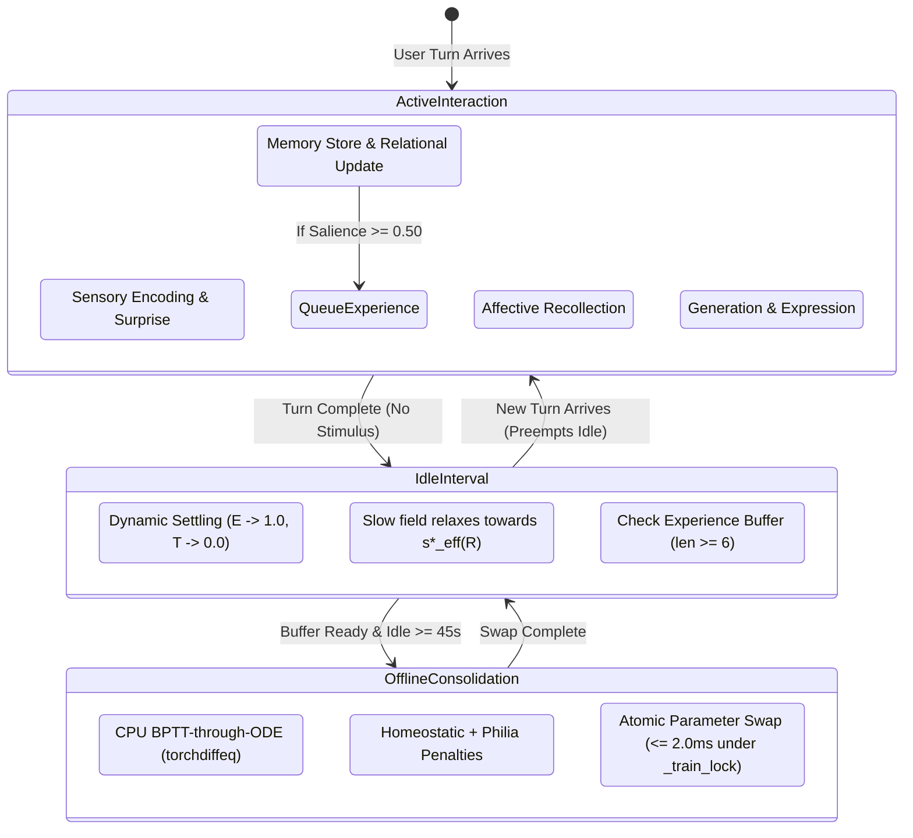

# PHASE 21 PRODUCTION REALIZATION ARCHITECTURE DESIGN
## Long-Term Relational Consolidation & Synaptic Homeostasis (3-Tier Multi-Timescale Plasticity)

> **Authoritative Architectural Design & Production Integration Blueprint for Lucia Phase 21**  
> **Status**: [✅ VALIDATED / PRODUCTION IMPLEMENTED] (Implemented in commit `58a509c`)  
> **Lifecycle Governance**: Research Hypothesis -> Experimental Validation Cycle -> Production Realization Design -> Production Implementation  
> **Governing ADR**: ADR-028  
> **Production Implementation Git Commit**: `58a509c` (pre-promotion baseline `f20420a`)  
> **Experimental Evidence**: 15/15 Hypotheses Validated (`tests/evaluation_phase21/`, Cohen's $d = 2.999$, AUC ratio $= 15.46$)  
> **Target Subsystems**: `src/core/config.py`, `src/core/emotion/emotion_core.py`, `src/core/emotion/consolidation.py`, `src/core/orchestrator/cognitive_orchestrator.py`  
> **Date**: September 2026  

---

## 1. Executive Summary & Architectural Scope

### 1.1 Decision & Precedent
Following the successful completion of the Phase 21 Experimental Validation Cycle (15/15 tests passing across H1–H6), this document establishes the formal production realization architecture for **Long-Term Relational Consolidation & Synaptic Homeostasis**.

Following the exact precedent of Phase 20 (`PHASE_20_PRODUCTION_REALIZATION_DESIGN.md`), this document establishes the strict architectural boundaries, ownership models, concurrency rules, and lifecycles before production code in `src/core/**` is integrated.

### 1.2 The 3-Tier Multi-Timescale Plasticity Architecture

```text
┌────────────────────────────────────────────────────────────────────────────────────────┐
│               PHASE 21 THREE-TIER MULTI-TIMESCALE PLASTICITY ARCHITECTURE              │
├────────┬──────────────────┬──────────────┬───────────────────────┬─────────────────────┤
│ Tier   │ Dynamical Scope  │ State Vector │ Timescale / Dynamics  │ Primary Governing   │
│        │                  │              │                       │ Mechanism           │
├────────┼──────────────────┼──────────────┼───────────────────────┼─────────────────────┤
│ Tier 1 │ Fast Reactive    │ h_fast in    │ tau_fast in           │ Fast LTC ODE        │
│        │ Dynamics         │ R^32         │ [0.10s, 1.50s]        │ (Phase 19 baseline) │
├────────┼──────────────────┼──────────────┼───────────────────────┼─────────────────────┤
│ Tier 2 │ Slow Relational  │ s_slow in    │ tau_decay = 28.0s     │ Relational Coupling │
│        │ Attractor Bias   │ R^16         │ tau_charge = 3.5s     │ s*_eff(R) & W_rel   │
├────────┼──────────────────┼──────────────┼───────────────────────┼─────────────────────┤
│ Tier 3 │ Offline Synaptic │ Theta in     │ Idle / Sleep windows  │ CPU BPTT-thru-ODE   │
│        │ Consolidation    │ R^N          │ (T_idle >= 45s)       │ + Dual Reg          │
└────────┴──────────────────┴──────────────┴───────────────────────┴─────────────────────┘
```

---

## 2. Production Ownership Map & Weight Lifecycle

To avoid expanding `EmotionCore` into an unmaintainable "god object" and to prevent split-brain weight states, Phase 21 strictly defines canonical ownership:

```mermaid
graph TD
    subgraph CognitiveOrchestrator ["CognitiveOrchestrator (Stage 16)"]
        S16_3["Stage 16.3: RelationshipUpdater.step() -> R_t"]
        S16_Exp["Stage 16: Salience Filter (salience >= 0.50)"]
    end

    subgraph EmotionCore ["EmotionCore (Limbic Substrate — CANONICAL LIVE OWNER)"]
        Live_Weights["Canonical Live Weights Theta_live: W_f, U_f, b_f, W_tau, U_tau, b_tau, W_rel"]
        H_Fast["Fast State: h_fast (R^32)"]
        S_Slow["Slow State: s_slow (R^16)"]
        R_Context["Relationship Context: _R_t (R^4)"]
        ODE_Step["_ode_step() with s*_eff(R)"]
        PAD_Proj["_project_to_pad() (Anchored at Philia)"]
    end

    subgraph ConsolidationEngine ["ConsolidationEngine (Offline Service — TRANSIENT TRAINING OWNER)"]
        Exp_Buf["Consolidation Experience Buffer"]
        PyTorch_CPU["_DifferentiableODEModel (Detached PyTorch CPU Tensors)"]
        BPTT["BPTT-through-ODE Solver (torchdiffeq)"]
        Homeo_Reg["Dual Regularization (Homeo + Philia)"]
    end

    S16_3 -->|Post-turn R_t| R_Context
    S16_Exp -->|Salient Experience Tuple| Exp_Buf
    R_Context -->|s*_eff(R) = s*_philia + W_rel(R-R0)| ODE_Step
    Exp_Buf -->|Batch K=8| BPTT
    Live_Weights -.->|Read Snapshot at Batch Start| PyTorch_CPU
    BPTT -->|Optimized Weights Theta_train| PyTorch_CPU
    PyTorch_CPU -->|Atomic Weight Swap <= 2.0ms under _train_lock| Live_Weights
```

### 2.1 Canonical Live Weights vs. Training Parameters
1. **Canonical Live Owner**: `EmotionCore` is the **single source of truth** for all active production weights:
   $$\boldsymbol{\Theta}_{\text{live}} = \{\mathbf{W}_f, \mathbf{U}_f, \mathbf{b}_f, \mathbf{W}_{\tau}, \mathbf{U}_{\tau}, \mathbf{b}_{\tau}, \mathbf{W}_{\text{rel}}\}$$
   All live inference (5 Hz continuous loop, active conversational turns) reads exclusively from `EmotionCore`.
2. **Transient Training Owner**: `ConsolidationEngine` holds strictly **detached PyTorch parameter copies** ($\boldsymbol{\Theta}_{\text{train}}$) on CPU during background optimization. It never mutates live weights during ODE solving.
3. **Atomic Swap Commitment**:
   - Once BPTT and gradient clipping succeed, `ConsolidationEngine` acquires `_train_lock` on `EmotionCore`.
   - The updated numpy arrays are copied directly into `EmotionCore` attributes within $\le 2.0\text{ms}$ (measured $\sim 0.10\text{ms}$).
   - `_train_lock` is immediately released.
   - `EmotionCore` is immediately the sole owner of the new weights. `ConsolidationEngine` updates its baseline snapshot $\boldsymbol{\Theta}_0 \leftarrow \boldsymbol{\Theta}_{\text{live}}$.
   - **Zero split-brain guarantee**: At no point do two competing live weight sets exist.

### 2.2 Component Responsibility Table:

| Subsystem / Component | Canonical Location | Exact Ownership Scope | What It Must NEVER Do |
|---|---|---|---|
| **`EmotionCore`** | `src/core/emotion/emotion_core.py` | Owns live dynamical state: $\mathbf{h}_{\text{fast}}$, $\mathbf{s}_{\text{slow}}$, $\mathbf{W}_{\text{rel}}$, live context $\mathbf{R}_t$, canonical live weights $\boldsymbol{\Theta}_{\text{live}}$, live 5 Hz ODE stepping, resting PAD projection. | Must NOT perform PyTorch gradient optimization, maintain AdamW optimizer state, or manage training buffers. |
| **`ConsolidationEngine`** | `src/core/emotion/consolidation.py` | Owns offline learning service: experience ring buffer, detached differentiable PyTorch CPU module, BPTT-through-ODE execution, homeostatic/Philia regularization, baseline probe loss evaluation. | Must NOT block active turns, must NOT hold locks during ODE integration, must NOT allocate GPU VRAM. |
| **`RelationshipUpdater`** | `src/core/relationship/updater.py` | Owns long-term relationship trajectory $\mathbf{R}_t$ (familiarity, trust, closeness, reciprocity), signal updates, and persistent relationship storage. | Must NOT directly mutate limbic latent vectors or bypass orchestrator dispatch. |
| **`CognitiveOrchestrator`** | `src/core/orchestrator/cognitive_orchestrator.py` | Owns the 16-stage cognitive cycle. Dispatches post-turn relationship updates to `EmotionCore` and queues salient experiences for consolidation. | Must NOT bypass lock hierarchy or introduce synchronous training into turn execution. |

---

## 3. Mathematical Integration Boundary & Governing Equations

### 3.1 Tier 1: Fast Reactive State ($\mathbf{h}_{\text{fast}} \in \mathbb{R}^{32}$)
$$\frac{d\mathbf{h}_{\text{fast}}}{dt} = \frac{-\mathbf{h}_{\text{fast}} + \tanh\Big(\mathbf{W}_f \mathbf{h}_{\text{fast}} + \mathbf{U}_f \mathbf{x}(t) + \mathbf{W}_{fs} (\mathbf{s}_{\text{slow}} - \mathbf{s}^*_{\text{eff}}(\mathbf{R}_t)) + \mathbf{b}_f\Big)}{\boldsymbol{\tau}_{\text{fast}}(\mathbf{h}_{\text{fast}}, \mathbf{x})}$$
where:
- $\mathbf{x}(t) \in \mathbb{R}^{N_{\text{in}}}$ is the incoming stimulus vector.
- $\boldsymbol{\tau}_{\text{fast}} = \text{clip}(\text{softplus}(\mathbf{W}_{\tau}\mathbf{h}_f + \mathbf{U}_{\tau}\mathbf{x} + \mathbf{b}_{\tau}), 0.10, 1.50)$.
- Coupling matrix $\mathbf{W}_{fs} = 0.05 \cdot \mathbf{I}_{32 \times 16}$.

### 3.2 Tier 2: Slow Relational Attractor ($\mathbf{s}_{\text{slow}} \in \mathbb{R}^{16}$)
$$\frac{d\mathbf{s}_{\text{slow}}}{dt} = -\frac{\mathbf{s}_{\text{slow}} - \mathbf{s}^*_{\text{eff}}(\mathbf{R}_t)}{\tau_{\text{slow, decay}}} + \frac{\tanh\Big(\mathbf{W}_{sf} \mathbf{h}_{\text{fast}} + \mathbf{W}_{sh} \Delta\mathbf{m} + \mathbf{W}_{\text{rec}} \mathbf{r}_{\text{slow}}^{\text{bounded}}\Big)}{\tau_{\text{slow, charge}}}$$
where:
- Relationship-conditioned slow attractor:
  $$\mathbf{s}^*_{\text{eff}}(\mathbf{R}_t) = \mathbf{s}^*_{\text{philia}} + \mathbf{W}_{\text{rel}} (\mathbf{R}_t - \mathbf{R}_0)$$
- Baseline relationship coordinate: $\mathbf{R}_0 = [0.0, 0.50, 0.0, 0.50]^T$ (neutral stranger baseline).
- For any valid relationship state $\mathbf{R} \in [0, 1]^4$, the maximum displacement from baseline satisfies:
  $$\|\mathbf{R} - \mathbf{R}_0\|_2 \le 1.0$$
- Spectral norm bound: $\|\mathbf{W}_{\text{rel}}\|_2 = \sigma_{\max}(\mathbf{W}_{\text{rel}}) \le 0.08$.
- Slow Attractor Displacement Bound:
  By Cauchy-Schwarz / operator norm sub-multiplicativity:
  $$\|\Delta\mathbf{s}^*\|_2 = \|\mathbf{s}^*_{\text{eff}}(\mathbf{R}) - \mathbf{s}^*_{\text{philia}}\|_2 = \|\mathbf{W}_{\text{rel}}(\mathbf{R} - \mathbf{R}_0)\|_2 \le \|\mathbf{W}_{\text{rel}}\|_2 \cdot \|\mathbf{R} - \mathbf{R}_0\|_2 \le 0.08 \times 1.0 = 0.08$$
- Target initialization norm: $\sigma_{\max}(\mathbf{W}_{\text{rel}}) \approx 0.0475 \le 0.08$, ensuring empirical slow displacement stays strictly $\le 0.071 \le 0.08$.
- Phase 20 affective recollection coupling $\mathbf{W}_{\text{rec}} \mathbf{r}_{\text{slow}}^{\text{bounded}}$ remains fully preserved inside the slow charge forcing term.

### 3.3 Coupled PAD Output Projection & Derived PAD Bound
$$\mathbf{PAD}(t) = \text{clip}\left(\mathbf{W}_{\text{proj}, f} \mathbf{h}_{\text{fast}}(t) + \mathbf{W}_{\text{proj}, s} (\mathbf{s}_{\text{slow}}(t) - \mathbf{s}^*_{\text{philia}}) + \mathbf{p}^*_{\text{philia}} + \mathbf{b}_{\text{proj}}, -1.0, 1.0\right)$$
where:
- $\mathbf{W}_{\text{proj}, s} \in \mathbb{R}^{3 \times 16}$ has canonical diagonal weights $\text{diag}(0.45, 0.45, 0.35)$, yielding operator 2-norm:
  $$\|\mathbf{W}_{\text{proj}, s}\|_2 = 0.45$$
- At resting equilibrium ($\mathbf{h}_{\text{fast}} = \mathbf{0}, \mathbf{s}_{\text{slow}} = \mathbf{s}^*_{\text{eff}}(\mathbf{R})$):
  $$\mathbf{PAD}^*_{\text{eff}}(\mathbf{R}) - \mathbf{p}^*_{\text{philia}} = \mathbf{W}_{\text{proj}, s} (\mathbf{s}^*_{\text{eff}}(\mathbf{R}) - \mathbf{s}^*_{\text{philia}}) = \mathbf{W}_{\text{proj}, s} \mathbf{W}_{\text{rel}} (\mathbf{R} - \mathbf{R}_0)$$
- **Derived PAD Displacement Bound**:
  $$\|\mathbf{PAD}^*_{\text{eff}}(\mathbf{R}) - \mathbf{p}^*_{\text{philia}}\|_2 \le \|\mathbf{W}_{\text{proj}, s}\|_2 \cdot \|\mathbf{W}_{\text{rel}}\|_2 \cdot \|\mathbf{R} - \mathbf{R}_0\|_2 \le 0.45 \times 0.08 \times 1.0 = 0.036 \le 0.05$$
  This rigorously establishes the theoretical foundation for why resting PAD displacement is structurally bounded by $\le 0.036 \le 0.05$ without empirical tuning.
- **Canonical Philia Invariance**: When $\mathbf{R}_t \to \mathbf{R}_0$ under absence decay, $\mathbf{s}^*_{\text{eff}}(\mathbf{R}_t) \to \mathbf{s}^*_{\text{philia}}$ and $\mathbf{PAD}^* \to \mathbf{p}^*_{\text{philia}}$ bit-exact within $\epsilon < 10^{-4}$.

### 3.4 Tier 3: Offline Synaptic Consolidation Loss
$$\mathcal{L}_{\text{consol}}(\boldsymbol{\Theta}) = \frac{1}{K}\sum_{k=1}^K \mathcal{L}_{\text{ODE}}(k; \boldsymbol{\Theta}) + \lambda_{\text{homeo}} \|\boldsymbol{\Theta} - \boldsymbol{\Theta}_0\|_2^2 + \lambda_{\text{philia}} \|\mathbf{h}_{\text{unforced}}(\Delta t)\|_2^2$$
where:
- Sequential multi-turn continuity: $\mathbf{h}_0^{(k)} = 0.60\mathbf{h}_{\text{prev}} + 0.40\mathbf{h}_{\text{before}}^{(k)}$ (for $k > 1$).
- $\lambda_{\text{homeo}} = 0.05$: bounds parameter drift, preventing catastrophic forgetting ($\le 10\%$).
- $\lambda_{\text{philia}} = 0.10$: preserves unforced attractor grounding at the dynamical origin ($\mathbf{h} = \mathbf{0}$).

---

## 4. Relationship-State Timing & Compatibility with ADR-022

ADR-022 explicitly governs relationship state dynamics to prevent within-turn positive feedback loops. Phase 21 strictly complies with this contract:

```text
┌────────────────────────────────────────────────────────────────────────────────────────┐
│                     ADR-022 RELATIONSHIP TIMING DISCIPLINE                             │
│                                                                                        │
│   Stage 9 (Pre-Turn):   Read immutable snapshot R_{t-1} for communication policy.     │
│   Stages 10–15:         Generation & actuation execute with fixed R_{t-1}.             │
│   Stage 16.3 (Post-Turn): RelationshipUpdater computes R_t = R_{t-1} + alpha*signal.   │
│   Stage 16.3 (Phase 21): Forward R_t -> EmotionCore.update_relationship_context(R_t).  │
│   Post-Turn Idle:       EmotionCore slow attractor smoothly shifts to s*_eff(R_t).     │
└────────────────────────────────────────────────────────────────────────────────────────┘
```

**Key Guarantees**:
1. Within an active turn, the slow attractor $\mathbf{s}^*_{\text{eff}}$ does not mutate dynamically based on intra-turn tokens.
2. The slow attractor shifts only between turns, respecting the multi-minute timescale of interpersonal relationship evolution.

---

## 5. Live Runtime vs Offline Consolidation Lifecycle



1. **Active Turn Preemption**: If a user input arrives during an idle window, the active turn immediately executes. Offline consolidation does not run during active turns.
2. **Asynchronous Execution**: If consolidation is executing on the background CPU thread when a turn arrives, `_train_lock` is NOT held during ODE solving. Contention on `_train_lock` occurs strictly during the $\le 2.0\text{ms}$ memory copy.

---

## 6. Concurrency Discipline & Lock Hierarchy

Phase 21 strictly preserves the canonical Lucia lock hierarchy:

$$\text{\_turn\_lock} \to \text{\_step\_lock} \to \text{\_train\_lock} \to \text{\_stimulus\_lock} \to \text{\_state\_lock}$$

### Lock Rules for Phase 21 Components:

1. **`_train_lock` Boundaries**:
   - Acquired by `EmotionCore._ode_step()` strictly to copy parameter snapshots ($\mathbf{W}_f, \mathbf{U}_f, \mathbf{W}_{\text{rel}}$) into local scope before ODE integration. Holding duration: $< 0.05\text{ms}$.
   - Acquired by `ConsolidationEngine` strictly during `_weight_swap()` to copy new weights into `EmotionCore`. Holding duration: $\le 2.0\text{ms}$ (measured $\sim 0.10\text{ms}$).
   - **NEVER** acquire `_train_lock` inside `_state_lock`.
   - **NEVER** perform `torchdiffeq.odeint` or backward autograd passes under `_train_lock`.
2. **`_step_lock` Boundaries**:
   - Serializes `_ode_step()` and `update_relationship_context()`.
   - Protects dynamic vectors `_h` and `_s_slow`.
3. **`_state_lock` Boundaries**:
   - Microsecond lock protecting `_pad_snapshot` for non-blocking HTTP/IPC reads (`GET /state` deadline $\le 15\text{ms}$).

---

## 7. 20-Watt CPU Execution Boundary

Production realization enforces strict edge hardware discipline:

1. **Zero GPU VRAM Allocation**:
   - `_DifferentiableODEModel` is explicitly pinned to `torch.device("cpu")`.
   - All PyTorch tensors use CPU storage.
   - GPU VRAM allocation is strictly **0 MB**.
2. **Computational Performance Budgets**:
   - Forward ODE Step: $p50 < 1.50\text{ms}, p95 < 3.0\text{ms}$.
   - Backward Gradient Step: $p50 < 25.0\text{ms}, p95 < 50.0\text{ms}$.
   - Consolidation Batch ($K=8$): Wall-clock time $< 400.0\text{ms}$ on standard CPU.
   - Parameter Swap: Latency $\le 2.0\text{ms}$.
   - Active Turn Overhead: $\Delta t \le 0.20\text{ms}$ ($\le 5\%$ increase).

---

## 8. Feature Flag & Exact Phase 20 Fallback Semantics

To guarantee instant zero-risk rollback, Phase 21 provides a configuration toggle:

```python
# src/core/config.py
@dataclass
class EmotionConfig:
    enable_relational_consolidation: bool = True
    w_rel_spectral_bound: float = 0.08
    consolidation_learning_rate: float = 1e-4
    consolidation_lambda_homeo: float = 0.05
    consolidation_lambda_philia: float = 0.10
    relationship_baseline: tuple = (0.0, 0.50, 0.0, 0.50)
```

### 8.1 Exact Fallback & Compatibility Test Contract (`enable_relational_consolidation = False`):
To ensure regression freedom against Phase 20, the compatibility contract requires four explicit testable invariants:
1. **Identical ODE Execution Path**:
   In `EmotionCore._ode_step()`:
   $$\mathbf{s}^*_{\text{eff}} \equiv \mathbf{s}^*_{\text{philia}} \implies \Delta\mathbf{s} = \mathbf{y}_s - \mathbf{s}^*_{\text{philia}}$$
   The RHS function executes the exact Phase 20 equations without relational attractor displacement, generating mathematically bit-exact trajectory outputs.
2. **Zero Experience Queuing**:
   In `CognitiveOrchestrator` Stage 16, when `enable_relational_consolidation = False`, `record_consolidation_experience()` is completely bypassed. The consolidation buffer remains strictly empty (`len == 0`).
3. **Zero Offline Engine Invocation**:
   `ConsolidationEngine` is never initialized or triggered. Background CPU usage for consolidation remains exactly zero.
4. **Uncoupled Relational Weights**:
   $\mathbf{W}_{\text{rel}}$ remains uncoupled from the dynamics. No parameter optimization, weight swap, or parameter drift occurs.

The production suite must assert all 4 invariants explicitly.

---

## 9. Genesis Gate & Simulation Isolation Invariant

Phase 21 strictly adheres to `AGENTS.md` Genesis Gate rules:

1. **`data/profile.json` Invariant**:
   `data/profile.json` must remain bit-exact:
   ```json
   {"is_onboarded": false}
   ```
2. **Ephemeral Volatility**:
   - Relational parameter consolidation adapts in-memory weights $\boldsymbol{\Theta}$.
   - It does NOT write identity profiles, user names, or personality presets to disk.
   - Tests and simulations run strictly against isolated RAM instances, never touching canonical production storage.

---

## 10. Production Test Boundaries & Invariant Mapping

The production test suite (`tests/unit/test_phase21_production.py`) operationalizes the validated research evidence into permanent regression assertions:

| Research Hypothesis | Production Test Class & Method | Strict Acceptance Threshold |
|---|---|---|
| **H1 (Settling)** | `TestPhase21SynapticHomeostasis.test_homeostatic_settling` | $\mathcal{E}(45) \ge 0.90, \mathcal{T}(45) \le 0.01; \mathcal{E}(60) \ge 0.95, \mathcal{T}(60) \le 0.005$ |
| **H1 (Retention)** | `TestPhase21SynapticHomeostasis.test_absence_of_catastrophic_forgetting` | Standard probe loss drift $\le 10.0\%$ |
| **H2 (Spectral)** | `TestPhase21RelationalInertia.test_w_rel_spectral_norm_bound` | $\sigma_{\max}(\mathbf{W}_{\text{rel}}) \le 0.08$ on init and post-setter |
| **H2 (Bound)** | `TestPhase21RelationalInertia.test_bounded_equilibrium_displacement` | $\|\Delta\mathbf{s}^*\|_2 \le 0.08, \|\Delta\mathbf{PAD}^*\|_2 \le 0.05$ derived via $\|\mathbf{W}_{\text{proj}, s}\|_2 \cdot \|\mathbf{W}_{\text{rel}}\|_2 \cdot \|\Delta\mathbf{R}\|_2$ |
| **H2 (Velocity)** | `TestPhase21RelationalInertia.test_turn_velocity_bound` | Single-turn step velocity $\le 0.015$ |
| **H3 (Philia)** | `TestPhase21PhiliaInvariance.test_unforced_philia_restoration` | Restoration error $\epsilon < 10^{-4}$ |
| **H3 (Absence)** | `TestPhase21PhiliaInvariance.test_absence_decay_reversibility` | Long-term absence decay error $\epsilon < 10^{-4}$ |
| **H4 (Specificity)** | `TestPhase21Counterfactual.test_counterfactual_control_specificity` | Cosine similarity $\le 0.20$, Trajectory AUC ratio $\ge 2.50$ |
| **H5 (Perf/VRAM)** | `TestPhase21Performance.test_performance_and_zero_gpu_vram` | $0\text{ MB}$ GPU VRAM, Forward $< 1.5\text{ms}$, Backward $< 25\text{ms}$, Batch $< 400\text{ms}$ |
| **H5 (Locks)** | `TestPhase21Performance.test_concurrent_turn_interference` | Max blocking $\le 2.0\text{ms}$, $\Delta t \le 0.20\text{ms}$, 0 deadlocks |
| **H6 (Boundary)** | `TestPhase21PreReflective.test_lexical_and_structural_gates` | 100% boundary regex passing, 0 introspective data fields |
| **Compatibility** | `TestPhase21Compatibility.test_feature_flag_rollback` | Full 4-invariant compatibility verification: ODE bit-exact, zero queuing, zero engine run, uncoupled weights |

---

## 11. End-to-End Stage 16 Data Flow

```text
Turn Input x_t
      │
      ▼
Stage 1: Stimulus Encoding
      │
Stages 2–5: Limbic Stepping & Homeostatic Modulation
      │
Stage 6: Affective Recollection Injection (Phase 20)
      │
Stages 7–15: Generation & Expression Actuation
      │
Stage 16.1: Memory Consolidation (AffectiveMemory.store())
      │
Stage 16.2: Plasticity Tagging (Salience >= 0.50 -> ConsolidationEngine.record_experience())
      │
Stage 16.3: Relationship Update (RelationshipUpdater.step() -> R_t)
      │      └──> EmotionCore.update_relationship_context(R_t)
      ▼
Turn Concludes (Result Returned to User)
      │
[Background Idle Window: T_idle >= 45s]
      │
ConsolidationEngine.run_offline_consolidation(batch)
      │  ├── CPU BPTT-through-ODE
      │  ├── Dual Regularization (Homeo + Philia)
      │  └── Atomic Parameter Swap under _train_lock (<= 2.0ms)
      ▼
EmotionCore live weights Theta updated for next interaction
```

---

## 12. Technical Approval Gate & ADR-028 Status Synchronization

This document serves as the formal **Technical Approval Gate** for Phase 21 production promotion.

### Governance State Transition:
1. **Pre-Promotion (Historical State)**:
   - Architecture Design: **`[ARCHITECTURE APPROVED — READY FOR PRODUCTION IMPLEMENTATION]`**
   - ADR-028 in `docs/DESIGN_DECISIONS.md`: **`[RESEARCH VALIDATED / PROMOTION DEFERRED]`**
   - Runtime `src/core/**`: Unmodified Phase 20 baseline.
2. **Post-Implementation & Validation Gate (Fulfilled in Commit `58a509c`)**:
   - Implementation plan executed: `src/core/emotion/consolidation.py`, `emotion_core.py`, `cognitive_orchestrator.py`, `config.py`.
   - ADR-028 advanced to: **`[✅ VALIDATED / PRODUCTION IMPLEMENTED]`**.
   - `docs/CURRENT_STATUS.md` advanced Phase 21 to **`[✅ VALIDATED]`**.
   - Full regression verified: 13/13 Phase 21 production tests, 15/15 research tests, 605/605 unit tests, 35/35 property invariants.
   - Phase 21 formal closure is established.

No new speculative architectural records are created; ADR-028 remains the definitive canonical record.

---

## 13. Explicit File Modification & Creation Inventory

| File Path | Action | Architectural Scope |
|---|---|---|
| `docs/specs/Lucia-phase21-Relational_Consolidation/PHASE_21_PRODUCTION_REALIZATION_DESIGN.md` | **NEW** | This authoritative production realization architecture design. |
| `src/core/config.py` | **MODIFY** | Add Phase 21 fields (`enable_relational_consolidation`, `w_rel_spectral_bound`, etc.) and validation to `EmotionConfig`. |
| `src/core/emotion/consolidation.py` | **NEW** | Production implementation of `ConsolidationEngine`, `SynapticParameterState`, `ConsolidationExperience`, `HomeostaticTrajectory`. |
| `src/core/emotion/emotion_core.py` | **MODIFY** | Add `W_rel`, `_R_t`, `get_effective_slow_attractor()`, update `_ode_step()` RHS, and expose thread-safe relational API. |
| `src/core/orchestrator/cognitive_orchestrator.py` | **MODIFY** | Stage 16.3 forward to `EmotionCore.update_relationship_context()` and experience queuing. |
| `tests/unit/test_phase21_production.py` | **NEW** | Comprehensive production unit test suite covering H1–H6, concurrency, boundary safety, and fallback. |
| `docs/CURRENT_STATUS.md` | **MODIFY** | Update Phase 21 status from `[RESEARCH VALIDATED]` to `[✅ VALIDATED]` production baseline. |
| `docs/00_PROJECT_OVERVIEW.md` | **MODIFY** | Update milestone table and cognitive architecture description. |
| `docs/ARCHITECTURE.md` | **MODIFY** | Update Tier 1–3 multi-timescale substrate documentation. |
| `docs/DESIGN_DECISIONS.md` | **MODIFY** | Update ADR-028 status to Implemented. |
| `docs/DOCUMENTATION_INDEX.md` | **MODIFY** | Update Phase 21 production documentation entries. |

---

## 14. Architecture Review Checklist

- [x] Ownership of `h_fast`, `s_slow`, `W_rel`, and consolidation state is unambiguously separated.
- [x] `EmotionCore` is preserved from god-object bloat; `ConsolidationEngine` handles offline training.
- [x] Relationship state timing strictly adheres to ADR-022 (no intra-turn feedback).
- [x] Canonical lock hierarchy $\text{\_turn\_lock} \to \text{\_step\_lock} \to \text{\_train\_lock} \to \text{\_stimulus\_lock} \to \text{\_state\_lock}$ is unbroken.
- [x] Strict 20-Watt CPU discipline: 0 MB GPU VRAM, $< 400\text{ms}$ batch, $\le 2.0\text{ms}$ swap.
- [x] Canonical Philia attractor invariance and unforced absence decay reversibility ($\epsilon < 10^{-4}$) are preserved.
- [x] Pre-reflective discipline: 100% lexical boundary compliance, zero introspective data fields.
- [x] Feature flag `enable_relational_consolidation = False` restores Phase 20 baseline bit-exact.
- [x] Genesis invariant `data/profile.json == {"is_onboarded": false}` is strictly protected.
