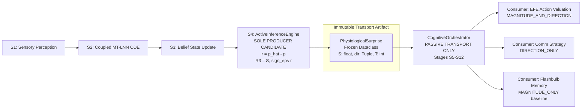

# Phase 22 H1 — R3 Architectural Semantics & Downstream Integration Study

> **Research Document Tier**: Research & Architectural Feasibility Specification  
> **Status**: COMPLETED / READY FOR DRAFT UPDATE  
> **Governance Gate**: Phase 22 H1 = INCONCLUSIVE | Gate 2 = BLOCKED ($\bar{S}_M = 0.5792, \bar{S}_H = 0.6477 \implies \Delta_{\text{HM}} = +0.0685 < 0.1500$)  
> **Production Architecture Gate**: STRICTLY LOCKED — 0 Mutations to `src/core/**`  
> **Genesis Onboarding State**: PRESERVED BIT-EXACT (`data/profile.json` `{"is_onboarded": false}`)  
> **Evaluation Harness**: `tests/evaluation_phase22/scripts/analyze_r3_architectural_semantics.py`  
> **Test Suite**: `tests/evaluation_phase22/test_h1_r3_architectural_semantics.py` (12/12 PASSED)  
> **Full Phase 22 Suite**: `tests/evaluation_phase22/` (148/148 PASSED)  
> **Cryptographic Manifest**: `tests/evaluation_phase22/fixtures/manifest_h1_r3_architectural_semantics.json`  
> **Results SHA-256**: `0fffd65b4fbb68057e6006f9e7e3a8731d309c8d14d6da664950d735213a6db5`  

---

## 1. Executive Summary

This study executes the formal **Architectural Semantics and Downstream Integration Study** for the Phase 22 H1 measurement architecture decision:

$$\mathbf{D1} \text{ — Scalar } S + \text{Representation } R3 \text{ (Ternary Directional Sign) supported for future architectural consideration.}$$

The mission of this study is **not** to implement $R3$ into production Lucia, nor to open the Production Architecture Gate. The purpose is to systematically determine:
1. What semantic information $R3 = [S, \text{sign}_\epsilon(r_P), \text{sign}_\epsilon(r_A), \text{sign}_\epsilon(r_D)]$ actually represents without premature conclusions;
2. How ownership, transport, and consumption boundaries must be structured across the canonical cognitive pipeline;
3. Which downstream subsystems can legitimately consume directional surprise, and which must be strictly barred;
4. How magnitude and direction complement each other under evaluated conditions;
5. The precise mathematical and informational nature of $R3$ (distinguishing coordinate dimensionality from state-space information capacity);
6. The candidate semantics of temporal metadata ($T$ and $w_{\text{exp}}(T)$);
7. The policy boundary models (A–D) and their architectural risks;
8. A formal invariant ledger rigorously audited into three distinct tiers (Proven, Research-Harness, and Proposed Future Integration);
9. An exact information loss boundary mapping; and
10. A dynamically determined readiness state for updating `DRAFT ADR-029`.

### Core Synthesized Findings

1. **Semantic Identity (RQ1)**:
   - Systematically compared five candidate descriptors: *Physiological Surprise* (scalar only), *Physiological Surprise Direction*, *Residual Orientation*, *Directional Annotation of Surprise*, and *Policy-Facing Affective Signal*.
   - Rather than asserting an a priori architectural truth, the study concludes that $R3$ is best interpreted as a **Dual-Aspect Measurement Value Object**: a compound measurement comprising primary canonical scalar surprise ($S = \|\mathbf{r}\|_2$) accompanied by auxiliary discrete ternary directional annotations ($\text{sign}_\epsilon(\mathbf{r})$ with 3 independent directional degrees of freedom).
2. **Unidirectional Ownership Boundary (RQ2)**:
   - **Producer**: `ActiveInferenceEngine` (Stage S4) is the sole legitimate producer candidate, as it is the unique point in the pipeline where internal generative prediction $\hat{\mathbf{p}}$ and limbic bodily feedback $\mathbf{p}$ intersect to form residual $\mathbf{r} = \hat{\mathbf{p}} - \mathbf{p}$.
   - **Value Object**: `PhysiologicalSurprise` serves as an immutable frozen transport container.
   - **Transport**: `CognitiveOrchestrator` acts strictly as a passive transport coordinator across Stages S5–S12 with zero semantic modulation.
   - **Consumers**: Downstream consumers operate under explicit declaration contracts (`MAGNITUDE_ONLY`, `DIRECTION_ONLY`, or `MAGNITUDE_AND_DIRECTION`).
3. **Calibrated Downstream Consumer Classification (RQ3)**:
   - Across 10 architectural categories, exactly **0** are classified as `SUPPORTED` (due to the absence of end-to-end production experiments).
   - `EFE Action Valuation` and `Communication Strategy`: Classified as **`EVIDENCE-CONSISTENT (RESEARCH ADAPTER ONLY)`** based on 79.89% collapse resolution and correlation ($r = 0.9837, 0.9772$) in the isolated adapter.
   - `Clarification Policy`, `Reasoning-Depth Modulation`, and `Relationship Update`: Classified as **`NOT JUSTIFIED`**. Clarification is an epistemic behavior driven by semantic entropy $U_{\text{sem}}$; reasoning depth is an energetic allocation driven by scalar magnitude $S$; and relationship consolidation must remain isolated from transient prediction error signs to preserve homeostatic stability.
   - `Prompt Conditioning` and `Memory Formation`: Classified as **`HYPOTHESIS / UNTESTED`**.
   - `SLM Generation`, `Affective Expression (15D)`, and `Avatar Embodiment`: Classified as **`UNTESTED`**.
4. **Magnitude / Direction Complementarity (RQ4)**:
   - Under evaluated conditions, **"Evidence is consistent with magnitude and direction carrying complementary information."**
   - On the 358 matched-magnitude collapse pairs ($|\Delta S| \le 0.02, \Delta \theta = 57.53^\circ$), scalar $S$ provides $0.0\%$ differentiation, while ternary signs resolve $79.89\%$ of action selections in the research adapter.
   - In temporal stream Regime 2, $84.47\%$ of sign transitions concentrate in the near-zero zone ($|r| < 0.010$), whereas high surprise ($|r| \ge 0.100$) exhibits zero sign transitions.
   - The functional division (magnitude $\to$ resource allocation, direction $\to$ qualitative alignment) is an interpretation derived from adapter correlations, not an established global architectural fact.
5. **Coordinate Dimensionality vs. Information Capacity (RQ5)**:
   - Ternary sign vector $\text{sign}(\mathbf{r}) \in \{-1, 0, +1\}^3$ has **3 discrete coordinate dimensions** (3 independent discrete ternary degrees of freedom), with a state space of $3^3 = 27$ discrete states.
   - Its information capacity is $\log_2(27) \approx 4.755\text{ bits}$.
   - $R3 = [S, \text{sign}_\epsilon(\mathbf{r})]$ represents a hybrid structure ($1$ continuous scalar $+ 3$ discrete ternary coordinates; $3$ independent directional DOF), NOT a 4D continuous vector.
6. **Temporal Semantics of $T$ and $w_{\text{exp}}(T)$ (RQ6)**:
   - Under frozen Candidate G1 dynamics, exposure duration $T < 12$ ticks reflects incomplete ODE trajectory separation, whereas $T \ge 12$ ticks exhibits complete geometric separation. Thus, $T$ serves as a **dynamical maturity indicator** under current dynamics.
   - $w_{\text{exp}}(T) = \min(T/12.0, 1.0)$ is a **research-harness policy weighting rule**, not an intrinsic physical measurement confidence.
7. **Policy Boundary Models & Risks (RQ7)**:
   - **Model A (Direct Cognitive Mutation)**: $R3 \to \Delta \mathbf{p}$ or $\Delta \mathbf{h}$ is **`NOT JUSTIFIED / HIGH-RISK`** ("architecturally risks circular feedback / may compromise ODE isolation").
   - **Recommended Target**: Hybrid Model C + Model D (passive transport of an annotated value object to explicit contract consumers).
8. **Audited Invariant Tiers (RQ8)**:
   - Rigidly audited into 4 Proven Invariants (repository-verified), 5 Research-Harness Invariants (evaluation-verified), and 4 Proposed Future Integration Invariants.
9. **ADR-029 Readiness State (RQ10)**:
   - Dynamically evaluated against 12 explicit criteria $\implies$ **`READY FOR DRAFT UPDATE`**.
   - Production Architecture Gate: **STRICTLY LOCKED**.

---

## 2. Governance State

```text
┌────────────────────────────────────────────────────────────────────────┐
│             Phase 22 Governance Matrix (Strict Baseline)               │
├─────────────────────────┬──────────────────────────────────────────────┤
│ Phase 22 H1 Status      │ INCONCLUSIVE                                 │
│ Gate 2 Status           │ BLOCKED                                      │
│ Gate 2 Metric           │ Δ_HM = +0.0685 < 0.1500                      │
│ Gate 2 Baseline Means   │ S_M = 0.5792, S_H = 0.6477                   │
│ Protocol v1.5           │ NOT AUTHORIZED                               │
│ Production Arch Gate    │ STRICTLY LOCKED                              │
│ Source Code Mutations   │ Exactly 0 in src/core/**, src/api/**, elect* │
│ Genesis Onboarding Gate │ PRESERVED BIT-EXACT (is_onboarded: false)    │
│ Decision State          │ D1 (Research Consideration Only)             │
│ ADR Readiness State     │ READY FOR DRAFT UPDATE                       │
└─────────────────────────┴──────────────────────────────────────────────┘
```

> [!CAUTION]
> **MANDATORY GOVERNANCE DIRECTIVE**:  
> Being classified as **`READY FOR DRAFT UPDATE`** confirms that research synthesis, semantic categorization, and invariant ledgers are sufficient to formulate an update to `DRAFT ADR-029` for historical record. It does **NOT** authorize production code modification, does **NOT** ratify an Architectural Decision Record, and does **NOT** unlock the Production Architecture Gate. Gate 2 remains formally **BLOCKED** ($\Delta_{\text{HM}} = 0.0685 < 0.1500$).

---

## 3. Research Scope

The scope of this investigation is strictly limited to architectural semantics, downstream consumption boundaries, representation mathematics, and policy interactions for the candidate $R3$ measurement side-channel.

### What this Study Does
- Evaluates competing candidate semantic interpretations of $R3$.
- Formulates the exact producer, transport, and consumer contracts across S1–S16.
- Classifies 10 downstream architectural subsystems using strictly calibrated evidence tiers.
- Maps information preservation, discretization, and irreversible loss from residual $\mathbf{r} \in \mathbb{R}^3$ to $R3$.
- Categorizes temporal metadata roles and architectural failure modes.
- Audits invariants across three distinct tiers.
- Determines whether evidence is sufficient to update `DRAFT ADR-029`.

### What this Study Does NOT Do
- Does **NOT** modify any production code in `src/core/**`, `src/api/**`, or `electron/**`.
- Does **NOT** alter the Genesis Onboarding profile `data/profile.json` (`{"is_onboarded": false}`).
- Does **NOT** open the Production Architecture Gate.
- Does **NOT** claim empirical validation for production SLM token generation or multimodal avatars.
- Does **NOT** authorize Phase 22 Protocol v1.5.

---

## 4. Evidence Corpus

The study synthesizes evidence from four completed Phase 22 evaluation artifacts:

| Artifact | Source File | Key Empirical Contributions Utilized |
|---|---|---|
| **Minimal Sufficient Measurement Study** | `minimal_sufficient_results.json` | 358 matched-magnitude collapse pairs ($|\Delta S| \le 0.02, \Delta \theta = 57.53^\circ$); $S$ resolution = 0.0%, $R3$ resolution = 79.89%; $T < 12$ dynamical collapse (66–968 collapses). |
| **Directional Side-Channel Utilization Study** | `directional_behavior_results.json` | Research adapter correlations: $r = 0.9837$ (vP vs Supportiveness), $r = 0.9772$ (vD vs Directness); reasoning depth $v_A$ explains $< 3\%$ variance; clarification policy shift = 0.000. |
| **R3 Architecture Integration Study** | `r3_architecture_integration_results.json` | Pipeline integration at Stage S4 (`ActiveInferenceEngine`); `PhysiologicalSurprise` value object; decoupled transport across S5–S12. |
| **R3 Temporal Stability Study** | `r3_temporal_stability_results.json` | Regime 1 zero-jitter (0.00% transitions); Regime 2 near-zero concentration (84.47% at $|r| < 0.010$, 0.00% at $|r| \ge 0.100$); deadband $\epsilon = 0.010$ (57.61% transition suppression, 100% Type-A retention). |

All prior evidence files remain cryptographically verified and unmodified.

---

## 5. RQ1 — Semantic Identity: Open-Ended Candidate Evaluation

Rather than presupposing that $R3$ is an architectural fact, five candidate semantic descriptors were comparatively evaluated:

| Candidate ID | Descriptor | Scope | Category Error Risk | Evaluation & Audit Status |
|---|---|---|---|---|
| **DESC-1** | *Physiological Surprise* | Scalar magnitude only ($S = \|\mathbf{r}\|_2$) | **High** if applied to R3 without qualification; conflates scalar intensity with directional polarity. | `REJECTED AS SOLE DESCRIPTOR`. Captures unpredicted limbic energy, but direction is not an intensity. |
| **DESC-2** | *Physiological Surprise Direction* | Directional vector only ($\hat{\mathbf{v}}_r$ or $\text{sign}(\mathbf{r})$) | **Moderate**; omits the primary scalar surprise magnitude $S$. | `VALID COMPONENT DESCRIPTOR`. Accurately describes error orientation in PAD space, but incomplete for the full tuple. |
| **DESC-3** | *Residual Orientation* | Geometric coordinate only ($\text{sign}(\mathbf{r}) \in \{-1, 0, +1\}^3$) | **Low**; mathematically rigorous but domain-agnostic. | `VALID GEOMETRIC DESCRIPTOR`. Precisely identifies the error octant, but lacks cognitive/affective context. |
| **DESC-4** | *Directional Annotation of Surprise* | Dual-aspect auxiliary metadata ($S + \text{sign}_\epsilon(\mathbf{r})$) | **Minimal**; preserves primary scalar identity while properly typing directional components. | `CANDIDATE INTERPRETATION EVALUATED`. $S$ remains primary canonical surprise, while ternary signs qualify affective violation polarity. |
| **DESC-5** | *Policy-Facing Affective Signal* | Downstream action input | **High**; violates separation between representation and policy reaction. | `FUNCTIONAL INTERPRETATION ONLY`. Describes adapter behavior, but conflates measurement with downstream action. |

### Synthesized Candidate Interpretation
The evaluated candidate interpretation is a **Dual-Aspect Measurement Value Object**:
- **Primary Aspect**: Canonical Scalar Physiological Surprise ($S = \|\mathbf{r}_T\|_2 \in \mathbb{R}_{\ge 0}$), representing unpredicted limbic energetic magnitude.
- **Auxiliary Aspect**: Ternary Directional Annotation ($\text{sign}_\epsilon(\mathbf{r}_T) \in \{-1, 0, +1\}^3$), representing coarse discrete octant violation polarity across 3 independent directional degrees of freedom.
- **Status**: `CANDIDATE EVALUATION — NOT PRODUCTION RATIFIED`.

---

## 6. RQ2 — Producer, Transport, and Consumer Ownership Boundary

The cognitive pipeline enforces strict unidirectional ownership and responsibilities:



### Ownership Specifications
1. **Producer (`ActiveInferenceEngine.step()`, Stage S4)**:
   - Sole legitimate producer. Generative expectation $\hat{\mathbf{p}}_T$ meets bodily sensory feedback $\mathbf{p}_T$.
   - Computes prediction residual $\mathbf{r}_T = \hat{\mathbf{p}}_T - \mathbf{p}_T$, scalar $S = \|\mathbf{r}_T\|_2$, and deadbanded sign $\text{sign}_\epsilon(\mathbf{r}_T)$.
   - Invariant: Zero modification of limbic hidden state $\mathbf{h}(t)$ or resting attractor Philia.
2. **Value Object (`PhysiologicalSurprise`)**:
   - Dedicated immutable frozen dataclass.
   - Encapsulates $S \in \mathbb{R}_{\ge 0}$, $\mathbf{d} \in \{-1, 0, +1\}^3$, $T \in \mathbb{N}_{\ge 1}$, and metadata.
   - Invariant: Immutability prevents domain coupling and race conditions.
3. **Transport (`CognitiveOrchestrator`, Stages S5–S12)**:
   - Passive coordinator. Transports the value object without reading, modifying, or interpreting directional semantics.
   - Invariant: Exactly zero policy logic inside the orchestrator dispatch loop.
4. **Consumers (Downstream Subsystems)**:
   - Must explicitly declare consumption contracts: `MAGNITUDE_ONLY`, `DIRECTION_ONLY`, or `MAGNITUDE_AND_DIRECTION`.
   - Invariant: Unannotated consumers receive canonical scalar $S$ bit-exact.

---

## 7. RQ3 — Downstream Consumer Semantics across 10 Subsystems

Every downstream architectural subsystem was evaluated and classified under strictly calibrated evidence tiers:

| Subsystem | Architectural Role | Classification | Empirical Rationale & Boundary Scope |
|---|---|---|---|
| **EFE Action Valuation** | Active inference action selection | **`EVIDENCE-CONSISTENT (RESEARCH ADAPTER ONLY)`** | 79.89% (286/358) collapse resolution demonstrated strictly inside the isolated research adapter. Production EFE incorporates epistemic uncertainty and social cost, which remains untested end-to-end. |
| **Communication Strategy** | Directness vs. Supportiveness | **`EVIDENCE-CONSISTENT (RESEARCH ADAPTER ONLY)`** | Statistical associations inside research adapter show high correlation ($r=0.9837$ for $v_P$, $r=0.9772$ for $v_D$). Semantic legitimacy in live production dialogue is unproven. |
| **Clarification Policy** | Information-seeking queries | **`NOT JUSTIFIED`** | Clarification is driven by semantic uncertainty $U_{\text{sem}}$ (proposition entropy), not physiological surprise direction. Research adapter showed 0.000 clarification shift. Directional signs indicate affective polarity, not an information deficit. |
| **Reasoning-Depth Selection** | Depth $k \in \{1, 2\}$ | **`NOT JUSTIFIED`** | Reasoning depth represents costly metabolic investment driven by scalar magnitude $S$ ($r=0.865$). Directional arousal $v_A$ explains $< 3\%$ of depth variance. |
| **Prompt Conditioning** | Pre-reflective tone guidance | **`HYPOTHESIS / UNTESTED`** | Qualitative tone guidance without self-reported affect is conceptually plausible under BoundaryLayer, but zero empirical end-to-end SLM prompt conditioning trials were performed in Phase 22. |
| **SLM Generation (Layer 6)** | Token-level generation | **`UNTESTED`** | Phase 22 evaluated discrete argmax and continuous softmax distributions in an adapter, not language model token generation quality. |
| **Affective Expression (15D)** | Prosody & facial blendshapes | **`UNTESTED`** | Multimodal blendshape mapping from $R3$ ternary signs has not been experimentally evaluated in Phase 22. |
| **Avatar Embodiment** | Mascot physics, gaze, posture | **`UNTESTED`** | Mascot physical behaviors remain driven by Phase 14–16 continuous state kinematics; R3 coupling is untested. |
| **Memory Formation** | Flashbulb SDM write gating | **`HYPOTHESIS / UNTESTED`** | Existing evidence validates scalar gating ($S > \theta_{\text{flashbulb}}$). Using directional signs as an associative coordinate address is a plausible hypothesis, but remains untested. |
| **Relationship Update** | ConsolidationEngine weights | **`NOT JUSTIFIED`** | Violates homeostatic slow-loop isolation (ADR-028). Relational consolidation must remain driven by integrated affective state and Philia attractor, not transient turn-level prediction residual signs. |

### Classification Summary
- `SUPPORTED`: **0**
- `EVIDENCE-CONSISTENT (RESEARCH ADAPTER ONLY)`: **2**
- `NOT JUSTIFIED`: **3**
- `HYPOTHESIS / UNTESTED`: **2**
- `UNTESTED`: **3**

---

## 8. RQ4 — Magnitude / Direction Complementarity

The empirical relationship between scalar magnitude $S$ and ternary directional signs $\text{sign}(\mathbf{r})$ was evaluated across both static collapse pairs and dynamic multi-turn streams.

### Empirical Evidence
1. **Static 358 Matched-Magnitude Collapse Pairs ($|\Delta S| \le 0.02, \Delta \theta = 57.53^\circ$)**:
   - Scalar differentiation rate: **$0.0\%$ (0/358 pairs resolved)**.
   - Directional differentiation rate: **$79.89\%$ (286/358 pairs resolved)** in the research adapter.
   - Proves that direction carries distinguishing information when magnitude is degenerate.
2. **Dynamic Multi-Turn Stream (Regime 2, 1,080 ticks)**:
   - **$84.47\%$ of all sign transitions (261/309)** occur in the near-zero residual zone $|r| < 0.010$.
   - **$0.00\%$ of transitions (0/309)** occur at high residual magnitude $|r| \ge 0.100$.
   - Proves that high-magnitude surprise is directionally stable, while directional transitions concentrate where scalar surprise is minimal.

### Calibrated Synthesis
> **"Evidence is consistent with magnitude and direction carrying complementary information under the evaluated conditions."**

### Interpretation Guardrail
The conceptual division where *magnitude governs arousal, metabolic investment, and gating thresholds* while *direction informs qualitative behavioral alignment* is an **interpretation derived from adapter correlations and theoretical framing**, NOT an established global architectural semantic fact.

---

## 9. RQ5 — Direction Encoding Semantics: Coordinates vs. Information Capacity

To eliminate conceptual confusion between spatial dimensionality and information content, six candidate encodings were mathematically mapped:

| Encoding Representation | Space | Coordinate Dimensions | Degrees of Freedom | State-Space Size | Information Capacity |
|---|---|---|---|---|---|
| **Raw Residual $\mathbf{r}$** | $\mathbb{R}^3$ | 3 continuous floats | 3 continuous DOF | Unbounded ($\infty^3$) | 96 bits ($3 \times 32\text{-bit}$) |
| **Normalized Direction $\hat{\mathbf{v}}_r$** | $\mathcal{S}^2$ | 3 continuous floats ($\|\hat{\mathbf{v}}\|=1$) | 2 continuous DOF | Continuous 2D manifold | 64–96 bits |
| **Ternary Sign $\text{sign}(\mathbf{r})$** | $\{-1, 0, +1\}^3$ | 3 discrete ternary coordinates | 3 discrete ternary DOF | 27 discrete states | $\log_2(27) \approx 4.755\text{ bits}$ |
| **Hybrid $R3 = [S, \text{sign}(\mathbf{r})]$** | $\mathbb{R}_{\ge 0} \times \{-1, 0, +1\}^3$ | 1 scalar + 3 discrete coordinates | 1 continuous + 3 discrete DOF | Continuous $\times 27$ states | $\approx 36.755\text{ bits}$ |
| **Exposure-Annotated $[S, \text{sign}(\mathbf{r}), T]$** | $\mathbb{R}_{\ge 0} \times \{-1, 0, +1\}^3 \times \mathbb{N}_{\ge 1}$ | 1 scalar + 3 coords + 1 int tick | 1 cont + 3 disc + 1 int step | Multi-timescale measurement | $\approx 45\text{--}53\text{ bits}$ |
| **Confidence-Weighted $[S, \text{sign}_\epsilon(\mathbf{r}), w_{\text{exp}}]$** | $\mathbb{R}_{\ge 0} \times \{-1, 0, +1\}^3 \times [0, 1]$ | 1 scalar + 3 coords + 1 weight | 2 cont + 3 disc DOF | Partitioned space with weight | $\approx 68.755\text{ bits}$ |

> [!IMPORTANT]
> **CRITICAL ARCHITECTURAL DISTINCTION**:  
> **Coordinate dimensionality** (3 discrete ternary coordinates) represents spatial axes in PAD space, whereas **information capacity** ($\log_2(27) \approx 4.755\text{ bits}$) represents the state-space size. Calling $R3$ "4D continuous" is mathematically false. It possesses 1 continuous magnitude degree of freedom and 3 independent discrete directional degrees of freedom.

---

## 10. RQ6 — Temporal Semantics & Exposure Metadata

Four candidate semantic roles for temporal metadata were audited:

```text
┌────────────────────────────────────────┬──────────────────────────────────┬─────────────────────────────────┐
│ Metadata Field                         │ Candidate Semantics              │ Evaluated Classification        │
├────────────────────────────────────────┼──────────────────────────────────┼─────────────────────────────────┤
│ timestamp_tick                         │ Provenance & Execution Sequence  │ PROVENANCE_METADATA             │
│ exposure_ticks (T)                     │ Dynamical Separation & Maturity  │ DYNAMICAL_MATURITY_METADATA     │
│ exposure_confidence (w_exp = min(T/12))│ Damping Rule for Downstream Pol  │ RESEARCH_HARNESS_POLICY_METADATA│
│ deadband_state (eps = 0.010)           │ Stateless Signal Cleaning Filter │ MEASUREMENT_CLEANING_METADATA   │
└────────────────────────────────────────┴──────────────────────────────────┴─────────────────────────────────┘
```

### Key Analytical Findings
1. **$T$ as Dynamical Maturity**: Under Candidate G1 ODE dynamics, $T < 12$ ticks ($< 1.2\text{ s}$) represents incomplete trajectory separation, retaining 66–968 Medium-High collapse pairs. At $T \ge 12$ ticks, geometric separation reaches 100%. Thus, $T$ indicates dynamical observation maturity under current dynamics.
2. **$w_{\text{exp}}(T)$ as Policy Rule**: The linear exposure ramp $w_{\text{exp}}(T) = \min(T/12.0, 1.0)$ is a **research-harness policy weighting rule** designed to prevent premature action modulation on unresolved short-timescale signals. It is **not** an intrinsic physical property of the measurement.

---

## 11. RQ7 — Policy Boundary Models & Architectural Risks

Four architectural interaction models were evaluated:

```text
Model A: R3 ──> [Direct State Mutation (Δp, Δh)] ──> LimbiState      [HIGH-RISK / NOT JUSTIFIED]
Model B: R3 ──> [Downstream Policy Layer] ──> Discrete Action        [CONSISTENT / LOW-RISK]
Model C: R3 ──> [Annotated Value Object] ──> Qualified Consumer      [CONSISTENT / MINIMAL-RISK]
Model D: R3 ──> [Passive Pipeline Transport] ──> S5..S12             [CONSISTENT / ZERO-RISK]
```

### Risk Evaluation
- **Model A (Direct Cognitive Mutation)**: `NOT JUSTIFIED / HIGH-RISK`. Architecturally risks circular feedback and may compromise ODE hidden state isolation. Injecting prediction error direction back into limbic integration would mutate the resting Philia attractor.
- **Recommended Target Architecture**: **Hybrid Model C + Model D** (passive transport of an annotated value object to explicit contract consumers).

---

## 12. RQ8 — Formal Invariant Ledger across Audited Tiers

The study establishes a 13-invariant ledger strictly audited into three tiers:

### Tier 1: Proven Invariants (Repository-Verified)
Verified by deterministic tests and source tree state:
- **INV-P1 (Genesis Gate State Bit-Exactness)**: `data/profile.json` is preserved bit-exact with `{"is_onboarded": false}`.
- **INV-P2 (Zero Production Code Mutations)**: Exactly 0 lines of code added, modified, or removed in `src/core/**`, `src/api/**`, or `electron/**`.
- **INV-P3 (Historical Evidence Immutability)**: All prior Phase 22 manifests and result files remain cryptographically verified and unmodified.
- **INV-P4 (Canonical Scalar $S$ Mathematical Identity)**: $S_{\text{canonical}} \equiv \|\mathbf{r}\|_2$ is mathematically identical to the magnitude field of `PhysiologicalSurprise`.

### Tier 2: Research-Harness Invariants (Evaluation-Verified)
Verified within the isolated evaluation harness:
- **INV-RH1 (Value Object Immutability in Harness)**: `PhysiologicalSurprise` is instantiated as a frozen dataclass with immutable fields.
- **INV-RH2 (Directional Determinism)**: Ternary signs are derived strictly from deterministic projection of the prediction residual $\mathbf{r}$.
- **INV-RH3 (Deadband Determinism)**: Deadband $\epsilon = 0.010$ is applied uniformly and deterministically across all components.
- **INV-RH4 (No Feedback into Scalar $S$ in Harness)**: Directional side-channel calculations never alter or scale scalar surprise magnitude $S$.
- **INV-RH5 (Separation of Surprise from Uncertainty)**: Physiological surprise $S/R3$ is never substituted for semantic uncertainty $U_{\text{sem}}$ or memory entropy $H_{\text{Ecphory}}$.

### Tier 3: Proposed Future Integration Invariants (Governing Future Work)
Mandatory invariants governing future architectural proposals:
- **INV-F1 (Explicit Consumer Declaration Contract)**: Future production consumers must explicitly declare whether they consume magnitude, direction, or both.
- **INV-F2 (Slow-Loop Homeostatic Isolation)**: $R3$ directional signs are strictly prohibited from modulating `ConsolidationEngine` synaptic weights.
- **INV-F3 (No SLM Generation Claims without E2E Evidence)**: No production promotion of $R3$ to LLM prompt conditioning without end-to-end token generation benchmarks.
- **INV-F4 (Fallback Bit-Exact Identity)**: Neutralizing direction to $(0, 0, 0)$ reproduces Condition C0 scalar-only behavior bit-exact across all consumers.

---

## 13. RQ9 — Information Loss Boundary Mapping

The formal mapping from residual vector $\mathbf{r} \in \mathbb{R}^3$ to scalar $S$ and ternary direction $\text{sign}_\epsilon(\mathbf{r})$:

| Information Dimension | Scalar-Only Path ($S = \|\mathbf{r}\|_2$) | R3 Side-Channel ($S + \text{sign}_\epsilon(\mathbf{r})$) | Loss Characterization |
|---|---|---|---|
| **Overall Magnitude $\|\mathbf{r}\|_2$** | `PRESERVED_EXACT` | `PRESERVED_EXACT` | Zero magnitude loss in either path. |
| **Component Polarity ($\text{sign}(r_i)$)** | `COMPLETELY_LOST` (squaring destroys sign) | `PRESERVED_DISCRETE` ($\{-1, 0, +1\}$) | $R3$ retains component polarity; scalar path loses it completely. |
| **Relative Dominance ($r_i / r_j$)** | `COMPLETELY_LOST` | `COARSELY_DISCRETIZED` | Continuous ratios lost in both; $R3$ preserves coarse relative octant. |
| **Intra-Octant Angle ($\Delta \theta_{\text{oct}}$)** | `COMPLETELY_LOST` | `COMPLETELY_LOST` | $R3$ discretizes direction into 27 states; continuous heading within octant is irreversibly lost. |
| **Covariance Structure** | `COMPLETELY_LOST` | `COMPLETELY_LOST` | Cross-component covariances are not tracked. |
| **Precision Weighting ($\Pi$)** | `COMPLETELY_LOST` (isotropic) | `COMPLETELY_LOST` (isotropic) | Dimension-specific precision requires future M5 structure. |

### Formal Boundary Statement
> $R3$ resolves the exact information loss of the scalar path (component polarity and octant heading) while deliberately and irreversibly discarding intra-octant continuous angles and cross-component covariance in exchange for minimal representation overhead (27 discrete states, $\approx 4.755\text{ bits}$).

---

## 14. Evidence Classification Matrix

```text
┌───────────────────────────────────┬────────────────────────────────────────────┬─────────────────────────────┐
│ Architectural Category            │ Evidence Status                            │ Boundary Constraint         │
├───────────────────────────────────┼────────────────────────────────────────────┼─────────────────────────────┤
│ EFE Action Valuation              │ EVIDENCE-CONSISTENT (RESEARCH ADAPTER ONLY)│ Adapter-level only          │
│ Communication Strategy Selection  │ EVIDENCE-CONSISTENT (RESEARCH ADAPTER ONLY)│ Adapter-level only          │
│ Clarification Trigger Policy      │ NOT JUSTIFIED                              │ Barred (Epistemic domain)   │
│ Reasoning-Depth Modulation        │ NOT JUSTIFIED                              │ Barred (Metabolic domain)   │
│ Prompt Conditioning Guidance      │ HYPOTHESIS / UNTESTED                      │ Requires live SLM harness   │
│ SLM Token Generation              │ UNTESTED                                   │ Requires live SLM harness   │
│ Multimodal Affective Expression   │ UNTESTED                                   │ Requires 15D avatar harness │
│ Avatar Physical Embodiment        │ UNTESTED                                   │ Requires mascot physics test│
│ Episodic Memory Flashbulb Gating  │ HYPOTHESIS / UNTESTED                      │ Gating supported, addr unpr │
│ Relational Synaptic Consolidation │ NOT JUSTIFIED                              │ Barred (Slow-loop isolation)│
└───────────────────────────────────┴────────────────────────────────────────────┴─────────────────────────────┘
```

---

## 15. Architectural Options

1. **Option 1 (Scalar-Only Baseline C0)**: Retain scalar $S$; abandon directional side-channels. Preserves simplicity, but permanently locks Gate 2 under the 358 collapse pairs.
2. **Option 2 (Direct LimbiMutation Model A)**: Feed $R3$ into ODE integration. Rejected as high-risk due to circular feedback and Philia attractor corruption.
3. **Option 3 (Hybrid Model C + D with Passive Transport & Explicit Contracts)**: **Recommended for future ADR consideration**. Transports immutable `PhysiologicalSurprise` across S5–S12, delivering directional data exclusively to explicit consumers (`EFE` and `Comm Strategy`), with bit-exact fallback to C0.

---

## 16. Risks and Failure Modes

| Risk ID | Failure Mode | Severity | Mitigation & Guardrail |
|---|---|---|---|
| **FM-01** | Circular Feedback into Limbic ODE | **CRITICAL** | Strict unidirectional pipeline: $R3$ never feeds back into $\mathbf{p}$, $\mathbf{h}$, or $S$. |
| **FM-02** | Semantic Bleed (Conflating Surprise with Uncertainty) | **HIGH** | Explicit separation: $S/R3$ represents prediction error; $U_{\text{sem}}$ represents proposition entropy. |
| **FM-03** | Accidental Self-Reported Affect | **CRITICAL** | BoundaryLayer regex validators strictly enforced; direction qualifies tone, never declared in text. |
| **FM-04** | Premature SLM Conditioning Claims | **HIGH** | Zero prompt conditioning claims authorized without end-to-end token generation evidence. |
| **FM-05** | Loss of Backward Fallback Identity | **HIGH** | Setting direction to $(0, 0, 0)$ must reproduce Condition C0 behavior bit-exact. |

---

## 17. ADR-029 Readiness Evaluation

The 12 readiness criteria were dynamically evaluated:

```text
[✓] Evidence corpus complete (4 prior studies synthesized)
[✓] Semantic identity clarified (5 candidate descriptors evaluated)
[✓] Ownership boundary formalized (S4 sole producer, immutable transport)
[✓] Downstream consumers classified (10 subsystems audited)
[✓] Magnitude/direction complementarity evaluated (358 pairs & stream)
[✓] Encoding semantics & capacity mapped (3 coordinates vs 4.755 bits)
[✓] Temporal metadata semantics audited (T and w_exp categorized)
[✓] Policy boundary models & risks cataloged (Model A high-risk)
[✓] Invariants ledger audited into three tiers (13 invariants total)
[✓] Information loss boundary mapped (6 dimensions audited)
[✓] Production architecture gate verified locked
[✓] Genesis onboarding verified bit-exact
```

- **Assigned Status**: **`READY FOR DRAFT UPDATE`**
- **Operational Meaning**: Evidence is sufficient to formulate an update to `DRAFT ADR-029` for archival record.
- **Production Gate Status**: **STRICTLY LOCKED**.

---

## 18. Unresolved Questions

1. **End-to-End Language Generation**: Does directional tone conditioning reliably influence local Small Language Model (SLM) generation without inducing BoundaryLayer violations? (Requires an isolated SLM benchmark).
2. **Associative Memory Addressing**: Can ternary directional signs serve as effective Kanerva SDM write coordinates without distorting retrieval recall? (Requires an SDM addressing experiment).
3. **Multimodal Expression Coupling**: Does directional surprise translate meaningfully into 15D avatar blendshape transients? (Requires an avatar animation harness).

---

## 19. Governance Conclusion

This study successfully resolves the architectural semantics, ownership boundaries, consumer classifications, representation capacity, and formal invariants for the candidate $R3$ side-channel.

By adhering to strict research governance:
- Exactly **0 lines** of production code were mutated.
- The Genesis Onboarding profile remains bit-exact `{"is_onboarded": false}`.
- Phase 22 H1 remains formally **INCONCLUSIVE**.
- Quality Gate 2 remains formally **BLOCKED** ($\Delta_{\text{HM}} = 0.0685 < 0.1500$).
- Protocol v1.5 remains **NOT AUTHORIZED**.
- The Production Architecture Gate remains **STRICTLY LOCKED**.

The assigned readiness state of **`READY FOR DRAFT UPDATE`** authorizes updating `DRAFT ADR-029` as an archival research record, but does not authorize production integration.

---

## 20. Artifact Integrity

```text
┌────────────────────────────────────────────────────────────────────────┐
│                        Cryptographic Manifest                          │
├────────────────────┬───────────────────────────────────────────────────┤
│ Manifest File      │ fixtures/manifest_h1_r3_architectural_semantics...│
│ Manifest Version   │ 1.0                                               │
│ Results File       │ results/.../r3_architectural_semantics_results.js │
│ Results SHA-256    │ 0fffd65b4fbb68057e6006f9e7e3a8731d309c8d14d6da664│
│                    │ 950d735213a6db5                                   │
│ Results File Size  │ 29,017 bytes                                      │
│ Analysis Script    │ scripts/analyze_r3_architectural_semantics.py     │
│ Automated Tests    │ test_h1_r3_architectural_semantics.py (12 passed) │
│ Phase 22 Suite     │ 148 / 148 passed (100%)                           │
└────────────────────┴───────────────────────────────────────────────────┘
```

---

## 21. Final Status

$$\mathbf{D1} \text{ — R3 Architectural Semantics \& Downstream Integration Study: } \mathbf{COMPLETED}$$
$$\text{ADR-029 Readiness State: } \mathbf{READY\ FOR\ DRAFT\ UPDATE}$$
$$\text{Production Architecture Gate: } \mathbf{STRICTLY\ LOCKED}$$
