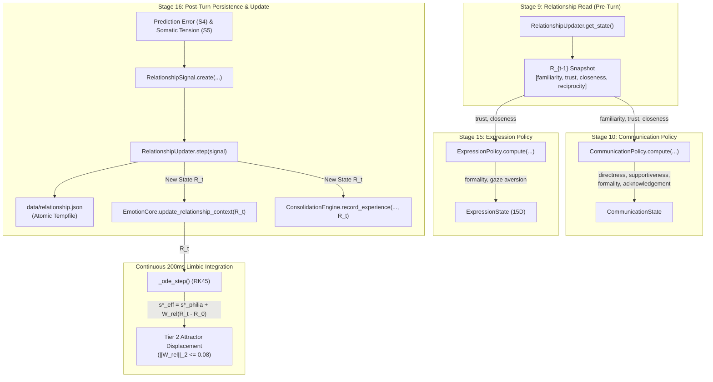

# Phase 24 Gate 1 — Canonical Relational State Audit Report

> **Document Type:** Research Audit Artifact  
> **Permanent Location:** `tests/evaluation/phase24/P24_GATE1_RELATIONAL_STATE_AUDIT.md`  
> **Governance Authority:** [`AGENTS.md`](file:///c:/Users/Lunafiah/Desktop/My_project/Lucia/AGENTS.md) §0, §6, §7; [`docs/L1_INVARIANTS.md`](file:///c:/Users/Lunafiah/Desktop/My_project/Lucia/docs/L1_INVARIANTS.md); [`docs/ARCHITECTURE.md`](file:///c:/Users/Lunafiah/Desktop/My_project/Lucia/docs/ARCHITECTURE.md); [`docs/00_PROJECT_OVERVIEW.md`](file:///c:/Users/Lunafiah/Desktop/My_project/Lucia/docs/00_PROJECT_OVERVIEW.md)  
> **Audit Focus:** Canonical Implementation Semantics of Relational State Vector $\mathbf{R}_t \in [0, 1]^4$  
> **Operational Mode:** Read-Only Audit (`production diff = 0`)

---

## 1. Executive Summary

This audit establishes the **canonical implementation semantics** of the 4-dimensional interpersonal relationship state vector $\mathbf{R}_t \in [0, 1]^4$ in the Lucia repository. 

### Critical Findings:
1. **Canonical Field Names are Fixed in Code:** In production source code ([`src/core/relationship/state.py`](file:///c:/Users/Lunafiah/Desktop/My_project/Lucia/src/core/relationship/state.py#L18-L34)), the 4 dimensions are strictly:
   $$\mathbf{R}_t = [\text{familiarity}, \text{trust}, \text{closeness}, \text{reciprocity}]^T \in [0.0, 1.0]^4$$
   The informal assumption that dimensions are `[trust, familiarity, depth, alignment]` is **FALSE**.
2. **Severe Documentation vs. Code Naming Mismatch:** Canonical architecture documents contain conflicting nomenclature:
   - [`docs/00_PROJECT_OVERVIEW.md`](file:///c:/Users/Lunafiah/Desktop/My_project/Lucia/docs/00_PROJECT_OVERVIEW.md#L157): $(\text{trust}, \text{familiarity}, \text{attunement}, \text{shared\_experience})$
   - [`docs/ARCHITECTURE.md`](file:///c:/Users/Lunafiah/Desktop/My_project/Lucia/docs/ARCHITECTURE.md#L370): $[\text{Trust}, \text{Familiarity}, \text{Attunement}, \text{Shared Experience}]$
   - [`docs/USER_MANUAL.md`](file:///c:/Users/Lunafiah/Desktop/My_project/Lucia/docs/USER_MANUAL.md#L180): $[\text{Affinity}, \text{Familiarity}, \text{Trust}, \text{Depth}]$
   - Historical Phase 13 Spec: $[\text{Familiarity}, \text{Trust}, \text{Closeness}, \text{Continuity}]$
   - Production Source Code: $[\text{familiarity}, \text{trust}, \text{closeness}, \text{reciprocity}]$
3. **Partial Communication Policy Integration:** Current production code actively conditions communication on $\mathbf{R}_t$ at Stage 10 ([`CommunicationPolicy`](file:///c:/Users/Lunafiah/Desktop/My_project/Lucia/src/core/communication/communication_policy.py#L91-L119)) and multimodal expression at Stage 15 ([`ExpressionPolicy`](file:///c:/Users/Lunafiah/Desktop/My_project/Lucia/src/core/expression/expression_policy.py#L89-L130)). However, **`reciprocity` is completely unread / dead** in communication policy, and both `familiarity` and `reciprocity` are unread in expression policy. In contrast, all 4 dimensions are coupled into `EmotionCore` via $W_{\text{rel}}$.

---

## 2. Canonical Definition

The canonical relational state vector is defined as an immutable dataclass in [`src/core/relationship/state.py`](file:///c:/Users/Lunafiah/Desktop/My_project/Lucia/src/core/relationship/state.py#L18-L86):

```python
@dataclass
class RelationshipState:
    familiarity: float
    trust: float
    closeness: float
    reciprocity: float
    timestamp: float = field(default_factory=time.time)
```

### Numerical Vector Representation
When converted to a NumPy array via `RelationshipState.to_array()`, the vector mapping is:
$$\mathbf{R}_t = \begin{bmatrix} R_{t, 0} \\ R_{t, 1} \\ R_{t, 2} \\ R_{t, 3} \end{bmatrix} = \begin{bmatrix} \text{familiarity} \\ \text{trust} \\ \text{closeness} \\ \text{reciprocity} \end{bmatrix} \in [0.0, 1.0]^4$$

### Neutral Stranger Baseline ($R_0$)
Constructed by `RelationshipState.initial()` and defined in `EmotionConfig.relationship_baseline` ([`src/core/config.py`](file:///c:/Users/Lunafiah/Desktop/My_project/Lucia/src/core/config.py#L95)):
$$\mathbf{R}_0 = \begin{bmatrix} 0.00 \\ 0.50 \\ 0.00 \\ 0.50 \end{bmatrix}$$
- **Familiarity = 0.0:** Zero prior exposure or interaction volume.
- **Trust = 0.50:** Neutral stranger default (neither paranoid distrust nor unearned vulnerability).
- **Closeness = 0.0:** Zero shared emotional depth or proximity.
- **Reciprocity = 0.50:** Balanced baseline expectation of conversational engagement.

---

## 3. Dimension Ledger

| Index | Canonical Field | Initialization | Update Delta ($\Delta_{\text{signal}}$ by type) | Bounds | Concrete Semantic Meaning | Source Evidence |
|---|---|---|---|---|---|---|
| **0** | `familiarity` | `0.00` | • Collab: $+0.20$<br/>• Casual: $+0.50$<br/>• Disclose: $+0.30$<br/>• Conflict: $+0.05$<br/>• Repair: $+0.10$<br/>• Absence: $-0.30$ | $[0.0, 1.0]$ | **Accumulated interaction volume & habituation.** Tracks cumulative conversational exposure. Monotonically rises with interaction; decays slowly during extended absence. Drives Stage 10 `acknowledgement_level`. | [`src/core/relationship/state.py`](file:///c:/Users/Lunafiah/Desktop/My_project/Lucia/src/core/relationship/state.py#L24); [`signals.py`](file:///c:/Users/Lunafiah/Desktop/My_project/Lucia/src/core/relationship/signals.py#L43-L60) |
| **1** | `trust` | `0.50` | • Collab: $+0.60$<br/>• Casual: $+0.10$<br/>• Disclose: $+0.40$<br/>• Conflict: $-0.70$<br/>• Repair: $+0.40$<br/>• Absence: $-0.05$ | $[0.0, 1.0]$ | **Interaction expectation stability & reliability.** Rises with collaborative success and repair; drops sharply on conflict dismissal. High trust enables collaborative inquiring strategy, increases supportiveness, and softens directness. | [`src/core/relationship/state.py`](file:///c:/Users/Lunafiah/Desktop/My_project/Lucia/src/core/relationship/state.py#L25); [`signals.py`](file:///c:/Users/Lunafiah/Desktop/My_project/Lucia/src/core/relationship/signals.py#L43-L60) |
| **2** | `closeness` | `0.00` | • Collab: $+0.30$<br/>• Casual: $+0.10$<br/>• Disclose: $+0.80$<br/>• Conflict: $-0.60$<br/>• Repair: $+0.20$<br/>• Absence: $-0.40$ | $[0.0, 1.0]$ | **Relational proximity & shared context depth.** Rises primarily through emotional disclosure and mutual vulnerability; contracts sharply on conflict. Strongly reduces linguistic formality and softens directness. | [`src/core/relationship/state.py`](file:///c:/Users/Lunafiah/Desktop/My_project/Lucia/src/core/relationship/state.py#L26); [`signals.py`](file:///c:/Users/Lunafiah/Desktop/My_project/Lucia/src/core/relationship/signals.py#L43-L60) |
| **3** | `reciprocity` | `0.50` | • Collab: $+0.50$<br/>• Casual: $+0.10$<br/>• Disclose: $+0.40$<br/>• Conflict: $-0.40$<br/>• Repair: $+0.50$<br/>• Absence: $-0.20$ | $[0.0, 1.0]$ | **Degree of balanced, mutually sustained engagement.** Reflects symmetric multi-turn conversational investment. Decays toward 0.50. Couplings active in limbic $W_{\text{rel}}$, but unread in S10 communication policy. | [`src/core/relationship/state.py`](file:///c:/Users/Lunafiah/Desktop/My_project/Lucia/src/core/relationship/state.py#L27); [`signals.py`](file:///c:/Users/Lunafiah/Desktop/My_project/Lucia/src/core/relationship/signals.py#L43-L60) |

---

## 4. Mathematical Mechanics & Transition Logic

The transition equation is executed by [`RelationshipUpdater.step()`](file:///c:/Users/Lunafiah/Desktop/My_project/Lucia/src/core/relationship/updater.py#L84-L138):

$$\mathbf{R}_{t+1} = \operatorname{clip}\left(\mathbf{R}_t + \alpha \cdot \kappa_{\text{intensity}} \cdot \boldsymbol{\Delta}_{\text{signal}} - \delta_{\text{decay}} \cdot (\mathbf{R}_t - \mathbf{R}_{\text{neutral}}), \quad 0.0, \quad 1.0\right)$$

### Parameters:
- **Inertia Rate ($\alpha$):** $\alpha = 0.03$ (bounded learning rate: ~3% maximum change per turn, enforcing $\tau_{\text{rel}} \gg \tau_{\text{turn}}$).
- **Signal Intensity ($\kappa_{\text{intensity}}$):** Default $0.50$ in [`CognitiveOrchestrator._execute_pipeline`](file:///c:/Users/Lunafiah/Desktop/My_project/Lucia/src/core/orchestrator/cognitive_orchestrator.py#L649).
- **Decay Rate ($\lambda_{\text{decay}}$):** $0.005$ per elapsed absence hour.
- **Decay Factor:** $\delta_{\text{decay}} = \min(1.0, \lambda_{\text{decay}} \cdot \max(0.0, \Delta t_{\text{hours}}))$.
- **Neutral Target ($\mathbf{R}_{\text{neutral}}$):** $[0.00, 0.50, 0.00, 0.50]^T$.

### Signal Triggering in Stage 16.3:
```python
# S16.3 Structured Relationship Update (src/core/orchestrator/cognitive_orchestrator.py:L646-L650)
signal_type = RelationshipSignalType.CASUAL_INTERACTION
if prediction_error < 0.30 and markers.tension < 0.40:
    signal_type = RelationshipSignalType.COLLABORATIVE_SUCCESS
sig = RelationshipSignal.create(signal_type, intensity=0.5)
rel_state_updated, _ = self._relationship_updater.step(signal=sig)
```

---

## 5. End-to-End Dataflow



### Complete Producer/Consumer Matrix

| Path | Source Subsystem | Intermediary / Payload | Target Subsystem | Locking & Synchronization |
|---|---|---|---|---|
| **P1 $\to$ C1** | [`RelationshipUpdater`](file:///c:/Users/Lunafiah/Desktop/My_project/Lucia/src/core/relationship/updater.py) | Internal `_current_state` copy | Stage 9 `CognitiveOrchestrator` | `_turn_lock` + `RelationshipUpdater._lock` (RLock) |
| **P1 $\to$ C2** | Stage 9 `RelationshipState` | Dictionary: `rel_state.to_dict()` | Stage 10 `CommunicationPolicy` | Evaluated within turn; zero thread locks needed |
| **P1 $\to$ C3** | Stage 9 `RelationshipState` | Dictionary: `rel_state.to_dict()` | Stage 15 `ExpressionPolicy` | Evaluated within turn; zero thread locks needed |
| **P2 $\to$ P1** | Stage 16.3 `CognitiveOrchestrator` | `RelationshipSignal` (intensity=0.5) | `RelationshipUpdater.step()` | `_turn_lock` + `RelationshipUpdater._lock` |
| **P1 $\to$ Disk** | `RelationshipUpdater.step()` | `save_relationship()` | `data/relationship.json` | Atomic rename (`mkstemp` + `os.replace`) |
| **P1 $\to$ C4** | Stage 16.4 `CognitiveOrchestrator` | `rel_state_updated.to_array()` | `EmotionCore.update_relationship_context()` | `_step_lock` ($\le 1\text{ms}$ holding time) |
| **C4 $\to$ C5** | `EmotionCore._R_t` | $\mathbf{W}_{\text{rel}} (\mathbf{R}_t - \mathbf{R}_0)$ | Continuous 200ms Fast Loop ODE | Evaluated under `_train_lock` / `_step_lock` in ODE RHS |
| **P1 $\to$ C7** | Stage 16.2 `CognitiveOrchestrator` | `rel_state.to_array()` | `ConsolidationEngine.record_experience()` | Appended to thread-safe FIFO experience queue |
| **Turn $\to$ C8** | `CognitiveTurnResult` | `result.relationship.to_dict()` | FastAPI `/chat` and `/state` | Read-only atomic pointer access |

---

## 6. Support for Relationship-Conditioned Communication Policy

The audit verifies that **relationship-conditioned communication policy is ALREADY IMPLEMENTED in production**.

### Active Couplings in [`CommunicationPolicy.compute()`](file:///c:/Users/Lunafiah/Desktop/My_project/Lucia/src/core/communication/communication_policy.py#L102-L138):

1. **Directness ($\lambda_{\text{direct}}$):**
   $$\text{directness} = \operatorname{clip}(0.50 + 0.25 d - 0.20 \mathcal{T} - 0.15 \cdot \text{closeness} - 0.10 \cdot (\text{trust} - 0.50), \quad 0.10, \quad 0.95)$$
   - Increasing `closeness` softens directness.
   - High `trust` ($>0.50$) reduces blunt transactional directness.
2. **Supportiveness:**
   $$\text{supportiveness} = \operatorname{clip}(0.30 + 0.35 p + 0.25 \cdot (\text{trust} - 0.50) + 0.20 \cdot \text{closeness}, \quad 0.00, \quad 1.00)$$
   - Both `trust` and `closeness` positively scale conversational supportiveness.
3. **Formality Score:**
   $$\text{formality} = \operatorname{clip}(0.60 - 0.30 p - 0.25 \cdot \text{closeness} - 0.20 \cdot (\text{trust} - 0.50) + 0.15 \mathcal{T}, \quad 0.00, \quad 1.00)$$
   - Deepened `closeness` and `trust` directly dismantle formal conversational barriers.
4. **Acknowledgement Level:**
   $$\text{acknowledgement} = \operatorname{clip}(0.40 + 0.25 \cdot \text{familiarity} + 0.20 m_{\text{avail}} - 0.15 \mathcal{T}, \quad 0.10, \quad 1.00)$$
   - `familiarity` is the primary relational driver of active conversational acknowledgement.
5. **Question Frequency & Inquiring Strategy:**
   $$\text{question\_freq} = \operatorname{clip}(0.10 + 0.25 \cdot (\text{trust} - 0.50) + 0.20 a - 0.25 \mathcal{T}, \quad 0.00, \quad 1.00)$$
   - Trust gates the proactive inquisitive strategy: `CommStrategy.COLLABORATIVE_INQUIRING` requires $\text{question\_freq} \ge 0.50 \land \text{trust} \ge 0.65$.

### Actuation Couplings in [`ExpressionPolicy.compute()`](file:///c:/Users/Lunafiah/Desktop/My_project/Lucia/src/core/expression/expression_policy.py#L96,L130):
- **Text Formality:** $\text{formality} = \operatorname{clip}(0.50 - 0.30 p - 0.20 \cdot \text{closeness} + 0.20 \cdot (1.0 - \text{trust}), 0.0, 1.0)$.
- **Gaze Aversion Probability:** $\text{gaze\_avert} = \operatorname{clip}(0.10 + 0.40(1-\mathcal{E}) + 0.30\mathcal{T} - 0.10 \cdot \text{trust}, 0.0, 1.0)$. High trust suppresses awkward mascot gaze avoidance.

---

## 7. Evidence Classification

| Statement / Claim | Evidence Source | Classification |
|---|---|---|
| Vector dimensionality is exactly 4 ($\mathbf{R}_t \in \mathbb{R}^4$) | [`src/core/relationship/state.py`](file:///c:/Users/Lunafiah/Desktop/My_project/Lucia/src/core/relationship/state.py#L46-L50); [`src/core/emotion/emotion_core.py`](file:///c:/Users/Lunafiah/Desktop/My_project/Lucia/src/core/emotion/emotion_core.py#L180) | **`CANONICAL / VERIFIED`** |
| Field names are `familiarity`, `trust`, `closeness`, `reciprocity` | [`src/core/relationship/state.py`](file:///c:/Users/Lunafiah/Desktop/My_project/Lucia/src/core/relationship/state.py#L29-L32) | **`CANONICAL / VERIFIED`** |
| Default stranger baseline is $[0.0, 0.50, 0.0, 0.50]^T$ | [`src/core/relationship/state.py`](file:///c:/Users/Lunafiah/Desktop/My_project/Lucia/src/core/relationship/state.py#L38-L43); [`src/core/config.py`](file:///c:/Users/Lunafiah/Desktop/My_project/Lucia/src/core/config.py#L95) | **`CANONICAL / VERIFIED`** |
| Update rule applies bounded learning rate $\alpha = 0.03$ | [`src/core/relationship/updater.py`](file:///c:/Users/Lunafiah/Desktop/My_project/Lucia/src/core/relationship/updater.py#L58,L102) | **`CANONICAL / VERIFIED`** |
| Two-phase lifecycle decouples Stage 9 read from Stage 16.3 update | [`src/core/orchestrator/cognitive_orchestrator.py`](file:///c:/Users/Lunafiah/Desktop/My_project/Lucia/src/core/orchestrator/cognitive_orchestrator.py#L428,L644) | **`CANONICAL / VERIFIED`** |
| Relational state is persistent across sessions via JSON | [`src/core/relationship/persistence.py`](file:///c:/Users/Lunafiah/Desktop/My_project/Lucia/src/core/relationship/persistence.py); `data/relationship.json` | **`CANONICAL / VERIFIED`** |
| Relational state displaces slow latent attractor via $\|\mathbf{W}_{\text{rel}}\|_2 \le 0.08$ | [`src/core/emotion/emotion_core.py`](file:///c:/Users/Lunafiah/Desktop/My_project/Lucia/src/core/emotion/emotion_core.py#L181-L186); [`tests/unit/test_phase21_production.py`](file:///c:/Users/Lunafiah/Desktop/My_project/Lucia/tests/unit/test_phase21_production.py) | **`CANONICAL / VERIFIED`** |
| `reciprocity` actively modulates communication policy | [`src/core/communication/communication_policy.py`](file:///c:/Users/Lunafiah/Desktop/My_project/Lucia/src/core/communication/communication_policy.py#L91-L96) | **`CONTRADICTED`** (Unused in code) |
| Dimensions are `[trust, familiarity, attunement, shared_experience]` | [`docs/ARCHITECTURE.md`](file:///c:/Users/Lunafiah/Desktop/My_project/Lucia/docs/ARCHITECTURE.md#L370); [`docs/00_PROJECT_OVERVIEW.md`](file:///c:/Users/Lunafiah/Desktop/My_project/Lucia/docs/00_PROJECT_OVERVIEW.md#L157) | **`DOCUMENTED BUT NOT CODE-VERIFIED`** |
| Dimensions are `[Affinity, Familiarity, Trust, Depth]` | [`docs/USER_MANUAL.md`](file:///c:/Users/Lunafiah/Desktop/My_project/Lucia/docs/USER_MANUAL.md#L180) | **`DOCUMENTED BUT NOT CODE-VERIFIED`** |
| Relational State is `NOT ESTABLISHED BY SOURCES` | [`docs/research/P24_GEMINI'S_REPORT.md`](file:///c:/Users/Lunafiah/Desktop/My_project/Lucia/docs/research/P24_GEMINI%27S_REPORT.md#L25) | **`CONTRADICTED`** (False research claim) |
| Dimensions are `[trust, familiarity, depth, alignment]` | Informal User Prompt Assumption | **`UNRESOLVED / CONTRADICTED`** |

---

## 8. Contradiction & Inconsistency Ledger

### 1. Dimension Nomenclature Inconsistency
- **Source Code ([`state.py`](file:///c:/Users/Lunafiah/Desktop/My_project/Lucia/src/core/relationship/state.py)):** `[familiarity, trust, closeness, reciprocity]`
- **`docs/ARCHITECTURE.md` (Line 370):** `[Trust, Familiarity, Attunement, Shared Experience]`
- **`docs/00_PROJECT_OVERVIEW.md` (Line 157):** `[trust, familiarity, attunement, shared_experience]`
- **`docs/USER_MANUAL.md` (Line 180):** `[Affinity, Familiarity, Trust, Depth]`
- **Phase 13 Specification:** `[Familiarity, Trust, Closeness, Continuity]`
- **Harm:** New research proposals or agent prompts infer incorrect field names (`attunement`, `depth`, `continuity`, `affinity`), leading to attribute access crashes or bogus data mappings.
- **Resolution Principle:** Source code [`src/core/relationship/state.py`](file:///c:/Users/Lunafiah/Desktop/My_project/Lucia/src/core/relationship/state.py) is the sole authoritative source of truth. Canonical documentation must be synchronized to match the code.

### 2. Update Formula Discrepancy
- **Documented Formula ([`docs/ARCHITECTURE.md`](file:///c:/Users/Lunafiah/Desktop/My_project/Lucia/docs/ARCHITECTURE.md#L407)):**
  $$\mathbf{R}_t = (1 - \alpha)\mathbf{R}_{t-1} + \alpha \mathbf{R}_{\text{obs}}$$
- **Executable Code ([`src/core/relationship/updater.py`](file:///c:/Users/Lunafiah/Desktop/My_project/Lucia/src/core/relationship/updater.py#L102-L110)):**
  $$\mathbf{R}_{t+1} = \operatorname{clip}\left(\mathbf{R}_t + \alpha \cdot \kappa \cdot \boldsymbol{\Delta}_{\text{signal}} - \delta_{\text{decay}} \cdot (\mathbf{R}_t - \mathbf{R}_{\text{neutral}}), 0.0, 1.0\right)$$
- **Harm:** The documented formula assumes a convex combination with an observed vector $\mathbf{R}_{\text{obs}}$, whereas the actual implementation accumulates empirical directional deltas from categorical signals and applies explicit absence decay toward $\mathbf{R}_{\text{neutral}}$.

### 3. Dead Dimension in S10 Communication Policy (`reciprocity`)
- **Code Observation:** [`CommunicationPolicy.compute()`](file:///c:/Users/Lunafiah/Desktop/My_project/Lucia/src/core/communication/communication_policy.py#L91-L96) explicitly extracts `familiarity`, `trust`, and `closeness` from `relationship`, but leaves `reciprocity` completely unreferenced.
- **Consequence:** While `reciprocity` is maintained, persisted, and shifted in the slow limbic attractor, it produces **zero direct pragmatic effect** on generated conversational style.

---

## 9. Consequences for Phase 24

### What P24 is SAFE to Assume:
1. **Relational State Vector Exists and is Validated:** P24 does not need to construct, invent, or mock relationship tracking. It is an operational, persistent subsystem.
2. **Correct Fields and Indices:** Any P24 consumer MUST use the exact fields:
   $$\mathbf{R}[0] = \text{familiarity}, \quad \mathbf{R}[1] = \text{trust}, \quad \mathbf{R}[2] = \text{closeness}, \quad \mathbf{R}[3] = \text{reciprocity}$$
3. **Pre-Turn Read Contract (S9):** P24 communication adaptation MUST consume the static read-only snapshot $\mathbf{R}_{t-1}$ at Stage 9/10. It MUST NEVER attempt to update $\mathbf{R}_t$ during communication generation.
4. **Existing Communication Couplings:** P24 can leverage the established mappings where `closeness` and `trust` soften directness, reduce formality, and increase supportiveness, while `familiarity` scales conversational acknowledgement.

### What Remains BLOCKED for Phase 24:
1. **Blocked: Using Alternative Field Names:** Any design relying on `attunement`, `depth`, `alignment`, `affinity`, or `continuity` is prohibited and invalid against the codebase.
2. **Blocked: Assuming `reciprocity` Drives Communication:** P24 cannot claim `reciprocity` modulates communication policy without a formally approved code change to `CommunicationPolicy.compute()`.
3. **Blocked: Within-Turn Relational Mutation:** P24 cannot adjust or fast-adapt $\mathbf{R}_t$ inside a single turn; relational state has high inertia ($\alpha = 0.03$) and is strictly updated at Stage 16.3 post-turn.
4. **Blocked: Replacing Relational State with Trust Tiers:** Phase 22-RI's discrete trust tiers ($T_0 - T_4$) are research artifacts; they are not promoted into `src/core/relationship/`. P24 must interface with continuous $\mathbf{R}_t \in [0, 1]^4$.
