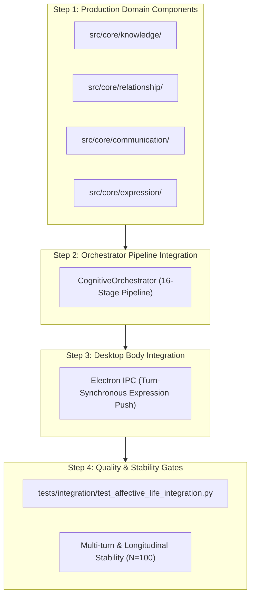

# Phase 16 — Affective Life Integration Plan

> **Authoritative Implementation Plan: Phased Subsystem Promotion, Architectural Decision Records (ADRs), Integration Validation, and Quality Gates**  
> **Status:** Authoritative Implementation Roadmap  
> **Directory:** `docs/specs/lucia-phase16-Affective_Life_Integration/PHASE_16_INTEGRATION_PLAN.md`  
> **Authority Level:** Authoritative Specification  

---

## 1. Executive Implementation Roadmap

Phase 16 executes a disciplined, stepwise transition from isolated research prototypes (`tests/unit/`) into production cognitive architecture (`src/core/`). Each promoted capability is implemented, verified, and placed under strict integration tests before the next capability is introduced.

---

## 2. Phased Work Packages & Implementation Sequence

### Phase 16.1 — Production Knowledge Subsystem (`src/core/knowledge/`)
- **Objective:** Establish production structured knowledge representation, local in-memory storage, deterministic rule-based derivation, and atomic persistence.
- **Files to create:**
  - `src/core/knowledge/__init__.py`: Public domain exports.
  - `src/core/knowledge/proposition.py`: `Proposition`, `Concept`, `Relation`, `ProvenanceType` enums.
  - `src/core/knowledge/store.py`: `KnowledgeStore` with thread-safe CRUD, confidence decay, validity updating.
  - `src/core/knowledge/derivation.py`: `DerivationEngine` with bounded depth $d_{max}=3$.
  - `src/core/knowledge/persistence.py`: Safe JSON persistence to `data/knowledge.json`.
- **Validation:** Unit tests verifying thread-safety, persistence, and non-destructive contradiction handling.

### Phase 16.2 — Production Relationship Subsystem (`src/core/relationship/`)
- **Objective:** Establish production interpersonal relationship state tracking with strict two-phase lifecycle (Read early in turn, Update post-turn), temporal inertia adaptation, and atomic persistence.
- **Files to create:**
  - `src/core/relationship/__init__.py`: Public domain exports.
  - `src/core/relationship/state.py`: `RelationshipState` ($F, T, C, K \in [0, 1]^4$).
  - `src/core/relationship/signals.py`: `RelationshipSignalType` enum (structured signals).
  - `src/core/relationship/updater.py`: `RelationshipUpdater` enforcing temporal inertia ($\alpha = 0.03$).
  - `src/core/relationship/persistence.py`: Atomic JSON persistence to `data/relationship.json` (isolated in tests).
- **Validation:** Unit tests verifying temporal inertia, absence decay, two-phase read/update lifecycle, and separation from limbic ODE.

### Phase 16.3 — Production Communication Subsystem (`src/core/communication/`)
- **Objective:** Establish production communication policy, strategy classification, bounded memory contextualization (grounded in Phase 15 contextual communication evidence), and intentional somatic pacing modulation.
- **Files to create:**
  - `src/core/communication/__init__.py`: Public domain exports.
  - `src/core/communication/communication_state.py`: `CommunicationState` (10D vector) and `CommStrategy` (5 modes).
  - `src/core/communication/communication_policy.py`: `CommunicationPolicy` with exponential smoothing ($\gamma = 0.25$) and pacing latency cap ($\le 1000\text{ms}$).
  - `src/core/communication/semantic_consistency_guard.py`: Semantic consistency validator (verifying intent preservation and entities on controlled benchmark; no universal truth claim).
- **Validation:** Unit tests verifying bounding, strategy selection, pacing bounds, and multi-layered anti-roleplay invariant.

### Phase 16.4 — Production Expression Subsystem (`src/core/expression/`)
- **Objective:** Establish production multimodal expression policy conforming strictly to the Phase 14 canonical 15 continuous dimensions schema and pure feedforward actuator decoupling.
- **Files to create:**
  - `src/core/expression/__init__.py`: Public domain exports.
  - `src/core/expression/expression_state.py`: `ExpressionState` (Exact 15 continuous bounded dimensions).
  - `src/core/expression/expression_policy.py`: Multi-modal mapping from PAD + Somatic + CommState.
  - `src/core/expression/semantic_consistency_guard.py`: Benchmark truth verification before actuation.
- **Validation:** Unit tests verifying physiological bounds, pure feedforward, and latency $\le 5.0\text{ms}$.

### Phase 16.5 — Canonical CognitiveOrchestrator 16-Stage Integration
- **Objective:** Upgrade `CognitiveOrchestrator` to execute the unified 16-stage pipeline in strict causal sequence with decoupled Relationship Read (S9) and Relationship Update (S16).
- **Files to modify:**
  - `src/core/orchestrator/cognitive_orchestrator.py`: Incorporate Knowledge, Relationship, Communication, and Expression into the 16-stage turn lifecycle.
  - `src/core/orchestrator/prompt_assembler.py`: Incorporate communication strategy framing and structured knowledge context.
  - `src/core/orchestrator/policies.py`: Update `CognitiveTurnResult` to include `RelationshipState`, `CommunicationState`, and `ExpressionState`.
- **Validation:** Regression testing of all existing unit tests and new 16-stage pipeline.

### Phase 16.6 — Body & Desktop Turn-Synchronous IPC Integration
- **Objective:** Connect production expression output to the Electron renderer process synchronously on each turn.
- **Files to modify:**
  - `src/api/server.py`: Extend `POST /process` and `GET /state` responses with `expression` payload.
  - `electron/main/index.js` or IPC bridge: Forward turn expression payload to avatar renderer.
  - `electron/renderer/avatar/avatar.js`: Apply turn-synchronous expression parameters alongside background polling.
- **Validation:** Electron Jest test suite validation.

### Phase 16.7 — Production Integration Test Suite (`tests/integration/`)
- **Objective:** Provide exhaustive integration testing across the complete unified lifecycle with strict test storage isolation (`tmp_path`).
- **Files to create:**
  - `tests/integration/test_affective_life_integration.py`: End-to-end multi-component tests:
    - Test A: Subsystem Isolation & Independent Ablations
    - Test B: Temporal Correctness (Relationship Read S9 precedes LLM S13; Relationship Update S16 occurs post-gen)
    - Test C: State Boundedness across all subsystems
    - Test D: Deterministic Replay
    - Test E: Multi-Turn Persistence across process restarts using isolated temporary directory
    - Test F: Failure Isolation (error in knowledge/relationship does not crash limbic loop)
    - Test G: Controlled Benchmark Semantic Consistency
    - Test H: Multi-Layered Anti-Roleplay Invariant under live generation
    - Test I: Concurrency & Lock Hierarchy Stress Test
    - Test J: 100-Turn Longitudinal Stability Simulation

---

## 3. Required Architectural Decision Records (ADRs)

To document the architectural rationale, the following ADRs will be authored in `docs/DESIGN_DECISIONS.md`:

1. **ADR-021: Knowledge Subsystem Integration & K0–K5 Scope Boundary**
   - Context: Need structured conceptual knowledge distinct from episodic memory and LLM weights.
   - Decision: Promote K0–K5 (propositions, concepts, store, derivation, revision); defer K6–K9 open-domain unsupervised extraction.
2. **ADR-022: Relational Subsystem Integration & Two-Phase Temporal Discipline**
   - Context: Need slowly evolving interpersonal bond without within-turn self-reinforcing loops or personality sliders.
   - Decision: Implement dynamic $R_t \in [0, 1]^4$ with adaptation rate $\alpha = 0.03 \ll 1.0$, structured signals, and two-phase separation (Read at S9, Update at S16).
3. **ADR-023: Memory Contextualization & Communicative Strategy Promotion**
   - Context: Need dialogue style and pacing to reflect cognitive load, fatigue, and memory context without introspective self-reporting.
   - Decision: Promote bounded memory contextualization (grounded in Phase 15 communication evidence, distinct from limbic recollection); promote 10D CommunicationState and 5 canonical strategies; cap somatic pacing latency at $1000\text{ms}$.
4. **ADR-024: Multimodal Expression Policy & Actuator Decoupling**
   - Context: Need avatar blendshapes and voice prosody to reflect affect while ensuring pure feedforward.
   - Decision: Promote ExpressionPolicy with exact 15 continuous dimensions matching Phase 14 research model; strict feedforward decoupling; zero feedback to limbic ODE.
5. **ADR-025: Unified 16-Stage Cognitive Turn Architecture & Storage Isolation**
   - Context: Need unified cognitive turn executing in strict causal sequence under `_turn_lock` with strict test storage isolation.
   - Decision: Expand CognitiveOrchestrator from 10 to 16 stages; enforce temporary store isolation during tests.

---

## 4. Quality Acceptance Gates & Sign-Off Checklist

Before Phase 16 can be declared complete, the following gates must be passed:

- [ ] All production code lives in `src/core/` and adheres to typing and documentation standards.
- [ ] No test-only research mocks exist in `src/core/`.
- [ ] All 575 existing unit tests pass without regression.
- [ ] All 119 Electron desktop tests pass without regression.
- [ ] New integration test suite (`tests/integration/test_affective_life_integration.py`) passes 100%.
- [ ] Longitudinal 100-turn stability simulation completes with zero NaNs, zero deadlocks, and bounded states.
- [ ] Bit-exact data file safety: `data/profile.json` remains untouched (`is_onboarded = False`); canonical data files remain unmutated by test suite.
- [ ] Multi-layered anti-roleplay checks pass.
- [ ] Canonical documentation updated (`CURRENT_STATUS.md`, `ARCHITECTURE.md`, `DESIGN_DECISIONS.md`, `00_PROJECT_OVERVIEW.md`, `DOCUMENTATION_INDEX.md`).
