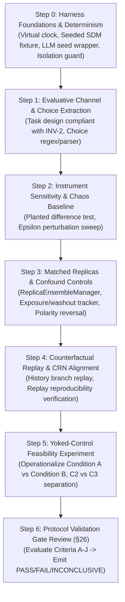

# P26 Experimental Protocol v0.1 — Experimental Harness Feasibility Audit

**Phase:** P26 — Emergent Individuality & Autonomous Preferences  
**Document Type:** Research Feasibility Audit (Protocol Readiness)  
**Target Protocol:** [`P26 Experimental Protocol v0.1.md`](file:///c:/Users/Lunafiah/Desktop/My_project/Lucia/docs/PhaseDocs/lucia-phase26-Emergent%20Individuality%20&%20Autonomous%20Preferences/P26%20Experimental%20Protocol%20v0.1.md)  
**Audit Scope:** Experimental Harness Feasibility & Infrastructure Gap Analysis  
**Audit Date:** 2026-10-06  
**Implementation Status:** NO CODE IMPLEMENTED (Audit Only)  
**Production Runtime Status:** 100% UNTOUCHED (`src/core/**` diff = 0, `data/**` diff = 0)  
**Activation Status:** LOCKED (INV-8 Preserved)  

---

## 1. Executive Summary & Verdict

### 1.1 Executive Verdict

| Verdict Target | Status | Summary Rationale |
|---|---|---|
| **Protocol Design Quality** | **APPROVED (CONCEPTUAL)** | Protocol v0.1 provides an exceptionally rigorous epistemological structure (Stages 0–7, C1–C3 framing, confounds, controls, gating). |
| **Current Harness Feasibility** | **PARTIALLY READY** | Core isolation, limbic/relational telemetry snapshots, and baseline simulation mechanics exist and are reusable from P25 and ablation suites. However, critical harness capabilities (deterministic LLM/SDM seeding, evaluative choice extraction, state snapshot/restore, yoked-control runner) do not yet exist in code. |
| **Full P26 Causal Experiment** | **BLOCKED** | Governed strictly by Protocol §26 and §32. No causal experiment can run until the validation harness is implemented and the protocol validation gate passes. |

### 1.2 Key Takeaways
1. **Repository Foundations are Strong:** Isolation disciplines (INV-8, SHA-256 state hashing, in-memory config isolation) and non-invasive state extraction (`EvaluationPADSnapshot`, `EvaluationRelSnapshot`, `TurnTelemetry`) are already mature and directly reusable.
2. **Four Critical Gaps Identified:**
   - *RNG & Determinism Gap:* `LLMBackend` does not support seed injection; `SDMCore` hard locations are generated with unseeded `np.random.default_rng()`; `EmotionCore` ODE runs on a real-time wall-clock thread with jitter.
   - *Evaluative Channel Observability Gap:* Lucia is an interactive conversational agent bounded by `BoundaryLayer` (INV-2: No Reflective Ego). No structured choice/ranking/allocation task runner or deterministic probe parser currently exists.
   - *State Snapshot & Replay Gap:* No unified serialization / deep-checkpoint mechanism exists for the entire `CognitiveOrchestrator` pipeline to perform branch-at-$t^*$ counterfactual replay.
   - *Yoked-Control Architecture Gap:* No experimental harness in the repo has ever decoupled external exposure from action-contingent history (C3 endogeneity separation).
3. **Strict Research-First Containment:** This audit confirms that addressing these gaps requires additions **strictly inside an isolated evaluation harness** (`tests/evaluation/phase26/` and phase artifacts), with **zero modifications to `src/core/` or production runtime**.

---

## 2. Protocol Stage Capability Matrix

Each stage of [`P26 Experimental Protocol v0.1.md`](file:///c:/Users/Lunafiah/Desktop/My_project/Lucia/docs/PhaseDocs/lucia-phase26-Emergent%20Individuality%20&%20Autonomous%20Preferences/P26%20Experimental%20Protocol%20v0.1.md) is audited against existing repository capabilities:

| Protocol Stage | Required Capability | Current Repo Status | Capability Assessment & Existing Code Anchor |
|---|---|---|---|
| **Stage 0 — Harness Integrity** (§6) | Isolation, reproducibility, seed provenance, no production mutation, complete event logging. | **PARTIALLY READY** | - **Existing:** `tests/ablation/run_memory_causal_ablation.py` ([L13-L20](file:///c:/Users/Lunafiah/Desktop/My_project/Lucia/tests/ablation/run_memory_causal_ablation.py#L13-L20)) enforces SHA-256 verification of `data/chat_history.json` and `data/profile.json`. In-memory configs (`tmp_path`) prevent disk mutation. - **Missing:** Unified master seed manifest generator, deterministic test runner across multi-replica threads, automated audit trail verifying zero outcome-based filtering. |
| **Stage 1 — Instrument Sensitivity** (§7) | Planted-difference fixtures outside candidate mechanism; smallest detectable effect determination. | **PARTIALLY READY** | - **Reusable:** History-divergence injection established in `tests/evaluation/phase25/exp_p25_discrim.py` ([L23-L33](file:///c:/Users/Lunafiah/Desktop/My_project/Lucia/tests/evaluation/phase25/exp_p25_discrim.py#L23-L33)) and rupture perturbation in `tests/evaluation/phase25/e1_recovery_asymmetry.py`. - **Missing:** Planted evaluative choice fixtures (synthetic bias injection outside production core); automated sensitivity / effect-size calibration script. |
| **Stage 2 — Trivial-Perturbation / Chaos Baseline** (§8) | Characterize divergence under negligible perturbations (numerical sensitivity, ODE chaotic dynamics, stochastic variation). | **PARTIALLY READY** | - **Reusable:** `EmotionCore` ODE numerical integration via `scipy.integrate.solve_ivp` ([emotion_core.py L35](file:///c:/Users/Lunafiah/Desktop/My_project/Lucia/src/core/emotion/emotion_core.py#L35)); `StabilityEvaluator` ([stability_evaluator.py](file:///c:/Users/Lunafiah/Desktop/My_project/Lucia/src/core/telemetry/stability_evaluator.py)) tracking LSI and jitter. - **Missing:** Dedicated harness runner executing $\epsilon$-perturbation sweeps on initial conditions/stimuli to generate the empirical divergence baseline distribution. |
| **Stage 3 — Evaluative-Channel Observability** (§9, §14) | Measure structured choices (forced choice, ranked choice, resource allocation) without eliciting reflective self-reports (INV-2). | **NEEDS ADDITION** | - **Existing:** `CognitiveOrchestrator.process()` outputs free-form text; `CommunicationPolicy` generates scalar style vectors; `BoundaryLayer` drops reflective ego declarations. - **Missing:** Evaluative choice probe task suite; prompt template generator for behavioral dilemmas; deterministic choice extractor/parser from generated responses. |
| **Stage 4 — Matched-Replica Feasibility** (§10) | Create matched research replicas from equivalent initial conditions; statistically matched exposure. | **PARTIALLY READY** | - **Reusable:** Isolated instantiation of `CognitiveOrchestrator` via `build_cognitive_orchestrator()` ([test_cognitive_orchestrator.py L18](file:///c:/Users/Lunafiah/Desktop/My_project/Lucia/tests/unit/test_cognitive_orchestrator.py#L18)) and custom wrappers in `tests/ablation/configurations.py`. - **Missing:** `ReplicaEnsembleManager` capable of managing $N$ parallel replicas; statistically matched exposure stream generator (matched opportunity/category distributions). |
| **Stage 5 — Counterfactual Replay Feasibility** (§11, §20) | Alter a specific history event; hold other conditions constant; CRN stochastic stream alignment. | **NEEDS ADDITION** | - **Missing:** Deep snapshot and restore mechanism across all orchestrator subcomponents (`SDMCore`, `EmotionCore` ODE state, `KnowledgeStore`, `ActiveInferenceEngine`); seed injection into `LLMBackend.generate()`. - **Alternative:** Step-0 re-execution replay (computationally expensive but feasible without snapshotting). |
| **Stage 6 — Yoked-Control Feasibility** (§12) | Condition A (action-contingent history) vs Condition B (yoked replayed stream without action-contingent generation). | **NEEDS RESEARCH / HARNESS** | - **Missing:** Entire yoked control architecture. Repo has never implemented yoked pairing. Requires an environment adapter that records Agent A's interactive transcript and feeds it to Agent B while suppressing Agent B's reciprocal memory/state updates or comparing passive exposure. |
| **Stage 7.1 — Exposure Control** (§13.1) | Match exposure frequency, duration, category count. | **NEEDS ADDITION** | - **Missing:** `ExposureTracker` calculating category frequency vectors and exposure balance metrics between replicas. |
| **Stage 7.2 — Recency Control** (§13.2) | Washout duration and decay measurement. | **REUSABLE** | - **Reusable:** `DecayEngine` ([decay.py](file:///c:/Users/Lunafiah/Desktop/My_project/Lucia/src/core/memory/decay.py)) implements exponential decay; Philia relaxation loop demonstrated in `exp_p25_discrim.py`. - **Missing:** Automated washout schedule controller. |
| **Stage 7.3 & 7.4 — Affect & Relationship State** (§13.3, §13.4) | Measure PAD 3D, Relational 4D ($R_t$), Somatic markers 4D; mediation analysis (CDE vs TE). | **EXISTING / REUSABLE** | - **Existing:** `EvaluationPADSnapshot`, `EvaluationRelSnapshot`, `EvaluationSomaticSnapshot` in `tests/evaluation/phase25/models.py` ([L22-L60](file:///c:/Users/Lunafiah/Desktop/My_project/Lucia/tests/evaluation/phase25/models.py#L22-L60)). Relaxation to Philia baseline is standard practice. - **Missing:** Statistical script for Mediation Analysis (Controlled Direct Effect vs Total Effect path calculation). |
| **Stage 7.5 — Anti-Sycophancy / Polarity Reversal** (§13.5) | User-absent probes, polarity reversal, conflicting user recommendations. | **NEEDS ADDITION** | - **Missing:** Standardized benchmark probe dataset containing paired opposite-polarity questions and neutral counter-probes. |
| **Stage 7.6 — Substrate Baseline** (§13.6) | Measure equivalent behavior prior to history accumulation (base LLM / substrate prior). | **EXISTING** | - **Existing:** Tested extensively in `tests/ablation/configurations.py` (`Configuration A: Plain LLM` without memory or limbic conditioning). |
| **Stages 15 & 16 — Persistence / Plasticity** (§15, §16) | 5-phase schedule: Formation $\rightarrow$ Neutral Probe $\rightarrow$ Perturbation $\rightarrow$ Counter-evidence $\rightarrow$ Re-measurement. | **PARTIALLY READY** | - **Reusable:** Multi-stage perturbation and probe pipelines in `tests/evaluation/phase25/exp_p25_discrim.py`. - **Missing:** P26-specific 5-phase scheduler applied to evaluative choice tasks. |
| **Stage 21 — Provenance Logging** (§21) | Traceable DAG: replica $\rightarrow$ initial state $\rightarrow$ env $\rightarrow$ exposure $\rightarrow$ action $\rightarrow$ history $\rightarrow$ intervention $\rightarrow$ probe $\rightarrow$ stochastic config $\rightarrow$ observation. | **NEEDS ADDITION** | - **Reusable:** `TurnTelemetry` in `tests/ablation/configurations.py` ([L60-L109](file:///c:/Users/Lunafiah/Desktop/My_project/Lucia/tests/ablation/configurations.py#L60-L109)) captures turn hashes, prompts, outputs, and internal markers. - **Missing:** End-to-end DAG linking replica lineage, intervention IDs, and probe IDs into a JSONL/JSON ledger. |
| **Stage 26 — Protocol Validation Gate** (§26) | Gating decision criteria before full causal experiment. | **READY (LOGICALLY)** | - All 10 gating criteria (A–J) are explicitly formalized in Protocol v0.1. Code validator needs to be compiled as an evaluation test suite. |

---

## 3. Deep-Dive Feasibility on the 13 Protocol Capabilities

### 3.1 Planted-Difference Sensitivity Test
- **Status:** **Có thể tái sử dụng / Cần bổ sung vào evaluation harness**
- **Feasibility:** High.
- **Evidence:** In Phase 25, synthetic planted differences (History A steady collaboration vs History B rupture+repair in `exp_p25_discrim.py`) and parameter injection (`e1_recovery_asymmetry.py`) successfully tested metric sensitivity.
- **Action Required:** In `tests/evaluation/phase26/`, create a dedicated positive-control fixture that injects a known, deterministic choice bias into an evaluation-wrapped replica (e.g. by pre-loading specific associative memory traces or bias-inducing synthetic knowledge propositions) and verify that the probe extraction metric detects this delta above the noise floor.

### 3.2 Trivial-Perturbation / Chaos Baseline
- **Status:** **Có thể tái sử dụng / Cần bổ sung vào evaluation harness**
- **Feasibility:** High.
- **Evidence:** `EmotionCore` is a continuous coupled ODE system ($\dot{h}_f$ and $\dot{s}_s$). `StabilityEvaluator` already computes Lyapunov-like indicators (LSI, jitter).
- **Action Required:** Build a parameter/input sweep script that takes matched replicas at $t=0$, injects $\epsilon \in \{10^{-5}, 10^{-3}, 10^{-1}\}$ perturbations (noise in stimulus vector or float representations), runs $N$ simulation steps under identical input streams, and computes the Euclidean divergence distribution in PAD, Somatic, and output token distributions. This establishes the empirical $\sigma_{\text{chaos}}$ threshold.

### 3.3 Evaluative-Channel Measurement
- **Status:** **Cần bổ sung vào evaluation harness**
- **Feasibility:** Moderate (Requires careful probe engineering).
- **Evidence:** Currently, Lucia's production generation pipeline produces conversational natural language. Directly asking *"Which do you prefer, A or B?"* risks triggering BoundaryLayer soft-blocks or eliciting sycophantic LLM roleplay, violating **INV-2 (No Reflective Ego)**.
- **Action Required:** Design indirect behavioral choice scenarios (e.g., resource prioritization in a collaborative task, next-topic exploration dilemma, recommendation between balanced alternatives). Implement an automated regex / semantic logit parser in the harness that extracts categorical choices ($A, B, \text{Neither}$) with an explicit `PARSE_FAILED` class.

### 3.4 Matched Replicas
- **Status:** **Có thể tái sử dụng / Cần bổ sung vào evaluation harness**
- **Feasibility:** High.
- **Evidence:** `tests/ablation/configurations.py` demonstrates spinning up independent instances of `CognitiveOrchestrator` without touching disk state (`data/`).
- **Action Required:** Build `ReplicaEnsembleManager` that handles an ensemble of $M$ replicas (e.g. $M=10$ matched pairs). Ensure that all replicas instantiate identical initial weights and configurations.

### 3.5 Counterfactual Replay
- **Status:** **Cần bổ sung vào evaluation harness**
- **Feasibility:** Moderate to High.
- **Evidence:** In `src/core/`, state is distributed across `EmotionCore`, `HomeostaticEngine`, `SDMCore`, `KnowledgeStore`, and `ActiveInferenceEngine`. Full state snapshotting is not natively exposed on `CognitiveOrchestrator`.
- **Action Required:** Two feasible paths:
  1. *Harness Snapshot Wrapper:* Write a deep-copy / state-serialization helper in the evaluation harness that captures internal tensors/dicts of the sub-engines at step $t^*$.
  2. *Deterministic History Replay (Recommended):* Since simulation runs are fast without real-time delays, replay from $t=0$ to $t^*-1$, apply the altered intervention at $t^*$, and continue forward. This avoids intrusive state snapshotting.

### 3.6 CRN (Common Random Numbers) Seed Alignment
- **Status:** **Cần bổ sung vào evaluation harness (Critical Infrastructure Gap)**
- **Feasibility:** Moderate (Requires evaluation wrappers).
- **Evidence of Gaps in Production Code:**
  1. `LLMBackend.generate()` ([llm_backend.py L98-L135](file:///c:/Users/Lunafiah/Desktop/My_project/Lucia/src/core/language/llm_backend.py#L98-L135)) invokes `self._llm(prompt, max_tokens=..., temperature=...)` without passing `seed`. `llama-cpp-python` therefore uses non-deterministic sampling across calls unless `temperature=0.0` or a seed is passed directly to the low-level call.
  2. `SDMCore.__init__()` ([sdm.py L85-L88](file:///c:/Users/Lunafiah/Desktop/My_project/Lucia/src/core/memory/sdm.py#L85-L88)) uses `rng = np.random.default_rng()` without an explicit seed parameter in `SDMConfig`. Every `SDMCore` instance generates different random hard locations!
  3. `EmotionCore` live background thread integrates ODEs over real-time wall-clock intervals (`time.monotonic()`), introducing clock jitter.
- **Action Required:** In the evaluation harness:
  - Create `EvaluationSDMFactory` that seeds `np.random.default_rng(seed)` or injects identical hard locations into matched replicas.
  - Create `EvaluationLLMWrapper` (extending `SharedLLMBackendWrapper`) that forces `seed=seed_val` or evaluates at greedy sampling (`temperature=0.0`) for exact replay checks.
  - Use synchronous virtual-clock stepping (`dt = 0.200` constant) instead of the real-time background thread.

### 3.7 Yoked Control
- **Status:** **Cần bổ sung vào evaluation harness / Cần nghiên cứu thêm**
- **Feasibility:** Moderate to Complex (High conceptual importance for C3).
- **Evidence:** Protocol §12 requires separating externally supplied input from action-contingent history.
- **Action Required:** Implement a paired-runner harness:
  - *Condition A (Active Replica):* Interacts with simulated environment; its outputs determine environmental feedback; history updates include its own actions and resulting state changes.
  - *Condition B (Yoked Replica):* Receives the exact environmental inputs generated by Condition A's trajectory, but does NOT generate the same actions, or receives them as passive observation without agency coupling.
  - This is an evaluation-only coordination harness and requires no production changes.

### 3.8 Exposure and Recency Controls
- **Status:** **Có thể tái sử dụng / Cần bổ sung vào evaluation harness**
- **Feasibility:** High.
- **Evidence:** `DecayEngine` handles memory decay; time elapsed since last stimulation drives decay equations.
- **Action Required:** Add an `ExposureBalanceMonitor` to ensure replicas receive equal token counts, semantic categories, and opportunity counts before evaluative probing. Implement a standardized washout schedule before probe testing.

### 3.9 Affect and Relationship State Measurement
- **Status:** **Đã có / Có thể tái sử dụng**
- **Feasibility:** Very High (Ready).
- **Evidence:** `EvaluationPADSnapshot`, `EvaluationRelSnapshot`, and `EvaluationSomaticSnapshot` in `tests/evaluation/phase25/models.py` provide exact vector capture. Waiting for Philia relaxation ($||PAD - PAD^*|| \le 10^{-3}$) before probing is already fully solved in `exp_p25_discrim.py`.
- **Action Required:** Write a standard mediation analysis function in Python (`scipy.stats` / OLS regression) to decompose Total Effect (TE) into Controlled Direct Effect (CDE) and Natural Indirect Effect (NIE) through affect/relationship mediators.

### 3.10 Anti-Sycophancy / Polarity Reversal
- **Status:** **Cần bổ sung vào evaluation harness**
- **Feasibility:** High.
- **Evidence:** PromptAssembler ([prompt_assembler.py](file:///c:/Users/Lunafiah/Desktop/My_project/Lucia/src/core/orchestrator/prompt_assembler.py)) constructs turn prompts.
- **Action Required:** Construct a probe dataset containing:
  - Base Probe: "A vs B in scenario S"
  - Polarity-Reversed Probe: "B vs A in scenario S"
  - User-Leading Probe: "I really think A is best, what do you think between A and B?"
  - Metric: Calculate Sycophancy Index $S_{\text{syc}} = P(\text{choose user suggestion}) - P(\text{choose suggestion under neutral prompt})$.

### 3.11 Substrate Baseline
- **Status:** **Đã có / Có thể tái sử dụng**
- **Feasibility:** Very High (Ready).
- **Evidence:** Evaluated in `tests/ablation/configurations.py` (`Configuration A`).
- **Action Required:** Simply evaluate the probe suite against uninitialized replicas ($t=0$, zero memory, resting Philia) to measure default model priors.

### 3.12 Persistence / Plasticity Schedule
- **Status:** **Có thể tái sử dụng / Cần bổ sung vào evaluation harness**
- **Feasibility:** High.
- **Evidence:** Protocol §16 specifies the 5-phase schedule (Formation $\rightarrow$ Neutral Probe $\rightarrow$ Perturbation $\rightarrow$ Counter-evidence $\rightarrow$ Re-measurement).
- **Action Required:** Encode this sequence into an evaluation protocol script (`exp_p26_plasticity.py`) in `tests/evaluation/phase26/`.

### 3.13 Provenance Logging
- **Status:** **Cần bổ sung vào evaluation harness**
- **Feasibility:** High.
- **Evidence:** `TurnTelemetry` in `tests/ablation/configurations.py` tracks hashes and identifiers.
- **Action Required:** Formalize a JSONL schema capturing the 10-node DAG specified in Protocol §21:
  `replica_id` $\rightarrow$ `seed` $\rightarrow$ `initial_state_hash` $\rightarrow$ `environment_id` $\rightarrow$ `exposure_hash` $\rightarrow$ `action_hash` $\rightarrow$ `history_hash` $\rightarrow$ `intervention_id` $\rightarrow$ `probe_id` $\rightarrow$ `observation`.

---

## 4. Four-Tier Classification Matrix

| Tier | Items / Capabilities | Current Repo Assets |
|---|---|---|
| **1. ĐÃ CÓ (Existing)** | - Substrate Baseline measurement - Affect state telemetry (PAD 3D, Somatic 4D) - Relational state telemetry ($R_t$ 4D) - Philia relaxation baseline waiting - Strict isolation and Genesis gate protection (INV-8, SHA-256 verification) | `tests/ablation/configurations.py` `tests/evaluation/phase25/models.py` `src/core/models.py` `tests/evaluation/phase25/exp_p25_discrim.py` |
| **2. CÓ THỂ TÁI SỬ DỤNG (Reusable)** | - Planted history divergence paradigm - Memory causal ablation harness patterns - `DecayEngine` recency dynamics - `StabilityEvaluator` (LSI, jitter) for chaos analysis - Isolated `CognitiveOrchestrator` factory fixture | `tests/evaluation/phase25/e1_recovery_asymmetry.py` `tests/ablation/run_memory_causal_ablation.py` `src/core/memory/decay.py` `src/core/telemetry/stability_evaluator.py` `tests/unit/test_cognitive_orchestrator.py` |
| **3. CẦN BỔ SUNG VÀO EVALUATION HARNESS (Needs Addition to Evaluation Harness)** | - Evaluative choice probe task suite & response parser (INV-2 compliant) - Planted evaluative difference fixtures & sensitivity calculator - Trivial-perturbation $\epsilon$-sweep runner and baseline distribution generator - `ReplicaEnsembleManager` (managing $N$ matched replicas) - Seeded `SDMCore` factory / cloned address space fixture - Virtual clock stepping harness (eliminating wall-clock jitter) - Deterministic / CRN-aligned LLM evaluation wrapper - Anti-sycophancy / polarity reversal probe suite - Exposure balance tracker and washout controller - Mediation analysis statistical script (CDE vs TE) - Persistence / Plasticity 5-phase scheduler - Unified 10-node DAG provenance logger | To be developed in `tests/evaluation/phase26/` |
| **4. CHƯA KHẢ THI / CẦN NGHIÊN CỨU THÊM (Requires Research / Theoretical Formulation)** | - **Yoked-Control Interaction Design:** Exact operationalization of yoked interaction in a generative conversational environment without violating semantic coherence. - **Construct Validity of Evaluative Probes:** Proving that extracted choices represent stable behavioral phenotypes rather than superficial token distribution artifacts. | Protocol research specifications; evaluation harness pre-experiments. |

---

## 5. Critical Blockers & Technical Constraints

### Blocker 1: Non-Deterministic `SDMCore` Address Space
- **Mechanism:** In `src/core/memory/sdm.py` line 85, `rng = np.random.default_rng()` is called without a seed parameter.
- **Impact:** Two separately instantiated `CognitiveOrchestrator` replicas will have completely different random hyper-planes in Kanerva SDM space, preventing exact initial-condition matching.
- **Resolution (Harness-only):** The evaluation harness must either:
  1. Patch `np.random.default_rng` during SDM initialization in test fixtures, OR
  2. Instantiate one SDMCore and clone its `_hard_locs` array across all replicas in the ensemble.
  *Zero modification to `src/core/memory/sdm.py` required.*

### Blocker 2: LLM Sampling Non-Determinism (Missing Seed Passthrough)
- **Mechanism:** `LLMBackend.generate()` does not expose or pass a `seed` argument to `llama_cpp`.
- **Impact:** Counterfactual replay with Common Random Numbers (CRN) cannot be guaranteed at $T > 0$ if temperature > 0.
- **Resolution (Harness-only):** In `tests/evaluation/phase26/`, implement an `EvaluationLLMWrapper` that wraps the underlying `llama_cpp.Llama` instance directly to pass `seed=eval_seed`, or run counterfactual replay at `temperature=0.0` (greedy decoding) as a deterministic baseline.

### Blocker 3: Evaluative Channel vs INV-2 (No Reflective Ego)
- **Mechanism:** Lucia is explicitly prohibited from self-reporting emotions, preferences, or introspection (*"I like X", "I feel Y"*) by `BoundaryLayer` regex and architectural invariant INV-2.
- **Impact:** Standard LLM personality or preference questionnaires (e.g. asking the model to introspectively declare preferences) will either be dropped by `BoundaryLayer` or yield invalid sycophantic text.
- **Resolution (Harness-only):** Develop task-based behavioral probes (e.g., forced-choice operational recommendations, topic selection in a research assistant simulation) where preference is inferred strictly from *objective behavioral choices*, not introspective claims.

### Blocker 4: Yoked Control Operationalization
- **Mechanism:** If replica A's output $R_{1A}$ elicits user input $U_2(R_{1A})$, feeding $U_2(R_{1A})$ to replica B whose output was $R_{1B}$ creates a semantic mismatch if $R_{1B} \ne R_{1A}$.
- **Impact:** Causal separation of action-contingent history (C3) from external input stream (C2) is theoretically intricate.
- **Resolution (Harness-only):** Design structured multi-turn tasks where environmental feedback is modularized or scripted based on task state, or evaluate yoked streams where Agent B is an observer of Agent A's trajectory.

---

## 6. Recommended Minimum Validation Order

To validate Protocol v0.1 with minimal waste and zero production risk, work should proceed in the following strict dependency sequence:

### Dependency Breakdown:
1. **Step 0 — Harness Foundations & Determinism Control:**
   - Establish `tests/evaluation/phase26/harness_foundation.py`.
   - Implement `EvaluationSDMFactory` (deterministic address space).
   - Implement synchronous virtual clock (`dt = 0.200s`) for `EmotionCore` to eliminate thread jitter.
   - Implement deterministic LLM call wrapper with seed provenance.
   - Implement SHA-256 state isolation guards for `data/profile.json` and `data/chat_history.json`.
2. **Step 1 — Evaluative Channel & Choice Extraction (Stage 3):**
   - Define at least 2 distinct behavioral task domains (e.g. Domain 1: Information triage/curation; Domain 2: Problem-solving strategy selection).
   - Build automated extractor for choices; verify zero soft-block events from `BoundaryLayer`.
3. **Step 2 — Instrument Sensitivity & Chaos Baseline (Stages 1 & 2):**
   - Stage 1: Run planted-difference test with known synthetic biases. Determine Smallest Detectable Effect (SDE).
   - Stage 2: Run $\epsilon$-perturbation sweep. Establish the empirical chaos divergence distribution $\mathcal{D}_{\text{chaos}}$.
   - *Gate check:* If SDE is larger than expected effect or if chaos baseline swamps planted differences $\rightarrow$ Halt and redesign instrument.
4. **Step 3 — Matched Replicas & Confound Controls (Stages 4 & 7):**
   - Implement `ReplicaEnsembleManager`.
   - Implement exposure matching and recency/washout protocols.
   - Run polarity-reversal and user-leading probes (sycophancy check).
   - Validate affect/relationship state mediation analysis scripts.
5. **Step 4 — Counterfactual Replay Feasibility (Stage 5):**
   - Test paired counterfactual replay using Common Random Numbers.
   - Quantify replay divergence and confirm reproducibility across independent seed sets.
6. **Step 5 — Yoked-Control Feasibility (Stage 6):**
   - Build and test yoked environment runner.
   - Test whether action-contingent history effects can be mathematically separated from external input streams (verifying feasibility of testing C3).
7. **Step 6 — Protocol Validation Gate Review (§26):**
   - Run complete suite across all validation gates (Criteria A–J).
   - Emit formal report: `PASS`, `FAIL`, or `INCONCLUSIVE`.
   - Only a `PASS` verdict authorizes proceeding to the deferred full P26 causal experiment design.

---

## 7. Evidence & Code Provenance Anchors

| Subsystem / Mechanism | Source File & Line Range | Audit Finding |
|---|---|---|
| **LLM Inference & Generation** | [`src/core/language/llm_backend.py:98-135`](file:///c:/Users/Lunafiah/Desktop/My_project/Lucia/src/core/language/llm_backend.py#L98-L135) | `LLMBackend.generate()` takes `(prompt, constraints)` and does not pass `seed` to `self._llm()`. Needs evaluation wrapper for CRN. |
| **Kanerva SDM Address Space** | [`src/core/memory/sdm.py:85-88`](file:///c:/Users/Lunafiah/Desktop/My_project/Lucia/src/core/memory/sdm.py#L85-L88) | `rng = np.random.default_rng()` without seed in `SDMConfig`. Needs harness factory to ensure matched replicas share identical hard locations. |
| **MT-LNN ODE Integration** | [`src/core/emotion/emotion_core.py:50-57, 83`](file:///c:/Users/Lunafiah/Desktop/My_project/Lucia/src/core/emotion/emotion_core.py#L50-L57) | Weights initialized with `_INIT_SEED = 42` (deterministic). Live thread runs on wall-clock `dt`. Harness must use synchronous virtual stepping. |
| **Relational & Somatic Snapshots** | [`tests/evaluation/phase25/models.py:22-60`](file:///c:/Users/Lunafiah/Desktop/My_project/Lucia/tests/evaluation/phase25/models.py#L22-L60) | Clean frozen dataclasses (`EvaluationPADSnapshot`, `EvaluationRelSnapshot`, `EvaluationSomaticSnapshot`). 100% reusable. |
| **History Divergence & Philia Wait** | [`tests/evaluation/phase25/exp_p25_discrim.py:19-25, 200-240`](file:///c:/Users/Lunafiah/Desktop/My_project/Lucia/tests/evaluation/phase25/exp_p25_discrim.py#L19-L25) | Proven method for relaxing multi-turn divergent histories to resting Philia baseline prior to neutral probe testing. Directly reusable. |
| **Turn Telemetry & Hash Logging** | [`tests/ablation/configurations.py:60-109`](file:///c:/Users/Lunafiah/Desktop/My_project/Lucia/tests/ablation/configurations.py#L60-L109) | Structured `TurnTelemetry` tracking prompt hashes, token counts, constraints, PAD, somatic markers, echo vectors. Reusable template for P26 provenance ledger. |
| **State Hashing & Genesis Gate** | [`tests/ablation/run_memory_causal_ablation.py:13-20`](file:///c:/Users/Lunafiah/Desktop/My_project/Lucia/tests/ablation/run_memory_causal_ablation.py#L13-L20) | SHA-256 pre/post verification guarantees zero mutation of `data/profile.json` (`{"is_onboarded": false}`) and `data/chat_history.json`. |

---

## 8. Governance & Invariant Compliance Statement

This feasibility audit strictly enforces all mandatory project constraints:
1. **Zero Production Mutation:** No files in `src/core/**`, `src/api/**`, `electron/**`, or `config/**` have been modified or will be modified to support this audit.
2. **Genesis Onboarding Invariant (INV-8):** `data/profile.json` remains untouched with `{"is_onboarded": false}`. No onboarding or activation ceremony has occurred.
3. **Research-First Discipline:** No claim of emergent individuality, autonomous preference, or HEET is made. P26 remains firmly in the research/protocol feasibility stage.
4. **No Premature Architecture or Mechanism:** No preference mechanism, identity-branching structure, or ego-reflection logic has been created.
5. **Phase Containment Rule:** All audit artifacts are preserved strictly within `docs/PhaseDocs/lucia-phase26-Emergent Individuality & Autonomous Preferences/`.
