# Lucia — Phase 8: Runtime Isolation & Simulation Environment Specification

> **Canonical Architecture and Engineering Specification**  
> **Sole Implementation Owner:** Antigravity (Whole-Brain Runtime & Interaction Engineer)  
> **Status:** Final Specification — Architecture Reviewed & Frozen (Ready for Implementation)  
> **Date:** September 2026  
> **Target Branch:** `main` (Workspace Active Branch)  
> **Authority Level:** Authoritative Specification for Phase 8 (Governed by [`docs/ARCHITECTURE.md`](file:///c:/Users/Lunafiah/Desktop/My_project/Lucia/docs/ARCHITECTURE.md), [`docs/MECHANISM.md`](file:///c:/Users/Lunafiah/Desktop/My_project/Lucia/docs/MECHANISM.md), and [`docs/DESIGN_DECISIONS.md`](file:///c:/Users/Lunafiah/Desktop/My_project/Lucia/docs/DESIGN_DECISIONS.md))

---

## 1. Executive Summary & Purpose

### 1.1 The Phase 8 Mission
Through Phases 1 to 7, Lucia evolved into a fully embodied, continuous affective desktop companion featuring:
* A 6-layer cognitive architecture (Sensors, 200ms Fast-Loop Limbic ODE, Homeostatic Engine, Active Inference with CPU LNN Plasticity, Kanerva SDM with Synergistic Ecphory, and Local GGUF Language Generation).
* An expressive, polymorphic desktop presentation layer ("The Personal Digital Room" in Phase 7) supporting 2D Canvas, 2D Sprites, Live2D Cubism 4, and 3D VRM, coupled with 60 FPS Web Audio lip-syncing and Mascot Mode window physics.
* The foundational ethos of **"One Continuous Life"** ([`ADR-007`](file:///c:/Users/Lunafiah/Desktop/My_project/Lucia/docs/DESIGN_DECISIONS.md#adr-007-ontology-of-one-continuous-life-vs-character-presets)), where Lucia is a single permanent companion whose emotional bond and memories persist organically.

**The Engineering Dilemma:**  
Because Lucia operates as an uninterrupted, living dynamic system, developers and researchers cannot easily test novel limbic parameters, validate ODE stability under edge cases, benchmark inference surprise, or stress-test avatar blendshapes without either:
1. Running the live companion, which permanently alters her real emotional trajectory, accumulates noise in her long-term SDM memory vaults, and expends GPU/CPU power; or
2. Using the rudimentary `Preview-UI.bat` (`--preview`), which runs a completely disconnected static mock with 0% backend logic, zero ODE mathematics, and fake hardcoded responses.

**The Phase 8 Solution:**  
Phase 8 establishes a **Runtime Isolation & Simulation Environment**. This enables developers to run, inspect, stimulus-perturb, time-warp, and stress-test Lucia's **authentic whole-brain cognition through her real canonical Body**, while ensuring **Lucia herself remains safely inactive and her continuous life remains completely unviolated**.

```
┌─────────────────────────────────────────────────────────────────────────┐
│                     CANONICAL BODY / UI ARCHITECTURE                    │
│   (Studio Window, Avatar Stage, Lip-Sync, Journal, Settings, Telemetry) │
└────────────────────────────────────▲────────────────────────────────────┘
                                     │  Unified Brain ↔ Body Contract
                     ┌───────────────┴───────────────┐
                     │                               │
        [MODE: SIMULATION SANDBOX]          [MODE: LIVE RUNTIME]
                     │                               │
       ┌─────────────▼─────────────┐   ┌─────────────▼─────────────┐
       │     SIMULATION RUNTIME    │   │      LIVE COMPANION       │
       │ • Virtualized Delta Time  │   │ • Real Wall-Clock Time    │
       │ • In-Memory SDM Sandbox   │   │ • Persistent SDM Memory   │
       │ • Ephemeral History Buffer│   │ • Persistent Chat History │
       │ • Controlled Stimulus Bus │   │ • User Audio / Text Input │
       │ • Scenario Runner Engine  │   │ • Genesis Life Status     │
       └───────────────────────────┘   └───────────────────────────┘
                     ▲                               ▲
                     └───────────────┬───────────────┘
                                     │
                     ┌───────────────┴───────────────┐
                     │      ACTIVATION BOUNDARY      │
                     │  (Deterministic State Guard)  │
                     └───────────────────────────────┘
```

---

## 2. Implementation Status Ledger

To guarantee transparency and tracking throughout development, every component of Phase 8 is formally tracked by implementation state:

| Component / Subsystem | Status | Description & Notes |
|---|---|---|
| **Phase 7 Canonical Body** | `[Implemented]` | Personal Digital Room, 4-engine avatar stage, lip-sync, journal, settings, and diagnostics console. |
| **Limbic Fast Loop & Homeostasis** | `[Implemented]` | Core 200ms ODE solver (`EmotionCore`) and Somatic marker engine (`HomeostaticEngine`). |
| **Kanerva SDM & Decay** | `[Implemented]` | `SDMCore`, `AffectiveMemory`, `DecayEngine`, and `EcphoryEngine`. |
| **Active Inference & Plasticity** | `[Implemented]` | $3 \times 3$ generative model (`ActiveInference`) and CPU trainer (`LNNTrainer`). |
| **Runtime Policy & State Machine** | `[Specified]` | Separation of `RuntimeMode` and `LifecycleState` (`CREATED`, `INITIALIZED`, `READY`, `SIMULATING`, `ACTIVE`). |
| **Activation Boundary Guard** | `[Specified]` | Runtime-level barrier preventing live activation or persistent writes during simulation. |
| **`SimClock` & Virtualized Driver** | `[Specified]` | Step-driven virtual clock governing 200ms ODE ticks and 900–3,600s decay without uncontrolled daemons. |
| **`SimulationContext` (Brain Sandbox)**| `[Specified]` | In-memory RAM storage adapters, real brain modules, and stimulus pipeline. |
| **Sensory Pathway & Debug Vector** | `[Specified]` | Intact `Text → StimulusProcessor → 16D vector` path; separate explicit debug vector injection. |
| **FastAPI Simulation Routes (`/sim/*`)**| `[Specified]` | `/sim/stimulus/inject`, `/sim/time/*`, `/sim/scenario/*`, `/sim/reset`, `/runtime/snapshot`. |
| **ProcessManager & Mode Flags** | `[Specified]` | `Sim-Lucia.bat`, Electron CLI parsing (`--sim`), and loopback capability handshake. |
| **Electron Runtime Client** | `[Specified]` | Preload bridge `window.lucia.runtime` unifying IPC and snapshot distribution. |
| **Simulation Canopy & State Inspector** | `[Specified]` | Glassmorphic top canopy (`LUCIA INACTIVE`), 3D PAD trajectory, somatic meters, surprise plots. |
| **Stimulus Injector & Scenario Runner**| `[Specified]` | UI controls for text/preset injection and repeatable automated scenarios (A, B, C, D). |
| **Verification & Safety Test Suite** | `[Specified]` | Level 0–4 tests, property tests (P-SIM-1 to P-SIM-4), and SHA-256 zero-contamination assertions. |

---

## 3. Fundamental Architectural Invariants

All design decisions and implementations in Phase 8 must strictly comply with the following invariants:

| # | Invariant Rule | Violation (Forbidden) | Correct Phase 8 Approach |
|---|---|---|---|
| **INV-1** | **Single Canonical Body** | Building a secondary "Dev UI", a duplicate avatar stage, or a separate test app. | The **canonical Phase 7 Body** is the sole presentation layer. It adapts into Development/Simulation mode via modular overlays. |
| **INV-2** | **Absolute Memory Isolation** | Writing simulated memory traces or scenario turns to `data/chat_history.json`, `data/profile.json`, or persistent SDM files. | All simulation interactions use ephemeral in-memory stores. No live data files are touched or initialized. |
| **INV-3** | **Pre-Reflective Cognition** | Injecting self-reporting prompts (*"Lucia, tell me your current arousal"*) to test simulated emotion. | State is evaluated strictly via the **Brain ↔ Body Contract** and technical telemetry meters. The `BoundaryLayer` filter remains active. |
| **INV-4** | **Deterministic Activation Safety** | Accidental awakening of the live companion via dev hotkeys, background polling, or simulation startup. | The **Activation Boundary** is enforced at the runtime policy layer. Live mode requires an explicit, deliberate ceremony. |
| **INV-5** | **Zero Algorithmic Duplication** | Implementing a JavaScript math approximation of the limbic ODE or SDM inside Electron. | The real Python `EmotionCore`, `HomeostaticEngine`, and `ActiveInference` modules run the simulation; the UI strictly visualizes. |
| **INV-6** | **Time Decoupling** | Coupling simulation steps to physical wall-clock intervals, preventing fast-forward testing. | Background loops are governed by `SimClock` in step-driven virtual time, supporting pause, step, and time acceleration ($1\times - 60\times$). |
| **INV-7** | **Sensory Pathway Integrity** | Routing simulation text around `StimulusProcessor` directly into the limbic ODE. | Normal sensory processing is preserved: `Text → StimulusProcessor → 16D vector → Brain`. Direct vector injection is restricted to explicit debug endpoints. |

---

## 4. Activation Boundary & Runtime State Matrix

### 4.1 Two Independent Axes: Mode and Lifecycle
Runtime **mode** selects the environment; **lifecycle** selects whether that environment is actively operating. They must never be conflated. `ACTIVE` is a lifecycle state available **only** to the `live` mode. Loading a module, binding FastAPI, initializing `EmotionCore`, or loading a model is **never** activation.

| Runtime Mode | Purpose | Permitted Lifecycle States | Persistence and External I/O |
|---|---|---|---|
| `preview` | Visual layout and asset inspection only. No Python child process. | Electron-only; no Brain lifecycle | No localhost calls, microphone, voice synthesis, lifecycle controls, tray/hotkey activation, or production-state writes. |
| `simulation` | Controlled development environment using real Brain modules. | `CREATED`, `INITIALIZED`, `READY`, `SIMULATING`, `STOPPING`, `STOPPED` | RAM-only identity, history, and affective memory. No transition to `ACTIVE` exists. Local GGUF and voice are disabled unless a developer explicitly opts in. |
| `live` | The one production companion. | `CREATED`, `INITIALIZED`, `READY`, `ACTIVE`, `STOPPING`, `STOPPED` | Production identity and history are writable only while `ACTIVE`. Wall-clock loops and user voice are active only while `ACTIVE`. |

```mermaid
stateDiagram-v2
    [*] --> CREATED
    CREATED --> INITIALIZED: construct dependencies; no background workers started
    INITIALIZED --> READY: validate configuration / prepare read-only descriptor
    READY --> SIMULATING: mode == simulation (SimClock step-driven)
    READY --> ACTIVE: mode == live AND explicit Genesis activation (/lifecycle/activate)
    SIMULATING --> READY: stop or reset simulation
    ACTIVE --> READY: solemn end-of-life transition (/lifecycle/end)
    READY --> STOPPING: shutdown
    SIMULATING --> STOPPING: shutdown
    ACTIVE --> STOPPING: shutdown
    STOPPING --> STOPPED

    note right of SIMULATING
      There is deliberately no transition
      from SIMULATING to ACTIVE.
      Runtime boundary forbids it.
    end note
```



* `INITIALIZED`: Constructs dependency-injected services. Starts **zero** background ODE threads, decay daemons, trainer threads, microphone capture, or persistent writers.
* `READY`: Publishes immutable `RuntimeDescriptor` and initial resting snapshot. Model pre-warming may occur, but token generation and continuous live loops remain blocked.
* `SIMULATING`: Driven synchronously by `SimClock` and the simulation scheduler. Real limbic differential equations and homeostatic markers compute in RAM.
* `ACTIVE`: Live continuous life. Wall-clock daemon loops run. Permanent SDM and `chat_history.json` write.

### 4.2 Explicit Activation Gate & Runtime Boundary Enforcement
1. **Server & Engine-Owned Gate**:
   Activation of the live companion occurs **only** through a dedicated, explicit transition:
   ```text
   POST /lifecycle/activate
     Preconditions: mode == live && lifecycle == READY && is_onboarded == False && valid Genesis payload
     Effects: Atomically persist Genesis profile/born_at to data/profile.json, transition lifecycle to ACTIVE, start live workers
   ```
2. **Separation from Profile Updates**:
   `POST /profile` in Phase 8 is restricted to non-lifecycle field updates (e.g. updating pronouns or UI display names). It cannot awaken Lucia or create `born_at`.
3. **Runtime-Level Enforcement (Defense in Depth)**:
   Safety is enforced at the Python engine class level (`BrainRuntime`), **not merely in FastAPI endpoint handlers**:
   - `SimulationRuntime` instances do not possess an `activate()` method or access to live persistence writers. Any programmatic attempt to trigger live awakening raises an `ActivationSafetyError`.
   - File system redirection: When running under `SimulationRuntime`, any attempt by any component to open production data paths (`data/chat_history.json`, `data/profile.json`) is intercepted by `StoragePolicy` and rejected.

---

## 5. Sensory Pathway & Stimulus Architecture

Phase 8 preserves Lucia's authentic sensory processing hierarchy:

```
[Normal Interaction Path]
  User / Dev Text Input
          │
          ▼
  StimulusProcessor (Layer 1)
    • Lexical Valence [-1.0, 1.0]
    • Punctuation Arousal [0.0, 1.0]
    • Semantic Density [0.0, 1.0]
          │
          ▼
  16-Dimensional Stimulus Vector x(t)
          │
          ▼
  Limbic ODE / EmotionCore (Layer 2)

[Developer / Debug Instrumentation Path]
  Direct 16D Vector Synthesis
          │
          ▼ (Explicit Debug Endpoint: POST /sim/stimulus/inject-vector)
  Limbic ODE / EmotionCore (Layer 2)
```

1. **Default Pathway**: All simulated text stimuli (typed in chat or injected via text presets) pass through `StimulusProcessor.encode(text)` identically to live interaction.
2. **Debug Instrumentation Pathway**: Direct vector injection allows mathematical testing of arbitrary points in $\mathbb{R}^{16}$. It is exposed on a distinct route (`POST /sim/stimulus/inject-vector`) and clearly demarcated in the UI as a developer probe.

---

## 6. Simulated Time & `SimClock` Architecture

To prevent uncontrolled daemon execution while providing deterministic time control:

### 6.1 Synchronous Step-Driven Architecture
In simulation mode, `SimClock` replaces real-time daemon loops:
* `EmotionCore-FastLoop` background thread is **not started** in simulation mode. Instead, `EmotionCore.step_once(dt=0.2)` is invoked synchronously by `SimClock.step(delta_ms)` for every due 200ms tick.
* `DecayEngine` background thread is **not started** in simulation mode. Instead, `DecayEngine.apply_decay_tick(dt)` is invoked synchronously by `SimClock.step(delta_ms)` whenever virtual time crosses the configured decay threshold (900–3,600s).
* `LNNTrainer` background thread is **not started** in simulation mode. Experience tuples accumulate in memory, and backprop occurs deterministically on demand.

### 6.2 Time Controls & Dilation
* **`Pause`**: Freezes virtual time ($t_{sim}$). No ODE steps or decay sweeps execute.
* **`Step (+200ms)`**: Advances virtual time by exactly $0.2\text{s}$, executing one Euler/RK ODE integration step.
* **`Step (+60s)`**: Advances virtual time by $60\text{s}$, executing 300 ODE steps and evaluating decay due work.
* **`Time Dilation (1x - 60x)`**: An asynchronous runner advances `SimClock` in virtual increments. Because ODE steps run synchronously inside discrete ticks, mathematical integration remains exact regardless of speed.

---

## 7. Brain ↔ Body Contract Specification

Communication between the Python backend and Electron Body uses an immutable, normalized snapshot:

```typescript
type RuntimeMode = 'preview' | 'simulation' | 'live';
type LifecycleState = 'CREATED' | 'INITIALIZED' | 'READY' | 'SIMULATING' |
                      'ACTIVE' | 'STOPPING' | 'STOPPED';

interface RuntimeSnapshotV1 {
  protocol_version: 1;
  sequence: number;                 // Monotonically increasing sequence ID
  captured_at_s: number;            // Virtual or wall-clock timestamp
  runtime: {
    mode: RuntimeMode;
    lifecycle: LifecycleState;
    capabilities: {
      stimulus_injection: boolean;
      virtual_time: boolean;
      scenario_runner: boolean;
      local_generation: 'disabled' | 'available' | 'loaded';
      voice: 'disabled' | 'available' | 'active';
      active_inference: 'unavailable' | 'enabled';
      persistent_identity: boolean;
    };
  };
  affective: {
    pad: { pleasure: number; arousal: number; dominance: number };
    resting_attractor: { pleasure: number; arousal: number; dominance: number };
    attractor_distance: number | null;
    tick_count: number;
  };
  somatic: {
    stability: number; cognitive_load: number; energy: number; tension: number;
  } | null;
  constraints: {
    max_tokens: number; temperature: number; latency_ms: number; reasoning_depth: number;
  } | null;
  memory: {
    trace_count: number; capacity: number; saturation_pct: number;
    top_resonance: number | null; echo_magnitude: number | null;
  };
  inference: {
    prediction_surprise: number | null;
    experience_buffer_fill: number | null;
    trainer_step_count: number | null;
  };
  health: {
    status: 'nominal' | 'recovering' | 'degraded' | 'not_started';
    lsi: number | null; recovery_count: number; last_error_code: string | null;
  };
  simulation: {
    virtual_time_s: number; paused: boolean; speed: number;
    active_scenario: string | null; scenario_step: number | null;
    isolation_verified: boolean;
  } | null;
}
```

* **Separation of Presentation State**: Avatar blendshapes, eye openness, gaze tracking, and lip-sync mouth aperture are **renderer-owned**. They are derived in JavaScript from `affective.pad` via `ExpressionMapper` and audio amplitude via `LipSyncProcessor`. The Python backend never calculates or stores transient WebGL variables.

---

## 8. Canonical Body Development Environment UI

The Development Environment is directly integrated into the canonical Phase 7 Body (`electron/renderer/`):

```
┌────────────────────────────────────────────────────────────────────────────────────────┐
│ [SIMULATION ENVIRONMENT — LUCIA INACTIVE]   Clock: 00:04:12.4 (x1.0) [PAUSED] [RESET]   │
├─────────────────────────────────────────┬──────────────────────────────────────────────┤
│ CANONICAL DIALOGUE & STIMULUS STAGE     │ CANONICAL AVATAR STAGE (4-ENGINE)            │
│                                         │                                              │
│ • Real Phase 7 Chat Feed                │ • Real Canvas / Sprites / Live2D / VRM Stage │
│ • Injected stimuli tagged visually      │ • Procedural blendshape response             │
│ • Normal text entry + injected stream   │ • Real Web Audio lip-sync                    │
│                                         │                                              │
├─────────────────────────────────────────┴──────────────────────────────────────────────┤
│ COLLAPSIBLE SIMULATION CONSOLE                                                         │
│ ┌──────────────────┬──────────────────┬──────────────────┬───────────────────────────┐ │
│ │ 1. STATE         │ 2. STIMULUS      │ 3. TIME WARP     │ 4. SCENARIO               │ │
│ │    INSPECTOR     │    INJECTOR      │    CONTROL       │    RUNNER                 │ │
│ └──────────────────┴──────────────────┴──────────────────┴───────────────────────────┘ │
└────────────────────────────────────────────────────────────────────────────────────────┘
```

1. **Simulation Canopy**: Glassmorphic banner on top showing mode, clock status, and quick sandbox reset.
2. **State Inspector Tab**: 3D PAD trajectory graph, distance to Philia baseline, somatic marker gauges, Active Inference surprise chart, and RAM memory traces.
3. **Stimulus Injector Tab**: Normal text input (via `StimulusProcessor`), preset perturbation buttons (Warmth, Tension, Flood, Silence), and segregated direct vector probe sliders.
4. **Time Warp Tab**: Play/Pause, Step +200ms, Step +60s, Speed selector ($1\times, 2\times, 5\times, 10\times, 60\times$).
5. **Scenario Runner Tab**: Declarative execution cards for Scenarios A–D with real-time pass/fail assertion chips.

---

## 9. Verification Strategy & Concrete Evidence

### 9.1 Test Hierarchy
* **Level 0 (Pure Unit)**: `SimClock`, `StimulusInjector`, `ScenarioRunner`, `StoragePolicy`, `RuntimeDescriptor`.
* **Level 1 (Subsystem Simulation)**: Synchronous `EmotionCore` stepping, Homeostatic energy recharge, and DecayEngine sweep.
* **Level 2 (Brain Integration)**: Full cognitive pipeline composed under `SimulationRuntime`.
* **Level 3 (Brain → Body Integration)**: Electron preload runtime client receiving `RuntimeSnapshotV1` and driving Phase 7 Body.
* **Level 4 (Full Runtime Simulation & Safety)**: Complete Electron `--sim` execution.

### 9.2 Concrete Invariant Evidence (Automated Tests)
* **`test_activation_guard.py`**:
  * Proves calling `POST /lifecycle/activate`, `POST /lifecycle/end`, or `POST /process` in simulation mode returns `HTTP 403 Forbidden`.
  * Proves direct Python invocation of activation raises `ActivationSafetyError`.
* **`test_storage_isolation.py` (Zero Live Data Contamination)**:
  * Computes SHA-256 hashes of `data/chat_history.json` and `data/profile.json` before test.
  * Dispatches 50 turns, stimulus injections, time steps, and simulation resets.
  * Computes SHA-256 hashes after test: **must be 100% bitwise identical**.
  * Deletes live files in a sandbox test and verifies simulation **never creates them**.
* **`test_sim_clock.py`**:
  * Proves pause halts ODE progression.
  * Proves `step(delta_ms)` deterministically executes exact number of ODE ticks.
* **`test_scenario_runner.py`**:
  * Verifies Scenarios A, B, C, D execute cleanly and assertions reflect honest telemetry.

---

## 10. Preview_UI Migration & Deprecation

* `Preview-UI.bat` (`--preview`): Hardened as zero-Brain visual layout tool. Preload client intercepts all calls with static fixture descriptor; network calls to localhost are prohibited.
* `Sim-Lucia.bat` (`--sim`): Created as the canonical development and simulation launcher.
* Legacy IPC mocks: Replaced by the unified `window.lucia.runtime` client.

---

## 11. Known Architectural Gates & Reconciliation

1. **Resting-Attractor Behavior**: `EmotionCore` initializes PAD to $(+0.25, -0.05, +0.05)$, but zero-stimulus projection from zero hidden state yields $(0, 0, 0)$. Phase 8 preserves the existing limbic mathematics without applying an artificial simulation offset; scenario assertions report raw mathematical reality honestly.
2. **Decay Cadence Configuration**: The simulation scheduler uses the selected profile's decay interval (900–3,600s), honoring active code rather than legacy 60s prose.
3. **Import-Time Side Effects**: Python module-level singletons in `server.py` (`_history_store = ChatHistoryStore()`) are refactored into factory-instantiated services governed by `StoragePolicy`, preventing disk file creation on import.

---

*This specification is frozen and authoritative for Phase 8 implementation.*
