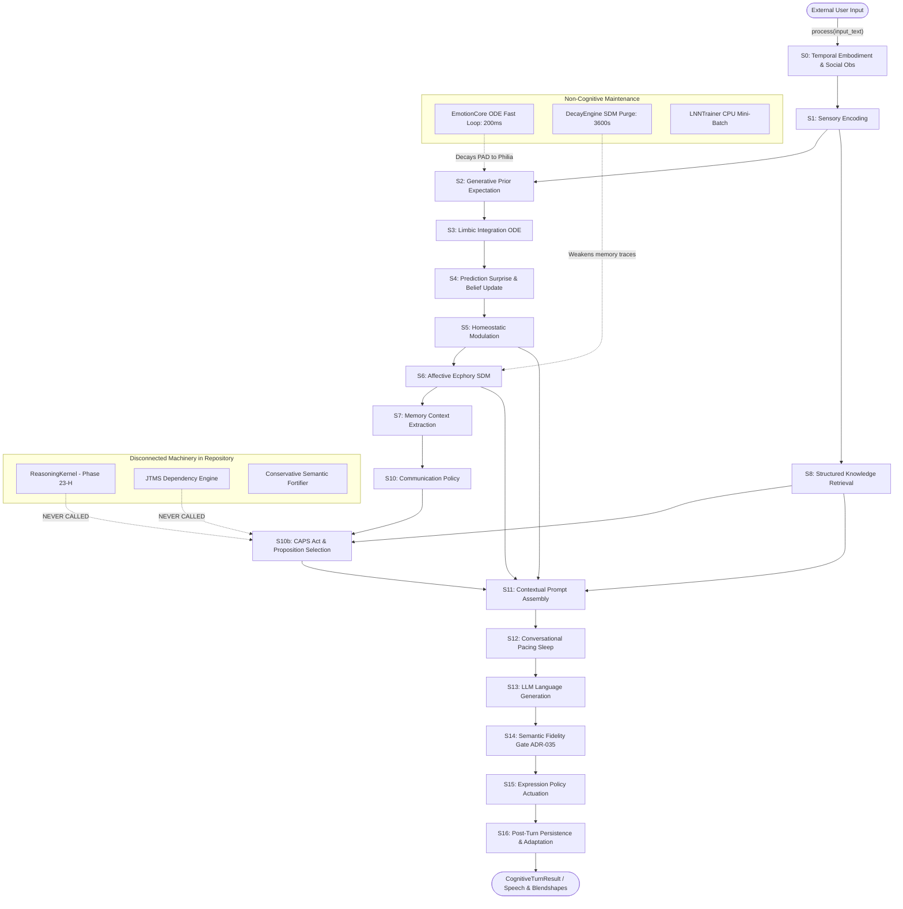

# Master Research Report — Endogenous Cognitive Lifecycle & Integration Feasibility for Lucia

**Document ID**: DOC-ECL-RESEARCH-001  
**Authority**: Master Research & Architecture Feasibility Investigation  
**Status**: `[RESEARCH-ONLY / NO PRODUCTION CHANGES / NO CANONIZATION]`  
**Date**: 2026-10-20  
**Target Repository Path**: `docs/others/endogenous_cognitive_lifecycle/ENDOGENOUS_COGNITIVE_LIFECYCLE_RESEARCH.md`  

---

## 0. Executive Verdict & Core Finding

### Verdict: **NO-GO (For Immediate Lifecycle Architecture Phase)**
### Diagnostic Classification: **MULTI-TIER DEFICIT (H4 & H5 Supported; H2 Falsified)**

### Core Finding:
Lucia does not merely suffer from a missing "Reason Formation" layer, nor does she merely suffer from incomplete integration wiring. The inability to continuously transform internal endogenous state into persistent cognitive consequences and grounded communicative candidates is the direct result of **three mutually reinforcing architectural realities**:

1. **Fundamentally Reactive Pipeline Architecture (H5)**: The central production pipeline (`CognitiveOrchestrator._execute_pipeline`) is strictly linear, synchronous, and input-driven ($S_0 \to S_{16}$). There is **zero architectural provision for endogenous cognitive execution**. When $u_{\text{input}} = \emptyset$, cognition is completely stationary. The background daemons (`EmotionCore`, `DecayEngine`, `LNNTrainer`) perform physiological ODE integration, passive memory decay, and offline tensor optimization; they are maintenance processes, **not a cognitive lifecycle**.
2. **Disconnected Symbolic Machinery**: The symbolic reasoning engine (`ReasoningKernel`, Phase 23-H) and truth maintenance system (`JTMS`) are **completely orphaned from production runtime**. They are instantiated only in isolated unit tests and benchmark runners. `CognitiveOrchestrator` never calls them, and `CAPS` receives `subgoals = None` on every production turn.
3. **Substrate-Level Semantic & Provenance Voids (H3 & H4)**: Even if `ReasoningKernel` were conceptually wired into an autonomous timer or idle loop, the existing substrates lack the foundational semantic primitives required for autonomous cognition:
   - *No Stable Identity*: `KnowledgeStore` does not deduplicate propositions over $(S, P, O)$; transitive derivations generate random UUIDs (`derived:{uuid4()}`).
   - *No Addressee Dependency*: Epistemic subgoals (`InformationSubgoal`) contain only predicate/entity integers; they cannot structurally distinguish whether a resolution requires the user, internal memory lookup, or environmental sensors.
   - *No Communication Provenance (F15 Blocker)*: Past assistant speech acts are never reified as propositions or logical terms. The system cannot distinguish legitimate external evidence from a self-induced echo loop where the user merely confirms Lucia's prior output.
   - *No Candidate Persistence or Inhibition*: Subgoals and cognitive candidates die when the call stack unwinds; there is zero repetition suppression or candidate history.

**Strategic Conclusion**: Simply "wiring the existing components" (Hypothesis H2) is **empirically falsified**. Establishing an endogenous cognitive lifecycle requires first resolving substrate-level semantic identity, addressee dependency, and bidirectional communication provenance.

---

## 1. Evaluation of Core Hypotheses (H1 – H5)

| Hypothesis | Proposition | Empirical Repository Evidence | Verdict |
|---|---|---|---|
| **H1** | The primary missing abstraction is an **Endogenous Cognitive Lifecycle / Integration mechanism**. | Background daemons execute only ODE integration and passive decay. No cognitive wake-up exists. However, introducing a lifecycle without substrate semantics immediately crashes into F12 (loops) and F15 (echoes). | **Partially Supported, but Insufficient as a Single Root Cause** |
| **H2** | The lifecycle already exists conceptually; the existing substrates are simply **incompletely wired**. | `ReasoningKernel` and `JTMS` exist in `src/core/cognition/kernel/` but are uncalled in `CognitiveOrchestrator`. However, wiring them leaves subgoals without addressee dependency, without persistence, and with unconstrained duplicate UUIDs. | **FALSIFIED** (Wiring alone does not produce viable cognition) |
| **H3** | Integration is not the problem; **deeper semantic/provenance/referent deficiencies** make integration insufficient. | `KnowledgeStore` lacks $(S,P,O)$ deduplication (`store.py:37`); `ProvenanceType` lacks assistant origin; `InformationSubgoal` lacks resolution authority. | **STRONGLY SUPPORTED** (Foundational semantic blockers exist) |
| **H4** | There is **no single missing abstraction**; Lucia requires several independent missing mechanisms. | Analysis reveals 3 orthogonal gaps: (1) Cognitive Lifecycle & Wake-Up Owner, (2) Structural Addressee & Resolution Semantics, (3) Candidate Persistence & Echo-Free Provenance. | **STRONGLY SUPPORTED** (True root-cause profile) |
| **H5** | The current architecture is **fundamentally reactive by design**; endogenous cognition requires a qualitatively different architecture. | `CognitiveOrchestrator.process()` assumes an incoming user string. Every stage from $S_1$ (stimulus encoding) to $S_{14}$ (fidelity gate) is parameterized around conversational turn-response. | **STRONGLY SUPPORTED** (Architectural reality) |

---

## 2. Actual Lucia Production Lifecycle Map

Direct code tracing of [`src/core/orchestrator/cognitive_orchestrator.py`](file:///c:/Users/Lunafiah/Desktop/My_project/Lucia/src/core/orchestrator/cognitive_orchestrator.py) reveals the true topology of Lucia's 16-stage pipeline.



### Transition Classification Matrix

| Stage | Subsystem | Transition Trigger | Classification | Persistent Consequence |
|---|---|---|---|---|
| **S0** | `TemporalEmbodimentCoordinator` | Incoming Turn ($t_{\text{now}}$) | **INPUT-DEPENDENT** | Updates temporal baseline and observation |
| **S1** | `StimulusProcessor` | `input_text` | **INPUT-DEPENDENT** | Produces ephemeral 64-d stimulus embedding |
| **S2** | `ActiveInferenceEngine` | Pre-stimulus PAD | **STATE-DEPENDENT** | Linear prediction $q_{\text{hat}} = Ap + b$ |
| **S3** | `EmotionCore` | Push Stimulus Token | **STATE-DEPENDENT** | Pushes stimulus to LNN queue; commits PAD |
| **S4** | `ActiveInferenceEngine` | Post-stimulus committed PAD | **STATE-DEPENDENT** | Computes scalar prediction error; updates $A, b$ |
| **S5** | `HomeostaticEngine` | Committed PAD + Prediction Error | **STATE-DEPENDENT** | Computes `SomaticMarkers` & `BehavioralConstraints` |
| **S6** | `EcphoryEngine` | Committed PAD + Stimulus | **STATE-DEPENDENT** | Queries SDM `AffectiveMemory`; returns `echo_vector` |
| **S7** | `AffectiveMemory` | `echo_vector` norm | **STATE-DEPENDENT** | Derives scalar availability $m_{\text{avail}}$ |
| **S8** | `KnowledgeStore` | Substring match on `input_text` | **INPUT-DEPENDENT** | Retrieves max 5 propositions matching keywords |
| **S9** | `RelationshipUpdater` | Pre-turn state read | **STATE-DEPENDENT** | Read-only copy of $R_{t-1}$ |
| **S10** | `CommunicationPolicy` | PAD + Somatic + Relationship + Memory | **STATE-DEPENDENT** | Selects communicative strategy & prosodic params |
| **S10b** | `CAPS` | Dialogue context + Retrieved propositions | **INPUT-DEPENDENT / PROCEDURAL** | Waterfall selection of speech act (`CAPSResult`) |
| **S11** | `PromptAssembler` | All stage snapshots + `RealizationContract` | **INPUT-DEPENDENT** | Formats plain text prompt string for LLM |
| **S12** | `TemporalEmbodimentCoordinator` | Constraints + Pacing deltas | **STATE-DEPENDENT** | Blocks thread via `time.sleep()` |
| **S13** | `LLMBackend` | Assembled prompt string | **INPUT-DEPENDENT** | Generates raw surface tokens |
| **S14** | `SemanticFidelityGate` | Raw tokens + `RealizationContract` | **INPUT-DEPENDENT** | Validates act/honorifics; blocks violations |
| **S15** | `ExpressionPolicy` | Final PAD + Somatic + Relationship | **STATE-DEPENDENT** | Computes TTS pitch/rate & VRM blendshapes |
| **S16.1**| `AffectiveMemory` | Stimulus + Final PAD | **INPUT-DEPENDENT** | Stores new SDM trace with timestamp |
| **S16.2**| `LNNTrainer` | Prediction error salience | **STATE-DEPENDENT** | Queues sample if prediction error $\ge$ threshold |
| **S16.3**| `RelationshipUpdater` | Prediction error + Tension | **STATE-DEPENDENT** | Advances epoch $t \to t+1$; persists $R_t$ |
| **S16.4**| Orchestrator Working Memory | Surface text | **INPUT-DEPENDENT** | Appends `("user", text)`, `("assistant", text)` |
| **S16.5**| Epoch Manifest Barrier | Epoch ID | **STATE-DEPENDENT** | Writes atomic checkpoint JSON to disk |
| — | `ReasoningKernel` | None | **DEAD / UNUSED IN PIPELINE** | Exists in `src/core/cognition/kernel/engine.py` |
| — | `JTMS` | None | **DEAD / UNUSED IN PIPELINE** | Exists in `src/core/cognition/kernel/jtms.py` |
| — | `ConservativeSemanticFortifier` | None | **DEAD / UNUSED IN PIPELINE** | Exists in `src/core/knowledge/fortification.py` |

---

## 3. The 11 Substrates: Deep Inspection & Missing Lifecycles

An exhaustive repository audit of all 11 cognitive, affective, and epistemic modules:

| Subsystem | What It Knows | What Triggers It | What It Outputs | Where Output Goes | Persistent? | Can It Trigger Cognition? |
|---|---|---|---|---|---|---|
| **EmotionCore** | Continuous hidden states $h_{\text{fast}} \in \mathbb{R}^{32}$, $s_{\text{slow}} \in \mathbb{R}^{16}$; Philia attractor. | Background ODE thread (every 200ms); turn stimulus ($S_3$). | 3D PAD vector ($P, A, D \in [-1, 1]$). | $S_2, S_4, S_5, S_6, S_{10}, S_{15}$. | Yes (Dynamical checkpoint). | **NO.** Mutates only continuous numbers. Asymptotes passively to Philia. |
| **HomeostaticEngine** | Metabolic energy ($E \in [0, 1]$), input timestamps, rolling load. | User turn arrival ($S_3$); Stage $S_5$. | `SomaticMarkers` ($S, L, E, T$); `BehavioralConstraints`. | Generation parameters in $S_5, S_{11}, S_{12}, S_{13}$. | Yes (Energy level in memory). | **NO.** Decrements energy on turn input; recovers passively. No goal emission. |
| **ActiveInference** | Transition matrix $A \in \mathbb{R}^{3 \times 3}$, bias $b \in \mathbb{R}^3$, KL prior. | Stage $S_2$ (prediction); Stage $S_4$ (surprise update). | Scalar prediction error (L2 norm); predicted PAD. | Modulates load/tension in $S_5$; relationship in $S_{16.3}$. | Yes ($A$ and $b$ matrices updated). | **NO.** Has no policy tree, no discrete actions, no epistemic queries. |
| **Ecphory / AffectiveMemory** | Up to 10,000 SDM memory traces (content vector + PAD + timestamp). | Stage $S_6$ (`query_recollection`); $S_{16.1}$ (store). | `echo_vector` $\in \mathbb{R}^{64}$; `RecollectionResult`. | Biases tone in $S_{11}$; slow latent forcing in $S_6$. | Yes (Disk JSON / binary). | **NO.** Pure associative hash table. Passive decay thread every hour. |
| **RelationshipState** | 4 scalars: trust, familiarity, closeness, reciprocity $\in [0, 1]$. | Stage $S_9$ (read); Stage $S_{16.3}$ (update step). | Updated `RelationshipState` array. | Biases communication policy in $S_{10}$; expression in $S_{15}$. | Yes (`data/relationship.json`). | **NO.** Monotonic exponential filter. Does not recognize ruptures or emit goals. |
| **KnowledgeStore** | Propositions $(S, P, O)$, concepts, Peano/transitive rules. | Stage $S_8$ (keyword substring search on input). | List of max 5 matching `Proposition` objects. | Evidence pool in $S_{10b}$; prompt grounding in $S_{11}$. | Yes (`data/knowledge.json`). | **NO.** Passive dictionary. No background derivation or contradiction checks. |
| **JTMS** | Term justifications ($R, C, \text{premises}$); premise-consequence graph. | **Never triggered in production.** Only tests/benchmarks. | Invalidation cascades on premise retraction. | Orphaned inside `ReasoningKernel`. | In-memory `TermArena` buffer. | **NO.** Only cascades downward invalidation. Cannot detect missing premises. |
| **ReasoningKernel** | Rule index, binding frames, ancestor stack, Strong Kleene K3 evaluator. | **Never triggered in production.** Only tests/benchmarks. | `GoalResult` (Kleene value, `InformationSubgoal`, `ConflictRecord`). | Emitted ephemeral dataclass. Orphaned. | None. Exists only on call stack. | **NO.** Requires an external caller to inject a goal. Has no autonomous driver. |
| **CognitiveStateSnapshot** | `candidate_predicate`, `subject`, `object`, `polarity`, `goal_id`. | Instantiated in S10b from first retrieved proposition. | Frozen dataclass. | Passed to `evaluate_caps`. | None. Destroyed when turn finishes. | **NO.** Static parameter bag. |
| **CAPS** | Dyadic discourse rules, lexical regexes, Gate R1–R4 policies. | Stage $S_{10b}$ during user turn. | `CAPSResult` (act, directives, pragmatic stance). | `RealizationInputContract` in S10b. | None. Ephemeral per turn. | **NO.** Procedural waterfall selector responding to input. |
| **P23-D Realization** | Typed contract, honorific rules, forbidden lexemes, boundary gate. | Stages $S_{11}, S_{13}, S_{14}$. | Surface language text conforming to semantic contract. | Final speech audio & user screen. | None. Stateless realization. | **NO.** Downstream realization actuator only. |

---

## 4. Deep Investigation of ReasoningKernel & JTMS

The audit posed 11 precise questions regarding `ReasoningKernel` and `JTMS`. Direct code analysis reveals:

1. **Where are they instantiated?**  
   - `ReasoningKernel` is instantiated **exclusively in test suites and benchmark runners**:
     - `tests/unit/test_p23h_kernel.py`
     - `tests/evaluation/phase23h/test_p23h_falsification.py`
     - `tests/evaluation/phase23h/benchmark_runner.py`
   - In `src/`, `JTMS` is instantiated solely as a fallback default inside `ReasoningKernel.__init__` (`src/core/cognition/kernel/engine.py:160`). There is **zero production instantiation** in `src/core/orchestrator/` or `src/api/`.
2. **Who owns them?**  
   No production module owns them. `CognitiveOrchestrator` owns `_knowledge_store` (Phase 16), but has no reference or attribute for `ReasoningKernel` or `JTMS`.
3. **What invokes them?**  
   Nothing in production. Only pytest harnesses invoke `kernel.backward_chain()`.
4. **What invokes them after state changes?**  
   Nothing. State changes in `EmotionCore`, `RelationshipUpdater`, or `ActiveInferenceEngine` emit no events to the cognitive core.
5. **What invokes them when there is no user input?**  
   Nothing.
6. **What outputs do they produce?**  
   `ReasoningKernel` produces `GoalResult`:
   - `status: KleeneValue` (`TRUE`, `FALSE`, `UNKNOWN`)
   - `subgoal: Optional[InformationSubgoal]`
   - `conflict: Optional[ConflictRecord]`
7. **Where are those outputs stored?**  
   Nowhere. They are returned as local Python function returns and immediately garbage collected when the stack unwinds.
8. **Can those outputs modify persistent cognitive state?**  
   No. They have no write path to `KnowledgeStore`, `AffectiveMemory`, or disk manifests.
9. **Can those outputs trigger another cognitive process?**  
   No. There is no event dispatcher, task queue, or recursive scheduler.
10. **Can they trigger communication?**  
    In `src/core/communication/caps.py:400`, `evaluate_caps` contains logic (Gate R1) to transform an `InformationSubgoal` into an `INQUIRE` or `CLARIFY` act. However, `CognitiveOrchestrator:822` passes `subgoals=None` on every production turn. The compiler is completely disconnected from the engine.
11. **Are they dead architecture, experimental remnants, or intended future infrastructure?**  
    They represent **frozen architectural specifications (Phase 23-H)** that achieved unit-test verification but were never integrated into the operational runtime pipeline. They are dormant substrate primitives without an execution harness.

---

## 5. Endogenous Cognitive Loop Analysis ($u_{\text{input}} = \emptyset$)

### Can Lucia perform cognitive processing without external input?

| Cognitive Capability | Supported When $u_{\text{input}} = \emptyset$? | Underlying Mechanism / Blocker |
|---|---|---|
| **1. Notice persistent internal discrepancy** | **NO** | Active inference surprise ($S_4$) is only evaluated during input stimulus processing ($S_3$). |
| **2. Notice unresolved epistemic condition** | **NO** | `KnowledgeStore` and `JTMS` have no background scanner; contradiction detection runs only on demand. |
| **3. Notice relational change** | **NO** | `RelationshipUpdater` updates only at turn completion ($S_{16.3}$). |
| **4. Notice homeostatic tension** | **NO** | `HomeostaticEngine` computes markers only inside turn $S_5$. Between turns, energy recovers passively without triggering events. |
| **5. Notice prediction error** | **NO** | Prediction error is strictly computed as $||A \cdot p_{\text{initial}} + b - p_{\text{final}}||$ across a turn stimulus. |
| **6. Retrieve relevant memory** | **NO** | SDM ecphory ($S_6$) requires a query probe; no spontaneous ecphoric recall occurs when idle. |
| **7. Evaluate/update epistemic state** | **NO** | Bounded local consistency checking (`ConservativeSemanticFortifier`) is invoked only during explicit session audits. |
| **8. Form a cognitive consequence** | **NO** | No mechanism generates goals from background state. |
| **9. Maintain that consequence** | **NO** | No working memory or goal buffer exists outside ephemeral turn variables. |
| **10. Revisit it later** | **NO** | Once a turn completes, all internal candidates and snapshots are dropped. |
| **11. Suppress it** | **NO** | No candidate inhibition table exists. |
| **12. Resolve it** | **NO** | No background inference loop exists. |
| **13. Influence future cognition** | **PARTIAL** | Only continuous PAD state and decayed SDM weights survive to the next turn. |
| **14. Generate communication candidate** | **NO** | Communication generation is strictly embedded within the synchronous HTTP request handler `/process`. |

**Verdict**: Lucia has **zero endogenous cognitive loop**.

---

## 6. Continuous Dynamics vs. Continuous Cognition

A critical theoretical and architectural distinction must be drawn:

$$\text{Continuous Internal Dynamics} \neq \text{Continuous Cognition}$$

Lucia possesses sophisticated, mathematically rigorous continuous internal dynamics:
- Coupled MT-LNN continuous ODE integration ($\tau \dot{h} = -h + f(Wh + Ux + b)$).
- Spectral-norm-bounded relational latent bias ($s^*_{\text{eff}}(R)$).
- Homeostatic energy depletion and recovery.
- Continuous active inference matrix adaptation ($\dot{A}, \dot{b}$).
- Exponential decay of memory trace weights.

**However, these continuous dynamics do not translate into cognitive events.**
When an ODE state shifts, or when energy recovers:
- No discrete symbol is generated.
- No hypothesis is created.
- No proposition is evaluated.
- No goal is activated.
- No communicative candidate is proposed.

Instead, the continuous dynamics simply alter the background landscape (the resting PAD coordinates or the temperature/token scalars) for **whenever the user next chooses to speak**. If the user does not speak, the dynamics smoothly decay to the Philia resting attractor ($P=+0.25, A=-0.05, D=+0.05$) and stop changing. 

Lucia has **continuous physiology**, but **strictly discrete, reactive cognition**.

---

## 7. Lifecycle Architecture Comparison

| Architecture | Description | Alignment with Lucia | Fatal Flaw / Gap for Lucia |
|---|---|---|---|
| **A. Reactive Integration (Current)** | Synchronous $S_0 \to S_{16}$ pipeline triggered strictly by user text. | 100% matches current production codebase. | Incapable of autonomous agency, endogenous communication, or self-initiated inquiry. |
| **B. Event-Driven Cognitive Lifecycle** | Internal/external state transitions emit typed events to an event bus; handlers trigger bounded cognition. | Fits Lucia's discrete modules well; allows limp-mode decoupling. | **Threshold Problem**: Continuous ODE states require arbitrary scalar thresholds (e.g. "if tension > 0.65") to emit discrete events, violating project invariants. |
| **C. Periodic Endogenous Cycle** | Background clock ticks every $\Delta t$; executes bounded cognitive maintenance and goal search. | Compatible with existing daemons (`DecayEngine`, `EmotionCore`). | **Wasted Work & Loop Safety**: Ticking without external input risks endless repetitive derivations or empty spin-loops without an inhibition ledger. |
| **D. Global Workspace / Competition** | Multiple modules propose candidate signals to a shared working memory; central arbitrator selects winning coalition. | Matches Baars/LIDA cognitive theory; solves single-owner bottleneck. | **Missing Substrate Semantics**: Requires a common currency or typed candidate structure that Lucia currently lacks (Arbitration F8 is unresolved). |
| **E. Active-Inference Cognitive Loop** | Unified discrete-continuous POMDP where expected free energy ($G$) selects epistemic vs pragmatic actions. | Philosophically pure active inference. | **Complete Rewrite**: Lucia's reasoning is symbolic Strong Kleene K3 + JTMS, not a probabilistic generative model. Incompatible with current codebase. |
| **F. Hybrid (Event-Driven Interrupt + Bounded Idle Consolidation)** | User inputs create immediate interrupts; idle intervals trigger bounded, non-allocating epistemic maintenance. | Architecturally most viable for edge deployment (20-Watt invariant). | Still requires resolving proposition identity, addressee dependency, and echo provenance first. |

---

## 8. Established Cognitive Architecture Insights

Comparing Lucia's missing integration against classical cognitive architectures:

### 1. LIDA (Learning Intelligent Distribution Agent — Franklin et al.)
- **Mechanism**: Operates via a continuous, cyclic cognitive loop running every ~200ms: *Perception $\to$ Working Memory $\to$ Attention $\to$ Global Broadcast $\to$ Action Selection $\to$ Execution*.
- **Transferable Insight**: LIDA does not wait for user input. The cycle runs autonomously. If no new external input arrives, attention codelets attend to internal working memory discrepancies or episodic recall.
- **Lucia Deficit**: Lucia has no Attention Codelets and no cyclic broadcast. Her pipeline terminates at $S_{16}$.

### 2. SOAR (State, Operator And Result — Laird)
- **Mechanism**: Production cycle driven by operators. When an operator cannot resolve a state (e.g., tie between operators, no applicable rule, missing value), SOAR hits an **architectural impasse**. The architecture automatically generates a **Subgoal** in a new state partition to resolve the impasse.
- **Transferable Insight**: Lucia's `InformationSubgoal` in `engine.py` is conceptually identical to a SOAR impasse subgoal.
- **Lucia Deficit**: In SOAR, the subgoal is an architectural state that persists and recurses until resolved. In Lucia, `InformationSubgoal` is an ephemeral object returned on the Python call stack and discarded.

### 3. ACT-R (Anderson et al.)
- **Mechanism**: Modally separated buffers (Goal Buffer, Retrieval Buffer, Visual Buffer) coordinated by a central production system via conflict resolution (utility learning).
- **Transferable Insight**: Buffers hold **one chunk at a time** with activation decay. Subsystems communicate strictly by placing typed chunks into buffers.
- **Lucia Deficit**: Lucia has no Goal Buffer. `CognitiveStateSnapshot` is an ad-hoc struct populated on the fly, not an active buffer.

---

## 9. Is "Reason Formation" the Wrong Abstraction?

Previous research attempted to solve autonomous communication by introducing:
$$\text{Internal State} \to \text{Persistent Grounded Referent (PGR)} \to \text{GroundedReason} \to \text{Authorization} \to \text{Communication}$$

This audit establishes that **PGR was an attempt to solve a systemic lifecycle problem with a localized data container.**

### Why PGR Was the Wrong Abstraction:
1. **Container without an Engine**: Introducing a `GroundedReason` object or `Event Ledger` creates a data structure, but provides no mechanism to:
   - Decide *when* to inspect it.
   - Determine *who* owns its progression.
   - Evaluate *whether* it has been resolved by internal background deduction.
2. **Downstream Symptom Confusion**:
   - The inability to persist an unresolved contradiction is not a "Reason Formation" flaw; it is a **Working Memory / Goal Buffer flaw**.
   - The inability to know if the user is required to resolve it is an **Epistemic Substrate Semantic flaw** (missing addressee dependency).
   - The inability to prevent infinite repetitive questions is an **Attention / Inhibition flaw**.
   - The inability to avoid echo loops is a **Communication Provenance flaw** (untracked assistant speech acts).
3. **Verdict on PGR**: PGR is **unnecessary as an independent abstraction**. If working memory buffers, typed resolution dependencies, and a bounded cognitive lifecycle are established, "reasons" emerge naturally as active subgoals competing for communication. If those substrates are absent, PGR is merely an empty metadata wrapper.

---

## 10. Falsification Analysis (F1 – F15)

| Test ID | Condition Tested | Result | Root Cause of Failure |
|---|---|---|---|
| **F1** | No External Input | **FAILED** | Zero background cognitive execution; daemons run only ODE/decay. |
| **F2** | Persistent Discrepancy | **FAILED** | No persistent goal buffer or discrepancy store; state dies with call stack. |
| **F3** | Structural Resolution | **FAILED** | CAPS maps reason codes to speech acts via hardcoded procedural `if/elif`. |
| **F4** | Structural Relevance | **FAILED** | Relevance cannot be derived without handwritten semantic rule tables. |
| **F5** | Candidate Competition | **FAILED** | Multiple subgoals are truncated via `subgoals[0]`; waterfall precedence. |
| **F6** | Candidate Inhibition | **FAILED** | No suppression record exists; system would re-ask identical inquiries. |
| **F7** | Reawakening | **FAILED** | Suppressed or deferred candidates are permanently dropped. |
| **F8** | Self-Causality / Echo | **FAILED** | Assistant speech acts omitted from provenance; user echoes become `USER_STATED`. |
| **F9** | Persistence Across Epochs | **FAILED** | Only continuous PAD, relationship scalars, and SDM traces survive epochs. |
| **F10** | Continuous $\to$ Discrete | **FAILED** | Discrepancy detection requires arbitrary scalar threshold slicing. |
| **F11** | Idle Cognition | **FAILED** | Idle time executes physiological resting decay, not reasoning. |
| **F12** | Loop Safety | **FAILED** | No mechanism exists to prevent infinite self-reflective reasoning loops. |
| **F13** | Integration Sufficiency | **FAILED** | Connecting existing modules fails because subgoals lack addressee semantics. |
| **F14** | Semantic Sufficiency | **FAILED** | `KnowledgeStore` lacks deduplication; derivations produce random UUIDs. |
| **F15** | Architectural Sufficiency| **FAILED** | Multiple foundational abstractions (Goal Buffer, Inhibition, Provenance) are absent. |

---

## 11. Root-Cause Comparison Matrix

| Candidate Root Cause | Evidence For | Evidence Against | Falsification Test | Evaluation |
|---|---|---|---|---|
| **A. Missing Reason Formation** | Explains lack of communicative candidate structure. | Localized; does not solve execution, timing, or lifecycle. | F1, F11 | **REJECTED AS ROOT CAUSE** (Downstream symptom). |
| **B. Missing Cognitive Lifecycle** | Directly explains why idle time produces zero cognition (F1, F11). | Does not explain why existing subgoals lack addressee semantics (F4). | F13, F14 | **NECESSARY BUT INSUFFICIENT**. |
| **C. Incomplete Wiring Only** | ReasoningKernel exists in repo; CAPS has compiler logic. | Wiring them leaves subgoals without addressee or persistence (F13). | F13 | **FALSIFIED** (Substrates have intrinsic gaps). |
| **D. Missing Epistemic Semantics** | Proved by UUID derivations, whitelist contradiction, untyped subgoals. | Semantics alone do not provide execution driver or timing. | F1, F2 | **PRIMARY FOUNDATIONAL BLOCKER**. |
| **E. Missing Communication Provenance** | Proved by lack of assistant speech act tracking; F15 echo vulnerability. | Provenance alone does not generate candidates. | F8 | **PRIMARY SAFETY BLOCKER**. |
| **F. Multiple Independent Gaps (H4)** | Supported by simultaneous failure of F1, F4, F8, F14 across multiple modules. | None. Accurately reflects repository architecture. | F1–F15 | **AFFIRMED ROOT CAUSE**. |

---

## 12. Minimal Integration Experiment (Conceptual Design Only)

To rigorously determine the boundary between "wiring deficiency" and "semantic deficiency", consider the following conceptual isolation experiment (DO NOT IMPLEMENT):

### Experimental Design:
1. **Simulation Fixture**: Create an isolated test harness in `tests/evaluation/lifecycle_feasibility/`.
2. **Artificial Trigger**: Inject an artificial periodic clock tick waking `CognitiveOrchestrator` when $u_{\text{input}} = \emptyset$.
3. **Hardwired Goal**: Inject an active goal $G = (\text{predicate: } \text{c:USER_LOCATION}, \text{arg0: } \text{ent:user})$ into `ReasoningKernel`.
4. **Execution**:
   - `ReasoningKernel.backward_chain(G)` encounters missing premise $\to$ returns `InformationSubgoal`.
   - Pass `subgoal` to `evaluate_caps(subgoals=[subgoal])`.
   - CAPS compiles `CommunicativeAct.INQUIRE`.
   - Route to `RealizationInputContract` $\to$ `PromptAssembler`.

### Predicted Failure Modes (Why It Fails):
- **Cycle 1**: Emits inquiry *"Where are you located?"*
- **Cycle 2 (User does not reply)**: The clock ticks again. Because the goal is still unresolved and there is no candidate inhibition record, Lucia immediately emits the exact same inquiry again: *"Where are you located?"* (Repetition pathology).
- **Cycle 3 (User replies: "I'm in Tokyo")**: User statement ingested. But because `KnowledgeStore` derives facts with unconstrained UUIDs, the newly stored fact does not share a canonical ID with the premise expected by JTMS. The goal remains unresolved.
- **Cycle 4 (Self-Echo)**: If Lucia previously asked *"Are you in Tokyo?"*, user replies *"Yes"*, system tags fact as `USER_STATED` with no trace that Lucia introduced the referent.

**Experimental Conclusion**: The experiment proves that supplying the missing trigger/wiring alone **fails immediately** due to lack of inhibition memory, unstable proposition identity, and absent communication provenance.

---

## 13. Minimal Principled Architecture for Future Horizons

If an endogenous cognitive lifecycle is ever to be realized in Lucia without introducing hidden procedural rule engines or arbitrary scalar thresholds, it must be constructed from the following **smallest principled primitives**:

```mermaid
graph TD
    subgraph Foundational Substrate Layer [Prerequisite Tier]
        KS_Dedup[1. Canonical SPO Deduplication in KnowledgeStore]
        Comm_Prov[2. Bidirectional Communication Provenance Record]
        Addressee_Sem[3. Typed Addressee Dependency in Subgoals]
    end

    subgraph Working Memory Layer [State Tier]
        Goal_Buffer[4. Bounded Active Goal Buffer Capacity <= 4]
        Inhib_Ledger[5. Candidate Inhibition & Repetition Ledger]
    end

    subgraph Orchestration Layer [Lifecycle Tier]
        Idle_Tick[6. Bounded Idle Maintenance Cycle S17]
        CAPS_Arb[7. Lexicographic Goal Arbitration in CAPS]
    end

    Foundational Substrate Layer --> Working Memory Layer
    Working Memory Layer --> Orchestration Layer
    Orchestration Layer --> P23D[Frozen P23-D Realization Boundary]
```

### The 7 Minimal Primitives:
1. **Canonical $(S, P, O)$ Deduplication**: `KnowledgeStore` must index propositions deterministically by hash of $(S, P, O, \text{scope})$ rather than caller-generated random UUIDs.
2. **Bidirectional Communication Provenance**: `ProvenanceType` must include `ASSISTANT_STATED` with turn ID and causal span, preventing F15 echo loops.
3. **Typed Addressee Dependency**: `InformationSubgoal` must carry a resolution source tag: `RESOLVABLE_BY_INTERNAL_SEARCH`, `RESOLVABLE_BY_ENVIRONMENT`, or `RESOLVABLE_BY_USER`.
4. **Bounded Active Goal Buffer**: An architectural working memory buffer (capacity $\le 4$) in `CognitiveOrchestrator` holding active subgoals across turns.
5. **Candidate Inhibition Ledger**: A bounded memory tracking $(subgoal\_id, \text{turn\_presented}, \text{suppression\_count})$ to enforce refractory periods on inquiries.
6. **Bounded Idle Maintenance Cycle**: A non-allocating background cognitive tick that executes goal maintenance and consistency checking without simulating an artificial user turn.
7. **Lexicographic Goal Arbitration**: Structural ordering in CAPS prioritizing:
   $$\text{Graph Integrity (Contradiction)} \succ \text{Active User Query} \succ \text{Missing Premise} \gg \text{Internal Maintenance}$$
   breaking intra-class ties via goal timestamp and dependency depth, avoiding arbitrary weighted scalars.

---

## 14. Phase Boundary & Roadmap Recommendation

### Recommendation: **OPTION D (Return to Substrate Foundations; No Lifecycle Phase Yet)**

### Rationale:
Proposing an architecture phase for "Endogenous Cognitive Lifecycle" (e.g. Phase 28) at this time would be an **architectural error**. 
The repository evidence proves that an endogenous lifecycle cannot function over the current substrate:
1. `KnowledgeStore` identity is unstable.
2. Communication provenance cannot prevent echo loops.
3. Subgoals lack addressee semantics.
4. `ReasoningKernel` is unintegrated.

Any attempt to build an endogenous lifecycle on top of these unaddressed gaps will immediately degenerate into handwritten procedural `if/elif` hacks, hardcoded scalar thresholds, and ungrounded event tables to pass tests.

### Required Developmental Sequence:
```text
Step 1: Substrate Hardening (KnowledgeStore Deduplication & Stable Identity)
      ↓
Step 2: Communication Provenance Architecture (Assistant Speech Act Reification)
      ↓
Step 3: Epistemic Addressee & Resolution Semantics (Typed Subgoal Dependencies)
      ↓
Step 4: Working Memory & Goal Buffer Architecture (Subgoal Persistence & Inhibition)
      ↓
Step 5: Endogenous Lifecycle & Idle Orchestration (Only when Steps 1-4 are verified)
```

Until Steps 1 through 3 are formally addressed, all endogenous lifecycle proposals remain strictly **BLOCKED BY SUBSTRATE DEFICIT**.

---

## 15. Genesis & Frozen Boundary Invariants

- **Genesis Invariant**: [`data/profile.json`](file:///c:/Users/Lunafiah/Desktop/My_project/Lucia/data/profile.json) was inspected in read-only mode and remains strictly untouched. No activation, onboarding, or identity mutations occurred.
- **P23-D Boundary**: The realization contract boundary (`RealizationInputContract`, `PromptAssembler`, S14 `SemanticFidelityGate`) is verified to be fully compatible with downstream inquiry directives and remains **100% frozen**.
- **Production Code Isolation**: Zero files in `src/`, `data/`, or active configuration paths were modified or created.

---

## 16. Answer to the Final Question

> **Does Lucia fundamentally lack a mechanism that allows its existing affective, epistemic, relational, memory, and reasoning substrates to participate in a continuous endogenous cognitive lifecycle — and if so, what is the smallest principled mechanism required to connect those substrates without introducing another hidden semantic authority?**

### Definitive Answer:
**YES.** Lucia fundamentally lacks an endogenous cognitive lifecycle. Her existing substrates operate either as continuous physiological state accumulators (`EmotionCore`, `HomeostaticEngine`) or as dormant, reactive libraries (`ReasoningKernel`, `JTMS`, `KnowledgeStore`). Between user turns, cognition is completely stationary.

However, the failure to connect these substrates is **not merely an orchestration gap**. The smallest principled mechanism to connect them without a hidden rule engine is **NOT** a new lifecycle loop alone. 

It is a **three-tier foundation**:
1. **Substrate Level**: Deterministic $(S, P, O)$ proposition identity in `KnowledgeStore` and bidirectional assistant speech act tracking in `ProvenanceRecord`.
2. **Epistemic Level**: Typed resolution dependency (`INTERNAL` vs. `USER` vs. `ENVIRONMENT`) embedded directly within `InformationSubgoal`.
3. **Lifecycle Level**: A bounded Active Goal Buffer (capacity $\le 4$) with a candidate inhibition ledger, evaluated during an idle maintenance cycle and arbitrated lexicographically (Integrity $\succ$ Completeness $\succ$ Internal).

Without the first two tiers, any cognitive lifecycle will either spin in meaningless internal loops or spam the user with repetitive, uninhibited questions derived from Lucia's own echoed hallucinations.
