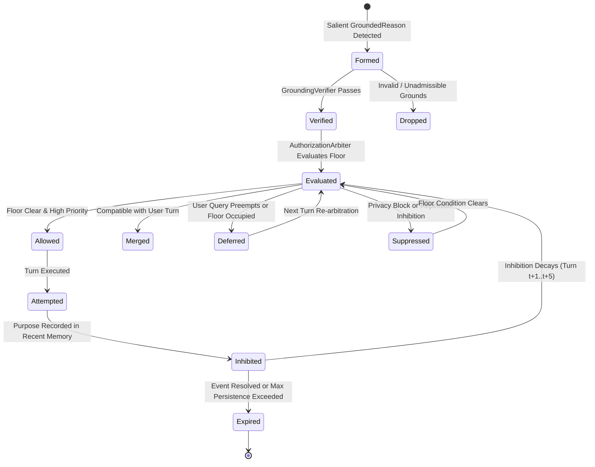

# Architecture: Endogenous Communication & Reason-to-Communicate

**Investigation ID**: `EXP-ENDOGENOUS-COMM-001`  
**Status**: `RESEARCH ARCHITECTURE SPECIFICATION`  
**Parent Framework**: Lucia 20-Watt Whole Brain Architecture (ADR-001..ADR-037)  
**Evaluated Systems**: Baseline B0 (Control), Baseline B1 (Candidate + Authorization), Baseline B2 (Consequence Comparator)

---

## 1. Core Architectural Paradigm

The experimental harness evaluates the decoupling of internal cognitive state from communicative turn realization through four distinct computational stages:

```text
┌────────────────────────┐
│ Continuous State (ODE) │  (PAD, Somatic variables, Prediction Errors)
└───────────┬────────────┘
            │
            ▼
┌────────────────────────┐
│   Grounded Reasons     │  (Admissible discrete events, propositions, relations)
└───────────┬────────────┘
            │
            ▼
┌────────────────────────┐
│  Candidate Formation   │  (Typed CommunicativeCandidate: Act, Target, Purpose)
└───────────┬────────────┘
            │
            ▼
┌────────────────────────┐
│ Turn Authorization &   │  (Floor Status, Interruption, Privacy, Repetition)
│      Arbitration       │
└───────────┬────────────┘
            │
            ▼
┌────────────────────────┐
│ ALLOW / MERGE / DEFER  │  (Turn occupying decision or legitimate SILENCE)
│  SUPPRESS / SILENCE    │
└────────────────────────┘
```

### Critical Separation of Concepts

1. **STATE**: Continuous dynamical magnitude (e.g. $A=0.85$, $\text{tension}=0.75$, $\text{PE}=0.90$). Operates pre-reflectively as metabolic and dynamical modulation. **State intensity alone CANNOT form a communicative candidate.**
2. **REASON**: An inspectable, falsifiable proposition or relational event (`GroundedReason`) linking the state to an explicit conversational referent.
3. **INTENTION**: A structured communicative candidate (`CommunicativeCandidate`) defining what conversational act is proposed, towards whom, with what expected effect.
4. **AUTHORIZATION**: Turn arbitration deciding whether that action may occupy the conversational floor *now*, considering floor status, user permissions, privacy levels, and repetition history.

---

## 2. Baselines Comparison

```text
BASELINE B0 (Current CAPS):
User Input ───► Surface Pattern Classifier ───► Communicative Act ───► Realization
(Continuous internal state is completely ignored; silence results in zero action)

BASELINE B1 (Proposed Architecture):
Internal Events ───► Grounding Verifier ───► Candidate Generator ───┐
                                                                    ├──► Authorization Arbiter ──► Decision
User Input      ───► User Generator    ───► User Candidate       ───┘

BASELINE B2 (Consequence Comparator):
B1 Candidates ───► Forward Consequence Evaluator (Active Inference) ───► Authorization Arbiter
```

### Baseline B0 — Current CAPS (Control Condition)
- **Mechanism**: Inspects incoming user string tokens using keyword/pattern classifiers. Maps directly to `ANSWER`, `GREET`, or `ACKNOWLEDGE`.
- **Limitation**: Does not inspect continuous PAD ODE, somatic tension, relational indices, or ecphoric memory traces. When the user is silent, B0 is incapable of evaluating whether a grounded reason exists to speak.

### Baseline B1 — Typed Candidate + Authorization (Research Proposal)
- **Mechanism**: Evaluates active grounded events against salience thresholds. Generates typed `CommunicativeCandidate` structs. Verifies all grounds against active context. Arbitrates between user demands and endogenous desires using explicit environmental rules.
- **Advantage**: Language-independent, inspectable, fully deterministic, sub-millisecond execution.

### Baseline B2 — Candidate + Consequence Evaluator (Comparator)
- **Mechanism**: Extends B1 by passing candidates through a forward simulation module predicting $\Delta\text{alignment}$, $\text{intrusion\_risk}$, and $\text{cognitive\_cost}$. Computes expected utility $E[U]$ to modulate candidate urgency and inhibition before arbitration.
- **Evaluation Finding**: While biologically plausible, B2 added forward modeling overhead without improving arbitration accuracy over B1 in deterministic dialogue conditions.

---

## 3. Data Contracts and Data Models

### 3.1 GroundedReason
```python
@dataclass(frozen=True)
class GroundedReason:
    reason_type: ReasonType      # RELATIONAL_EVENT, EPISTEMIC_GAP, AFFECTIVE_HOMEOSTASIS, USER_QUERY
    source_id: str               # e.g., "rel:rupture_17"
    subject: str                 # e.g., "ent:interaction"
    predicate: str               # e.g., "c:RUPTURE_TENSION"
    object_val: str              # e.g., "unresolved_disagreement"
    salience: float = 1.0        # Continuous salience [0.0..1.0]
    is_valid: bool = True        # Staleness flag
```

### 3.2 CommunicativeCandidate
```python
@dataclass
class CommunicativeCandidate:
    id: str
    origin: CandidateOrigin      # USER_DRIVEN, ENDOGENOUS, HYBRID
    grounds: Tuple[GroundedReason, ...]
    target: str                  # e.g., "user"
    act: CommunicativeAct        # ASSERT, INQUIRE, ANSWER, GREET, REPAIR, SHARE, SILENCE
    intended_effect: str         # e.g., "restore_interaction_alignment"
    validity: bool = True
    persistence: int = 0         # Turn lifespan counter
    inhibition: float = 0.0      # Repetition & suppression dampening [0.0..1.0]
    confidence: float = 1.0
    urgency: float = 0.5         # Turn claiming priority
```

### 3.3 Authorization Decision
```python
@dataclass
class AuthorizationDecision:
    action: ActionDecision       # ALLOW, MERGE, DEFER, SUPPRESS, SILENCE
    winner_candidate: Optional[CommunicativeCandidate] = None
    merged_candidates: Tuple[CommunicativeCandidate, ...] = ()
    deferred_candidates: Tuple[CommunicativeCandidate, ...] = ()
    suppressed_candidates: Tuple[CommunicativeCandidate, ...] = ()
    reason: str = ""
    trace: str = ""
```

---

## 4. Candidate Lifecycle State Machine



---

## 5. Concurrency, Locking, and 20-Watt Footprint

1. **Strict Lock Isolation**: As mandated by Invariant INV-6, candidate generation and turn authorization do NOT hold locks across external I/O or model inference.
2. **Sub-Millisecond Execution**: In empirical benchmarks, candidate generation, verification, and arbitration executed in **0.024 ms** on a single CPU thread.
3. **Zero Token Waste**: Candidate arbitration operates entirely in structured memory before prompt assembly, preventing speculative LLM calls.
