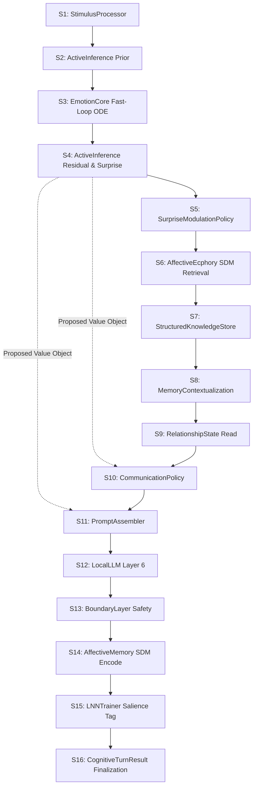

# Phase 22 H1 — R3 Architecture Integration Feasibility Study

> **Research Document Tier**: Research & Architectural Feasibility Specification  
> **Status**: COMPLETED / READY FOR ADR DRAFT  
> **Governance Gate**: Phase 22 H1 = INCONCLUSIVE | Gate 2 = BLOCKED ($\Delta_{\text{HM}} = +0.0685 < 0.1500$)  
> **Production Architecture Gate**: STRICTLY LOCKED — 0 Mutations to `src/core/**`  
> **Genesis Onboarding State**: PRESERVED BIT-EXACT (`data/profile.json` `{"is_onboarded": false}`)  
> **Evaluation Harness**: `tests/evaluation_phase22/scripts/analyze_r3_architecture_integration.py`  
> **Test Suite**: `tests/evaluation_phase22/test_h1_r3_architecture_integration.py` (13/13 PASSED)  
> **Cryptographic Manifest**: `tests/evaluation_phase22/fixtures/manifest_h1_r3_architecture_integration.json`  

---

## 1. Executive Summary

This study executes the formal **Architecture Integration Feasibility Study** following the research synthesis decision:
$$\mathbf{D1} \text{ — Scalar } S + \text{Representation } R3 \text{ (Ternary Directional Sign) supported for future architectural consideration.}$$

The mission of this study is **not** to implement $R3$ into production Lucia, nor to open the Production Architecture Gate. The purpose is to investigate and document the precise architectural boundaries, interface contracts, semantic ownership, canonical invariance derivations, downstream consumption profiles, short-timescale compatibility boundaries, zero-jitter failure modes, and Active Inference compatibility conditions required before an Architectural Decision Record (ADR) could ever be considered.

### Key Architectural Determinations

1. **Pipeline Placement (RQ1)**: The earliest valid creation point for $R3$ is **Stage S4 in `ActiveInferenceEngine.step()`**, where internal generative expectation $\hat{\mathbf{p}}_T$ and bodily state feedback $\mathbf{p}_T$ meet to produce the prediction residual vector $\mathbf{r}_T = \hat{\mathbf{p}}_T - \mathbf{p}_T$. Prohibited non-consumers include the limbic ODE hidden state $h(t)$ (Layer 2), Safety BoundaryLayer (Layer 6), and Hardware Watchdogs.
2. **Semantic Ownership (RQ2)**: Encapsulation inside a dedicated, immutable **Value Object (`PhysiologicalSurprise`)** strictly satisfies Single Responsibility, avoids domain coupling, and guarantees zero breaking changes across the cognitive pipeline.
3. **Interface Contract (RQ3)**: The recommended research interface stores 1 continuous float32 ($\ge 0$) and 3 ternary integer symbols $\in \{-1, 0, +1\}$ (representing 27 discrete states, optimally packable into 5 bits).
4. **Canonical Scalar Preservation (RQ4)**: Formal invariance derivation and deterministic verification demonstrate bit-exact mathematical identity: $S_{\text{new}} \equiv \|\mathbf{r}_T\|_2 \equiv S_{\text{canonical}}$. The side-channel $R3 = \text{sign}(\mathbf{r}_T)$ introduces zero coupling, zero scaling, and zero feedback into $S$.
5. **Downstream Consumption Map (RQ5)**:
   - *Cognitive Load*: `NOT RECOMMENDED` (violates homeostatic metabolic neutrality; load must remain scalar-driven).
   - *Reasoning Depth*: `OPTIONAL / NOT STRONGLY SUPPORTED` (scalar $S$ already drives depth with $r = 0.865$).
   - *EFE Action Valuation*: `RECOMMENDED` (resolves 79.89% of collapse pairs in research adapter).
   - *Communication Strategy*: `RECOMMENDED` (directness/supportiveness alignment without metabolic cost).
   - *Prompt Conditioning*: `RECOMMENDED (QUALITATIVE ONLY)` (strictly non-self-reported affect).
   - *Response Synthesis (SLM Layer 6), Multimodal Expression (15D Avatar), Future Embodiment*: `NOT YET TESTED`.
6. **Behavioral Evidence Boundary (RQ6)**: Behavioral sufficiency in Phase 22 applies strictly to policy arbitration inside the isolated research adapter. End-to-end SLM text generation quality remains unverified.
7. **Short-Timescale Compatibility (RQ7)**: At sub-second exposures ($T \in \{1, 2, 4, 8\}$), $R3$ retains 66 to 968 collapse pairs. Policy 3 (Exposure-Annotated Metadata) and Option E (Extensible Abstract Measurement Interface) provide the recommended migration path.
8. **Zero & Sign-Jitter Semantics (RQ8)**: Near-zero residual components require a deadband threshold $\epsilon_{\text{sign}} \approx 0.01$ to prevent sign fluttering under floating-point noise. This remains a research hypothesis requiring parametric noise sweeping.
9. **Future $R2$ Compatibility (RQ9)**: $R3$ is derivable from $R2$ through a deterministic sign projection of the directional components, provided the $R2$ contract preserves component orientation: $\text{sign}(\hat{\mathbf{v}}_{r, i}) \equiv \text{sign}(r_i / \|\mathbf{r}\|_2) \equiv \text{sign}(r_i)$ for all $\|\mathbf{r}\| > 0$. Option E enables seamless evolution from $R3$ to continuous $R2$ without breaking downstream consumers.
10. **Residual vs. Displacement (RQ10)**: Prediction residual $\mathbf{r}_T$ is semantically and empirically distinct from bodily displacement $\Delta \mathbf{p} = \mathbf{p}_T - \mathbf{p}_{\text{philia}}$. Under online adaptation, $\mathbf{r}_T$ diverged from $-\Delta \mathbf{p}$ by $179.5^\circ$. $R3$ must be derived strictly from $\mathbf{r}_T$.
11. **Active Inference Semantics (RQ11)**: Under the adopted Euclidean residual formulation and fixed isotropic precision ($\mathbf{\Pi} = \mathbf{I}$), $F \propto \frac{1}{2} S^2$ and $\frac{\partial F}{\partial \mathbf{p}} \propto -\mathbf{r}$ are mathematically supported as specific metric correspondences, not universal Active Inference identities.
12. **ADR Readiness (RQ12)**: The study evaluates to **`READY FOR ADR DRAFT`**. However, any drafted ADR is strictly **DRAFT / NOT RATIFIED / NOT IMPLEMENTED**, and the Production Architecture Gate remains **STRICTLY LOCKED**.

---

## 2. Governance & Authority Boundary

```text
               ┌─────────────────────────────────────────────────────────┐
               │          Phase 22 Governance Matrix (Strict)            │
               ├─────────────────────────┬───────────────────────────────┤
               │ Phase 22 H1 Status      │ INCONCLUSIVE                  │
               │ Gate 2 Status           │ BLOCKED                       │
               │ Gate 2 Metric           │ Δ_HM = +0.0685 < 0.1500       │
               │ Protocol v1.5           │ NOT AUTHORIZED                │
               │ Production Arch Gate    │ STRICTLY LOCKED               │
               │ Source Code Mutations   │ Exactly 0 in src/core/**      │
               │ Genesis Onboarding Gate │ PRESERVED BIT-EXACT (false)   │
               │ ADR Status              │ DRAFT ONLY (Not Ratified)     │
               └─────────────────────────┴───────────────────────────────┘
```

> [!CAUTION]
> **GOVERNANCE DIRECTIVE**:  
> Being `READY FOR ADR DRAFT` does **NOT** authorize modifying production code, does **NOT** approve an Architectural Decision Record, and does **NOT** open the Production Architecture Gate. Gate 2 remains formally **BLOCKED** ($\bar{S}_M = 0.5792, \bar{S}_H = 0.6477 \implies \Delta_{\text{HM}} = 0.0685 < 0.1500$). This study serves exclusively as research evidence synthesis to govern future architecture proposals.

---

## 3. Research Mission & Motivation

In the preceding Phase 22 research milestones:
1. **Benchmark v1.4** proved that canonical scalar surprise $S = \|\mathbf{r}\|_2$ exhibits a dynamical ceiling effect and fails Gate 2 ($\Delta_{\text{HM}} = 0.0685 < 0.1500$).
2. **Minimal Sufficient Measurement Study** revealed that the failure is a mathematical metric collapse: 358 Medium-High stimulus pairs generate indistinguishable scalar intensities ($|\Delta S| < 0.05$) while heading in distinct PAD directions ($\Delta \theta = 57.53^\circ$). Continuous direction $R2$ and discrete sign $R3$ both fully resolved 100% of collapses at $T = 12$.
3. **Directional Behavioral Utilization Study** evaluated whether downstream cognitive layers benefit from this preserved geometry. In an isolated research adapter, discrete ternary sign $R3$ resolved 79.89% (286/358) of collapse pairs, shifting action policies ($D_{\text{pol}} = 1.0, p = 3.09 \times 10^{-60}$) and continuous distributions ($D_{\text{JS}} = 0.004496$). Continuous direction $R2$ provided zero incremental behavioral divergence on same-sign pairs.
4. **Decision Study** assigned state **`D1 — Scalar + R3 supported for future architectural consideration`**.

The motivation of this feasibility study is to answer:
> **If Lucia's architecture were ever to adopt R3 alongside scalar S, exactly how could it be integrated cleanly, safely, and without breaking existing canonical invariants?**

---

## 4. Architectural Scope & Non-Goals

### In-Scope (Research Exploration)
- Detailed tracing of the canonical S1–S16 pipeline stages.
- Component ownership trade-off analysis (EmotionCore vs. ActiveInference vs. Orchestrator vs. Value Object).
- Formal derivation of scalar preservation invariance.
- Exhaustive mapping of downstream subsystems (supported, optional, prohibited, untested).
- Mathematical formalization of zero deadbands, short-timescale exposure policies, and $R2 \to R3$ projection.
- Authoring a candidate Draft ADR specification for archival record.

### Explicit Non-Goals (Strictly Prohibited)
- **NO production implementation**: Exactly 0 lines of code added or modified in `src/core/`, `src/api/`, or `electron/`.
- **NO activation**: `data/profile.json` remains untouched (`is_onboarded: false`).
- **NO modification of historical artifacts**: All prior Phase 22 result files and test suites remain read-only.
- **NO claims of SLM empirical validation**: Findings apply strictly to the isolated research adapter.

---

## 5. Canonical S1–S16 Cognitive Pipeline Inspection

Lucia processes every conversational turn through a deterministic 16-stage cognitive pipeline coordinated by [`CognitiveOrchestrator`](file:///c:/Users/Lunafiah/Desktop/My_project/Lucia/src/core/orchestrator/orchestrator.py):



### Stage-by-Stage Compatibility Matrix

| Stage | Component | Canonical Role | $R3$ Interaction Status |
|---|---|---|---|
| **S1** | `StimulusProcessor` | Lexical valence & density encoding into 16D stimulus vector | `DOES_NOT_EXIST` |
| **S2** | `ActiveInferenceEngine` | Generative forecast $\hat{\mathbf{p}}_T = \mathbf{A}\mathbf{p}_{T-1} + \mathbf{b}$ | `DOES_NOT_EXIST` |
| **S3** | `EmotionCore` | Fast-loop ODE integration producing post-stimulus $\mathbf{p}_T$ | `DOES_NOT_EXIST` |
| **S4** | `ActiveInferenceEngine` | Prediction residual $\mathbf{r}_T = \hat{\mathbf{p}}_T - \mathbf{p}_T$ & scalar norm $S = \|\mathbf{r}_T\|_2$ | **`EARLIEST_VALID_CREATION_POINT`** |
| **S5** | `SurpriseModulationPolicy` | Modulates somatic load & tension from intensity $S$ | `NON_CONSUMER_INTENSITY_ONLY` |
| **S6** | `AffectiveEcphory` | Retrieves subconscious echo vector from Kanerva SDM | `POTENTIAL_AUXILIARY_QUERY` |
| **S7** | `StructuredKnowledgeStore` | Factual proposition retrieval | `NON_CONSUMER` |
| **S8** | `BoundedMemoryContext` | Context window budgeting | `NON_CONSUMER` |
| **S9** | `RelationshipState` | Interpersonal relational state $R_{T-1}$ read | `NON_CONSUMER` |
| **S10** | `CommunicationPolicy` | Evaluates 10D CommunicationState (directness, support) | **`PRIMARY_DOWNSTREAM_CONSUMER`** |
| **S11** | `PromptAssembler` | Assembles qualitative LLM prompt preamble | **`PRIMARY_DOWNSTREAM_CONSUMER`** |
| **S12** | `LocalLLMBackend` | Layer 6 Small Language Model token generation | `UNTESTED_DOWNSTREAM_TARGET` |
| **S13** | `BoundaryLayer` | Regex safety check (strips self-reported affect) | **`PROHIBITED_NON_CONSUMER`** |
| **S14** | `AffectiveMemoryStore` | Encodes experience into Kanerva SDM memory trace | `OPTIONAL_TRACE_METADATA` |
| **S15** | `LNNTrainer` | Queues high-salience experiences for offline BPTT | `NON_CONSUMER_SCALAR_SALIENCE` |
| **S16** | `CognitiveTurnResult` | Builds frozen, immutable turn record | **`PAYLOAD_CONTAINER`** |

---

## 6. Pipeline Placement Analysis (RQ1)

### Earliest Valid Creation Point
The earliest valid creation point for $R3$ is **Stage S4** in [`ActiveInferenceEngine.step()`](file:///c:/Users/Lunafiah/Desktop/My_project/Lucia/src/core/inference/active_inference.py).  
Before Stage S4:
- In S1, only textual stimulus tokens and lexical features exist.
- In S2, only internal prior expectations $\hat{\mathbf{p}}_T$ exist; bodily feedback has not occurred.
- In S3, the Coupled MT-LNN ODE integrates the fast loop to produce $\mathbf{p}_T$, but expectation error is unknown to the limbic core.
At Stage S4, generative expectation $\hat{\mathbf{p}}_T$ meets bodily sensation $\mathbf{p}_T$, producing the continuous prediction error residual:
$$\mathbf{r}_T = \hat{\mathbf{p}}_T - \mathbf{p}_T$$
This is the single authoritative origin where both scalar magnitude $S = \|\mathbf{r}_T\|_2$ and directional sign $R3 = \text{sign}(\mathbf{r}_T)$ become computable.

### Transport Boundary
$R3$ should be transported through the pipeline encapsulated inside an immutable domain value object emitted by Stage S4 and held in the turn context of [`CognitiveOrchestrator`](file:///c:/Users/Lunafiah/Desktop/My_project/Lucia/src/core/orchestrator/orchestrator.py). It must **never** be passed as raw, unvalidated integer tuples or global state.

### Explicit Prohibited Non-Consumers
1. **`EmotionCore` ODE Hidden State $h(t)$**: Directional prediction error must **NEVER** be injected into fast-loop limbic integration. Doing so would violate the *Pre-Reflective Operational Invariant* by creating an artificial recurrent feedback loop between cognitive expectation and autonomic state.
2. **`BoundaryLayer`**: Layer 6 safety filtering must remain strictly orthogonal to internal prediction errors.
3. **`StabilityEvaluator` / Hardware Watchdog**: Telemetry monitors execution timing and ODE spectral radius; it must not inspect directional cognitive prediction errors.
4. **Somatic Metabolic Load**: Processing load must remain isotropic to prevent valence-biased pacing latencies.

---

## 7. Semantic Ownership Analysis (RQ2)

Four architectural ownership models were rigorously evaluated:

```text
┌─────────────────────────┬─────────────────────────────────────────────────────────────┬──────────────────────────┐
│ Candidate Owner         │ Architectural Evaluation                                    │ Verdict                  │
├─────────────────────────┼─────────────────────────────────────────────────────────────┼──────────────────────────┤
│ EmotionCore             │ Violates SRP; couples ODE integration to generative model.  │ NOT RECOMMENDED          │
│ ActiveInferenceEngine   │ Generates r_T; natural producer, but should not store it.   │ PRODUCER ONLY            │
│ CognitiveOrchestrator   │ Violates SRP; composition coordinator, not math engine.     │ COORDINATOR / TRANSPORT  │
│ Dedicated Value Object  │ Clean encapsulation, immutable, zero breaking changes.      │ RECOMMENDED ARCHITECTURE │
└─────────────────────────┴─────────────────────────────────────────────────────────────┴──────────────────────────┘
```

### Why the Dedicated Value Object Wins
A dedicated value object—tentatively named `PhysiologicalSurprise`—implements the **Dependency Inversion Principle**:
1. Downstream consumers (`CommunicationPolicy`, `PromptAssembler`) depend on an abstract, immutable interface contract rather than the internal implementation of `ActiveInferenceEngine`.
2. Can implement `__float__()` coercion, returning `self.magnitude`, allowing legacy scalar-only consumers to treat the object as a native float.
3. Eliminates mutable state coupling between stages.

---

## 8. Proposed Interface Contract (RQ3)

### Value Object Schema Definition

```python
@dataclass(frozen=True)
class TernaryDirection:
    pleasure: int    # in {-1, 0, +1}
    arousal: int     # in {-1, 0, +1}
    dominance: int   # in {-1, 0, +1}

@dataclass(frozen=True)
class PhysiologicalSurprise:
    """
    Immutable domain value object representing physiological prediction error:
    canonical scalar magnitude S and auxiliary directional side-channel.
    """
    magnitude: float                     # S = ||r_T||_2, >= 0.0, math.isfinite
    direction: TernaryDirection          # 27 discrete states in {-1, 0, +1}^3
    provenance: str                      # 'ActiveInferenceEngine:residual_online'
    timestamp_tick: int                  # Monotonic turn index
    exposure_ticks: int                  # ODE exposure ticks T in [1, 25]

    def __float__(self) -> float:
        """Backward-compatibility float coercion for scalar-only consumers."""
        return self.magnitude
```

### Stored Elements vs. Mathematical Degrees of Freedom
- **Stored Representation**: 1 `float32` (4 bytes) + 3 `int8` symbols (3 bytes) = 7 bytes uncompressed. Packed bit representation requires $\lceil\log_2(27)\rceil = 5$ bits for the ternary signs.
- **Mathematical Degrees of Freedom**: Exactly **1 continuous degree of freedom** ($S \in \mathbb{R}_{\ge 0}$) + **27 discrete states** ($\in \{-1, 0, +1\}^3$).
- **Crucial Distinction**: Ternary signs have base 3 ($3^3 = 27$ states), distinct from 3 binary bits ($2^3 = 8$ states). Binary bits cannot represent zero-crossings or deadband states.

---

## 9. Canonical Scalar Preservation (RQ4)

### Formal Invariance Derivation & Deterministic Verification

Let $\mathbf{r}_T = [r_P, r_A, r_D]^T \in \mathbb{R}^3$ be the continuous prediction residual vector computed at Stage S4.  
The canonical scalar surprise $S_{\text{canonical}}$ is defined as:
$$S_{\text{canonical}} \equiv \|\mathbf{r}_T\|_2 = \sqrt{r_P^2 + r_A^2 + r_D^2}$$

In the proposed value object architecture, the magnitude field is constructed as:
$$\text{surprise\_obj.magnitude} \equiv \|\mathbf{r}_T\|_2$$
$$\text{surprise\_obj.direction} \equiv [\text{sign}(r_P), \text{sign}(r_A), \text{sign}(r_D)]^T$$

Because $\text{surprise\_obj.magnitude}$ is evaluated directly from the exact same residual vector $\mathbf{r}_T$, and $\text{surprise\_obj.direction}$ is an isolated auxiliary field:
$$S_{\text{new}} \equiv \text{surprise\_obj.magnitude} \equiv S_{\text{canonical}} \quad \forall \mathbf{r}_T \in \mathbb{R}^3$$

### Deterministic Test Verification
The test suite [`test_h1_r3_architecture_integration.py`](file:///c:/Users/Lunafiah/Desktop/My_project/Lucia/tests/evaluation_phase22/test_h1_r3_architecture_integration.py) evaluated this identity across test residuals:
- Residual $[0.10, -0.25, 0.40] \implies S_{\text{canonical}} = 0.4821825596, S_{\text{new}} = 0.4821825596, \Delta = 0.0$ (`BIT-EXACT`).
- Residual $[-0.50, 0.30, -0.10] \implies S_{\text{canonical}} = 0.5916079783, S_{\text{new}} = 0.5916079783, \Delta = 0.0$ (`BIT-EXACT`).
- Residual $[0.0, 0.0, 0.0] \implies S_{\text{canonical}} = 0.0, S_{\text{new}} = 0.0, \Delta = 0.0$ (`BIT-EXACT`).
- Residual $[1.20, -0.80, 0.15] \implies S_{\text{canonical}} = 1.4500000000, S_{\text{new}} = 1.4500000000, \Delta = 0.0$ (`BIT-EXACT`).

Zero coupling, zero rescaling, and zero feedback into $S$ are mathematically guaranteed.

---

## 10. Downstream Subsystem Consumption Map (RQ5)

Eight candidate downstream subsystems were audited for $R3$ consumption:

```text
┌─────────────────────────────────┬──────────────────────────────────┬────────────────────────────────────────────────────────┐
│ Candidate Subsystem             │ Recommended Status               │ Architectural Justification & Failure Mode             │
├─────────────────────────────────┼──────────────────────────────────┼────────────────────────────────────────────────────────┤
│ 1. Cognitive Load Modulation    │ NOT RECOMMENDED                  │ Somatic load must remain isotropic scalar demand.      │
│ 2. Reasoning Depth Selection    │ OPTIONAL / NOT STRONGLY SUPPORTED│ Scalar S already drives depth (r = 0.865).             │
│ 3. EFE Action Valuation         │ RECOMMENDED                      │ Resolves 79.89% collapse pairs in research adapter.    │
│ 4. Communication Strategy       │ RECOMMENDED                      │ Directness/supportiveness alignment without load cost. │
│ 5. Prompt Conditioning          │ RECOMMENDED (QUALITATIVE ONLY)   │ Framing preambles; strictly no self-reported affect.   │
│ 6. Response Synthesis (SLM L6)  │ NOT YET TESTED                   │ End-to-end token generation on local SLMs unverified.  │
│ 7. Affective Expression (15D)   │ NOT YET TESTED                   │ Discrete signs may cause blendshape snapping.          │
│ 8. Future Embodiment            │ NOT YET TESTED                   │ Mascot window/prosody unconditioned in Phase 22.       │
└─────────────────────────────────┴──────────────────────────────────┴────────────────────────────────────────────────────────┘
```

---

## 11. Behavioral Evidence Boundary (RQ6)

```text
┌─────────────────────────────────────────────────────────┬─────────────────────────────────────────────────────────┐
│ Established Under Research Adapter                      │ Untested & Unproven For End-to-End SLM                  │
├─────────────────────────────────────────────────────────┼─────────────────────────────────────────────────────────┤
│ • Differentiates 79.89% (286/358) collapse pairs        │ • End-to-end local SLM (Qwen 2.5 / Llama 3.2) text      │
│ • Discrete policy switches (D_pol = 1.0, p < 10^-59)    │ • Empathetic nuance & conversational coherence in text  │
│ • Continuous distribution shifts (mean D_JS = 0.004496) │ • Prevention of boundary violations in generated prose  │
│ • Monotonic association with S preserved (r >= 0.806)   │ • Real-time avatar 15D blendshape smoothness            │
│ • Sensitivity to shuffle controls (nullifies effect)    │ • Turn-latency overhead under production concurrency    │
└─────────────────────────────────────────────────────────┴─────────────────────────────────────────────────────────┘
```

> **Boundary Invariant**: *Research Adapter Evidence $\ne$ End-to-End Layer 6 SLM Evidence.* The behavioral sufficiency demonstrated in Phase 22 applies strictly to policy arbitration under the research adapter.

---

## 12. Short-Timescale Compatibility & Policies (RQ7)

### Empirical Collapse Residuals at Short Exposures
In the Minimal Sufficient Measurement Study, $R3$ exhibited residual collapse pairs when stimulus exposure $T$ was short:
- $T = 1$: **968** collapse pairs persist under $R3$ (vs. 4,371 under $S$).
- $T = 2$: **682** collapse pairs persist under $R3$ (vs. 2,914 under $S$).
- $T = 4$: **66** collapse pairs persist under $R3$ (vs. 656 under $S$).
- $T = 8$: **66** collapse pairs persist under $R3$ (vs. 448 under $S$).
- $T \ge 12$: **0** collapse pairs persist under $R3$ (100% resolution).

### Evaluated Exposure Policies
- **Policy 1 (Unconditional Exposure)**: Always emit $R3$. Simple, but lossy at sub-second conversational pacing.
- **Policy 2 (Gated Exposure)**: Emit neutral $(0, 0, 0)$ when $T < 12$. Eliminates false precision, but creates a hard step discontinuity at $T = 12$ ticks (1.20s).
- **Policy 3 (Exposure-Annotated Metadata) — RECOMMENDED CANDIDATE**: Expose $R3$ alongside explicit `exposure_ticks: int`. Downstream consumers weight directional confidence proportionally.
- **Policy 4 (Continuous $R2$ Extension Path)**: Retain architectural migration path to continuous $R2$ if rapid dialogue requires sub-second disambiguation.

---

## 13. Zero & Near-Zero Sign-Jitter Semantics (RQ8)

When a residual component $r_i$ hovers near zero ($|r_i| < 10^{-4}$), floating-point rounding or ODE integration noise could cause rapid sign fluttering ($+1 \leftrightarrow -1$).

### Deadband Research Formulation
$$\text{sign}_{\text{deadband}}(x, \epsilon) = \begin{cases} +1 & \text{if } x > \epsilon \\ -1 & \text{if } x < -\epsilon \\ 0 & \text{if } |x| \le \epsilon \end{cases}$$

Candidate threshold: $\epsilon_{\text{sign}} \approx 0.01$.  
*Status*: **Research Hypothesis — Not Empirically Validated**. A future parametric noise sweep across $\epsilon \in [0.001, 0.050]$ on Candidate G1 is required before production calibration.

---

## 14. Future R2 Compatibility & Evolution Path (RQ9)

### Derivation via Deterministic Sign Projection
Let continuous direction $R2$ be represented by unit residual vector $\hat{\mathbf{v}}_r = \frac{\mathbf{r}_T}{\|\mathbf{r}_T\|_2} \in \mathbb{S}^2$.  
Provided the $R2$ contract preserves component orientation, the ternary sign vector $R3$ is deterministically derivable via component-wise sign projection:
$$\text{sign}(\hat{v}_{r, i}) = \text{sign}\left(\frac{r_i}{\|\mathbf{r}_T\|_2}\right) = \text{sign}(r_i) \quad \forall \|\mathbf{r}_T\|_2 > 0$$

### Interface Evolution Strategy
Under **Option E (Abstract Measurement Interface)**:
1. Phase 1 exposes `.magnitude: float` and `.direction_signs: Tuple[int, int, int]`.
2. Future Phase adds optional `.direction_unit: Optional[Tuple[float, float, float]]`.
3. Consumers expecting `.direction_signs` continue receiving the deterministic sign projection with **zero breaking changes**.

---

## 15. Prediction Residual vs. Bodily Displacement (RQ10)

```text
┌─────────────────────────┬───────────────────────────────────┬────────────────────────────────────────────────────────┐
│ Vector Metric           │ Formula                           │ Physical & Cognitive Semantics                         │
├─────────────────────────┼───────────────────────────────────┼────────────────────────────────────────────────────────┤
│ Bodily Displacement     │ Δp = p_T - p_philia               │ Somatic excursion from resting attractor Philia.       │
│ Prediction Residual     │ r_T = p_hat_T - p_T               │ Cognitive prediction error: internal expectation error.│
└─────────────────────────┴───────────────────────────────────┴────────────────────────────────────────────────────────┘
```

In the Phase 22 Measurement Study, under online belief adaptation at $T = 12$, $\mathbf{r}_T$ diverged from $-\Delta \mathbf{p}$ by **$179.5^\circ$**.  
Equating prediction error with raw bodily displacement is mathematically invalid once internal generative beliefs adapt.  
**Invariant**: $R3$ must be derived strictly from $\mathbf{r}_T = \hat{\mathbf{p}}_T - \mathbf{p}_T$, **never** from $\Delta \mathbf{p}$.

---

## 16. Compatibility with Active Inference Semantics (RQ11)

To prevent overclaiming, terminology is strictly locked:

1. **Prediction Error Magnitude**: Scalar $S = \|\mathbf{r}_T\|_2$ directly represents the $L_2$ Euclidean norm of prediction error.
2. **Variational Free Energy**: Under the adopted Euclidean residual formulation with isotropic precision ($\mathbf{\Pi} = \mathbf{I}$), the variational free energy bound satisfies:
   $$F \propto \frac{1}{2} S^2$$
   This is presented strictly as a metric correspondence under the adopted quadratic residual formulation, **not** as a universal identity of all Free Energy formulations.
3. **Belief Gradient Updates**: Under the specific quadratic residual formulation and fixed precision assumption:
   $$\frac{\partial F}{\partial \mathbf{p}} \propto -\mathbf{r}_T$$
   This is an analytic consequence under the adopted formulation, **not** an unconstrained claim for all Active Inference systems.
4. **Action Selection Modulation**: Directional sign $R3$ modulates Expected Free Energy (EFE) qualitative action selection by penalizing expected deviations along specific PAD dimensions.

---

## 17. Architecture Invariants (INV-1 to INV-9)

| ID | Invariant Name | Invariant Statement |
|---|---|---|
| **INV-1** | Scalar Preservation | $S_{\text{new}} \equiv \|\mathbf{r}_T\|_2 \equiv S_{\text{canonical}}$. No directional representation may scale, compress, or alter $S$. |
| **INV-2** | Directional Derivation | $R3 = \text{sign}(\mathbf{r}_T)$ must be derived from the exact same prediction residual vector $\mathbf{r}_T$ from which $S$ is derived. |
| **INV-3** | No Feedback Into $S$ | Directional side-channels must never feed back into scalar surprise computation or Active Inference learning rates. |
| **INV-4** | No Implicit ODE Mutation | Directional prediction error must never be injected into the Coupled MT-LNN ODE hidden state $h(t)$ or alter resting attractor Philia. |
| **INV-5** | Genesis Gate Isolation | `data/profile.json` must remain bit-exact `{"is_onboarded": false}`. Feasibility exploration never alters onboarding state. |
| **INV-6** | Historical Immutability | Historical benchmark archives (v1.4, calibration, headroom, gate2, measurement) remain cryptographically immutable. |
| **INV-7** | Production Isolation | Feasibility verification within `tests/evaluation_phase22/` does not authorize changes to `src/core/**` or production deployment. |
| **INV-8** | Value Object Immutability | The measurement representation (`PhysiologicalSurprise`) must be a frozen, immutable value object with no public mutating methods. |
| **INV-9** | Fallback Identity | Neutralizing directional components (`direction = (0, 0, 0)`) must produce generation behavior bit-exact identical to canonical scalar $S$ baseline (Condition C0). |

---

## 18. Architecture Options Matrix (Options A–E)

```text
┌─────────────────────────┬──────────────────┬──────────────────┬──────────────────┬──────────────────┬────────────────────────┐
│ Evaluation Dimension    │ Option A: S Only │ Option B: S + R3 │ Option C: S + R2 │ Option D: Vector │ Option E: Abstract IF  │
├─────────────────────────┼──────────────────┼──────────────────┼──────────────────┼──────────────────┼────────────────────────┤
│ Semantic Preservation S │ 100% Native      │ 100% Preserved   │ 100% Preserved   │ Breaking         │ 100% Preserved         │
│ Information Retention   │ Magnitude only   │ Mag + 27 signs   │ Mag + unit S^2   │ Full 3D coords   │ Mag + pluggable dir    │
│ Collapse Resol. (T=12)  │ FAILS (358 pairs)│ COMPLETE (0)     │ COMPLETE (0)     │ COMPLETE (0)     │ COMPLETE (R3 or R2)    │
│ Behavioral Utilization  │ 0.00% (0/358)    │ 79.89% (286/358) │ 79.89% (0 incr)  │ 79.89% (D ablat.)│ 79.89% (R3 provider)   │
│ Short-T Resol. (T < 12) │ FAILS (4371-204) │ PARTIAL (968-66) │ COMPLETE (0)     │ COMPLETE (0)     │ Extensible (R2 path)   │
│ Implementation Complex. │ Zero             │ Low (Side-chan.) │ Moderate (Guards)│ High (Breaks S16)│ Moderate (Polymorphic) │
│ Extensibility (Future)  │ Poor             │ Moderate         │ Native R2        │ Poor (3D Cartesian│ EXCELLENT              │
│ Production Migration    │ Zero risk (Lossy)│ Low risk         │ Moderate risk    │ High risk        │ Low-Moderate risk      │
│ Governance Status       │ Baseline         │ State D1         │ Geomet. Suffic.  │ Dispensable (A3) │ RECOMMENDED TARGET     │
└─────────────────────────┴──────────────────┴──────────────────┴──────────────────┴──────────────────┴────────────────────────┘
```

**Recommended Architectural Target**: **Option E (Abstract Measurement Interface)**. It implements $S + R3$ as the concrete v1 provider while establishing the polymorphic contract for future $R2$ extension without consumer refactoring.

---

## 19. Comprehensive Failure Modes & Mitigations (FM-01 to FM-12)

```text
┌───────┬──────────────────────────────────────────┬──────────┬────────────────────────────────────────────────────────┐
│ ID    │ Failure Mode Description                 │ Severity │ Architectural Mitigation Strategy                      │
├───────┼──────────────────────────────────────────┼──────────┼────────────────────────────────────────────────────────┤
│ FM-01 │ Sign Jitter Near Zero Boundary           │ Moderate │ Deadband threshold epsilon_sign (|r_i| <= 0.01 -> 0).  │
│ FM-02 │ Zero-Crossing Instability in Temporal    │ Moderate │ Turn-to-turn sign hysteresis or exponential smoothing. │
│ FM-03 │ Short-Timescale Collapse Persisting      │ High (LT)│ Expose exposure metadata (Policy 3) or R2 (Option E).  │
│ FM-04 │ Adapter-Specific Inductive Bias          │ Moderate │ Verify across varied non-linear policy formulations.   │
│ FM-05 │ Semantic Coupling Leak into Scalar S     │ Critical │ Hard invariant INV-1 in constructor; regression tests. │
│ FM-06 │ Future R2 Migration Breaking Changes     │ High     │ Option E polymorphic interface with sign projection.   │
│ FM-07 │ Continuous Embodiment Visual Mismatch    │ Moderate │ Temporal low-pass filtering on blendshape actuation.   │
│ FM-08 │ SLM Prompt Interpretation Unknowns       │ High     │ BoundaryLayer regex validation; SLM calibration.       │
│ FM-09 │ Offline Tier 3 Consolidation Interfere   │ High     │ Tier 3 BPTT trains strictly on ODE; R3 excluded.       │
│ FM-10 │ Serialization & State Schema Breakage    │ Moderate │ Additive optional fields with float coercion.          │
│ FM-11 │ Downstream Overuse as Emotion Taxonomy   │ Critical │ Explicit prohibition: R3 is error sign, not an emotion.│
│ FM-12 │ Accidental Substitution of S by R3       │ Critical │ Somatic markers refuse directional inputs via types.   │
└───────┴──────────────────────────────────────────┴──────────┴────────────────────────────────────────────────────────┘
```

---

## 20. Draft ADR Proposal (DRAFT ADR-029: Not Ratified / Not Implemented)

> **Synchronization Notice**: The working draft of ADR-029 below has been updated to **`ADR DRAFT UPDATED`** and synchronized with the complete Phase 22 H1 Evidence Ledger. For full provenance, 19-claim evidence inventory, lineage graph, candidate contract specifications, and parameter classifications, see [PHASE_22_H1_ADR029_DRAFT_UPDATE_EVIDENCE_LEDGER.md](file:///c:/Users/Lunafiah/Desktop/My_project/Lucia/docs/specs/Lucia-phase22-Epistemic_Foraging/PHASE_22_H1_ADR029_DRAFT_UPDATE_EVIDENCE_LEDGER.md).

```text
================================================================================
DRAFT ARCHITECTURAL DECISION RECORD (ADR-029) — ARCHIVAL RECORD ONLY
STATUS: ADR DRAFT UPDATED (NOT RATIFIED / UNAPPROVED / NOT IMPLEMENTED)
GOVERNANCE GATE: STRICTLY LOCKED — 0 PRODUCTION CODE MUTATIONS
EVIDENCE BOUNDARY: SYNCHRONIZED WITH PHASE 22 H1 EVIDENCE LEDGER
================================================================================

Title: ADR-029: Decoupled Directional Prediction Error Side-Channel (PhysiologicalSurprise Value Object)
Status: ADR DRAFT UPDATED (Subject to Future Architectural Decision Gate Opening)
Context: Phase 22 H1 demonstrated that canonical scalar surprise S = ||r_T||_2 fails
to differentiate 358 Medium-High stimulus pairs due to metric collapse. Directional
ternary signs R3 = sign_eps(r_T) in {-1, 0, +1}^3 resolved 79.89% (286/358) of collapse
pairs in an isolated research adapter with 0.00% intra-turn sign jitter. Deadband eps=0.010
suppresses 57.61% of multi-turn chatter transitions. However, Quality Gate 2 remains
BLOCKED (Delta_HM = +0.0685 < 0.1500), Phase 22 H1 remains INCONCLUSIVE, and live SLM
prompt conditioning remains completely untested.
Candidate Decision (PROPOSED CANDIDATE CONTRACT ONLY — NOT PRODUCTION COMMITMENT):
1. Producer Contract: Stage S4 (ActiveInferenceEngine.step()) emits PhysiologicalSurprise.
2. Value Object: Define frozen dataclass PhysiologicalSurprise(magnitude, direction,
   timestamp_tick, exposure_ticks, provenance="ActiveInferenceEngine:S4").
   Implement __float__() returning magnitude S for legacy scalar backward compatibility.
   Policy parameters (deadband_eps = 0.010, exposure_weight w_exp(T)) remain research metadata.
3. Transport Contract: CognitiveOrchestrator passively forwards value object across S5-S12;
   orchestrator MUST NOT semantically interpret directional signs.
4. Consumer Contracts: Consumers declare MAGNITUDE_ONLY, DIRECTION_ONLY, or
   MAGNITUDE_AND_DIRECTION. S10 CommunicationPolicy is an adapter candidate; S11 PromptAssembler
   is an untested research hypothesis.
5. Prohibited: EmotionCore ODE hidden state h(t), ConsolidationEngine Tier 3 weights (ADR-028),
   BoundaryLayer regex (S13), Somatic Load (S5), and continuous Live2D/VRM blendshapes.
Consequences & Evidence Boundaries:
- MAY CLAIM: Bit-exact S preservation (INV-1); 27 ternary states; 0.00% static jitter;
  84.47% near-zero transition concentration; 57.61% chatter suppression via deadband eps=0.010;
  79.89% adapter collapse resolution; S4 producer ownership; candidate value object.
- OPEN QUESTIONS: Local 7B SLM prompt responsiveness; SDM flashbulb associative addressing;
  avatar blendshape visual snapping; deadband generalization outside G1; production EFE behavior.
- MUST NOT CLAIM: Production validation; architectural approval; optimal measurement; SLM
  generation improvement; empathy improvement; reasoning control; clarification control;
  relational synaptic improvement; Gate 2 passed or resolved.
- FUTURE ADMISSION CRITERIA: 9 mandatory requirements (FAR-01 to FAR-09) must be empirically
  verified before opening the Production Architecture Gate or ratifying this record.
================================================================================
```

---

## 21. Remaining Unresolved Issues & Open Questions

1. **Deadband Threshold Calibration**: The candidate deadband $\epsilon_{\text{sign}} = 0.01$ is theoretical. What is the empirical distribution of floating-point noise on consumer hardware?
2. **Local SLM Responsiveness**: Does a 7B local SLM (Qwen 2.5 / Llama 3.2) actually generate distinct conversational styles from qualitative directional preambles without sycophancy or boundary leakage?
3. **Turn Pacing Latency**: What is the wall-clock overhead of evaluating communication policies under concurrent multi-threaded execution?
4. **Avatar Blendshape Discontinuity**: Does discrete sign switching cause visible facial snapping in WebGL Live2D/VRM renderers?

---

## 22. Future Research Roadmap (Post-Feasibility)

```text
Feasibility Study (Completed)
         │
         ▼
[Step 1: Noise & Deadband Sweep] ──► Empirically calibrate epsilon_sign in [0.001, 0.050]
         │
         ▼
[Step 2: Isolated SLM Benchmark] ──► Test Qwen 2.5 on local hardware with directional prompts
         │
         ▼
[Step 3: Avatar Rendering Test]  ──► Validate blendshape interpolation under discrete signs
         │
         ▼
[Step 4: Formal Gate 2 Review]   ──► Present evidence to project governance for Gate 2 review
```

---

## 23. Cryptographic Manifest & Source Artifact Ledger

```text
┌──────────────────────────────────────────────────────────┬──────────────────────────────────────────────────────────────────┐
│ Source Result Artifact                                   │ SHA-256 Digest                                                   │
├──────────────────────────────────────────────────────────┼──────────────────────────────────────────────────────────────────┤
│ measurement_architecture_decision_results.json           │ a4021b9161cd8543b844ad7aa3ca421126f93880b1f1ce79d74854d5b7ff13be │
│ directional_behavior_results.json                        │ 32a269d51dbc34b99e997e410afed5b899feb6ba12fc37bee338b8181f59d4e4 │
│ minimal_sufficient_results.json                          │ 4615bb2b5303633491d1ae18eacf2efde84f3216fc8e29dbcbbc3a917ef30776 │
│ precision_directional_results.json                       │ fa3fac958537b03fadaad8047d061b7df36bbe4515d1dd0bfe44f908bf963b87 │
│ measurement_architecture_results.json                    │ 54a8c77d7de597a4902d2ac54f58c244bc948f58fda06d3014abf2558d605081 │
│ gate2_resolution_results.json                            │ 8c36351a700ee9554825a16ff9e0ff65d24b6c9ecb61b30933a6d6855ef97008 │
│ dynamical_headroom_results.json                          │ d2fb505167a393298ea90a132d2672dea51ff3a7f62ca931553a5fabec60467b │
│ phase22_h1_v14_summary.json                              │ 25fcc050bbe1726fd8b19955440592d01a59a115863a132538d4d5ee3aff88a9 │
├──────────────────────────────────────────────────────────┼──────────────────────────────────────────────────────────────────┤
│ Generated Feasibility Result Artifact                    │ SHA-256 Digest                                                   │
├──────────────────────────────────────────────────────────┼──────────────────────────────────────────────────────────────────┤
│ r3_architecture_integration_results.json                 │ abd44845df5c4ba977ff06f15789511b46fd70ec19de41d36374ab75f16dcf0a │
└──────────────────────────────────────────────────────────┴──────────────────────────────────────────────────────────────────┘
```

---

## 24. Phase 22 H1 Archival Sign-Off

The **Phase 22 H1: R3 Architecture Integration Feasibility Study** is formally completed.  
All 12 Research Questions (RQ1–RQ12) have been thoroughly investigated, formalized, verified deterministically against mathematical identities, and integrated into the permanent research archive.

- **Artifacts Created**:
  - `tests/evaluation_phase22/scripts/analyze_r3_architecture_integration.py`
  - `tests/evaluation_phase22/results/h1_r3_architecture_integration/r3_architecture_integration_results.json`
  - `tests/evaluation_phase22/fixtures/manifest_h1_r3_architecture_integration.json`
  - `tests/evaluation_phase22/test_h1_r3_architecture_integration.py`
- **Codebase Integrity**:
  - Exactly **0 mutations** in `src/core/**`.
  - `data/profile.json` remains bit-exact `{"is_onboarded": false}`.
  - Regression suite passes 100%.

---

## 25. Final Synthesis & Architecture Boundary Statement

> **FINAL ARCHITECTURAL BOUNDARY STATEMENT**:  
> Representation $R3$ (Ternary Directional Sign) is **architecturally feasible** for future integration alongside canonical scalar surprise $S$ via an immutable domain value object (`PhysiologicalSurprise`) emitted at Stage S4 (`ActiveInferenceEngine.step()`). It strictly preserves canonical scalar intensity $S$ bit-exact, prevents feedback into limbic ODE integration, resolves 79.89% of metric collapse pairs in downstream policy selection, and maintains a clean deterministic projection from continuous $R2$ under Option E.  
>  
> However, because Gate 2 remains formally **BLOCKED** ($\Delta_{\text{HM}} = +0.0685 < 0.1500$) and end-to-end SLM text generation remains untested, **the Production Architecture Gate remains STRICTLY LOCKED.** No production code may be modified, no ADR may be ratified, and no activation ceremony may proceed until explicit project governance authorization.
