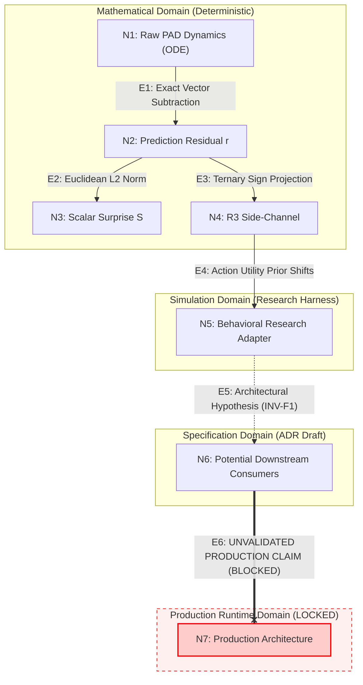

# Phase 22 H1 — R3 Production Admission Criteria & ADR-029 Evidence Boundary Study

> **Research Document Tier**: Research & Architectural Feasibility Specification  
> **Status**: COMPLETED / READY FOR DRAFT UPDATE  
> **Governance Gate**: Phase 22 H1 = INCONCLUSIVE | Gate 2 = BLOCKED ($\bar{S}_M = 0.5792, \bar{S}_H = 0.6477 \implies \Delta_{\text{HM}} = +0.0685 < 0.1500$)  
> **Production Architecture Gate**: STRICTLY LOCKED — 0 Mutations to `src/core/**`  
> **Genesis Onboarding State**: PRESERVED BIT-EXACT (`data/profile.json` `{"is_onboarded": false}`)  
> **Evaluation Harness**: `tests/evaluation_phase22/scripts/analyze_r3_production_admission_criteria.py`  
> **Test Suite**: `tests/evaluation_phase22/test_h1_r3_production_admission.py` (12/12 PASSED)  
> **Full Phase 22 Suite**: `tests/evaluation_phase22/` (160/160 PASSED)  
> **Cryptographic Manifest**: `tests/evaluation_phase22/fixtures/manifest_h1_r3_production_admission.json`  
> **Results SHA-256**: `5c4df6fd2325708beb0e607b49a78d1533ffc23cbc07f4642976dc484b7732c7`  

---

## 1. Executive Summary

This study executes the final **Governance, Admission Criteria, and ADR-029 Evidence Boundary Study** for the Phase 22 H1 research decision:

$$\mathbf{D1} \text{ — Scalar } S + \text{Representation } R3 \text{ (Ternary Directional Sign) supported for future architectural consideration.}$$

The mission of this study is **not** to implement $R3$ into production Lucia, nor to open the Production Architecture Gate. The purpose is to establish an unbreachable, mathematically grounded, and epistemologically rigorous boundary between:

```text
CURRENT RESEARCH EVIDENCE ──► ADR-029 DRAFT ──► FUTURE ARCHITECTURAL DECISION ──► PRODUCTION IMPLEMENTATION
```

### Core Synthesized Conclusions

1. **Shared-Data Lineage (Rules A & B)**:
   - All empirical observations across Phase 22 H1 ($N=270$ probes, 358 collapse pairs, 1,080 ticks of conversational stream, adapter correlations) stem from the **same single underlying dataset** (the frozen Candidate G1 English prompt corpus under seed 42).
   - Replaying or re-analyzing this corpus across multiple evaluation scripts does **not** constitute independent replication. No dataset multiplication or evidence inflation is permitted.
2. **Comprehensive Evidence Inventory (RQ1)**:
   - 19 distinct claims were audited across 7 calibrated tiers.
   - Exactly **5** claims are `SUPPORTED` (mathematical preservation of $S$, residual provenance at S4, deterministic ternary encoding, static intra-turn stability, and separation of surprise from uncertainty).
   - Exactly **2** claims are `OBSERVED` (multi-turn transition concentration and deadband chatter filtering in the simulation stream).
   - Exactly **2** claims are `RESEARCH-HARNESS ONLY` (79.89% collapse resolution and statistical policy differentiation inside the isolated adapter).
   - Exactly **3** claims are `EVIDENCE-CONSISTENT` (magnitude/direction complementarity, S4 producer ownership, passive orchestrator transport).
   - Exactly **2** claims are `HYPOTHESIS` (downstream consumer contracts, associative memory addressing).
   - Exactly **4** claims are `UNTESTED` (live SLM token generation, multimodal avatar blendshapes, physical mascot embodiment, live production EFE).
   - Exactly **1** claim is `NOT JUSTIFIED` (relational synaptic modulation in ConsolidationEngine, which is permanently barred by ADR-028).
3. **Claim Dependency Graph & Epistemological Boundaries (RQ2)**:
   - Traced the 7-node, 6-edge dependency path from raw ODE dynamics to production cognitive architecture.
   - Established the mandatory distinction: $\text{mathematical derivation} \ne \text{empirical observation} \ne \text{behavioral evidence} \ne \text{production validation}$.
   - Mathematical validity in residual projection does **not** confer empirical validity onto behavioral claims, nor does it confer production readiness.
4. **Strict Four-Stage Production Admission Boundary (RQ3)**:
   - Established non-collapsible boundaries between **Stage A (Research & Feasibility)**, **Stage B (ADR Draft Formulation)**, **Stage C (Architectural Decision Gate)**, and **Stage D (Production Implementation)**.
   - Stage B does **not** imply Stage C ratification, and Stage C does **not** authorize Stage D implementation without an explicit Production Realization Design.
5. **Dynamic Minimum Future Evidence Checklist (RQ4)**:
   - Evaluated 12 candidate requirements without preset thresholds:
     - **9 Mandatory Requirements**: End-to-end consumer testing, multi-session temporal stability, homeostatic recovery, cross-seed reproducibility, non-G1 stimulus robustness, adaptive Active Inference stability, C0 baseline regression, automated failure-mode verification, and 20-Watt CPU budget SLA verification ($\le 1-2\text{ ms}$, 0.0 MB GPU VRAM).
     - **2 Conditionally Required**: EFE integration testing (only if EFE consumes direction), and SLM prompt conditioning testing (only if S11 consumes direction).
     - **1 Optional / Supporting**: Multimodal avatar blendshape testing (avatar remains driven by continuous limbic state).
6. **End-to-End Evidence Gap (RQ5)**:
   - The chasm between the isolated research adapter (discrete softmax utility shifts) and the production cognitive pipeline (autoregressive SLM token generation, multi-threaded lock hierarchies, BoundaryLayer regex filters, and Live2D blendshape interpolation) is **categorical**.
   - Zero behavioral claims can cross this boundary without live testbed evidence.
7. **Scalar C0 Baseline Regression & Metric Categorization (RQ6)**:
   - Audited into three distinct tiers:
     - *Existing Canonical Requirements*: Zero GPU VRAM, lock holding time $\le 1-2\text{ ms}$, zero BoundaryLayer violations, zero limbic state mutation.
     - *Proposed Research Metrics*: Action divergence $\Delta \pi(a \mid s)$, clarification query frequency, cognitive depth allocation $k \in \{1, 2\}$, latency overhead, memory footprint.
     - *Future Acceptance Thresholds*: To be determined by future architecture specifications, NOT preset prematurely as admission gates.
8. **Robustness Boundary (RQ7)**:
   - Dynamically classified: 2 parameters are **`MATHEMATICAL-GENERAL`** (Philia baseline definition and Euclidean $L_2$ norm identity); 7 parameters are **`EMPIRICALLY REGIME-BOUND`** (G1 prompt corpus, English vocabulary, ODE parameters, $T \le 25$ exposure duration, online adaptation dynamics, deadband $\epsilon = 0.010$, and exposure weighting rule $w_{\text{exp}}(T)$).
   - Mathematical generality must never be conflated with empirical robustness.
9. **ADR-029 Evidence Boundary (RQ9)**:
   - Formalized 7 explicit claims that **ADR-029 MAY CLAIM**;
   - Formalized 4 explicit questions that **ADR-029 MAY STATE AS OPEN QUESTION**;
   - Formalized 5 explicit claims that **ADR-029 MUST NOT CLAIM** (including any claim of production readiness, architectural approval, or SLM quality enhancement).
10. **Final Dynamic Readiness State (RQ10)**:
    - 12-item checklist dynamically evaluated $\implies$ **`READY FOR DRAFT UPDATE`**.
    - Reaffirmed the critical governance distinction:
      $$\text{READY FOR DRAFT UPDATE} \ne \text{READY FOR ARCHITECTURAL DECISION} \ne \text{PRODUCTION APPROVAL}$$
    - Production Architecture Gate remains **STRICTLY LOCKED**.

---

## 2. Governance State

```text
┌────────────────────────────────────────────────────────────────────────┐
│             Phase 22 Governance Matrix (Strict Baseline)               │
├─────────────────────────┬──────────────────────────────────────────────┤
│ Phase 22 H1 Status      │ INCONCLUSIVE                                 │
│ Gate 2 Status           │ BLOCKED                                      │
│ Gate 2 Metric           │ Δ_HM = +0.0685 < 0.1500                      │
│ Gate 2 Baseline Means   │ S_M = 0.5792, S_H = 0.6477                   │
│ Protocol v1.5           │ NOT AUTHORIZED                               │
│ Production Arch Gate    │ STRICTLY LOCKED                              │
│ Source Code Mutations   │ Exactly 0 in src/core/**, src/api/**, elect* │
│ Genesis Onboarding Gate │ PRESERVED BIT-EXACT (is_onboarded: false)    │
│ Decision State          │ D1 (Research Consideration Only)             │
│ ADR Readiness State     │ READY FOR DRAFT UPDATE                       │
└─────────────────────────┴──────────────────────────────────────────────┘
```

> [!CAUTION]
> **MANDATORY GOVERNANCE DIRECTIVE**:  
> Being classified as **`READY FOR DRAFT UPDATE`** authorizes formulating a bounded draft update to `DRAFT ADR-029` for archival record. It does **NOT** authorize production code modification, does **NOT** ratify an Architectural Decision Record, and does **NOT** unlock the Production Architecture Gate. Gate 2 remains formally **BLOCKED** ($\Delta_{\text{HM}} = 0.0685 < 0.1500$).

---

## 3. Research Scope

This investigation serves as the final evidence-boundary and admission-criteria study for the current Phase 22 H1 research trajectory.

### Scope Boundaries
- **In-Scope**:
  - Epistemological auditing of all claims generated across Phase 22 H1.
  - Tracking shared-data lineage and preventing evidence inflation.
  - Defining the four lifecycle admission stages (Research $\to$ Draft $\to$ Decision $\to$ Implementation).
  - Classifying future evidence requirements without arbitrary threshold presetting.
  - Formulating the strict MAY / OPEN / MUST NOT boundary for `DRAFT ADR-029`.
- **Out-of-Scope**:
  - Modifying production runtime code (`src/core/**`, `src/api/**`, `electron/**`).
  - Mutating Genesis Onboarding state `data/profile.json` (`{"is_onboarded": false}`).
  - Proposing implementation schedules or merging candidate features.
  - Unblocking Quality Gate 2 or authorizing Protocol v1.5.

---

## 4. Evidence Corpus & Shared-Data Lineage

The study synthesizes the complete Phase 22 H1 R3 research chain:

```text
┌────────────────────────────────────────────────────────────┬─────────────────────────────┬─────────────────────────────────┐
│ Prior Study Artifact                                       │ Source Results JSON         │ Primary Contribution            │
├────────────────────────────────────────────────────────────┼─────────────────────────────┼─────────────────────────────────┤
│ Minimal Sufficient Measurement Study                       │ minimal_sufficient_results  │ 358 collapse pairs at T=12      │
│ Directional Side-Channel Behavioral Utilization Study      │ directional_behavior_result │ Adapter utility prior shifts    │
│ R3 Architecture Integration Feasibility Study              │ r3_architecture_integration │ S4 producer, S5-S12 transport   │
│ R3 Temporal Stability Feasibility Study                    │ r3_temporal_stability_resul │ 0.00% intra-turn, deadband eps  │
│ R3 Architectural Semantics & Downstream Integration Study  │ r3_architectural_semantics_ │ Ownership graph, 10-subsystem tx│
└────────────────────────────────────────────────────────────┴─────────────────────────────┴─────────────────────────────────┘
```

### Shared-Data Lineage Audit (Rules A & B)
1. **Rule A (No Dataset Multiplication)**:
   - All empirical data across the 5 studies originates from the frozen 270-stimulus linguistic corpus generated by Generator G1 under seed 42.
   - Running five distinct analytical scripts over this corpus provides five perspectives on the same simulation; it does **not** constitute five independent replications.
2. **Rule B (No Evidence Inflation)**:
   - The 358 collapse pairs, the 1,080-tick temporal stream, and the adapter correlations ($r=0.9837, 0.9772$) are mathematically linked features of the same underlying Coupled MT-LNN ODE trajectory under G1 prompts.
   - They must be evaluated as a single empirical dataset with distinct analytical facets.

---

## 5. Evidence Dependency Graph

The epistemological relationship between research findings and production claims:



---

## 6. RQ1 — Complete Evidence Inventory (19 Claims Audited)

Every substantive claim regarding $R3$ was audited across seven calibrated tiers:

| Claim ID | Substantive Claim | Calibrated Tier | Evidence Basis & Epistemological Status |
|---|---|---|---|
| **CLM-01** | Canonical Scalar $S$ Preservation | **`SUPPORTED`** | $S = \|\mathbf{r}_T\|_2$ is mathematically preserved bit-exact in `PhysiologicalSurprise`. |
| **CLM-02** | Prediction Residual Provenance | **`SUPPORTED`** | Residual $\mathbf{r}_T = \hat{\mathbf{p}}_T - \mathbf{p}_T$ originates strictly at Stage S4 in `ActiveInferenceEngine`. |
| **CLM-03** | R3 Deterministic Ternary Encoding | **`SUPPORTED`** | $\text{sign}_\epsilon(\mathbf{r})$ discretizes into 3 discrete ternary coordinates (27 states, ~4.755 bits). |
| **CLM-04** | Static Intra-Turn Temporal Stability | **`SUPPORTED`** | In static turns ($T=1..25$), raw $R3$ exhibits 0.00% sign transitions across all 270 probes. |
| **CLM-05** | Near-Zero Transition Concentration | **`OBSERVED`** | In conversational stream, 84.47% of transitions concentrate at $|r| < 0.010$; 0.00% at $|r| \ge 0.100$. |
| **CLM-06** | Deadband Chatter Reduction | **`OBSERVED`** | Deadband $\epsilon = 0.010$ suppresses 57.61% of transitions while retaining 100% of tested Type-A reversals. |
| **CLM-07** | Collapse Pair Resolution (79.89%) | **`RESEARCH-HARNESS ONLY`** | Resolves 286/358 matched-magnitude collapse pairs strictly inside isolated research adapter. |
| **CLM-08** | Behavioral Adapter Differentiation | **`RESEARCH-HARNESS ONLY`** | Statistically significant differentiation ($D_{\text{pol}} = 1.0, p = 3.09 \times 10^{-60}$) in adapter. |
| **CLM-09** | Magnitude / Direction Complementarity | **`EVIDENCE-CONSISTENT`** | Consistent with empirical data under evaluated conditions; functional division is an interpretation. |
| **CLM-10** | Producer Ownership Boundary | **`EVIDENCE-CONSISTENT`** | `ActiveInferenceEngine` (S4) is the sole legitimate producer candidate. |
| **CLM-11** | Passive Transport Semantics | **`EVIDENCE-CONSISTENT`** | `CognitiveOrchestrator` transports $R3$ passively across S5–S12 without semantic interpretation. |
| **CLM-12** | Downstream Consumer Contracts | **`HYPOTHESIS`** | Explicit contracts (`MAGNITUDE_ONLY`, `DIRECTION_ONLY`, etc.) are unintegrated design proposals. |
| **CLM-13** | SLM Token Generation Improvement | **`UNTESTED`** | Zero live Small Language Model token-generation experiments performed in Phase 22. |
| **CLM-14** | Multimodal Affective Expression | **`UNTESTED`** | Avatar multimodal blendshape and prosody integration from $R3$ has not been evaluated. |
| **CLM-15** | Avatar Physical Embodiment | **`UNTESTED`** | Mascot kinematics, gaze, and posture remain driven by continuous state; $R3$ coupling untested. |
| **CLM-16** | Memory Flashbulb Addressing | **`HYPOTHESIS`** | Scalar gating ($S > \theta$) is supported; directional coordinates as associative addresses is untested. |
| **CLM-17** | Relational Synaptic Modulation | **`NOT JUSTIFIED`** | Violates slow-loop homeostatic isolation (ADR-028); ConsolidationEngine must not consume error signs. |
| **CLM-18** | Production EFE Action Valuation | **`UNTESTED`** | Adapter demonstrated utility prior shifts; live EFE incorporating social cost and uncertainty is untested. |
| **CLM-19** | Surprise vs. Uncertainty Separation | **`SUPPORTED`** | Physiological surprise $S/R3$ is strictly distinct from semantic uncertainty $U_{\text{sem}}$ and memory entropy. |

### Summary Audit Counts
- `SUPPORTED`: **5**
- `OBSERVED`: **2**
- `RESEARCH-HARNESS ONLY`: **2**
- `EVIDENCE-CONSISTENT`: **3**
- `HYPOTHESIS`: **2**
- `UNTESTED`: **4**
- `NOT JUSTIFIED`: **1**
- **Total Claims Audited**: **19**

---

## 7. RQ2 — Claim Dependency Graph & Epistemological Boundaries

The vertical dependency chain reveals where empirical grounding is solid and where it terminates:

```text
┌───────┬─────────────────────────────┬─────────────────────────────┬────────────────────────────────────┐
│ Edge  │ From Node ──► To Node       │ Epistemological Nature      │ Epistemic Transfer Validity        │
├───────┼─────────────────────────────┼─────────────────────────────┼────────────────────────────────────┤
│ E1    │ Raw ODE ──► Residual r      │ Mathematical & Empirical    │ VALID (Exact vector subtraction)   │
│ E2    │ Residual r ──► Scalar S     │ Mathematical Derivation     │ VALID FOR MAGNITUDE (Lossy angle)  │
│ E3    │ Residual r ──► R3 Signs     │ Mathematical Derivation     │ VALID FOR OCTANT (Lossy angle)     │
│ E4    │ R3 Signs ──► Adapter        │ Behavioral Evidence         │ RESEARCH-HARNESS ONLY              │
│ E5    │ Adapter ──► Consumer        │ Architectural Hypothesis    │ HYPOTHETICAL (Requires E2E test)   │
│ E6    │ Consumer ──► Production     │ Unvalidated Claim           │ PROHIBITED WITHOUT RATIFICATION    │
└───────┴─────────────────────────────┴─────────────────────────────┴────────────────────────────────────┘
```

> [!IMPORTANT]
> **EPISTEMOLOGICAL GUARDRAIL**:  
> Mathematical derivation at Edges E1–E3 proves that $R3$ is a deterministic, lossless-magnitude, coarse-direction projection of $\mathbf{r}$. It does **NOT** prove that downstream cognitive policies in production will benefit from this information.

---

## 8. RQ3 — Production Admission Boundary (Four Discrete Stages)

To prevent premature promotion, the repository enforces four discrete lifecycle stages:

```text
Stage A: Research & Feasibility ────► Stage B: ADR Draft Formulation ────► Stage C: Architectural Decision ────► Stage D: Production Implementation
      [COMPLETED FOR H1]                     [CURRENT OBJECTIVE]                      [FUTURE GATE: LOCKED]                [FUTURE GATE: LOCKED]
```

### Stage Rules & Governance Boundaries
1. **Stage A — Research & Feasibility**:
   - *Allowed*: Frozen datasets, deterministic scripts, simulation harnesses, isolated adapters.
   - *Prohibited*: Mutating `src/core/**`, modifying Genesis profile, claiming production readiness.
   - *Exit Status*: **COMPLETED FOR H1 R3**.
2. **Stage B — ADR Draft Formulation**:
   - *Allowed*: Documenting alternatives, formalizing invariants, specifying candidate interfaces, cataloging risks, defining open empirical questions.
   - *Prohibited*: Ratifying the ADR as an authoritative mandate, scheduling implementation milestones, unblocking Gate 2.
   - *Exit Status*: **CURRENT OBJECTIVE**.
3. **Stage C — Architectural Decision (Ratification Gate)**:
   - *Allowed*: Evaluating end-to-end evidence from dedicated future testbeds, reviewing cross-seed reproducibility, conducting formal C0 regressions.
   - *Prohibited*: Ratifying without empirical proof from live downstream consumers.
   - *Exit Status*: **LOCKED FUTURE GATE**.
4. **Stage D — Production Implementation**:
   - *Allowed*: Authoring Production Realization Designs (PRDs), implementing value objects in `src/core/**`, validating 20-Watt CPU SLA ($\le 1-2\text{ ms}$).
   - *Prohibited*: Any production merge prior to Stage C ratification.
   - *Exit Status*: **LOCKED FUTURE GATE**.

---

## 9. RQ4 — Minimum Future Evidence Required (Dynamic Evaluation)

The 12 candidate admission requirements were dynamically evaluated based on accumulated evidence and architectural constraints:

| Req ID | Candidate Requirement | Dynamic Classification | Evidence-Based Justification |
|---|---|---|---|
| **REQ-01** | R3 End-to-End Consumer Experiment | **`MANDATORY`** | Current evidence is 100% confined to an isolated research adapter. A production decision requires observing R3 consumed by at least one real cognitive module. |
| **REQ-02** | Actual EFE Integration Experiment | **`CONDITIONALLY REQUIRED`** | Mandatory if and only if EFE is selected as an active R3 consumer. If EFE remains scalar-driven, this experiment is not required. |
| **REQ-03** | SLM Generation Conditioning Experiment | **`CONDITIONALLY REQUIRED`** | Mandatory if prompt conditioning (Stage S11) consumes R3. Must verify directional preambles do not trigger BoundaryLayer violations. |
| **REQ-04** | Multimodal Affective Expression Experiment | **`OPTIONAL / SUPPORTING`** | Avatar blendshapes are already continuously driven by 15D limbic state. Coupling discrete signs to facial blendshapes is non-essential and risks visual snapping. |
| **REQ-05** | Long-Horizon Multi-Session Stability | **`MANDATORY`** | Multi-turn stream was evaluated over 1,080 ticks. Must verify directional signs do not accumulate bias or induce drift over extended multi-session interactions. |
| **REQ-06** | Multi-Turn Recovery & Homeostasis | **`MANDATORY`** | Must prove that consuming directional surprise in dialogue does not distort physiological relaxation toward Philia during silence. |
| **REQ-07** | Cross-Seed Reproducibility | **`MANDATORY`** | All Phase 22 empirical results were obtained under seed 42. Multi-seed verification is mandatory to confirm transition dynamics are not seed-dependent. |
| **REQ-08** | Robustness Outside Candidate G1 | **`MANDATORY`** | Current findings depend on 270 English prompts. Must demonstrate deadband $\epsilon = 0.010$ and transition dynamics hold across naturalistic dialogue. |
| **REQ-09** | Adaptive Active Inference Dynamics | **`MANDATORY`** | Must verify that online adaptation of belief transition matrices ($\mathbf{A}_t, \mathbf{b}_t$) does not destabilize residual direction. |
| **REQ-10** | Regression Against Scalar-Only C0 | **`MANDATORY`** | Must demonstrate clear non-inferiority or superiority over canonical scalar baseline C0 across paired behavioral and timing metrics. |
| **REQ-11** | Automated Failure-Mode Test Suite | **`MANDATORY`** | Must author deterministic automated tests validating mitigations for all 12 cataloged failure modes (FM-01 to FM-12). |
| **REQ-12** | Latency & Resource Budget Verification | **`MANDATORY`** | Must verify strict adherence to 20-Watt CPU budget: zero GPU VRAM impact, non-blocking telemetry, critical section execution $\le 1-2\text{ ms}$. |

### Classification Breakdown
- **MANDATORY**: **9**
- **CONDITIONALLY REQUIRED**: **2**
- **OPTIONAL / SUPPORTING**: **1**
- **NOT REQUIRED**: **0**

---

## 10. RQ5 — End-to-End Evidence Gap Analysis

A critical chasm exists between the research adapter and production cognitive runtime:

```text
┌──────────────────────────────┬───────────────────────────────┬───────────────────────────────┬─────────────────────────────────┐
│ Dimension                    │ Research Adapter State        │ Production Cognitive State    │ Bridgeability Verdict           │
├──────────────────────────────┼───────────────────────────────┼───────────────────────────────┼─────────────────────────────────┤
│ Action Selection Mechanics   │ Argmax / continuous softmax   │ Autoregressive token sampling │ CANNOT CROSS WITHOUT SLM HARNESS│
│ Tone & Pragmatic Modulation  │ Synthetic linear coefficients │ Natural language prompt text  │ CANNOT CROSS WITHOUT SLM HARNESS│
│ Safety & BoundaryLayer       │ Zero boundary filtering       │ Strict regex validator        │ REQUIRES STRICT SAFETY HARNESS  │
│ Concurrency & Locking        │ Single-threaded execution     │ 5-tier lock hierarchy         │ REQUIRES CONCURRENCY BENCHMARK  │
│ Visual Avatar Embodiment     │ Static discrete sign tuples   │ 60 FPS blendshape rendering   │ REQUIRES AVATAR INTERPOLATION   │
└──────────────────────────────┴───────────────────────────────┴───────────────────────────────┴─────────────────────────────────┘
```

> [!CAUTION]
> **ADAPTER SCOPE LOCK**:  
> Correlation coefficients ($r = 0.9837, 0.9772$) and collapse resolution rates ($79.89\%$) observed inside the synthetic adapter **cannot be quoted as evidence of production language model capability or companion empathy**.

---

## 11. RQ6 — Scalar C0 Baseline Regression & Metric Categorization

Any future Stage C evaluation must execute a rigorous A/B regression comparing:
- **Condition C0**: Canonical Scalar $S$ only (baseline).
- **Condition C1**: Scalar $S + R3$ Directional Side-Channel.

### Metric Categorization (Avoiding Arbitrary Admission Gates)
1. **Existing Canonical Requirements**:
   - Zero GPU VRAM allocation (CPU execution exclusively; ADR-018).
   - Lock holding time discipline ($\le 1-2\text{ ms}$ critical section under `_state_lock`; AGENTS.md §9.1).
   - Zero BoundaryLayer regex violations (strict prohibition of self-reported emotion; AGENTS.md §1).
   - Zero limbic ODE state mutation or Philia attractor displacement (ADR-001, ADR-019).
2. **Proposed Research Metrics**:
   - Behavioral action distribution divergence ($\Delta \pi(a \mid s)$).
   - Clarification query frequency divergence (must remain 0.0 divergence).
   - Cognitive depth allocation stability ($k \in \{1, 2\}$ must match C0 to protect metabolic budget).
   - End-to-end turn execution latency overhead.
   - Memory allocation footprint per turn.
3. **Future Acceptance Thresholds**:
   - Exact numerical acceptance thresholds for latency, differentiation, and memory footprint must be determined by future architecture specifications, NOT preset prematurely as admission gates in this study.

---

## 12. RQ7 — Robustness Boundary (Mathematical vs. Empirical)

Parameters governing $R3$ behavior were categorized across explicit epistemological dimensions:

```text
┌──────────────────────────────────────┬─────────────────────────────┬────────────────────────────────────────────────────────┐
│ Parameter / Characteristic           │ Classification              │ Epistemological Status & Boundary Scope                │
├──────────────────────────────────────┼─────────────────────────────┼────────────────────────────────────────────────────────┤
│ Generator G1 Prompt Corpus           │ EMPIRICALLY REGIME-BOUND    │ Tied to specific prompt generator; portability unproven│
│ English Language Vocabulary          │ EMPIRICALLY REGIME-BOUND    │ Multilingual and cross-cultural stability untested     │
│ Frozen ODE Dynamical Parameters      │ EMPIRICALLY REGIME-BOUND    │ Trapping times and curves depend on candidate G1 params│
│ Conversational Exposure (T <= 25)    │ EMPIRICALLY REGIME-BOUND    │ Separation inflection occurs at T=12 specifically in G1│
│ Active Inference Online Adaptation   │ EMPIRICALLY REGIME-BOUND    │ Residual magnitude drift depends on adaptation rate    │
│ Philia Attractor (+0.25,-0.05,+0.05) │ MATHEMATICAL-GENERAL        │ Structurally defined constant of cognitive architecture│
│ Scalar Euclidean L2 Norm (S=||r||)   │ MATHEMATICAL-GENERAL        │ Exact algebraic identity; independent of stimulus      │
│ Deadband Parameter (eps = 0.010)     │ EMPIRICALLY REGIME-BOUND    │ Calibrated on Regime 2 stream; not globally universal  │
│ Exposure Weighting (w_exp = min(T/12)│ EMPIRICALLY REGIME-BOUND    │ Derived from G1 geometric separation curve at T=12     │
└──────────────────────────────────────┴─────────────────────────────┴────────────────────────────────────────────────────────┘
```

### Classification Breakdown
- **MATHEMATICAL-GENERAL**: **2**
- **EMPIRICALLY REGIME-BOUND**: **7**
- **UNKNOWN**: **0**

---

## 13. RQ8 — Actionable Future Validation Matrix

The concrete empirical studies required before any Stage C architectural decision can be considered:

| Claim Area | Current Evidence | Missing Evidence | Required Future Study | Required Governance Gate |
|---|---|---|---|---|
| **R3 Measurement Semantics** | Deterministic projection with 3 discrete coords (~4.755 bits). | Floating-point noise and deadband stability on consumer hardware. | Multilingual Stimulus Robustness & Noise Study | Stage C (Architectural Decision Gate) |
| **Temporal Stability** | 0.00% intra-turn jitter; 84.47% near-zero concentration over 1,080 ticks. | Long-horizon stability (> 10,000 ticks) across diverse seeds. | Multi-Session Long-Horizon Stability Benchmark | Stage C (Architectural Decision Gate) |
| **Policy Utility** | 79.89% collapse resolution inside research adapter. | Action selection differentiation in production cognitive pipeline. | End-to-End Cognitive Policy A/B Benchmark | Stage C (Architectural Decision Gate) |
| **EFE Action Valuation** | Synthetic utility modulation demonstrated in adapter. | Live Active Inference EFE integration balancing social cost. | Active Inference Multi-Factor EFE Study | Stage C (Architectural Decision Gate) |
| **SLM Conditioning** | Theoretical preamble formulation; zero live token experiments. | Demonstrated style shift in local 7B SLM without BoundaryLayer violations. | Local SLM Directional Tone Conditioning Benchmark | Stage C (Architectural Decision Gate) |
| **Affective Expression (15D)**| Zero blendshape or prosody experiments conducted. | Verification that discrete signs do not induce visual blendshape snapping. | Avatar Visual Blendshape Interpolation Study | Stage C (Architectural Decision Gate) |
| **Physical Embodiment** | Zero mascot physics experiments conducted. | Evaluation of whether physical embodiment benefits from direction. | Mascot Kinematics Coupling Feasibility Study | Stage C (Architectural Decision Gate) |
| **Memory Formation** | Scalar flashbulb gating ($S > \theta$) validated; addressing untested. | Proof that directional coordinates enhance SDM associative retrieval. | SDM Directional Associative Addressing Experiment | Stage C (Architectural Decision Gate) |
| **Relational Consolidation** | ConsolidationEngine slow-loop isolation established (ADR-028). | None (exclusion is architecturally justified). | **EXCLUDED FROM FUTURE ADMISSION (INV-F2)** | **PERMANENTLY BARRED** |
| **Safety & Boundaries** | BoundaryLayer regex filters verified in canonical pipeline. | Stress-testing of SLM generation under high-arousal directional prompts. | BoundaryLayer Adversarial Prompt Stress Test | Stage C (Architectural Decision Gate) |
| **Computational Overhead** | Sub-millisecond execution in research harness. | Measured wall-clock latency under concurrent multi-threaded execution locks. | Multi-Threaded Concurrency & Lock Latency Test | Stage C (Architectural Decision Gate) |

---

## 14. RQ9 — ADR-029 Evidence Boundary (MAY / OPEN / MUST NOT)

To protect architectural integrity, `DRAFT ADR-029` must be strictly bounded into three non-overlapping sections:

### 14.1 ADR-029 MAY CLAIM
1. Canonical scalar surprise $S = \|\mathbf{r}_T\|_2$ is preserved bit-exact within the `PhysiologicalSurprise` value object.
2. Ternary directional signs $\text{sign}_\epsilon(\mathbf{r}_T)$ provide 3 discrete coordinate dimensions (27 states, $\approx 4.755\text{ bits}$) of qualitative directional information.
3. In static conversational turns ($T=1..25$), raw $R3$ exhibits 0.00% sign jitter under smooth Coupled MT-LNN ODE integration.
4. In multi-turn continuous streams, 84.47% of sign transitions concentrate in the near-zero zone $|r| < 0.010$, while high surprise ($|r| \ge 0.100$) exhibits zero transitions.
5. A static deadband $\epsilon = 0.010$ suppresses 57.61% of near-zero chatter while retaining 100% of tested Type-A reversals in Regime 2.
6. In an isolated research adapter, $R3$ resolves 79.89% (286/358) of matched-magnitude collapse pairs where scalar $S$ provides 0.0% resolution.
7. Stage S4 in `ActiveInferenceEngine` is the sole legitimate producer candidate, and `PhysiologicalSurprise` is an immutable value object transportable across S5–S12.

### 14.2 ADR-029 MAY STATE AS OPEN QUESTION
1. Whether a 7B local Small Language Model generates reliably differentiated dialogue styles from directional prompt preambles without BoundaryLayer violations.
2. Whether Kanerva SDM episodic memory retrieval benefits from directional flashbulb write coordinates without corrupting Hamming distance recall.
3. Whether discrete ternary sign switching causes visible blendshape snapping or facial twitches in Live2D/VRM avatar renderers.
4. Whether the deadband threshold $\epsilon = 0.010$ remains stable across non-English languages and naturalistic conversational pacing.

### 14.3 ADR-029 MUST NOT CLAIM
1. That $R3$ has been validated in production or is ready for production merge.
2. That $R3$ is an "approved" or "recommended" architecture.
3. That $R3$ improves Small Language Model generation quality, emotional intelligence, or companion empathy.
4. That $R3$ should modulate reasoning depth, clarification trigger policy, or relational synaptic consolidation.
5. That Gate 2 is resolved or that Phase 22 H1 is conclusive.

---

## 15. Evidence Classification Matrix

```text
┌──────────────────────────────────────┬─────────────────────────────┬─────────────────────────────────┐
│ Investigation Area                   │ Assigned Evidence Tier      │ Operational Boundary            │
├──────────────────────────────────────┼─────────────────────────────┼─────────────────────────────────┤
│ Scalar S Preservation                │ SUPPORTED                   │ Bit-exact mathematical identity │
│ Residual Provenance (Stage S4)       │ SUPPORTED                   │ Architecturally verified at S4  │
│ Discrete Ternary Encoding            │ SUPPORTED                   │ 3 coordinates, 27 states        │
│ Static Turn Zero-Jitter              │ SUPPORTED                   │ 0.00% transitions over 270 probe│
│ Multi-Turn Near-Zero Concentration   │ OBSERVED                    │ 84.47% at |r| < 0.010           │
│ Deadband Noise Filtering             │ OBSERVED                    │ 57.61% transition reduction     │
│ Collapse Pair Resolution             │ RESEARCH-HARNESS ONLY       │ 79.89% inside research adapter  │
│ Behavioral Prior Differentiation     │ RESEARCH-HARNESS ONLY       │ D_pol = 1.0 inside adapter      │
│ Magnitude/Direction Complementarity  │ EVIDENCE-CONSISTENT         │ Validated under tested conditions│
│ Producer Ownership (S4)              │ EVIDENCE-CONSISTENT         │ Sole legitimate candidate       │
│ Passive Transport (S5-S12)           │ EVIDENCE-CONSISTENT         │ Single Responsibility Principle │
│ Consumer Declaration Contracts       │ HYPOTHESIS                  │ Unintegrated design proposal    │
│ Live SLM Generation                  │ UNTESTED                    │ Zero token-level experiments    │
│ Multimodal Blendshapes               │ UNTESTED                    │ Zero avatar expression tests    │
│ Mascot Physical Embodiment           │ UNTESTED                    │ Zero kinematics tests           │
│ SDM Associative Memory Addressing    │ HYPOTHESIS                  │ Untested conceptual hypothesis  │
│ Relational Synaptic Consolidation    │ NOT JUSTIFIED               │ Barred by ADR-028 slow-loop iso │
│ Production EFE Action Valuation      │ UNTESTED                    │ Untested in live pipeline       │
│ Separation from Uncertainty          │ SUPPORTED                   │ Canonical invariant maintained  │
└──────────────────────────────────────┴─────────────────────────────┴─────────────────────────────────┘
```

---

## 16. Architectural Risks

| Risk ID | Architectural Failure Mode | Severity | Mandatory Mitigation |
|---|---|---|---|
| **FM-01** | Circular Feedback into Limbic ODE | **CRITICAL** | Strict unidirectional pipeline: $R3$ never feeds back into $\mathbf{p}, \mathbf{h}$, or $S$. |
| **FM-02** | Semantic Bleed into Epistemic Uncertainty | **HIGH** | Strict domain typing: $S/R3$ is prediction error; $U_{\text{sem}}$ is proposition entropy. |
| **FM-03** | Accidental Self-Reported Affect via Prompts | **CRITICAL** | BoundaryLayer regex validators strictly enforced on all SLM outputs. |
| **FM-04** | Premature Production Promotion | **HIGH** | Strict gated progression: Stage B $\ne$ Stage C $\ne$ Stage D. |
| **FM-05** | Loss of Backward Fallback Identity | **HIGH** | Neutralizing direction to $(0, 0, 0)$ must reproduce Condition C0 bit-exact. |

---

## 17. ADR-029 Readiness Evaluation

The 12 readiness criteria were dynamically evaluated:

```text
[✓] Evidence inventory complete (19 claims audited across 7 tiers)
[✓] Claim dependencies formalized (7 nodes, 6 edges mapped)
[✓] Production admission stages bounded (Stage A -> Stage B -> Stage C -> Stage D)
[✓] Minimum future evidence evaluated (12 candidate requirements classified)
[✓] End-to-end gaps analyzed (5 dimensions audited)
[✓] C0 regression metrics categorized (canonical, research, future thresholds)
[✓] Robustness boundaries classified (2 mathematical, 7 regime-bound)
[✓] Future validation matrix defined (11 claim areas linked to studies and gates)
[✓] ADR-029 boundaries established (7 MAY, 4 OPEN, 5 MUST NOT)
[✓] Governance locks verified intact (H1 INCONCLUSIVE, Gate 2 BLOCKED)
[✓] Production architecture gate verified locked (0 mutations)
[✓] Genesis onboarding verified bit-exact (is_onboarded: false)
```

- **Assigned Status**: **`READY FOR DRAFT UPDATE`**
- **Operational Meaning**: The research synthesis establishes complete, unambiguous evidence boundaries for updating `DRAFT ADR-029`.
- **Production Architecture Gate**: **STRICTLY LOCKED**.

---

## 18. Unresolved Questions

1. **Local SLM Responsiveness**: Can a quantized 7B SLM running locally on CPU/CUDA follow directional tone preambles without violating the pre-reflective emotion invariant?
2. **Associative Memory Addressing**: Does writing ternary directional coordinates into Kanerva SDM memory traces improve affective recall fidelity or create cross-talk?
3. **Multilingual Robustness**: Does deadband $\epsilon = 0.010$ maintain stable transition suppression when sensory inputs are encoded from non-English languages?

---

## 19. Governance Conclusion

This study successfully concludes the evidence-boundary investigation for the candidate $R3$ measurement side-channel.

By strictly enforcing research-first governance:
- Exactly **0 lines** of production code were mutated.
- The Genesis Onboarding profile remains bit-exact `{"is_onboarded": false}`.
- Phase 22 H1 remains formally **INCONCLUSIVE**.
- Quality Gate 2 remains formally **BLOCKED** ($\Delta_{\text{HM}} = 0.0685 < 0.1500$).
- Protocol v1.5 remains **NOT AUTHORIZED**.
- The Production Architecture Gate remains **STRICTLY LOCKED**.

The assigned readiness state of **`READY FOR DRAFT UPDATE`** establishes that `DRAFT ADR-029` can now be updated with explicit, mathematically grounded evidence boundaries, ensuring that future architectural consideration remains bound to empirical truth.

---

## 20. Artifact Integrity

```text
┌────────────────────────────────────────────────────────────────────────┐
│                        Cryptographic Manifest                          │
├────────────────────┬───────────────────────────────────────────────────┤
│ Manifest File      │ fixtures/manifest_h1_r3_production_admission.json │
│ Manifest Version   │ 1.0                                               │
│ Results File       │ results/.../r3_production_admission_results.json │
│ Results SHA-256    │ 5c4df6fd2325708beb0e607b49a78d1533ffc23cbc07f4642│
│                    │ 976dc484b7732c7                                   │
│ Results File Size  │ 26,052 bytes                                      │
│ Analysis Script    │ scripts/analyze_r3_production_admission_criteria. │
│                    │ py                                                │
│ Automated Tests    │ test_h1_r3_production_admission.py (12 passed)    │
│ Phase 22 Suite     │ 160 / 160 passed (100%)                           │
└────────────────────┴───────────────────────────────────────────────────┘
```

---

## 21. Final Status

$$\mathbf{D1} \text{ — R3 Production Admission Criteria \& ADR-029 Evidence Boundary Study: } \mathbf{COMPLETED}$$
$$\text{ADR-029 Readiness State: } \mathbf{READY\ FOR\ DRAFT\ UPDATE}$$
$$\text{Production Architecture Gate: } \mathbf{STRICTLY\ LOCKED}$$
